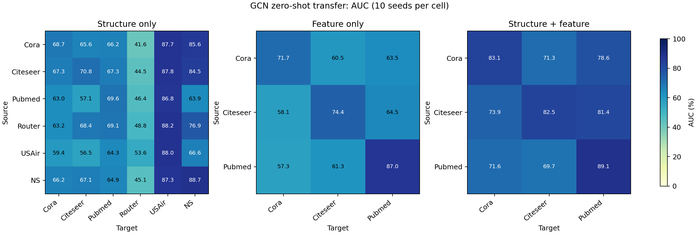
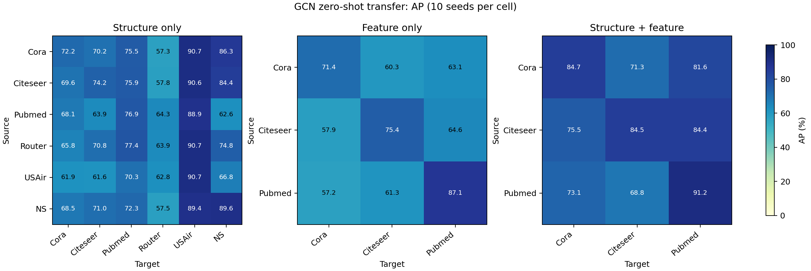
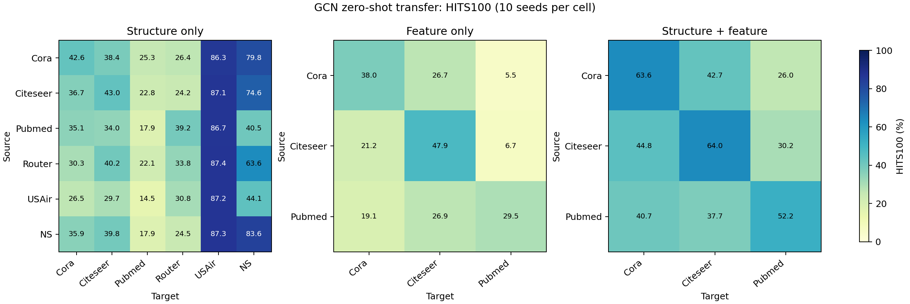

# GCN 链路预测消融与跨数据集迁移实验结果

状态：完整。完成 240 个训练单元，660/660 条单种子评估记录；随机种子 [0, 1, 2, 3, 4, 5, 6, 7, 8, 9]。

所有数值为百分数，表格给出均值 ± 样本标准差。结构-only 的图内输入为节点ID；迁移输入为训练图度数编码，因此两个协议须分开解读。

## 数据核对

| 数据集 | 节点数 | 清洗后的无向边数 | 原始特征维度 |
|---|---:|---:|---:|
| Cora | 2708 | 5278 | 1433 |
| Citeseer | 3327 | 4552 | 3703 |
| Pubmed | 19717 | 44324 | 500 |
| Router | 5022 | 6258 | 无 |
| USAir | 332 | 2126 | 无 |
| NS | 1589 | 2742 | 无 |

清洗包含无向化、去重、去自环。边划分80%/5%/15%，负边与正边等量；各组共享划分和候选池。

训练：hidden=64，embedding=32，dropout=0.3，lr=0.01，weight_decay=0.0；最多200轮，每5轮验证，30轮无验证AUC改善停止。

## 图内三组消融

### AUC

| 数据集 | 结构-only | 特征-only | 两者结合 |
|---|---:|---:|---:|
| Cora | 73.77 ± 1.60 | 76.92 ± 1.48 | 85.21 ± 1.12 |
| Citeseer | 71.47 ± 1.51 | 75.99 ± 1.71 | 82.45 ± 1.39 |
| Pubmed | 74.71 ± 0.90 | 90.54 ± 0.32 | 94.21 ± 1.95 |
| Router | 59.15 ± 1.69 | N/A | N/A |
| USAir | 88.45 ± 1.16 | N/A | N/A |
| NS | 89.88 ± 0.85 | N/A | N/A |

### AP

| 数据集 | 结构-only | 特征-only | 两者结合 |
|---|---:|---:|---:|
| Cora | 76.68 ± 1.52 | 75.33 ± 1.72 | 85.12 ± 1.29 |
| Citeseer | 75.38 ± 1.27 | 75.42 ± 1.45 | 82.91 ± 1.29 |
| Pubmed | 79.32 ± 0.56 | 89.52 ± 0.33 | 94.20 ± 2.63 |
| Router | 67.29 ± 1.72 | N/A | N/A |
| USAir | 90.79 ± 1.10 | N/A | N/A |
| NS | 91.57 ± 0.79 | N/A | N/A |

### HITS100

| 数据集 | 结构-only | 特征-only | 两者结合 |
|---|---:|---:|---:|
| Cora | 49.27 ± 3.34 | 44.31 ± 4.20 | 64.79 ± 2.52 |
| Citeseer | 48.74 ± 2.69 | 46.89 ± 2.87 | 60.48 ± 3.46 |
| Pubmed | 22.90 ± 1.80 | 28.66 ± 1.13 | 51.23 ± 10.74 |
| Router | 35.06 ± 2.15 | N/A | N/A |
| USAir | 87.61 ± 1.62 | N/A | N/A |
| NS | 86.74 ± 1.20 | N/A | N/A |

## 跨数据集迁移

行是训练源图，列是测试目标图。参数冻结，只在源图验证集选择最优epoch。对角线为相同迁移输入协议的图内对照；跨图平均排除对角线。属性投影只对齐维度，不对齐语义。

### AUC

**Structure only**

| 源图 → 目标图 | Cora | Citeseer | Pubmed | Router | USAir | NS |
|---|---:|---:|---:|---:|---:|---:|
| Cora | 68.67 ± 1.32 | 65.64 ± 1.70 | 66.23 ± 0.81 | 41.61 ± 2.58 | 87.66 ± 1.12 | 85.64 ± 1.88 |
| Citeseer | 67.30 ± 2.21 | 70.79 ± 1.92 | 67.34 ± 1.43 | 44.46 ± 4.21 | 87.82 ± 0.88 | 84.52 ± 3.08 |
| Pubmed | 63.04 ± 1.03 | 57.06 ± 1.50 | 69.63 ± 0.60 | 46.37 ± 1.76 | 86.79 ± 1.79 | 63.86 ± 1.54 |
| Router | 63.16 ± 0.93 | 68.38 ± 1.99 | 69.14 ± 0.53 | 48.78 ± 1.80 | 88.21 ± 1.54 | 76.90 ± 1.48 |
| USAir | 59.42 ± 5.81 | 56.50 ± 3.41 | 64.31 ± 8.69 | 53.59 ± 7.66 | 87.96 ± 1.15 | 66.65 ± 5.80 |
| NS | 66.15 ± 1.93 | 67.09 ± 1.55 | 64.85 ± 2.45 | 45.09 ± 3.51 | 87.34 ± 1.45 | 88.75 ± 1.27 |

**Feature only**

| 源图 → 目标图 | Cora | Citeseer | Pubmed |
|---|---:|---:|---:|
| Cora | 71.70 ± 1.68 | 60.47 ± 1.45 | 63.54 ± 1.48 |
| Citeseer | 58.14 ± 2.01 | 74.35 ± 1.66 | 64.55 ± 1.52 |
| Pubmed | 57.34 ± 1.34 | 61.28 ± 1.44 | 86.97 ± 0.38 |

**Structure + feature**

| 源图 → 目标图 | Cora | Citeseer | Pubmed |
|---|---:|---:|---:|
| Cora | 83.15 ± 1.43 | 71.34 ± 3.35 | 78.61 ± 2.12 |
| Citeseer | 73.85 ± 1.08 | 82.48 ± 1.11 | 81.39 ± 3.13 |
| Pubmed | 71.56 ± 1.48 | 69.75 ± 2.65 | 89.06 ± 0.44 |

### AP

**Structure only**

| 源图 → 目标图 | Cora | Citeseer | Pubmed | Router | USAir | NS |
|---|---:|---:|---:|---:|---:|---:|
| Cora | 72.18 ± 1.31 | 70.22 ± 1.65 | 75.46 ± 0.78 | 57.30 ± 2.39 | 90.69 ± 0.84 | 86.26 ± 2.06 |
| Citeseer | 69.56 ± 2.07 | 74.16 ± 2.11 | 75.95 ± 0.98 | 57.81 ± 1.96 | 90.64 ± 0.72 | 84.39 ± 3.45 |
| Pubmed | 68.05 ± 1.20 | 63.91 ± 1.80 | 76.89 ± 0.65 | 64.32 ± 1.57 | 88.85 ± 2.29 | 62.61 ± 3.24 |
| Router | 65.85 ± 1.48 | 70.80 ± 1.30 | 77.37 ± 0.42 | 63.93 ± 1.23 | 90.71 ± 1.57 | 74.84 ± 2.95 |
| USAir | 61.86 ± 7.95 | 61.64 ± 4.83 | 70.34 ± 9.03 | 62.83 ± 4.95 | 90.69 ± 0.94 | 66.82 ± 7.68 |
| NS | 68.46 ± 2.46 | 71.01 ± 2.04 | 72.30 ± 2.51 | 57.45 ± 2.22 | 89.44 ± 1.14 | 89.64 ± 1.34 |

**Feature only**

| 源图 → 目标图 | Cora | Citeseer | Pubmed |
|---|---:|---:|---:|
| Cora | 71.38 ± 2.03 | 60.28 ± 1.14 | 63.08 ± 1.74 |
| Citeseer | 57.87 ± 2.14 | 75.38 ± 1.68 | 64.58 ± 1.68 |
| Pubmed | 57.22 ± 1.35 | 61.26 ± 2.11 | 87.07 ± 0.31 |

**Structure + feature**

| 源图 → 目标图 | Cora | Citeseer | Pubmed |
|---|---:|---:|---:|
| Cora | 84.73 ± 1.50 | 71.34 ± 3.97 | 81.59 ± 2.34 |
| Citeseer | 75.47 ± 1.73 | 84.46 ± 1.17 | 84.39 ± 2.36 |
| Pubmed | 73.11 ± 1.80 | 68.83 ± 3.58 | 91.19 ± 0.30 |

### HITS100

**Structure only**

| 源图 → 目标图 | Cora | Citeseer | Pubmed | Router | USAir | NS |
|---|---:|---:|---:|---:|---:|---:|
| Cora | 42.60 ± 2.95 | 38.36 ± 4.51 | 25.32 ± 1.85 | 26.44 ± 3.29 | 86.29 ± 1.77 | 79.83 ± 3.55 |
| Citeseer | 36.70 ± 3.40 | 43.02 ± 4.22 | 22.77 ± 1.32 | 24.24 ± 2.73 | 87.08 ± 1.69 | 74.65 ± 7.94 |
| Pubmed | 35.07 ± 1.63 | 34.00 ± 3.19 | 17.86 ± 1.17 | 39.21 ± 2.27 | 86.73 ± 2.06 | 40.51 ± 4.35 |
| Router | 30.29 ± 2.57 | 40.19 ± 2.33 | 22.07 ± 1.10 | 33.75 ± 3.35 | 87.42 ± 1.46 | 63.58 ± 2.71 |
| USAir | 26.51 ± 11.21 | 29.72 ± 5.92 | 14.46 ± 6.68 | 30.78 ± 9.92 | 87.17 ± 1.52 | 44.09 ± 12.59 |
| NS | 35.93 ± 3.62 | 39.79 ± 2.50 | 17.92 ± 4.30 | 24.54 ± 1.87 | 87.26 ± 2.41 | 83.58 ± 3.85 |

**Feature only**

| 源图 → 目标图 | Cora | Citeseer | Pubmed |
|---|---:|---:|---:|
| Cora | 37.96 ± 3.19 | 26.70 ± 2.11 | 5.52 ± 1.39 |
| Citeseer | 21.15 ± 2.44 | 47.90 ± 3.48 | 6.70 ± 1.34 |
| Pubmed | 19.13 ± 1.52 | 26.88 ± 2.53 | 29.50 ± 1.51 |

**Structure + feature**

| 源图 → 目标图 | Cora | Citeseer | Pubmed |
|---|---:|---:|---:|
| Cora | 63.63 ± 3.11 | 42.67 ± 5.65 | 25.99 ± 5.79 |
| Citeseer | 44.84 ± 3.49 | 64.02 ± 2.48 | 30.17 ± 4.81 |
| Pubmed | 40.73 ± 2.44 | 37.67 ± 6.32 | 52.18 ± 1.95 |

## 排除对角线后的跨图平均

结构-only 跨全部6图；属性组跨3个引文图。候选组合不同，不可直接比较其全体平均。另列共同的三个引文图上的平均以便公平比较。

| 范围 | 模型 | AUC | AP | Hits@100 |
|---|---|---:|---:|---:|
| 可用全部图 | Structure + feature | 74.42 ± 0.80 | 75.79 ± 0.98 | 37.01 ± 1.66 |
| 可用全部图 | Feature only | 60.89 ± 0.56 | 60.72 ± 0.64 | 17.68 ± 0.81 |
| 可用全部图 | Structure only | 67.07 ± 0.69 | 72.26 ± 0.93 | 44.39 ± 1.39 |
| 相同3个引文图 | Structure + feature | 74.42 ± 0.80 | 75.79 ± 0.98 | 37.01 ± 1.66 |
| 相同3个引文图 | Feature only | 60.89 ± 0.56 | 60.72 ± 0.64 | 17.68 ± 0.81 |
| 相同3个引文图 | Structure only | 64.44 ± 0.80 | 70.53 ± 0.57 | 32.04 ± 1.22 |

## 结果适用范围

- Router、USAir、NS 没有原始特征，属性相关实验为 N/A。
- 这是依据论文数据协议独立实现的 GCN 基线与新增消融，不是 SGDiff 模型复现，也不是作者表格数值的精确重现。论文未公开完整代码、精确划分和 GCN 超参数。
- 图内 ID 输入与原始属性模型参数量不同；迁移三组参数量相同。
- 跨图属性语义未对齐；较弱的迁移结果不能证明原始特征没有价值。
- Hits@100 对不同图使用不同规模的全局负边池，难度不同；论文未公开具体候选池细则。本实现使用严格大于第100高负边得分的定义。
- 统一训练配置；初步 Cora seed0 验证检查后采用 GAE 默认的零权重衰减，未做全面超参数优化。详细配置与协议见上级 README。
- 不附加节点分类、扩散模型、对抗攻击、1%训练数据实验。

可复查文件：`per_seed.csv`、`summary.csv`、`paired_deltas.csv`、`transfer_averages.csv`、`transfer_common_citation_average.csv`；`runs` 保存检查点/验证曲线/预测，`splits` 保存精确划分。
