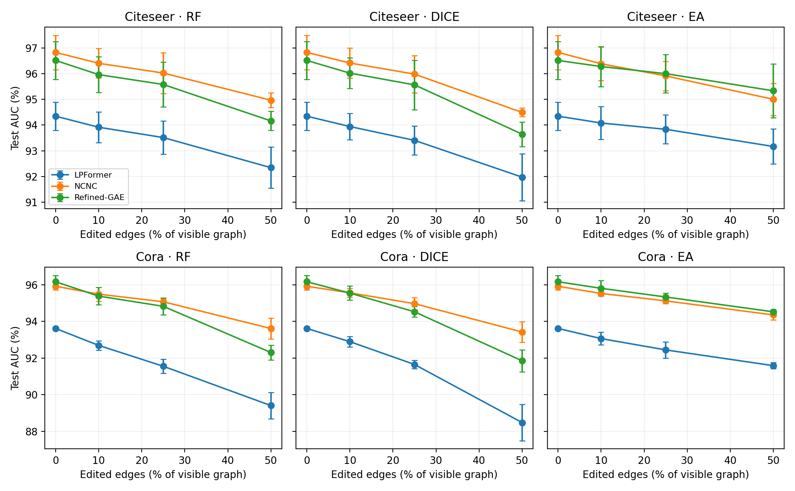

# NCNC / LPFormer / Refined-GAE: measured reproduction and robustness

Completed 54 configurations and 756 evaluations. Each configuration is one (dataset, model, component, seed).

Author model classes are called from pinned external repositories. These are author-architecture reproductions under a shared protocol, not claims of reproducing original paper tables.

Data: canonical Planetoid Cora/Citeseer, raw attributes; 80/5/15 positive split, balanced disjoint fixed negatives. All models use positive minibatch size 512, retaining a nonempty visible graph after target masking. Clean validation selects checkpoints. Test context is train+validation. Attacks edit this visible graph after protecting all test candidates. EA is the documented linear-surrogate transfer attack, not DeepRobust parity.

AUC/AP are standard ranking metrics. Hits@100 compares positives strictly against the 100th-highest global negative. Precision@100 is a separate metric, with order-independent cutoff ties. Values below are percentages, mean ± sample standard deviation.

## Clean full-model results

| Dataset | Model | Seeds | AUC | AP | Hits@100 |
|---|---|---|---|---|---|
| citeseer | lpformer | 3 | 94.35 ± 0.55 | 94.88 ± 0.44 | 88.87 ± 0.82 |
| citeseer | ncnc | 3 | 96.83 ± 0.67 | 96.97 ± 0.50 | 94.49 ± 1.76 |
| citeseer | refined_gae | 3 | 96.51 ± 0.73 | 96.63 ± 0.66 | 93.56 ± 1.83 |
| cora | lpformer | 3 | 93.61 ± 0.08 | 94.38 ± 0.19 | 86.74 ± 1.12 |
| cora | ncnc | 3 | 95.92 ± 0.19 | 95.78 ± 0.13 | 91.41 ± 0.55 |
| cora | refined_gae | 3 | 96.16 ± 0.35 | 95.97 ± 0.41 | 91.16 ± 1.10 |

## Full-model structural evasion (AUC)

| Dataset | Model | Clean | RF 25% | DICE 25% | EA 25% | RF 50% | DICE 50% | EA 50% |
|---|---|---|---|---|---|---|---|---|
| citeseer | lpformer | 94.35 ± 0.55 | 93.52 ± 0.65 | 93.41 ± 0.56 | 93.84 ± 0.56 | 92.35 ± 0.80 | 91.98 ± 0.91 | 93.17 ± 0.68 |
| citeseer | ncnc | 96.83 ± 0.67 | 96.02 ± 0.79 | 95.98 ± 0.72 | 95.91 ± 0.57 | 94.97 ± 0.29 | 94.49 ± 0.17 | 95.00 ± 0.62 |
| citeseer | refined_gae | 96.51 ± 0.73 | 95.58 ± 0.87 | 95.56 ± 0.96 | 96.00 ± 0.74 | 94.16 ± 0.37 | 93.65 ± 0.48 | 95.33 ± 1.05 |
| cora | lpformer | 93.61 ± 0.08 | 91.55 ± 0.38 | 91.65 ± 0.22 | 92.44 ± 0.44 | 89.41 ± 0.71 | 88.48 ± 0.99 | 91.58 ± 0.17 |
| cora | ncnc | 95.92 ± 0.19 | 95.07 ± 0.17 | 94.96 ± 0.34 | 95.12 ± 0.15 | 93.61 ± 0.56 | 93.42 ± 0.57 | 94.35 ± 0.26 |
| cora | refined_gae | 96.16 ± 0.35 | 94.82 ± 0.47 | 94.52 ± 0.28 | 95.33 ± 0.21 | 92.30 ± 0.40 | 91.85 ± 0.60 | 94.52 ± 0.14 |

## Retrained component ablations (AUC)

| Dataset | Model | Component | Clean | RF 50% | DICE 50% | EA 50% |
|---|---|---|---|---|---|---|
| citeseer | lpformer | full | 94.35 ± 0.55 | 92.35 ± 0.80 | 91.98 ± 0.91 | 93.17 ± 0.68 |
| citeseer | lpformer | uniform_attention | 94.09 ± 0.84 | 91.84 ± 1.34 | 91.34 ± 1.00 | 92.84 ± 1.00 |
| citeseer | lpformer | no_ppr_encoding | 93.78 ± 0.91 | 91.11 ± 0.50 | 90.91 ± 0.24 | 92.66 ± 0.75 |
| citeseer | ncnc | full | 96.83 ± 0.67 | 94.97 ± 0.29 | 94.49 ± 0.17 | 95.00 ± 0.62 |
| citeseer | ncnc | no_completion | 96.83 ± 0.53 | 95.04 ± 0.71 | 94.69 ± 0.62 | 95.08 ± 0.79 |
| citeseer | ncnc | no_cn | 96.63 ± 0.57 | 94.74 ± 0.53 | 94.30 ± 0.40 | 94.78 ± 0.73 |
| citeseer | refined_gae | full | 96.51 ± 0.73 | 94.16 ± 0.37 | 93.65 ± 0.48 | 95.33 ± 1.05 |
| citeseer | refined_gae | no_norm | 96.39 ± 0.67 | 93.76 ± 0.34 | 93.18 ± 0.29 | 94.82 ± 0.71 |
| citeseer | refined_gae | dot_decoder | 96.13 ± 0.54 | 93.80 ± 0.58 | 93.44 ± 0.70 | 95.18 ± 0.75 |
| cora | lpformer | full | 93.61 ± 0.08 | 89.41 ± 0.71 | 88.48 ± 0.99 | 91.58 ± 0.17 |
| cora | lpformer | uniform_attention | 93.30 ± 0.67 | 88.82 ± 0.75 | 88.12 ± 0.74 | 91.32 ± 0.53 |
| cora | lpformer | no_ppr_encoding | 92.63 ± 1.17 | 87.74 ± 0.47 | 86.81 ± 0.33 | 90.79 ± 1.00 |
| cora | ncnc | full | 95.92 ± 0.19 | 93.61 ± 0.56 | 93.42 ± 0.57 | 94.35 ± 0.26 |
| cora | ncnc | no_completion | 95.86 ± 0.27 | 93.40 ± 0.39 | 93.26 ± 0.58 | 94.42 ± 0.31 |
| cora | ncnc | no_cn | 95.79 ± 0.25 | 93.65 ± 0.52 | 93.41 ± 0.53 | 94.02 ± 0.31 |
| cora | refined_gae | full | 96.16 ± 0.35 | 92.30 ± 0.40 | 91.85 ± 0.60 | 94.52 ± 0.14 |
| cora | refined_gae | no_norm | 95.20 ± 0.30 | 92.00 ± 0.47 | 91.58 ± 0.55 | 93.47 ± 0.31 |
| cora | refined_gae | dot_decoder | 94.59 ± 0.15 | 90.92 ± 1.13 | 90.51 ± 0.73 | 93.68 ± 0.14 |

## Frozen-model mechanism probes (AUC)

| Dataset | Model | Clean | Random deletion 50% | Hub deletion 50% | Insertion 50% | Feature shuffle |
|---|---|---|---|---|---|---|
| citeseer | lpformer | 94.35 ± 0.55 | 93.20 ± 0.71 | 91.93 ± 1.52 | 92.17 ± 0.30 | 74.34 ± 0.39 |
| citeseer | ncnc | 96.83 ± 0.67 | 96.40 ± 0.60 | 96.27 ± 0.77 | 93.62 ± 0.48 | 63.69 ± 3.74 |
| citeseer | refined_gae | 96.51 ± 0.73 | 95.90 ± 0.60 | 95.75 ± 0.80 | 93.27 ± 0.67 | 69.80 ± 0.72 |
| cora | lpformer | 93.61 ± 0.08 | 89.67 ± 0.23 | 88.70 ± 0.12 | 89.82 ± 0.25 | 82.63 ± 0.58 |
| cora | ncnc | 95.92 ± 0.19 | 95.47 ± 0.14 | 94.77 ± 0.31 | 92.92 ± 0.55 | 69.16 ± 1.69 |
| cora | refined_gae | 96.16 ± 0.35 | 94.80 ± 0.42 | 94.43 ± 0.25 | 90.70 ± 1.58 | 76.52 ± 1.64 |

## Interpretation limits

- Frozen probes measure sensitivity; component rows are independent retraining experiments.
- No prespecified robustness ranking is assumed. Read attacked absolute performance together with clean-to-attack drops.
- Three seeds support an initial comparison, not a definitive significance or broad robustness claim.
- Shared train/validation/test masks and negatives differ from the authors’ original benchmark protocols. Hyperparameters and every departure are saved in config.json.
- LPFormer PPR is regenerated on every distinct attacked graph; the PE ablation retains the same neighborhood selection.
- No-norm Refined-GAE retains dropout, avoiding the author encoder’s norm/dropout switch coupling.

Paired seed-level full-minus-variant performance and variant-minus-full degradation are in `paired_components.csv` and `paired_components_summary.csv`. Positive performance deltas favor the full model; positive degradation deltas mean the variant loses more.

## Robustness curves

Mean ± sample SD over three seeds; edit fractions refer to the visible inference graph.

