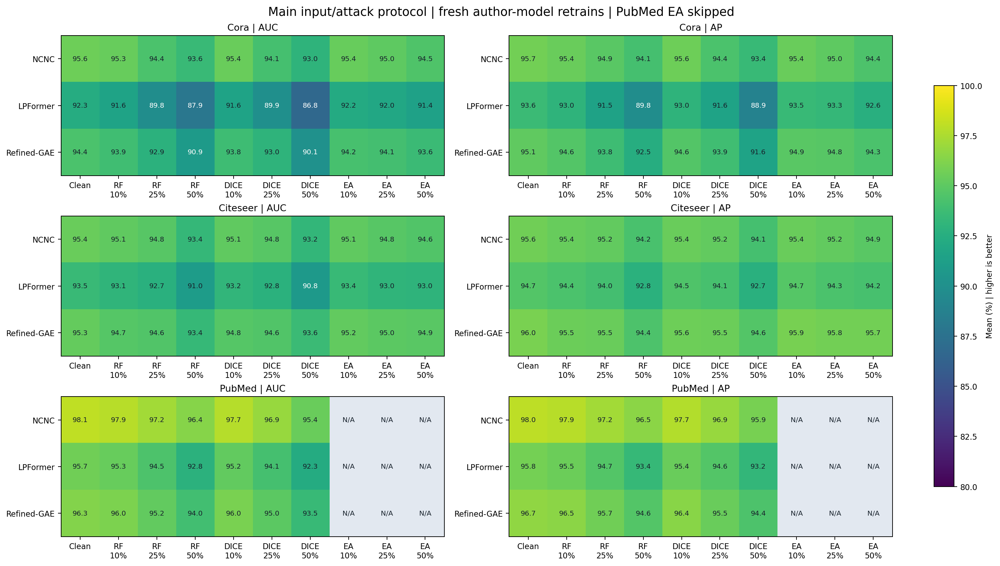
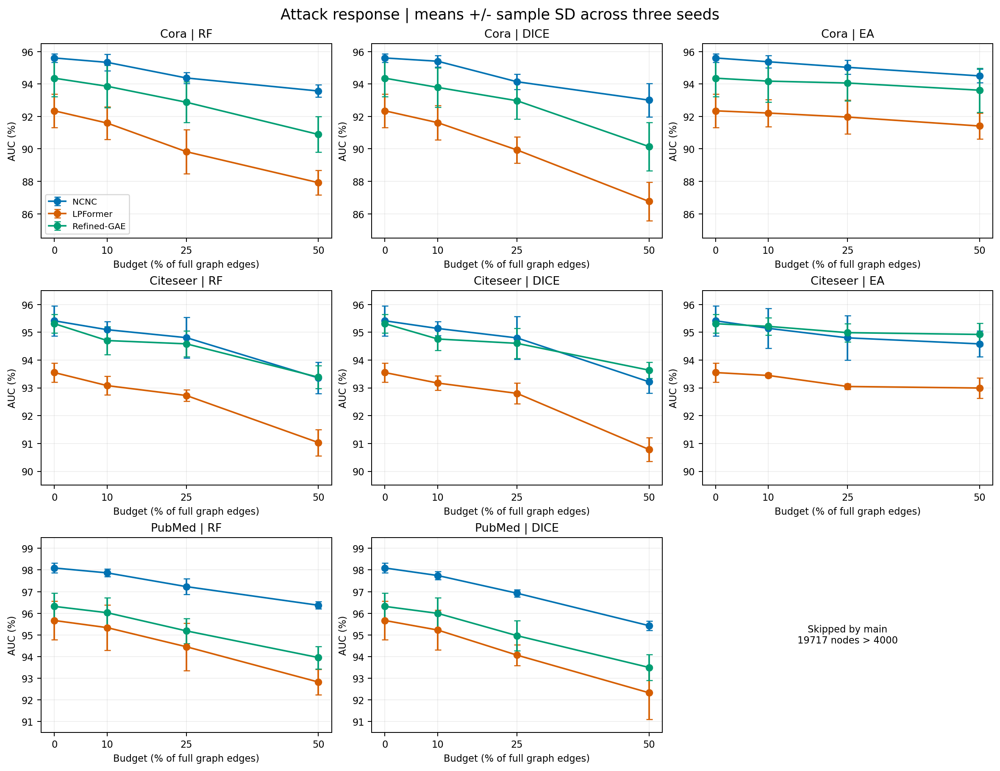
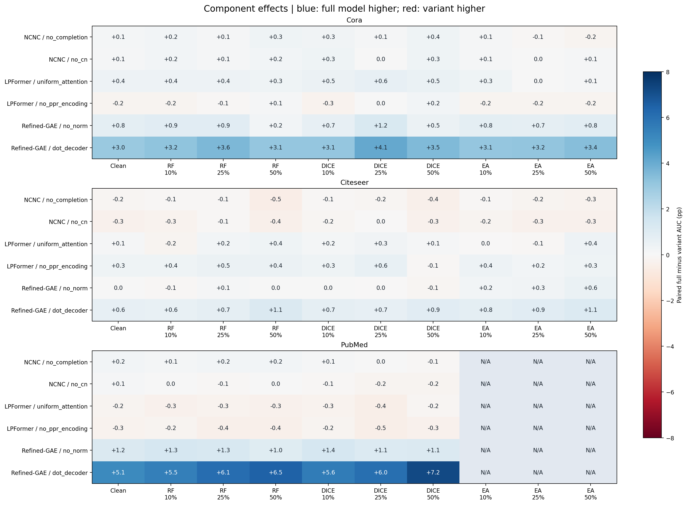

# main 输入与攻击协议补实验：Cora、Citeseer、PubMed

**完成 81 组新训练、729 次评估，三个种子 0/1/2；包含完整模型和全部组件变体。**

固定 main 提交 `d4b150c121625001f52ead23abf15aead1a4b665`，直接调用原始攻击器，不再使用上一轮的 EA 替代实现。图为本次新生成并共享的缓存，不保证与历史 H20 环境或合作者未提供的缓存逐边一致。模型结构和优化器采用固定版本作者配方，并针对 PubMed 使用作者的 PubMed 配置。

## 图形总览

热图显示三种子的 AUC/AP 均值，灰色 N/A 表示未运行；标准差见表。

曲线误差棒为样本标准差，预算分母为完整干净图边数；不是纯删边比例。PubMed EA 遵守 main 节点上限。

组件图为同种子内“完整−消融”的 AUC 配对差值，蓝色/正值表示完整模型更高；不是显著性检验。

## 实验协议与解释边界

- **输入**：使用 main 的数据加载器、80/5/15 划分、互斥平衡负样本及 `node_feature_matrix` 属性标准化。旧权重使用原始特征，因此本轮全部重新训练，不复用旧权重。
- **攻击**：调用 main `apply_attack` 在完整图生成 RF/DICE/EA，然后移除全部测试正边；不增加测试负候选保护、不改变原攻击的删插配额，不修复原算法中可能抵消的编辑。
- **测试**：直接调用 main `_cap_pairs`，取每类前 500 个点对；三个模型及所有组件共享同一图和测试点对。
- **验证**：遵循 main 节点对基线的实际代码，在 train+val 上下文中验证，每 10 epoch 检查干净验证 AUC，耐心 30 epoch。注意该上下文含验证正边，不能称为严格隐藏验证边的协议；上一轮独立实验只用训练边验证。
- **作者训练配方**：保留作者架构、数据集专属学习率/维度/dropout；共同正例 batch512，目标正边从传播图中移除。最多 100 epoch。LPFormer 仍沿用作者训练图 PPR 缓存，可能包含批次训练目标信息。因此对齐的是 main 输入、节点对验证上下文、攻击、测试点对和指标；并非强制所有模型使用同一优化器或复现原论文表格。
- **PPR**：每张不同的受扰图重算。PubMed 使用作者 `eps=1e-5`，Cora/Citeseer 为 `1e-7`；图指纹一致的已有 PPR 缓存可复用，模型权重不复用。
- **指标**：AUC/AP 使用 main `summarize_scores`。main 的 `hit@100` 实为池化 Precision@100，并列分数保持输入顺序；本报告沿用其原值用于协议核对，并额外给出严格全局负样本 Hits@100。三种子均值±样本标准差；降幅单位为百分点。
- **PubMed EA**：19717 个节点超过 main 的 `EA_MAX_NODES=4000`，三种子均跳过。没有擅自提高限制、改成稀疏攻击或把其他扰动标成 EA。

## main 中已有的 PubMed 描述与要求

- main README、`docs/reproduction.md` 已有 SGDiff PubMed 的 10 种子域内结果：AUC 约 **0.902±0.002**，AP 约 0.900；还保存了 PubMed 相关的跨数据集迁移结果。
- main `configs/sgdiff_pubmed.yaml` 配置：1-hop、每跳最多 20 节点、结构扩散 10 步、特征 GCN 64×2、特征扩散 50 步、训练 50 epoch、预训练 10 epoch。这些是 SGDiff 专属配置，不应套用到 NCNC/LPFormer/Refined-GAE。
- main 数据说明使用 Planetoid PubMed：19717 节点、44324 条规范化无向边、500 维特征；与论文边数存在 3 条差异，main 已说明。
- main 另有早期 GCN 消融/迁移实验的 PubMed 记录，属于独立协议，不能当作这三个新模型的结果。
- 本报告 PubMed 与 main 历史 SGDiff 的种子数、测试样本量和模型训练配方不同，不能只凭两个汇总 AUC 宣称优劣。主分支没有这三个新模型的原生 PubMed 基准要求，作者配方来源见运行配置。

## 完整模型概览

| 数据集 | 模型 | 干净 AUC | RF50 AUC | DICE50 AUC | EA50 AUC |
| --- | --- | --- | --- | --- | --- |
| Cora | NCNC | 95.60 ± 0.26 | 93.57 ± 0.38 | 93.01 ± 1.03 | 94.50 ± 0.42 |
| Cora | LPFormer | 92.35 ± 1.03 | 87.92 ± 0.76 | 86.76 ± 1.18 | 91.41 ± 0.79 |
| Cora | Refined-GAE | 94.36 ± 1.14 | 90.89 ± 1.09 | 90.14 ± 1.49 | 93.62 ± 1.37 |
| Citeseer | NCNC | 95.41 ± 0.54 | 93.35 ± 0.56 | 93.22 ± 0.40 | 94.58 ± 0.47 |
| Citeseer | LPFormer | 93.55 ± 0.35 | 91.03 ± 0.47 | 90.78 ± 0.42 | 92.99 ± 0.37 |
| Citeseer | Refined-GAE | 95.31 ± 0.33 | 93.38 ± 0.41 | 93.64 ± 0.29 | 94.92 ± 0.40 |
| PubMed | NCNC | 98.09 ± 0.22 | 96.37 ± 0.17 | 95.43 ± 0.21 | 跳过：节点限制 |
| PubMed | LPFormer | 95.66 ± 0.89 | 92.82 ± 0.59 | 92.32 ± 1.22 | 跳过：节点限制 |
| PubMed | Refined-GAE | 96.32 ± 0.61 | 93.95 ± 0.52 | 93.50 ± 0.60 | 跳过：节点限制 |

## 主要观察与组件贡献

以下差值均为同一种子内“完整模型−变体”的 AUC，单位为百分点；变体独立重训，因此测量的是组件与其训练共同产生的效果，不是冻结编码器后只换一个打分函数。

NCNC 关闭补全的干净图配对差为 Cora 0.14 ± 0.52；Citeseer -0.15 ± 0.35；PubMed 0.21 ± 0.37。本轮补全的边际贡献较小且随设置变化，不能据此将其攻击后表现直接归因于补全。

LPFormer 在 PubMed 上，完整−均匀注意力的干净配对差为 -0.23 ± 0.59，完整−去位置编码为 -0.31 ± 0.41；DICE50 下完整−去位置编码为 -0.33 ± 0.75。这些均值不支持把位置编码或学习注意力的提升视作所有数据集上的普遍规律；保留的 PPR 候选筛选仍含结构信息。

Refined-GAE 在 PubMed 上，完整−点积解码器的干净配对差为 5.09 ± 0.36，DICE50 下为 7.23 ± 1.08。本轮结果支持解码器选择在该设置下有较大影响；完整配对标准差与其他数据集见后表。

三种子只支持初步比较，误差棒不是置信区间，也未进行显著性检验。旧协议与本轮同时改变特征、验证上下文、测试点对和攻击，不能把两轮差异仅归因于 EA。

## 全部组件与条件

- NCNC：`no_completion` 关闭补全（depth=0）；`no_cn` 使用端点预测器，仍保留 GCN(A,X)，不是特征-only。
- LPFormer：`uniform_attention` 固定均匀注意力；`no_ppr_encoding` 仅将位置编码置零，保留 PPR 候选筛选和计数。
- Refined-GAE：`no_norm` 只移除模型内 LayerNorm，保留 dropout、输入标准化和邻接度归一化；`dot_decoder` 保留编码器并换为作者点积预测器。PubMed 的完整编码器和变体均为两层传播。

### Cora / NCNC / full

| 条件 | AUC | AP | main原hit@100（Precision） | 严格Hits@100 | AUC降幅 | AP降幅 |
| --- | --- | --- | --- | --- | --- | --- |
| 干净图 | 95.60 ± 0.26 | 95.71 ± 0.30 | 99.33 ± 0.58 | 93.47 ± 0.99 | 0.00 ± 0.00 | 0.00 ± 0.00 |
| DICE 10% | 95.40 ± 0.34 | 95.56 ± 0.43 | 99.00 ± 1.00 | 93.60 ± 0.72 | 0.20 ± 0.34 | 0.15 ± 0.40 |
| DICE 25% | 94.14 ± 0.46 | 94.37 ± 0.69 | 99.00 ± 1.00 | 91.07 ± 1.33 | 1.46 ± 0.44 | 1.34 ± 0.39 |
| DICE 50% | 93.01 ± 1.03 | 93.44 ± 0.72 | 98.67 ± 0.58 | 89.20 ± 2.00 | 2.60 ± 0.90 | 2.27 ± 0.59 |
| EA 10% | 95.37 ± 0.38 | 95.41 ± 0.45 | 99.00 ± 1.00 | 93.47 ± 0.83 | 0.23 ± 0.13 | 0.30 ± 0.25 |
| EA 25% | 95.03 ± 0.43 | 95.03 ± 0.52 | 98.67 ± 0.58 | 92.67 ± 1.85 | 0.58 ± 0.19 | 0.68 ± 0.33 |
| EA 50% | 94.50 ± 0.42 | 94.40 ± 0.50 | 98.33 ± 1.53 | 92.53 ± 1.45 | 1.10 ± 0.16 | 1.31 ± 0.34 |
| RF 10% | 95.33 ± 0.51 | 95.41 ± 0.15 | 99.00 ± 1.00 | 93.33 ± 1.47 | 0.27 ± 0.32 | 0.30 ± 0.17 |
| RF 25% | 94.37 ± 0.33 | 94.87 ± 0.13 | 99.33 ± 0.58 | 91.27 ± 1.14 | 1.23 ± 0.08 | 0.83 ± 0.25 |
| RF 50% | 93.57 ± 0.38 | 94.09 ± 0.75 | 98.67 ± 1.53 | 90.00 ± 0.92 | 2.03 ± 0.40 | 1.62 ± 0.48 |

### Cora / NCNC / no_completion

| 条件 | AUC | AP | main原hit@100（Precision） | 严格Hits@100 | AUC降幅 | AP降幅 |
| --- | --- | --- | --- | --- | --- | --- |
| 干净图 | 95.46 ± 0.56 | 95.98 ± 0.69 | 99.67 ± 0.58 | 93.73 ± 1.94 | 0.00 ± 0.00 | 0.00 ± 0.00 |
| DICE 10% | 95.09 ± 0.65 | 95.64 ± 0.76 | 99.67 ± 0.58 | 93.20 ± 1.40 | 0.37 ± 0.09 | 0.35 ± 0.08 |
| DICE 25% | 94.03 ± 0.13 | 94.72 ± 0.23 | 99.33 ± 0.58 | 91.33 ± 0.83 | 1.43 ± 0.48 | 1.27 ± 0.53 |
| DICE 50% | 92.63 ± 0.53 | 93.63 ± 0.22 | 99.67 ± 0.58 | 88.07 ± 0.90 | 2.83 ± 1.00 | 2.35 ± 0.90 |
| EA 10% | 95.30 ± 0.52 | 95.85 ± 0.56 | 99.67 ± 0.58 | 93.20 ± 1.64 | 0.16 ± 0.07 | 0.13 ± 0.14 |
| EA 25% | 95.12 ± 0.51 | 95.62 ± 0.62 | 99.67 ± 0.58 | 93.07 ± 1.29 | 0.34 ± 0.33 | 0.37 ± 0.26 |
| EA 50% | 94.75 ± 0.52 | 95.14 ± 0.59 | 99.67 ± 0.58 | 92.67 ± 1.10 | 0.71 ± 0.40 | 0.84 ± 0.55 |
| RF 10% | 95.13 ± 0.74 | 95.81 ± 0.63 | 100.00 ± 0.00 | 93.40 ± 1.91 | 0.33 ± 0.23 | 0.18 ± 0.15 |
| RF 25% | 94.27 ± 0.76 | 94.89 ± 0.82 | 99.33 ± 0.58 | 92.00 ± 1.64 | 1.19 ± 0.47 | 1.09 ± 0.50 |
| RF 50% | 93.26 ± 0.20 | 94.28 ± 0.25 | 99.67 ± 0.58 | 89.53 ± 0.83 | 2.20 ± 0.75 | 1.71 ± 0.67 |

### Cora / NCNC / no_cn

| 条件 | AUC | AP | main原hit@100（Precision） | 严格Hits@100 | AUC降幅 | AP降幅 |
| --- | --- | --- | --- | --- | --- | --- |
| 干净图 | 95.52 ± 0.27 | 96.05 ± 0.31 | 99.67 ± 0.58 | 94.07 ± 0.46 | 0.00 ± 0.00 | 0.00 ± 0.00 |
| DICE 10% | 95.08 ± 0.44 | 95.66 ± 0.53 | 99.33 ± 0.58 | 93.47 ± 0.81 | 0.44 ± 0.17 | 0.39 ± 0.26 |
| DICE 25% | 94.12 ± 0.41 | 94.79 ± 0.63 | 99.67 ± 0.58 | 91.67 ± 0.58 | 1.40 ± 0.34 | 1.27 ± 0.40 |
| DICE 50% | 92.68 ± 0.49 | 93.57 ± 0.38 | 99.33 ± 0.58 | 88.53 ± 1.36 | 2.83 ± 0.67 | 2.48 ± 0.46 |
| EA 10% | 95.29 ± 0.22 | 95.82 ± 0.26 | 99.67 ± 0.58 | 93.87 ± 0.70 | 0.22 ± 0.06 | 0.23 ± 0.10 |
| EA 25% | 94.99 ± 0.13 | 95.55 ± 0.30 | 99.67 ± 0.58 | 93.33 ± 0.61 | 0.52 ± 0.29 | 0.50 ± 0.28 |
| EA 50% | 94.43 ± 0.15 | 94.81 ± 0.39 | 98.00 ± 1.00 | 92.67 ± 0.64 | 1.09 ± 0.22 | 1.24 ± 0.20 |
| RF 10% | 95.11 ± 0.20 | 95.61 ± 0.25 | 99.00 ± 1.00 | 93.53 ± 0.61 | 0.41 ± 0.20 | 0.44 ± 0.07 |
| RF 25% | 94.30 ± 0.53 | 95.01 ± 0.38 | 99.33 ± 0.58 | 91.80 ± 0.80 | 1.22 ± 0.32 | 1.04 ± 0.26 |
| RF 50% | 93.35 ± 0.29 | 94.26 ± 0.46 | 99.00 ± 1.00 | 90.20 ± 0.53 | 2.16 ± 0.39 | 1.80 ± 0.23 |

### Cora / LPFormer / full

| 条件 | AUC | AP | main原hit@100（Precision） | 严格Hits@100 | AUC降幅 | AP降幅 |
| --- | --- | --- | --- | --- | --- | --- |
| 干净图 | 92.35 ± 1.03 | 93.63 ± 0.65 | 99.33 ± 1.15 | 87.60 ± 2.51 | 0.00 ± 0.00 | 0.00 ± 0.00 |
| DICE 10% | 91.62 ± 1.06 | 93.00 ± 0.71 | 99.67 ± 0.58 | 86.27 ± 2.73 | 0.73 ± 0.53 | 0.63 ± 0.38 |
| DICE 25% | 89.94 ± 0.80 | 91.60 ± 0.30 | 99.67 ± 0.58 | 83.67 ± 1.86 | 2.41 ± 0.25 | 2.03 ± 0.43 |
| DICE 50% | 86.76 ± 1.18 | 88.89 ± 0.68 | 99.33 ± 0.58 | 78.00 ± 2.11 | 5.58 ± 0.45 | 4.74 ± 0.52 |
| EA 10% | 92.21 ± 0.83 | 93.49 ± 0.53 | 99.33 ± 1.15 | 87.40 ± 2.12 | 0.14 ± 0.58 | 0.14 ± 0.36 |
| EA 25% | 91.96 ± 1.04 | 93.30 ± 0.72 | 99.33 ± 1.15 | 87.20 ± 1.78 | 0.38 ± 0.53 | 0.33 ± 0.47 |
| EA 50% | 91.41 ± 0.79 | 92.62 ± 0.51 | 99.00 ± 1.00 | 86.73 ± 0.90 | 0.94 ± 0.73 | 1.01 ± 0.59 |
| RF 10% | 91.59 ± 1.01 | 93.02 ± 0.60 | 99.67 ± 0.58 | 86.67 ± 2.08 | 0.75 ± 0.18 | 0.61 ± 0.15 |
| RF 25% | 89.83 ± 1.36 | 91.50 ± 0.83 | 99.33 ± 0.58 | 84.00 ± 3.80 | 2.52 ± 0.35 | 2.13 ± 0.27 |
| RF 50% | 87.92 ± 0.76 | 89.82 ± 0.61 | 99.33 ± 1.15 | 80.07 ± 1.33 | 4.43 ± 0.61 | 3.81 ± 0.69 |

### Cora / LPFormer / uniform_attention

| 条件 | AUC | AP | main原hit@100（Precision） | 严格Hits@100 | AUC降幅 | AP降幅 |
| --- | --- | --- | --- | --- | --- | --- |
| 干净图 | 91.92 ± 2.10 | 93.24 ± 1.29 | 99.00 ± 1.00 | 88.27 ± 3.25 | 0.00 ± 0.00 | 0.00 ± 0.00 |
| DICE 10% | 91.13 ± 1.61 | 92.49 ± 0.98 | 99.33 ± 0.58 | 86.67 ± 2.34 | 0.79 ± 0.49 | 0.75 ± 0.32 |
| DICE 25% | 89.29 ± 1.30 | 91.13 ± 0.73 | 99.33 ± 1.15 | 82.40 ± 0.87 | 2.63 ± 1.16 | 2.11 ± 0.73 |
| DICE 50% | 86.24 ± 1.33 | 88.41 ± 0.66 | 98.67 ± 1.53 | 77.60 ± 2.51 | 5.68 ± 0.91 | 4.82 ± 0.67 |
| EA 10% | 91.89 ± 1.82 | 93.16 ± 1.07 | 99.33 ± 1.15 | 87.73 ± 2.41 | 0.03 ± 0.45 | 0.08 ± 0.32 |
| EA 25% | 91.94 ± 1.59 | 93.26 ± 1.06 | 99.00 ± 1.73 | 87.40 ± 1.91 | -0.02 ± 0.58 | -0.02 ± 0.37 |
| EA 50% | 91.35 ± 1.19 | 92.30 ± 0.80 | 98.67 ± 1.53 | 86.87 ± 1.81 | 0.57 ± 1.00 | 0.94 ± 1.08 |
| RF 10% | 91.16 ± 1.71 | 92.53 ± 1.04 | 99.00 ± 1.00 | 86.73 ± 2.50 | 0.76 ± 0.41 | 0.71 ± 0.25 |
| RF 25% | 89.40 ± 1.80 | 91.23 ± 1.25 | 99.67 ± 0.58 | 82.73 ± 2.89 | 2.52 ± 0.31 | 2.00 ± 0.22 |
| RF 50% | 87.60 ± 1.25 | 89.45 ± 0.64 | 99.33 ± 1.15 | 81.53 ± 1.33 | 4.32 ± 0.86 | 3.78 ± 1.00 |

### Cora / LPFormer / no_ppr_encoding

| 条件 | AUC | AP | main原hit@100（Precision） | 严格Hits@100 | AUC降幅 | AP降幅 |
| --- | --- | --- | --- | --- | --- | --- |
| 干净图 | 92.55 ± 1.56 | 93.75 ± 1.16 | 99.67 ± 0.58 | 87.47 ± 3.64 | 0.00 ± 0.00 | 0.00 ± 0.00 |
| DICE 10% | 91.91 ± 1.53 | 93.10 ± 1.00 | 99.33 ± 0.58 | 86.07 ± 3.35 | 0.64 ± 0.23 | 0.64 ± 0.19 |
| DICE 25% | 89.91 ± 1.17 | 91.66 ± 0.72 | 99.33 ± 1.15 | 83.67 ± 3.44 | 2.64 ± 0.75 | 2.08 ± 0.60 |
| DICE 50% | 86.56 ± 1.22 | 88.62 ± 0.95 | 99.33 ± 1.15 | 77.13 ± 2.60 | 6.00 ± 0.73 | 5.12 ± 0.20 |
| EA 10% | 92.44 ± 1.40 | 93.64 ± 1.00 | 99.33 ± 0.58 | 87.53 ± 3.63 | 0.11 ± 0.37 | 0.11 ± 0.41 |
| EA 25% | 92.17 ± 1.20 | 93.47 ± 0.82 | 99.67 ± 0.58 | 86.87 ± 3.11 | 0.39 ± 0.48 | 0.28 ± 0.55 |
| EA 50% | 91.64 ± 1.15 | 92.63 ± 0.74 | 99.00 ± 1.00 | 86.13 ± 2.73 | 0.91 ± 1.09 | 1.11 ± 1.03 |
| RF 10% | 91.80 ± 1.33 | 93.10 ± 0.86 | 99.00 ± 1.00 | 85.93 ± 2.91 | 0.75 ± 0.25 | 0.65 ± 0.30 |
| RF 25% | 89.92 ± 2.15 | 91.57 ± 1.63 | 99.67 ± 0.58 | 83.00 ± 4.69 | 2.64 ± 0.66 | 2.17 ± 0.55 |
| RF 50% | 87.82 ± 1.36 | 89.79 ± 0.80 | 99.33 ± 1.15 | 79.73 ± 3.59 | 4.73 ± 0.30 | 3.96 ± 0.53 |

### Cora / Refined-GAE / full

| 条件 | AUC | AP | main原hit@100（Precision） | 严格Hits@100 | AUC降幅 | AP降幅 |
| --- | --- | --- | --- | --- | --- | --- |
| 干净图 | 94.36 ± 1.14 | 95.10 ± 0.99 | 99.00 ± 1.00 | 91.73 ± 1.68 | 0.00 ± 0.00 | 0.00 ± 0.00 |
| DICE 10% | 93.79 ± 1.22 | 94.64 ± 1.00 | 98.67 ± 1.15 | 90.87 ± 1.70 | 0.57 ± 0.09 | 0.46 ± 0.05 |
| DICE 25% | 92.97 ± 1.13 | 93.88 ± 0.76 | 99.00 ± 1.00 | 88.60 ± 3.30 | 1.39 ± 0.13 | 1.22 ± 0.36 |
| DICE 50% | 90.14 ± 1.49 | 91.63 ± 1.07 | 99.67 ± 0.58 | 84.33 ± 2.83 | 4.21 ± 0.86 | 3.47 ± 0.56 |
| EA 10% | 94.18 ± 1.30 | 94.88 ± 1.15 | 99.00 ± 1.00 | 91.33 ± 1.68 | 0.18 ± 0.17 | 0.21 ± 0.17 |
| EA 25% | 94.06 ± 1.09 | 94.78 ± 0.98 | 99.33 ± 0.58 | 91.13 ± 1.55 | 0.30 ± 0.05 | 0.31 ± 0.11 |
| EA 50% | 93.62 ± 1.37 | 94.35 ± 1.11 | 99.00 ± 1.00 | 90.33 ± 2.21 | 0.74 ± 0.23 | 0.75 ± 0.13 |
| RF 10% | 93.86 ± 1.30 | 94.64 ± 1.04 | 99.00 ± 1.00 | 91.07 ± 1.72 | 0.50 ± 0.26 | 0.45 ± 0.11 |
| RF 25% | 92.87 ± 1.25 | 93.81 ± 1.01 | 99.00 ± 1.73 | 89.00 ± 2.75 | 1.48 ± 0.29 | 1.28 ± 0.36 |
| RF 50% | 90.89 ± 1.09 | 92.48 ± 0.64 | 99.33 ± 0.58 | 85.60 ± 2.11 | 3.47 ± 0.40 | 2.61 ± 0.36 |

### Cora / Refined-GAE / no_norm

| 条件 | AUC | AP | main原hit@100（Precision） | 严格Hits@100 | AUC降幅 | AP降幅 |
| --- | --- | --- | --- | --- | --- | --- |
| 干净图 | 93.56 ± 0.36 | 94.72 ± 0.50 | 100.00 ± 0.00 | 90.40 ± 1.97 | 0.00 ± 0.00 | 0.00 ± 0.00 |
| DICE 10% | 93.12 ± 0.39 | 94.33 ± 0.51 | 100.00 ± 0.00 | 89.80 ± 2.03 | 0.44 ± 0.19 | 0.39 ± 0.09 |
| DICE 25% | 91.74 ± 0.19 | 93.17 ± 0.15 | 100.00 ± 0.00 | 87.40 ± 0.87 | 1.81 ± 0.54 | 1.55 ± 0.52 |
| DICE 50% | 89.68 ± 0.51 | 91.52 ± 0.26 | 100.00 ± 0.00 | 82.53 ± 1.80 | 3.88 ± 0.52 | 3.20 ± 0.28 |
| EA 10% | 93.38 ± 0.61 | 94.60 ± 0.58 | 100.00 ± 0.00 | 90.13 ± 1.80 | 0.18 ± 0.25 | 0.12 ± 0.12 |
| EA 25% | 93.33 ± 0.67 | 94.48 ± 0.60 | 100.00 ± 0.00 | 89.47 ± 1.72 | 0.23 ± 0.34 | 0.24 ± 0.11 |
| EA 50% | 92.80 ± 0.75 | 93.87 ± 0.63 | 99.67 ± 0.58 | 88.60 ± 1.71 | 0.76 ± 0.38 | 0.85 ± 0.31 |
| RF 10% | 92.96 ± 0.52 | 94.21 ± 0.52 | 99.67 ± 0.58 | 89.27 ± 1.92 | 0.60 ± 0.16 | 0.51 ± 0.03 |
| RF 25% | 91.96 ± 0.26 | 93.29 ± 0.31 | 100.00 ± 0.00 | 87.13 ± 0.83 | 1.59 ± 0.55 | 1.44 ± 0.41 |
| RF 50% | 90.67 ± 0.32 | 92.46 ± 0.18 | 99.67 ± 0.58 | 85.00 ± 2.84 | 2.89 ± 0.39 | 2.26 ± 0.46 |

### Cora / Refined-GAE / dot_decoder

| 条件 | AUC | AP | main原hit@100（Precision） | 严格Hits@100 | AUC降幅 | AP降幅 |
| --- | --- | --- | --- | --- | --- | --- |
| 干净图 | 91.37 ± 1.17 | 93.48 ± 1.11 | 100.00 ± 0.00 | 87.20 ± 2.42 | 0.00 ± 0.00 | 0.00 ± 0.00 |
| DICE 10% | 90.70 ± 1.40 | 92.84 ± 1.33 | 100.00 ± 0.00 | 85.33 ± 2.44 | 0.68 ± 0.28 | 0.64 ± 0.23 |
| DICE 25% | 88.89 ± 1.53 | 91.28 ± 1.50 | 100.00 ± 0.00 | 82.13 ± 3.90 | 2.49 ± 0.95 | 2.20 ± 0.80 |
| DICE 50% | 86.62 ± 0.83 | 89.43 ± 0.93 | 100.00 ± 0.00 | 77.53 ± 0.81 | 4.75 ± 0.55 | 4.05 ± 0.57 |
| EA 10% | 91.10 ± 1.36 | 93.17 ± 1.24 | 100.00 ± 0.00 | 86.33 ± 2.86 | 0.27 ± 0.28 | 0.31 ± 0.15 |
| EA 25% | 90.87 ± 1.18 | 92.98 ± 1.14 | 100.00 ± 0.00 | 86.00 ± 3.00 | 0.50 ± 0.06 | 0.51 ± 0.09 |
| EA 50% | 90.21 ± 1.27 | 92.02 ± 0.99 | 99.33 ± 0.58 | 85.27 ± 3.43 | 1.17 ± 0.15 | 1.46 ± 0.13 |
| RF 10% | 90.63 ± 1.31 | 92.78 ± 1.19 | 99.67 ± 0.58 | 85.60 ± 3.70 | 0.75 ± 0.16 | 0.71 ± 0.08 |
| RF 25% | 89.31 ± 1.67 | 91.66 ± 1.44 | 100.00 ± 0.00 | 83.47 ± 3.93 | 2.07 ± 0.76 | 1.82 ± 0.53 |
| RF 50% | 87.78 ± 0.89 | 90.36 ± 1.18 | 100.00 ± 0.00 | 80.20 ± 2.50 | 3.60 ± 0.85 | 3.12 ± 0.73 |

### Citeseer / NCNC / full

| 条件 | AUC | AP | main原hit@100（Precision） | 严格Hits@100 | AUC降幅 | AP降幅 |
| --- | --- | --- | --- | --- | --- | --- |
| 干净图 | 95.41 ± 0.54 | 95.63 ± 0.66 | 99.33 ± 0.58 | 92.87 ± 0.81 | 0.00 ± 0.00 | 0.00 ± 0.00 |
| DICE 10% | 95.13 ± 0.25 | 95.41 ± 0.50 | 99.33 ± 0.58 | 92.13 ± 0.70 | 0.28 ± 0.29 | 0.22 ± 0.17 |
| DICE 25% | 94.79 ± 0.77 | 95.23 ± 0.75 | 99.33 ± 0.58 | 91.80 ± 1.73 | 0.62 ± 0.23 | 0.40 ± 0.08 |
| DICE 50% | 93.22 ± 0.40 | 94.10 ± 0.73 | 99.67 ± 0.58 | 89.47 ± 0.42 | 2.19 ± 0.22 | 1.53 ± 0.07 |
| EA 10% | 95.14 ± 0.72 | 95.45 ± 0.85 | 99.33 ± 0.58 | 92.40 ± 0.87 | 0.27 ± 0.28 | 0.18 ± 0.30 |
| EA 25% | 94.80 ± 0.80 | 95.17 ± 0.95 | 99.33 ± 0.58 | 92.27 ± 1.21 | 0.61 ± 0.29 | 0.46 ± 0.34 |
| EA 50% | 94.58 ± 0.47 | 94.91 ± 0.70 | 99.33 ± 0.58 | 92.07 ± 0.83 | 0.83 ± 0.13 | 0.72 ± 0.13 |
| RF 10% | 95.09 ± 0.30 | 95.39 ± 0.52 | 99.33 ± 0.58 | 92.20 ± 0.92 | 0.32 ± 0.27 | 0.24 ± 0.22 |
| RF 25% | 94.80 ± 0.73 | 95.22 ± 0.70 | 99.33 ± 0.58 | 92.53 ± 0.83 | 0.61 ± 0.24 | 0.41 ± 0.13 |
| RF 50% | 93.35 ± 0.56 | 94.23 ± 0.63 | 99.33 ± 0.58 | 89.20 ± 1.31 | 2.06 ± 0.08 | 1.40 ± 0.07 |

### Citeseer / NCNC / no_completion

| 条件 | AUC | AP | main原hit@100（Precision） | 严格Hits@100 | AUC降幅 | AP降幅 |
| --- | --- | --- | --- | --- | --- | --- |
| 干净图 | 95.56 ± 0.88 | 96.10 ± 0.80 | 99.33 ± 0.58 | 94.00 ± 1.91 | 0.00 ± 0.00 | 0.00 ± 0.00 |
| DICE 10% | 95.21 ± 0.65 | 95.89 ± 0.70 | 99.67 ± 0.58 | 93.33 ± 1.80 | 0.35 ± 0.28 | 0.21 ± 0.30 |
| DICE 25% | 94.97 ± 0.81 | 95.70 ± 0.86 | 99.67 ± 0.58 | 92.27 ± 1.45 | 0.60 ± 0.15 | 0.40 ± 0.27 |
| DICE 50% | 93.60 ± 0.15 | 94.72 ± 0.12 | 99.00 ± 0.00 | 90.80 ± 1.00 | 1.96 ± 0.94 | 1.38 ± 0.73 |
| EA 10% | 95.26 ± 0.81 | 95.96 ± 0.74 | 99.33 ± 0.58 | 93.40 ± 2.16 | 0.31 ± 0.11 | 0.14 ± 0.17 |
| EA 25% | 95.05 ± 0.84 | 95.89 ± 0.87 | 99.67 ± 0.58 | 93.07 ± 1.90 | 0.52 ± 0.06 | 0.21 ± 0.38 |
| EA 50% | 94.83 ± 0.53 | 95.65 ± 0.64 | 99.33 ± 0.58 | 92.80 ± 1.74 | 0.73 ± 0.38 | 0.45 ± 0.41 |
| RF 10% | 95.17 ± 0.81 | 95.79 ± 0.81 | 99.33 ± 0.58 | 93.00 ± 1.91 | 0.40 ± 0.16 | 0.31 ± 0.07 |
| RF 25% | 94.92 ± 0.84 | 95.57 ± 0.90 | 99.33 ± 0.58 | 92.53 ± 1.33 | 0.65 ± 0.24 | 0.53 ± 0.20 |
| RF 50% | 93.87 ± 0.40 | 94.75 ± 0.15 | 99.00 ± 1.00 | 90.73 ± 1.10 | 1.69 ± 0.49 | 1.35 ± 0.72 |

### Citeseer / NCNC / no_cn

| 条件 | AUC | AP | main原hit@100（Precision） | 严格Hits@100 | AUC降幅 | AP降幅 |
| --- | --- | --- | --- | --- | --- | --- |
| 干净图 | 95.72 ± 0.76 | 96.30 ± 0.81 | 99.67 ± 0.58 | 94.00 ± 1.06 | 0.00 ± 0.00 | 0.00 ± 0.00 |
| DICE 10% | 95.31 ± 0.63 | 95.99 ± 0.73 | 99.67 ± 0.58 | 93.13 ± 0.99 | 0.41 ± 0.13 | 0.31 ± 0.09 |
| DICE 25% | 94.83 ± 1.07 | 95.71 ± 0.92 | 99.67 ± 0.58 | 92.13 ± 1.68 | 0.89 ± 0.34 | 0.58 ± 0.16 |
| DICE 50% | 93.56 ± 0.34 | 94.77 ± 0.44 | 99.67 ± 0.58 | 90.40 ± 0.92 | 2.16 ± 0.62 | 1.53 ± 0.48 |
| EA 10% | 95.36 ± 0.79 | 96.05 ± 0.83 | 99.67 ± 0.58 | 93.67 ± 0.92 | 0.36 ± 0.20 | 0.24 ± 0.14 |
| EA 25% | 95.12 ± 0.65 | 95.83 ± 0.75 | 99.67 ± 0.58 | 93.07 ± 0.92 | 0.61 ± 0.17 | 0.47 ± 0.09 |
| EA 50% | 94.93 ± 0.57 | 95.58 ± 0.75 | 99.33 ± 0.58 | 92.73 ± 1.22 | 0.80 ± 0.23 | 0.72 ± 0.13 |
| RF 10% | 95.36 ± 0.63 | 96.01 ± 0.72 | 99.67 ± 0.58 | 92.93 ± 0.64 | 0.37 ± 0.13 | 0.29 ± 0.09 |
| RF 25% | 94.91 ± 0.83 | 95.77 ± 0.82 | 99.67 ± 0.58 | 92.00 ± 1.04 | 0.81 ± 0.17 | 0.53 ± 0.18 |
| RF 50% | 93.74 ± 0.46 | 94.62 ± 0.73 | 99.00 ± 1.00 | 90.13 ± 0.61 | 1.98 ± 0.32 | 1.68 ± 0.14 |

### Citeseer / LPFormer / full

| 条件 | AUC | AP | main原hit@100（Precision） | 严格Hits@100 | AUC降幅 | AP降幅 |
| --- | --- | --- | --- | --- | --- | --- |
| 干净图 | 93.55 ± 0.35 | 94.69 ± 0.52 | 99.00 ± 1.00 | 90.07 ± 0.81 | 0.00 ± 0.00 | 0.00 ± 0.00 |
| DICE 10% | 93.17 ± 0.26 | 94.47 ± 0.25 | 99.67 ± 0.58 | 89.07 ± 0.50 | 0.38 ± 0.29 | 0.22 ± 0.27 |
| DICE 25% | 92.80 ± 0.37 | 94.14 ± 0.43 | 99.00 ± 1.00 | 88.00 ± 1.25 | 0.75 ± 0.31 | 0.54 ± 0.18 |
| DICE 50% | 90.78 ± 0.42 | 92.71 ± 0.56 | 99.67 ± 0.58 | 85.13 ± 1.30 | 2.76 ± 0.63 | 1.98 ± 0.75 |
| EA 10% | 93.44 ± 0.07 | 94.71 ± 0.25 | 99.33 ± 0.58 | 89.47 ± 0.31 | 0.10 ± 0.30 | -0.02 ± 0.28 |
| EA 25% | 93.05 ± 0.10 | 94.33 ± 0.18 | 99.33 ± 0.58 | 88.93 ± 0.90 | 0.50 ± 0.36 | 0.36 ± 0.34 |
| EA 50% | 92.99 ± 0.37 | 94.17 ± 0.22 | 99.67 ± 0.58 | 88.53 ± 1.21 | 0.56 ± 0.63 | 0.52 ± 0.62 |
| RF 10% | 93.08 ± 0.34 | 94.36 ± 0.49 | 99.33 ± 1.15 | 88.93 ± 1.50 | 0.47 ± 0.02 | 0.33 ± 0.03 |
| RF 25% | 92.72 ± 0.20 | 93.99 ± 0.48 | 99.00 ± 1.00 | 88.53 ± 1.29 | 0.82 ± 0.16 | 0.70 ± 0.05 |
| RF 50% | 91.03 ± 0.47 | 92.75 ± 0.71 | 99.00 ± 1.00 | 85.20 ± 1.40 | 2.52 ± 0.26 | 1.93 ± 0.46 |

### Citeseer / LPFormer / uniform_attention

| 条件 | AUC | AP | main原hit@100（Precision） | 严格Hits@100 | AUC降幅 | AP降幅 |
| --- | --- | --- | --- | --- | --- | --- |
| 干净图 | 93.46 ± 0.17 | 94.69 ± 0.27 | 99.00 ± 1.00 | 90.07 ± 0.76 | 0.00 ± 0.00 | 0.00 ± 0.00 |
| DICE 10% | 93.01 ± 0.36 | 94.42 ± 0.12 | 99.33 ± 0.58 | 89.40 ± 0.92 | 0.45 ± 0.24 | 0.27 ± 0.18 |
| DICE 25% | 92.51 ± 0.45 | 93.97 ± 0.44 | 99.00 ± 0.00 | 87.73 ± 0.76 | 0.95 ± 0.56 | 0.72 ± 0.31 |
| DICE 50% | 90.68 ± 0.11 | 92.75 ± 0.08 | 99.67 ± 0.58 | 85.60 ± 0.53 | 2.78 ± 0.23 | 1.94 ± 0.19 |
| EA 10% | 93.48 ± 0.36 | 94.89 ± 0.23 | 99.33 ± 0.58 | 89.87 ± 1.03 | -0.02 ± 0.25 | -0.20 ± 0.25 |
| EA 25% | 93.15 ± 0.51 | 94.59 ± 0.37 | 99.33 ± 0.58 | 90.00 ± 1.25 | 0.31 ± 0.36 | 0.10 ± 0.38 |
| EA 50% | 92.56 ± 0.73 | 94.08 ± 0.44 | 99.33 ± 0.58 | 88.93 ± 0.90 | 0.90 ± 0.59 | 0.61 ± 0.45 |
| RF 10% | 93.27 ± 0.34 | 94.54 ± 0.29 | 99.33 ± 0.58 | 89.47 ± 0.76 | 0.19 ± 0.19 | 0.15 ± 0.07 |
| RF 25% | 92.50 ± 0.34 | 93.90 ± 0.58 | 99.00 ± 1.00 | 88.07 ± 0.31 | 0.96 ± 0.42 | 0.79 ± 0.33 |
| RF 50% | 90.66 ± 0.55 | 92.61 ± 0.52 | 99.00 ± 1.00 | 85.07 ± 1.03 | 2.80 ± 0.68 | 2.08 ± 0.41 |

### Citeseer / LPFormer / no_ppr_encoding

| 条件 | AUC | AP | main原hit@100（Precision） | 严格Hits@100 | AUC降幅 | AP降幅 |
| --- | --- | --- | --- | --- | --- | --- |
| 干净图 | 93.22 ± 0.20 | 94.61 ± 0.33 | 99.33 ± 0.58 | 89.27 ± 0.12 | 0.00 ± 0.00 | 0.00 ± 0.00 |
| DICE 10% | 92.83 ± 0.30 | 94.37 ± 0.27 | 99.67 ± 0.58 | 87.93 ± 0.76 | 0.39 ± 0.25 | 0.24 ± 0.25 |
| DICE 25% | 92.18 ± 0.75 | 93.69 ± 0.43 | 99.33 ± 0.58 | 87.40 ± 0.53 | 1.04 ± 0.55 | 0.92 ± 0.38 |
| DICE 50% | 90.85 ± 0.49 | 92.80 ± 0.57 | 100.00 ± 0.00 | 85.20 ± 0.40 | 2.37 ± 0.33 | 1.82 ± 0.71 |
| EA 10% | 93.07 ± 0.35 | 94.67 ± 0.13 | 100.00 ± 0.00 | 89.00 ± 0.53 | 0.15 ± 0.22 | -0.06 ± 0.25 |
| EA 25% | 92.84 ± 0.17 | 94.46 ± 0.04 | 100.00 ± 0.00 | 88.53 ± 1.10 | 0.38 ± 0.30 | 0.15 ± 0.34 |
| EA 50% | 92.65 ± 0.71 | 94.33 ± 0.35 | 100.00 ± 0.00 | 88.20 ± 2.09 | 0.57 ± 0.79 | 0.29 ± 0.68 |
| RF 10% | 92.71 ± 0.05 | 94.18 ± 0.31 | 99.33 ± 0.58 | 88.40 ± 0.20 | 0.51 ± 0.16 | 0.43 ± 0.05 |
| RF 25% | 92.25 ± 0.16 | 93.79 ± 0.29 | 99.33 ± 0.58 | 87.93 ± 0.61 | 0.97 ± 0.16 | 0.82 ± 0.09 |
| RF 50% | 90.58 ± 0.59 | 92.51 ± 0.56 | 99.33 ± 0.58 | 85.47 ± 0.31 | 2.64 ± 0.39 | 2.10 ± 0.44 |

### Citeseer / Refined-GAE / full

| 条件 | AUC | AP | main原hit@100（Precision） | 严格Hits@100 | AUC降幅 | AP降幅 |
| --- | --- | --- | --- | --- | --- | --- |
| 干净图 | 95.31 ± 0.33 | 95.96 ± 0.63 | 99.33 ± 0.58 | 93.07 ± 0.12 | 0.00 ± 0.00 | 0.00 ± 0.00 |
| DICE 10% | 94.76 ± 0.40 | 95.59 ± 0.60 | 99.33 ± 0.58 | 92.00 ± 0.40 | 0.55 ± 0.17 | 0.37 ± 0.05 |
| DICE 25% | 94.60 ± 0.55 | 95.49 ± 0.71 | 99.33 ± 0.58 | 91.13 ± 0.64 | 0.71 ± 0.23 | 0.47 ± 0.09 |
| DICE 50% | 93.64 ± 0.29 | 94.63 ± 0.45 | 99.33 ± 0.58 | 90.60 ± 0.53 | 1.67 ± 0.21 | 1.33 ± 0.18 |
| EA 10% | 95.21 ± 0.31 | 95.90 ± 0.61 | 99.33 ± 0.58 | 92.73 ± 0.50 | 0.10 ± 0.03 | 0.05 ± 0.08 |
| EA 25% | 94.98 ± 0.33 | 95.77 ± 0.67 | 99.33 ± 0.58 | 92.40 ± 0.60 | 0.32 ± 0.24 | 0.19 ± 0.09 |
| EA 50% | 94.92 ± 0.40 | 95.71 ± 0.69 | 99.33 ± 1.15 | 92.07 ± 0.46 | 0.39 ± 0.36 | 0.25 ± 0.10 |
| RF 10% | 94.70 ± 0.50 | 95.54 ± 0.67 | 99.00 ± 1.00 | 92.20 ± 0.40 | 0.61 ± 0.21 | 0.42 ± 0.07 |
| RF 25% | 94.58 ± 0.47 | 95.45 ± 0.61 | 99.33 ± 0.58 | 90.53 ± 0.31 | 0.72 ± 0.14 | 0.50 ± 0.10 |
| RF 50% | 93.38 ± 0.41 | 94.45 ± 0.50 | 99.33 ± 0.58 | 90.00 ± 1.00 | 1.92 ± 0.08 | 1.51 ± 0.19 |

### Citeseer / Refined-GAE / no_norm

| 条件 | AUC | AP | main原hit@100（Precision） | 严格Hits@100 | AUC降幅 | AP降幅 |
| --- | --- | --- | --- | --- | --- | --- |
| 干净图 | 95.29 ± 0.54 | 96.15 ± 0.77 | 99.67 ± 0.58 | 92.93 ± 0.90 | 0.00 ± 0.00 | 0.00 ± 0.00 |
| DICE 10% | 94.75 ± 0.46 | 95.73 ± 0.73 | 99.67 ± 0.58 | 92.07 ± 1.01 | 0.53 ± 0.08 | 0.43 ± 0.06 |
| DICE 25% | 94.60 ± 0.63 | 95.50 ± 0.93 | 98.67 ± 1.53 | 91.53 ± 0.50 | 0.68 ± 0.09 | 0.66 ± 0.26 |
| DICE 50% | 93.78 ± 0.81 | 94.75 ± 1.00 | 99.33 ± 0.58 | 89.40 ± 1.31 | 1.51 ± 0.50 | 1.40 ± 0.46 |
| EA 10% | 95.00 ± 0.44 | 95.84 ± 0.72 | 99.33 ± 0.58 | 92.60 ± 0.53 | 0.29 ± 0.10 | 0.31 ± 0.13 |
| EA 25% | 94.73 ± 0.54 | 95.60 ± 0.80 | 99.33 ± 0.58 | 92.53 ± 0.61 | 0.56 ± 0.16 | 0.55 ± 0.24 |
| EA 50% | 94.37 ± 0.45 | 95.25 ± 0.72 | 99.00 ± 1.00 | 92.60 ± 0.35 | 0.92 ± 0.18 | 0.90 ± 0.31 |
| RF 10% | 94.81 ± 0.46 | 95.82 ± 0.68 | 99.67 ± 0.58 | 91.93 ± 1.03 | 0.48 ± 0.08 | 0.34 ± 0.10 |
| RF 25% | 94.48 ± 0.60 | 95.53 ± 0.77 | 99.67 ± 0.58 | 91.93 ± 0.83 | 0.80 ± 0.14 | 0.62 ± 0.05 |
| RF 50% | 93.34 ± 0.81 | 94.43 ± 1.07 | 99.33 ± 0.58 | 89.40 ± 1.44 | 1.94 ± 0.37 | 1.72 ± 0.45 |

### Citeseer / Refined-GAE / dot_decoder

| 条件 | AUC | AP | main原hit@100（Precision） | 严格Hits@100 | AUC降幅 | AP降幅 |
| --- | --- | --- | --- | --- | --- | --- |
| 干净图 | 94.66 ± 0.03 | 96.00 ± 0.24 | 100.00 ± 0.00 | 91.60 ± 0.72 | 0.00 ± 0.00 | 0.00 ± 0.00 |
| DICE 10% | 94.04 ± 0.23 | 95.52 ± 0.14 | 100.00 ± 0.00 | 90.73 ± 0.23 | 0.63 ± 0.24 | 0.48 ± 0.10 |
| DICE 25% | 93.93 ± 0.19 | 95.40 ± 0.16 | 100.00 ± 0.00 | 90.20 ± 0.53 | 0.73 ± 0.22 | 0.60 ± 0.08 |
| DICE 50% | 92.74 ± 0.47 | 94.35 ± 0.42 | 100.00 ± 0.00 | 87.73 ± 1.53 | 1.92 ± 0.44 | 1.65 ± 0.25 |
| EA 10% | 94.41 ± 0.11 | 95.72 ± 0.33 | 100.00 ± 0.00 | 90.93 ± 0.42 | 0.25 ± 0.08 | 0.28 ± 0.09 |
| EA 25% | 94.05 ± 0.34 | 95.43 ± 0.49 | 100.00 ± 0.00 | 90.27 ± 1.01 | 0.61 ± 0.31 | 0.57 ± 0.27 |
| EA 50% | 93.81 ± 0.53 | 95.15 ± 0.50 | 99.67 ± 0.58 | 90.20 ± 0.87 | 0.85 ± 0.50 | 0.85 ± 0.31 |
| RF 10% | 94.10 ± 0.31 | 95.56 ± 0.09 | 100.00 ± 0.00 | 90.60 ± 0.53 | 0.56 ± 0.32 | 0.44 ± 0.18 |
| RF 25% | 93.85 ± 0.08 | 95.43 ± 0.22 | 100.00 ± 0.00 | 90.47 ± 0.70 | 0.82 ± 0.07 | 0.57 ± 0.07 |
| RF 50% | 92.25 ± 0.42 | 94.05 ± 0.55 | 99.67 ± 0.58 | 86.73 ± 2.21 | 2.41 ± 0.40 | 1.95 ± 0.31 |

### PubMed / NCNC / full

| 条件 | AUC | AP | main原hit@100（Precision） | 严格Hits@100 | AUC降幅 | AP降幅 |
| --- | --- | --- | --- | --- | --- | --- |
| 干净图 | 98.09 ± 0.22 | 97.98 ± 0.50 | 99.67 ± 0.58 | 98.07 ± 0.42 | 0.00 ± 0.00 | 0.00 ± 0.00 |
| DICE 10% | 97.74 ± 0.19 | 97.71 ± 0.49 | 99.67 ± 0.58 | 97.80 ± 0.72 | 0.35 ± 0.10 | 0.26 ± 0.14 |
| DICE 25% | 96.93 ± 0.16 | 96.93 ± 0.20 | 99.67 ± 0.58 | 96.53 ± 0.70 | 1.17 ± 0.16 | 1.05 ± 0.30 |
| DICE 50% | 95.43 ± 0.21 | 95.87 ± 0.23 | 99.67 ± 0.58 | 93.40 ± 1.31 | 2.67 ± 0.42 | 2.11 ± 0.43 |
| RF 10% | 97.87 ± 0.18 | 97.85 ± 0.41 | 99.67 ± 0.58 | 97.87 ± 0.42 | 0.23 ± 0.08 | 0.13 ± 0.12 |
| RF 25% | 97.23 ± 0.36 | 97.21 ± 0.55 | 99.67 ± 0.58 | 96.73 ± 0.12 | 0.86 ± 0.15 | 0.77 ± 0.13 |
| RF 50% | 96.37 ± 0.17 | 96.53 ± 0.23 | 99.67 ± 0.58 | 94.53 ± 1.10 | 1.72 ± 0.36 | 1.45 ± 0.33 |

### PubMed / NCNC / no_completion

| 条件 | AUC | AP | main原hit@100（Precision） | 严格Hits@100 | AUC降幅 | AP降幅 |
| --- | --- | --- | --- | --- | --- | --- |
| 干净图 | 97.88 ± 0.38 | 97.78 ± 0.57 | 100.00 ± 0.00 | 98.00 ± 0.00 | 0.00 ± 0.00 | 0.00 ± 0.00 |
| DICE 10% | 97.62 ± 0.32 | 97.55 ± 0.56 | 100.00 ± 0.00 | 97.73 ± 0.23 | 0.26 ± 0.07 | 0.23 ± 0.05 |
| DICE 25% | 96.88 ± 0.28 | 96.99 ± 0.58 | 99.33 ± 1.15 | 96.27 ± 0.64 | 1.00 ± 0.31 | 0.79 ± 0.43 |
| DICE 50% | 95.54 ± 0.60 | 95.74 ± 0.59 | 99.33 ± 1.15 | 94.13 ± 0.46 | 2.35 ± 0.43 | 2.04 ± 0.38 |
| RF 10% | 97.74 ± 0.32 | 97.64 ± 0.51 | 99.67 ± 0.58 | 97.93 ± 0.23 | 0.15 ± 0.09 | 0.14 ± 0.07 |
| RF 25% | 97.03 ± 0.45 | 97.04 ± 0.73 | 100.00 ± 0.00 | 96.73 ± 0.46 | 0.85 ± 0.09 | 0.74 ± 0.21 |
| RF 50% | 96.16 ± 0.46 | 96.21 ± 0.60 | 99.67 ± 0.58 | 94.60 ± 1.60 | 1.72 ± 0.38 | 1.57 ± 0.37 |

### PubMed / NCNC / no_cn

| 条件 | AUC | AP | main原hit@100（Precision） | 严格Hits@100 | AUC降幅 | AP降幅 |
| --- | --- | --- | --- | --- | --- | --- |
| 干净图 | 98.02 ± 0.30 | 98.01 ± 0.25 | 100.00 ± 0.00 | 98.47 ± 0.42 | 0.00 ± 0.00 | 0.00 ± 0.00 |
| DICE 10% | 97.85 ± 0.28 | 97.86 ± 0.29 | 100.00 ± 0.00 | 98.20 ± 0.20 | 0.17 ± 0.09 | 0.15 ± 0.09 |
| DICE 25% | 97.16 ± 0.22 | 97.30 ± 0.29 | 100.00 ± 0.00 | 96.80 ± 0.92 | 0.86 ± 0.24 | 0.71 ± 0.14 |
| DICE 50% | 95.63 ± 0.73 | 95.94 ± 0.63 | 100.00 ± 0.00 | 93.60 ± 1.40 | 2.39 ± 0.56 | 2.07 ± 0.41 |
| RF 10% | 97.83 ± 0.20 | 97.83 ± 0.16 | 100.00 ± 0.00 | 98.20 ± 0.35 | 0.19 ± 0.10 | 0.18 ± 0.09 |
| RF 25% | 97.35 ± 0.29 | 97.45 ± 0.38 | 100.00 ± 0.00 | 97.13 ± 0.58 | 0.68 ± 0.06 | 0.56 ± 0.15 |
| RF 50% | 96.33 ± 0.55 | 96.50 ± 0.50 | 100.00 ± 0.00 | 95.27 ± 1.33 | 1.69 ± 0.34 | 1.51 ± 0.25 |

### PubMed / LPFormer / full

| 条件 | AUC | AP | main原hit@100（Precision） | 严格Hits@100 | AUC降幅 | AP降幅 |
| --- | --- | --- | --- | --- | --- | --- |
| 干净图 | 95.66 ± 0.89 | 95.83 ± 1.00 | 99.00 ± 1.00 | 94.07 ± 1.33 | 0.00 ± 0.00 | 0.00 ± 0.00 |
| DICE 10% | 95.22 ± 0.92 | 95.42 ± 1.02 | 99.00 ± 1.00 | 93.27 ± 1.50 | 0.44 ± 0.08 | 0.41 ± 0.12 |
| DICE 25% | 94.06 ± 0.48 | 94.62 ± 0.70 | 99.33 ± 1.15 | 91.60 ± 0.72 | 1.60 ± 0.43 | 1.21 ± 0.45 |
| DICE 50% | 92.32 ± 1.22 | 93.24 ± 1.24 | 99.33 ± 1.15 | 88.53 ± 1.17 | 3.34 ± 1.14 | 2.59 ± 0.68 |
| RF 10% | 95.34 ± 1.05 | 95.53 ± 1.16 | 99.33 ± 1.15 | 93.60 ± 1.71 | 0.33 ± 0.29 | 0.30 ± 0.20 |
| RF 25% | 94.45 ± 1.10 | 94.67 ± 1.22 | 99.33 ± 1.15 | 92.67 ± 2.02 | 1.21 ± 0.31 | 1.16 ± 0.29 |
| RF 50% | 92.82 ± 0.59 | 93.42 ± 0.88 | 99.33 ± 1.15 | 88.33 ± 0.64 | 2.84 ± 0.33 | 2.41 ± 0.22 |

### PubMed / LPFormer / uniform_attention

| 条件 | AUC | AP | main原hit@100（Precision） | 严格Hits@100 | AUC降幅 | AP降幅 |
| --- | --- | --- | --- | --- | --- | --- |
| 干净图 | 95.89 ± 0.36 | 96.11 ± 0.59 | 99.67 ± 0.58 | 94.80 ± 0.53 | 0.00 ± 0.00 | 0.00 ± 0.00 |
| DICE 10% | 95.50 ± 0.43 | 95.73 ± 0.56 | 99.33 ± 0.58 | 94.33 ± 0.58 | 0.39 ± 0.11 | 0.38 ± 0.12 |
| DICE 25% | 94.51 ± 0.43 | 94.96 ± 0.58 | 99.33 ± 1.15 | 92.53 ± 0.99 | 1.38 ± 0.62 | 1.16 ± 0.53 |
| DICE 50% | 92.48 ± 0.75 | 93.45 ± 0.87 | 99.67 ± 0.58 | 88.67 ± 0.81 | 3.42 ± 0.70 | 2.66 ± 0.52 |
| RF 10% | 95.67 ± 0.48 | 95.89 ± 0.67 | 99.67 ± 0.58 | 94.20 ± 0.40 | 0.23 ± 0.20 | 0.22 ± 0.10 |
| RF 25% | 94.75 ± 0.49 | 94.90 ± 0.79 | 99.00 ± 1.00 | 92.47 ± 1.29 | 1.14 ± 0.23 | 1.21 ± 0.23 |
| RF 50% | 93.15 ± 0.64 | 93.88 ± 0.76 | 99.33 ± 1.15 | 90.07 ± 1.70 | 2.74 ± 0.44 | 2.23 ± 0.22 |

### PubMed / LPFormer / no_ppr_encoding

| 条件 | AUC | AP | main原hit@100（Precision） | 严格Hits@100 | AUC降幅 | AP降幅 |
| --- | --- | --- | --- | --- | --- | --- |
| 干净图 | 95.98 ± 0.51 | 96.00 ± 0.97 | 98.67 ± 1.53 | 95.27 ± 0.12 | 0.00 ± 0.00 | 0.00 ± 0.00 |
| DICE 10% | 95.47 ± 0.47 | 95.48 ± 0.77 | 98.33 ± 1.15 | 94.53 ± 0.23 | 0.51 ± 0.06 | 0.52 ± 0.22 |
| DICE 25% | 94.54 ± 0.19 | 95.00 ± 0.74 | 99.33 ± 1.15 | 92.13 ± 0.90 | 1.44 ± 0.43 | 1.00 ± 0.50 |
| DICE 50% | 92.66 ± 1.05 | 93.45 ± 0.96 | 99.33 ± 0.58 | 88.80 ± 1.11 | 3.32 ± 1.15 | 2.54 ± 0.71 |
| RF 10% | 95.52 ± 0.46 | 95.67 ± 0.98 | 98.67 ± 1.53 | 94.60 ± 0.60 | 0.45 ± 0.09 | 0.33 ± 0.06 |
| RF 25% | 94.87 ± 0.61 | 95.01 ± 1.04 | 99.00 ± 1.00 | 93.13 ± 0.58 | 1.10 ± 0.42 | 0.99 ± 0.26 |
| RF 50% | 93.24 ± 0.95 | 93.75 ± 1.13 | 99.33 ± 1.15 | 90.27 ± 1.03 | 2.73 ± 0.78 | 2.24 ± 0.37 |

### PubMed / Refined-GAE / full

| 条件 | AUC | AP | main原hit@100（Precision） | 严格Hits@100 | AUC降幅 | AP降幅 |
| --- | --- | --- | --- | --- | --- | --- |
| 干净图 | 96.32 ± 0.61 | 96.69 ± 0.48 | 100.00 ± 0.00 | 95.27 ± 0.83 | 0.00 ± 0.00 | 0.00 ± 0.00 |
| DICE 10% | 95.99 ± 0.73 | 96.45 ± 0.51 | 100.00 ± 0.00 | 94.60 ± 1.11 | 0.32 ± 0.23 | 0.24 ± 0.21 |
| DICE 25% | 94.96 ± 0.70 | 95.46 ± 0.49 | 99.33 ± 1.15 | 92.93 ± 1.29 | 1.35 ± 0.09 | 1.23 ± 0.13 |
| DICE 50% | 93.50 ± 0.60 | 94.44 ± 0.33 | 99.33 ± 0.58 | 89.80 ± 1.11 | 2.82 ± 0.69 | 2.25 ± 0.60 |
| RF 10% | 96.02 ± 0.70 | 96.54 ± 0.51 | 100.00 ± 0.00 | 94.60 ± 0.80 | 0.29 ± 0.27 | 0.15 ± 0.33 |
| RF 25% | 95.18 ± 0.57 | 95.69 ± 0.29 | 100.00 ± 0.00 | 93.27 ± 0.92 | 1.13 ± 0.13 | 1.00 ± 0.28 |
| RF 50% | 93.95 ± 0.52 | 94.61 ± 0.40 | 100.00 ± 0.00 | 90.47 ± 1.01 | 2.36 ± 0.41 | 2.08 ± 0.49 |

### PubMed / Refined-GAE / no_norm

| 条件 | AUC | AP | main原hit@100（Precision） | 严格Hits@100 | AUC降幅 | AP降幅 |
| --- | --- | --- | --- | --- | --- | --- |
| 干净图 | 95.13 ± 0.31 | 95.72 ± 0.22 | 99.00 ± 0.00 | 93.87 ± 0.31 | 0.00 ± 0.00 | 0.00 ± 0.00 |
| DICE 10% | 94.62 ± 0.48 | 95.28 ± 0.40 | 99.00 ± 1.00 | 93.60 ± 0.72 | 0.51 ± 0.18 | 0.45 ± 0.18 |
| DICE 25% | 93.85 ± 0.54 | 94.65 ± 0.21 | 99.00 ± 1.00 | 91.80 ± 1.71 | 1.28 ± 0.49 | 1.07 ± 0.13 |
| DICE 50% | 92.36 ± 0.28 | 93.49 ± 0.06 | 99.33 ± 1.15 | 89.00 ± 0.53 | 2.77 ± 0.29 | 2.23 ± 0.19 |
| RF 10% | 94.68 ± 0.50 | 95.34 ± 0.42 | 99.00 ± 1.73 | 93.67 ± 0.31 | 0.45 ± 0.23 | 0.38 ± 0.20 |
| RF 25% | 93.90 ± 0.28 | 94.67 ± 0.08 | 99.00 ± 0.00 | 92.40 ± 0.40 | 1.23 ± 0.31 | 1.05 ± 0.17 |
| RF 50% | 92.97 ± 0.32 | 93.83 ± 0.63 | 98.67 ± 1.53 | 89.53 ± 0.61 | 2.16 ± 0.50 | 1.89 ± 0.84 |

### PubMed / Refined-GAE / dot_decoder

| 条件 | AUC | AP | main原hit@100（Precision） | 严格Hits@100 | AUC降幅 | AP降幅 |
| --- | --- | --- | --- | --- | --- | --- |
| 干净图 | 91.23 ± 0.50 | 92.82 ± 0.75 | 99.33 ± 1.15 | 88.00 ± 0.72 | 0.00 ± 0.00 | 0.00 ± 0.00 |
| DICE 10% | 90.41 ± 0.60 | 91.97 ± 1.04 | 99.33 ± 1.15 | 86.87 ± 0.31 | 0.82 ± 0.29 | 0.85 ± 0.42 |
| DICE 25% | 88.96 ± 0.69 | 90.56 ± 0.54 | 99.00 ± 1.00 | 83.60 ± 1.22 | 2.26 ± 0.19 | 2.26 ± 0.31 |
| DICE 50% | 86.27 ± 0.51 | 88.11 ± 0.49 | 98.00 ± 1.00 | 78.67 ± 1.62 | 4.96 ± 0.42 | 4.71 ± 0.77 |
| RF 10% | 90.54 ± 0.54 | 92.12 ± 0.72 | 99.33 ± 1.15 | 86.80 ± 0.87 | 0.68 ± 0.42 | 0.71 ± 0.21 |
| RF 25% | 89.10 ± 0.58 | 90.93 ± 0.43 | 99.33 ± 1.15 | 84.13 ± 0.83 | 2.12 ± 0.28 | 1.89 ± 0.34 |
| RF 50% | 87.48 ± 0.45 | 89.25 ± 0.40 | 98.00 ± 1.00 | 80.87 ± 0.81 | 3.74 ± 0.86 | 3.57 ± 1.10 |

## 配对消融

先在同种子内相减再汇总；完整−变体为正表示完整模型更高。

### Cora 配对结果

| 模型 | 组件 | 条件 | 完整−变体AUC | 完整−变体AP | 变体−完整AUC降幅 |
| --- | --- | --- | --- | --- | --- |
| LPFormer | no_ppr_encoding | 干净图 | -0.21 ± 0.56 | -0.12 ± 0.53 | 0.00 ± 0.00 |
| LPFormer | no_ppr_encoding | DICE 10% | -0.29 ± 0.79 | -0.10 ± 0.59 | -0.08 ± 0.30 |
| LPFormer | no_ppr_encoding | DICE 25% | 0.03 ± 0.79 | -0.06 ± 0.42 | 0.23 ± 0.65 |
| LPFormer | no_ppr_encoding | DICE 50% | 0.21 ± 1.16 | 0.27 ± 0.78 | 0.41 ± 1.11 |
| LPFormer | no_ppr_encoding | EA 10% | -0.23 ± 0.62 | -0.15 ± 0.47 | -0.03 ± 0.21 |
| LPFormer | no_ppr_encoding | EA 25% | -0.20 ± 0.22 | -0.17 ± 0.12 | 0.00 ± 0.42 |
| LPFormer | no_ppr_encoding | EA 50% | -0.23 ± 0.38 | -0.01 ± 0.25 | -0.02 ± 0.39 |
| LPFormer | no_ppr_encoding | RF 10% | -0.21 ± 0.55 | -0.07 ± 0.39 | -0.00 ± 0.31 |
| LPFormer | no_ppr_encoding | RF 25% | -0.09 ± 1.07 | -0.08 ± 0.81 | 0.12 ± 0.61 |
| LPFormer | no_ppr_encoding | RF 50% | 0.10 ± 1.10 | 0.04 ± 0.65 | 0.31 ± 0.66 |
| LPFormer | uniform_attention | 干净图 | 0.43 ± 1.23 | 0.40 ± 0.69 | 0.00 ± 0.00 |
| LPFormer | uniform_attention | DICE 10% | 0.49 ± 1.27 | 0.51 ± 0.69 | 0.06 ± 0.43 |
| LPFormer | uniform_attention | DICE 25% | 0.64 ± 0.50 | 0.47 ± 0.57 | 0.22 ± 0.97 |
| LPFormer | uniform_attention | DICE 50% | 0.52 ± 1.30 | 0.48 ± 0.54 | 0.09 ± 1.07 |
| LPFormer | uniform_attention | EA 10% | 0.32 ± 0.99 | 0.33 ± 0.55 | -0.11 ± 0.31 |
| LPFormer | uniform_attention | EA 25% | 0.02 ± 0.55 | 0.04 ± 0.38 | -0.40 ± 0.69 |
| LPFormer | uniform_attention | EA 50% | 0.06 ± 0.41 | 0.32 ± 0.31 | -0.36 ± 0.84 |
| LPFormer | uniform_attention | RF 10% | 0.43 ± 1.09 | 0.49 ± 0.56 | 0.00 ± 0.39 |
| LPFormer | uniform_attention | RF 25% | 0.43 ± 0.86 | 0.26 ± 0.45 | 0.00 ± 0.56 |
| LPFormer | uniform_attention | RF 50% | 0.32 ± 1.04 | 0.37 ± 0.35 | -0.10 ± 0.33 |
| NCNC | no_cn | 干净图 | 0.09 ± 0.51 | -0.34 ± 0.34 | 0.00 ± 0.00 |
| NCNC | no_cn | DICE 10% | 0.32 ± 0.51 | -0.11 ± 0.22 | 0.24 ± 0.22 |
| NCNC | no_cn | DICE 25% | 0.02 ± 0.62 | -0.42 ± 0.44 | -0.06 ± 0.14 |
| NCNC | no_cn | DICE 50% | 0.32 ± 0.71 | -0.13 ± 0.48 | 0.24 ± 0.23 |
| NCNC | no_cn | EA 10% | 0.08 ± 0.58 | -0.42 ± 0.49 | -0.01 ± 0.08 |
| NCNC | no_cn | EA 25% | 0.03 ± 0.49 | -0.53 ± 0.40 | -0.05 ± 0.14 |
| NCNC | no_cn | EA 50% | 0.07 ± 0.56 | -0.41 ± 0.58 | -0.01 ± 0.20 |
| NCNC | no_cn | RF 10% | 0.23 ± 0.48 | -0.20 ± 0.22 | 0.14 ± 0.21 |
| NCNC | no_cn | RF 25% | 0.07 ± 0.77 | -0.14 ± 0.51 | -0.02 ± 0.37 |
| NCNC | no_cn | RF 50% | 0.22 ± 0.30 | -0.17 ± 0.37 | 0.13 ± 0.22 |
| NCNC | no_completion | 干净图 | 0.14 ± 0.52 | -0.28 ± 0.98 | 0.00 ± 0.00 |
| NCNC | no_completion | DICE 10% | 0.31 ± 0.31 | -0.08 ± 0.88 | 0.17 ± 0.28 |
| NCNC | no_completion | DICE 25% | 0.11 ± 0.59 | -0.35 ± 0.84 | -0.03 ± 0.18 |
| NCNC | no_completion | DICE 50% | 0.37 ± 0.51 | -0.19 ± 0.50 | 0.23 ± 0.35 |
| NCNC | no_completion | EA 10% | 0.07 ± 0.55 | -0.45 ± 1.00 | -0.07 ± 0.07 |
| NCNC | no_completion | EA 25% | -0.09 ± 0.39 | -0.59 ± 1.07 | -0.23 ± 0.15 |
| NCNC | no_completion | EA 50% | -0.25 ± 0.25 | -0.75 ± 0.90 | -0.39 ± 0.29 |
| NCNC | no_completion | RF 10% | 0.20 ± 0.36 | -0.39 ± 0.76 | 0.06 ± 0.16 |
| NCNC | no_completion | RF 25% | 0.10 ± 0.94 | -0.02 ± 0.95 | -0.04 ± 0.55 |
| NCNC | no_completion | RF 50% | 0.31 ± 0.19 | -0.19 ± 0.68 | 0.17 ± 0.36 |
| Refined-GAE | dot_decoder | 干净图 | 2.98 ± 0.98 | 1.61 ± 1.17 | 0.00 ± 0.00 |
| Refined-GAE | dot_decoder | DICE 10% | 3.09 ± 1.32 | 1.79 ± 1.43 | 0.11 ± 0.34 |
| Refined-GAE | dot_decoder | DICE 25% | 4.08 ± 1.98 | 2.60 ± 1.95 | 1.10 ± 1.03 |
| Refined-GAE | dot_decoder | DICE 50% | 3.52 ± 1.95 | 2.20 ± 1.80 | 0.54 ± 0.98 |
| Refined-GAE | dot_decoder | EA 10% | 3.07 ± 0.97 | 1.71 ± 1.33 | 0.09 ± 0.12 |
| Refined-GAE | dot_decoder | EA 25% | 3.19 ± 1.04 | 1.81 ± 1.33 | 0.20 ± 0.06 |
| Refined-GAE | dot_decoder | EA 50% | 3.41 ± 1.21 | 2.33 ± 1.15 | 0.43 ± 0.29 |
| Refined-GAE | dot_decoder | RF 10% | 3.23 ± 1.23 | 1.87 ± 1.35 | 0.25 ± 0.26 |
| Refined-GAE | dot_decoder | RF 25% | 3.57 ± 2.03 | 2.15 ± 1.98 | 0.58 ± 1.05 |
| Refined-GAE | dot_decoder | RF 50% | 3.11 ± 1.69 | 2.13 ± 1.42 | 0.13 ± 0.82 |
| Refined-GAE | no_norm | 干净图 | 0.80 ± 0.79 | 0.37 ± 0.58 | 0.00 ± 0.00 |
| Refined-GAE | no_norm | DICE 10% | 0.67 ± 0.85 | 0.31 ± 0.68 | -0.13 ± 0.25 |
| Refined-GAE | no_norm | DICE 25% | 1.23 ± 1.31 | 0.70 ± 0.86 | 0.43 ± 0.55 |
| Refined-GAE | no_norm | DICE 50% | 0.47 ± 1.24 | 0.11 ± 0.87 | -0.33 ± 0.60 |
| Refined-GAE | no_norm | EA 10% | 0.80 ± 0.72 | 0.28 ± 0.63 | -0.00 ± 0.08 |
| Refined-GAE | no_norm | EA 25% | 0.74 ± 0.42 | 0.30 ± 0.52 | -0.07 ± 0.39 |
| Refined-GAE | no_norm | EA 50% | 0.82 ± 0.68 | 0.48 ± 0.49 | 0.02 ± 0.19 |
| Refined-GAE | no_norm | RF 10% | 0.90 ± 0.79 | 0.43 ± 0.63 | 0.10 ± 0.18 |
| Refined-GAE | no_norm | RF 25% | 0.91 ± 1.41 | 0.52 ± 1.11 | 0.11 ± 0.81 |
| Refined-GAE | no_norm | RF 50% | 0.23 ± 0.99 | 0.02 ± 0.66 | -0.58 ± 0.26 |

### Citeseer 配对结果

| 模型 | 组件 | 条件 | 完整−变体AUC | 完整−变体AP | 变体−完整AUC降幅 |
| --- | --- | --- | --- | --- | --- |
| LPFormer | no_ppr_encoding | 干净图 | 0.33 ± 0.44 | 0.07 ± 0.31 | 0.00 ± 0.00 |
| LPFormer | no_ppr_encoding | DICE 10% | 0.34 ± 0.53 | 0.10 ± 0.36 | 0.02 ± 0.12 |
| LPFormer | no_ppr_encoding | DICE 25% | 0.62 ± 0.67 | 0.45 ± 0.52 | 0.29 ± 0.24 |
| LPFormer | no_ppr_encoding | DICE 50% | -0.07 ± 0.18 | -0.08 ± 0.47 | -0.40 ± 0.31 |
| LPFormer | no_ppr_encoding | EA 10% | 0.38 ± 0.36 | 0.04 ± 0.23 | 0.05 ± 0.09 |
| LPFormer | no_ppr_encoding | EA 25% | 0.21 ± 0.15 | -0.14 ± 0.17 | -0.12 ± 0.30 |
| LPFormer | no_ppr_encoding | EA 50% | 0.34 ± 0.42 | -0.16 ± 0.23 | 0.02 ± 0.23 |
| LPFormer | no_ppr_encoding | RF 10% | 0.37 ± 0.34 | 0.17 ± 0.25 | 0.04 ± 0.17 |
| LPFormer | no_ppr_encoding | RF 25% | 0.48 ± 0.20 | 0.20 ± 0.24 | 0.15 ± 0.30 |
| LPFormer | no_ppr_encoding | RF 50% | 0.45 ± 0.57 | 0.24 ± 0.53 | 0.12 ± 0.15 |
| LPFormer | uniform_attention | 干净图 | 0.09 ± 0.32 | -0.00 ± 0.25 | 0.00 ± 0.00 |
| LPFormer | uniform_attention | DICE 10% | 0.16 ± 0.26 | 0.05 ± 0.16 | 0.07 ± 0.06 |
| LPFormer | uniform_attention | DICE 25% | 0.29 ± 0.08 | 0.17 ± 0.17 | 0.20 ± 0.38 |
| LPFormer | uniform_attention | DICE 50% | 0.10 ± 0.39 | -0.04 ± 0.58 | 0.01 ± 0.53 |
| LPFormer | uniform_attention | EA 10% | -0.04 ± 0.43 | -0.18 ± 0.28 | -0.13 ± 0.29 |
| LPFormer | uniform_attention | EA 25% | -0.10 ± 0.41 | -0.26 ± 0.32 | -0.19 ± 0.37 |
| LPFormer | uniform_attention | EA 50% | 0.44 ± 0.43 | 0.08 ± 0.28 | 0.35 ± 0.47 |
| LPFormer | uniform_attention | RF 10% | -0.19 ± 0.47 | -0.19 ± 0.22 | -0.28 ± 0.19 |
| LPFormer | uniform_attention | RF 25% | 0.22 ± 0.28 | 0.09 ± 0.21 | 0.13 ± 0.55 |
| LPFormer | uniform_attention | RF 50% | 0.37 ± 0.31 | 0.14 ± 0.23 | 0.28 ± 0.42 |
| NCNC | no_cn | 干净图 | -0.31 ± 0.32 | -0.67 ± 0.25 | 0.00 ± 0.00 |
| NCNC | no_cn | DICE 10% | -0.18 ± 0.42 | -0.58 ± 0.26 | 0.14 ± 0.17 |
| NCNC | no_cn | DICE 25% | -0.04 ± 0.35 | -0.49 ± 0.21 | 0.27 ± 0.12 |
| NCNC | no_cn | DICE 50% | -0.35 ± 0.33 | -0.66 ± 0.31 | -0.03 ± 0.64 |
| NCNC | no_cn | EA 10% | -0.22 ± 0.35 | -0.61 ± 0.34 | 0.09 ± 0.09 |
| NCNC | no_cn | EA 25% | -0.32 ± 0.30 | -0.66 ± 0.40 | -0.01 ± 0.32 |
| NCNC | no_cn | EA 50% | -0.35 ± 0.10 | -0.67 ± 0.06 | -0.04 ± 0.28 |
| NCNC | no_cn | RF 10% | -0.27 ± 0.34 | -0.62 ± 0.20 | 0.05 ± 0.19 |
| NCNC | no_cn | RF 25% | -0.11 ± 0.28 | -0.55 ± 0.27 | 0.20 ± 0.18 |
| NCNC | no_cn | RF 50% | -0.39 ± 0.22 | -0.39 ± 0.37 | -0.07 ± 0.35 |
| NCNC | no_completion | 干净图 | -0.15 ± 0.35 | -0.47 ± 0.28 | 0.00 ± 0.00 |
| NCNC | no_completion | DICE 10% | -0.08 ± 0.43 | -0.48 ± 0.40 | 0.07 ± 0.14 |
| NCNC | no_completion | DICE 25% | -0.17 ± 0.21 | -0.47 ± 0.52 | -0.02 ± 0.35 |
| NCNC | no_completion | DICE 50% | -0.38 ± 0.50 | -0.62 ± 0.63 | -0.23 ± 0.83 |
| NCNC | no_completion | EA 10% | -0.12 ± 0.28 | -0.51 ± 0.36 | 0.04 ± 0.25 |
| NCNC | no_completion | EA 25% | -0.25 ± 0.27 | -0.72 ± 0.13 | -0.10 ± 0.35 |
| NCNC | no_completion | EA 50% | -0.25 ± 0.17 | -0.74 ± 0.26 | -0.10 ± 0.36 |
| NCNC | no_completion | RF 10% | -0.08 ± 0.51 | -0.40 ± 0.31 | 0.08 ± 0.16 |
| NCNC | no_completion | RF 25% | -0.11 ± 0.16 | -0.36 ± 0.35 | 0.04 ± 0.26 |
| NCNC | no_completion | RF 50% | -0.51 ± 0.19 | -0.52 ± 0.50 | -0.36 ± 0.53 |
| Refined-GAE | dot_decoder | 干净图 | 0.64 ± 0.35 | -0.04 ± 0.52 | 0.00 ± 0.00 |
| Refined-GAE | dot_decoder | DICE 10% | 0.72 ± 0.47 | 0.07 ± 0.57 | 0.08 ± 0.13 |
| Refined-GAE | dot_decoder | DICE 25% | 0.67 ± 0.56 | 0.09 ± 0.63 | 0.02 ± 0.33 |
| Refined-GAE | dot_decoder | DICE 50% | 0.89 ± 0.54 | 0.28 ± 0.56 | 0.25 ± 0.23 |
| Refined-GAE | dot_decoder | EA 10% | 0.80 ± 0.41 | 0.19 ± 0.56 | 0.16 ± 0.07 |
| Refined-GAE | dot_decoder | EA 25% | 0.93 ± 0.43 | 0.34 ± 0.62 | 0.29 ± 0.09 |
| Refined-GAE | dot_decoder | EA 50% | 1.11 ± 0.60 | 0.56 ± 0.74 | 0.47 ± 0.25 |
| Refined-GAE | dot_decoder | RF 10% | 0.60 ± 0.65 | -0.01 ± 0.69 | -0.04 ± 0.32 |
| Refined-GAE | dot_decoder | RF 25% | 0.73 ± 0.54 | 0.03 ± 0.54 | 0.09 ± 0.19 |
| Refined-GAE | dot_decoder | RF 50% | 1.13 ± 0.52 | 0.39 ± 0.39 | 0.49 ± 0.37 |
| Refined-GAE | no_norm | 干净图 | 0.02 ± 0.31 | -0.20 ± 0.21 | 0.00 ± 0.00 |
| Refined-GAE | no_norm | DICE 10% | 0.00 ± 0.38 | -0.14 ± 0.26 | -0.02 ± 0.12 |
| Refined-GAE | no_norm | DICE 25% | -0.00 ± 0.25 | -0.01 ± 0.40 | -0.02 ± 0.14 |
| Refined-GAE | no_norm | DICE 50% | -0.14 ± 0.58 | -0.12 ± 0.67 | -0.16 ± 0.30 |
| Refined-GAE | no_norm | EA 10% | 0.21 ± 0.25 | 0.06 ± 0.35 | 0.19 ± 0.07 |
| Refined-GAE | no_norm | EA 25% | 0.25 ± 0.22 | 0.17 ± 0.32 | 0.23 ± 0.10 |
| Refined-GAE | no_norm | EA 50% | 0.55 ± 0.08 | 0.46 ± 0.35 | 0.53 ± 0.28 |
| Refined-GAE | no_norm | RF 10% | -0.11 ± 0.39 | -0.27 ± 0.22 | -0.13 ± 0.22 |
| Refined-GAE | no_norm | RF 25% | 0.10 ± 0.26 | -0.08 ± 0.16 | 0.08 ± 0.05 |
| Refined-GAE | no_norm | RF 50% | 0.04 ± 0.64 | 0.01 ± 0.62 | 0.02 ± 0.35 |

### PubMed 配对结果

| 模型 | 组件 | 条件 | 完整−变体AUC | 完整−变体AP | 变体−完整AUC降幅 |
| --- | --- | --- | --- | --- | --- |
| LPFormer | no_ppr_encoding | 干净图 | -0.31 ± 0.41 | -0.17 ± 0.32 | 0.00 ± 0.00 |
| LPFormer | no_ppr_encoding | DICE 10% | -0.24 ± 0.47 | -0.06 ± 0.40 | 0.07 ± 0.07 |
| LPFormer | no_ppr_encoding | DICE 25% | -0.48 ± 0.41 | -0.38 ± 0.32 | -0.16 ± 0.04 |
| LPFormer | no_ppr_encoding | DICE 50% | -0.33 ± 0.75 | -0.22 ± 0.61 | -0.02 ± 0.40 |
| LPFormer | no_ppr_encoding | RF 10% | -0.19 ± 0.63 | -0.14 ± 0.55 | 0.12 ± 0.25 |
| LPFormer | no_ppr_encoding | RF 25% | -0.42 ± 0.77 | -0.34 ± 0.49 | -0.11 ± 0.36 |
| LPFormer | no_ppr_encoding | RF 50% | -0.42 ± 0.82 | -0.33 ± 0.86 | -0.11 ± 0.68 |
| LPFormer | uniform_attention | 干净图 | -0.23 ± 0.59 | -0.29 ± 0.51 | 0.00 ± 0.00 |
| LPFormer | uniform_attention | DICE 10% | -0.28 ± 0.53 | -0.31 ± 0.52 | -0.05 ± 0.07 |
| LPFormer | uniform_attention | DICE 25% | -0.45 ± 0.78 | -0.34 ± 0.59 | -0.22 ± 0.19 |
| LPFormer | uniform_attention | DICE 50% | -0.15 ± 0.70 | -0.21 ± 0.60 | 0.08 ± 0.51 |
| LPFormer | uniform_attention | RF 10% | -0.33 ± 0.62 | -0.36 ± 0.61 | -0.10 ± 0.14 |
| LPFormer | uniform_attention | RF 25% | -0.30 ± 0.79 | -0.24 ± 0.60 | -0.07 ± 0.21 |
| LPFormer | uniform_attention | RF 50% | -0.33 ± 0.60 | -0.46 ± 0.67 | -0.11 ± 0.39 |
| NCNC | no_cn | 干净图 | 0.07 ± 0.36 | -0.04 ± 0.53 | 0.00 ± 0.00 |
| NCNC | no_cn | DICE 10% | -0.11 ± 0.18 | -0.15 ± 0.36 | -0.18 ± 0.18 |
| NCNC | no_cn | DICE 25% | -0.24 ± 0.38 | -0.37 ± 0.38 | -0.31 ± 0.09 |
| NCNC | no_cn | DICE 50% | -0.20 ± 0.53 | -0.08 ± 0.50 | -0.27 ± 0.18 |
| NCNC | no_cn | RF 10% | 0.04 ± 0.18 | 0.02 ± 0.39 | -0.03 ± 0.18 |
| NCNC | no_cn | RF 25% | -0.11 ± 0.35 | -0.24 ± 0.44 | -0.19 ± 0.11 |
| NCNC | no_cn | RF 50% | 0.04 ± 0.39 | 0.03 ± 0.43 | -0.03 ± 0.08 |
| NCNC | no_completion | 干净图 | 0.21 ± 0.37 | 0.19 ± 0.53 | 0.00 ± 0.00 |
| NCNC | no_completion | DICE 10% | 0.12 ± 0.22 | 0.17 ± 0.35 | -0.08 ± 0.16 |
| NCNC | no_completion | DICE 25% | 0.04 ± 0.44 | -0.06 ± 0.62 | -0.17 ± 0.18 |
| NCNC | no_completion | DICE 50% | -0.11 ± 0.44 | 0.13 ± 0.44 | -0.32 ± 0.07 |
| NCNC | no_completion | RF 10% | 0.13 ± 0.27 | 0.21 ± 0.44 | -0.08 ± 0.11 |
| NCNC | no_completion | RF 25% | 0.20 ± 0.46 | 0.17 ± 0.64 | -0.01 ± 0.17 |
| NCNC | no_completion | RF 50% | 0.21 ± 0.29 | 0.31 ± 0.54 | -0.00 ± 0.12 |
| Refined-GAE | dot_decoder | 干净图 | 5.09 ± 0.36 | 3.87 ± 0.35 | 0.00 ± 0.00 |
| Refined-GAE | dot_decoder | DICE 10% | 5.58 ± 0.88 | 4.47 ± 0.95 | 0.49 ± 0.52 |
| Refined-GAE | dot_decoder | DICE 25% | 6.00 ± 0.45 | 4.90 ± 0.25 | 0.91 ± 0.16 |
| Refined-GAE | dot_decoder | DICE 50% | 7.23 ± 1.08 | 6.32 ± 0.82 | 2.14 ± 0.78 |
| Refined-GAE | dot_decoder | RF 10% | 5.48 ± 0.19 | 4.42 ± 0.51 | 0.39 ± 0.17 |
| Refined-GAE | dot_decoder | RF 25% | 6.08 ± 0.18 | 4.76 ± 0.40 | 0.99 ± 0.25 |
| Refined-GAE | dot_decoder | RF 50% | 6.47 ± 0.94 | 5.36 ± 0.39 | 1.38 ± 0.63 |
| Refined-GAE | no_norm | 干净图 | 1.18 ± 0.45 | 0.97 ± 0.26 | 0.00 ± 0.00 |
| Refined-GAE | no_norm | DICE 10% | 1.37 ± 0.31 | 1.17 ± 0.20 | 0.19 ± 0.18 |
| Refined-GAE | no_norm | DICE 25% | 1.12 ± 0.29 | 0.81 ± 0.29 | -0.07 ± 0.48 |
| Refined-GAE | no_norm | DICE 50% | 1.13 ± 0.62 | 0.95 ± 0.29 | -0.05 ± 0.96 |
| Refined-GAE | no_norm | RF 10% | 1.34 ± 0.20 | 1.20 ± 0.31 | 0.16 ± 0.33 |
| Refined-GAE | no_norm | RF 25% | 1.29 ± 0.36 | 1.02 ± 0.27 | 0.10 ± 0.43 |
| Refined-GAE | no_norm | RF 50% | 0.98 ± 0.69 | 0.78 ± 0.77 | -0.20 ± 0.49 |

## 逐种子完整结果

以下展开全部 729 次评估。百分数保留四位；CSV 保留原始精度。

### Cora / NCNC 逐种子结果

| 组件 | 种子 | 条件 | AUC | AP | main原hit@100 | 严格Hits@100 | AUC降幅 | AP降幅 |
| --- | --- | --- | --- | --- | --- | --- | --- | --- |
| full | 0 | 干净图 | 95.8980 | 95.4442 | 99.0000 | 94.6000 | 0.0000 | 0.0000 |
| full | 0 | RF 10% | 95.8912 | 95.2534 | 98.0000 | 95.0000 | 0.0068 | 0.1908 |
| full | 0 | RF 25% | 94.7308 | 94.8839 | 99.0000 | 92.2000 | 1.1672 | 0.5604 |
| full | 0 | RF 50% | 93.6100 | 93.2743 | 97.0000 | 91.0000 | 2.2880 | 2.1699 |
| full | 0 | DICE 10% | 95.6212 | 95.1018 | 98.0000 | 94.4000 | 0.2768 | 0.3424 |
| full | 0 | DICE 25% | 94.2328 | 93.7657 | 98.0000 | 92.2000 | 1.6652 | 1.6786 |
| full | 0 | DICE 50% | 93.4996 | 93.4786 | 99.0000 | 89.2000 | 2.3984 | 1.9656 |
| full | 0 | EA 10% | 95.7700 | 95.2556 | 98.0000 | 94.4000 | 0.1280 | 0.1886 |
| full | 0 | EA 25% | 95.4724 | 94.8955 | 98.0000 | 94.8000 | 0.4256 | 0.5487 |
| full | 0 | EA 50% | 94.9716 | 94.3114 | 97.0000 | 94.2000 | 0.9264 | 1.1328 |
| full | 1 | 干净图 | 95.4056 | 95.6460 | 99.0000 | 92.8000 | 0.0000 | 0.0000 |
| full | 1 | RF 10% | 95.2236 | 95.4363 | 99.0000 | 92.2000 | 0.1820 | 0.2097 |
| full | 1 | RF 25% | 94.0896 | 94.7365 | 99.0000 | 90.0000 | 1.3160 | 0.9095 |
| full | 1 | RF 50% | 93.1680 | 94.2358 | 100.0000 | 89.2000 | 2.2376 | 1.4102 |
| full | 1 | DICE 10% | 95.5760 | 95.9474 | 99.0000 | 93.0000 | -0.1704 | -0.3014 |
| full | 1 | DICE 25% | 93.6364 | 94.2057 | 99.0000 | 89.6000 | 1.7692 | 1.4404 |
| full | 1 | DICE 50% | 91.8216 | 92.7017 | 98.0000 | 87.2000 | 3.5840 | 2.9443 |
| full | 1 | EA 10% | 95.0228 | 95.0525 | 99.0000 | 93.2000 | 0.3828 | 0.5936 |
| full | 1 | EA 25% | 94.6148 | 94.5835 | 99.0000 | 91.6000 | 0.7908 | 1.0626 |
| full | 1 | EA 50% | 94.1584 | 93.9427 | 98.0000 | 91.8000 | 1.2472 | 1.7033 |
| full | 2 | 干净图 | 95.5064 | 96.0349 | 100.0000 | 93.0000 | 0.0000 | 0.0000 |
| full | 2 | RF 10% | 94.8868 | 95.5463 | 100.0000 | 92.8000 | 0.6196 | 0.4886 |
| full | 2 | RF 25% | 94.2936 | 95.0004 | 100.0000 | 91.6000 | 1.2128 | 1.0345 |
| full | 2 | RF 50% | 93.9280 | 94.7565 | 99.0000 | 89.8000 | 1.5784 | 1.2784 |
| full | 2 | DICE 10% | 95.0096 | 95.6161 | 100.0000 | 93.4000 | 0.4968 | 0.4188 |
| full | 2 | DICE 25% | 94.5472 | 95.1237 | 100.0000 | 91.4000 | 0.9592 | 0.9112 |
| full | 2 | DICE 50% | 93.6948 | 94.1367 | 99.0000 | 91.2000 | 1.8116 | 1.8982 |
| full | 2 | EA 10% | 95.3188 | 95.9105 | 100.0000 | 92.8000 | 0.1876 | 0.1244 |
| full | 2 | EA 25% | 94.9960 | 95.5969 | 99.0000 | 91.6000 | 0.5104 | 0.4380 |
| full | 2 | EA 50% | 94.3676 | 94.9382 | 100.0000 | 91.6000 | 1.1388 | 1.0967 |
| no_cn | 0 | 干净图 | 95.2928 | 95.7403 | 100.0000 | 93.8000 | 0.0000 | 0.0000 |
| no_cn | 0 | RF 10% | 95.1080 | 95.3837 | 98.0000 | 94.2000 | 0.1848 | 0.3566 |
| no_cn | 0 | RF 25% | 94.1196 | 94.8740 | 100.0000 | 91.8000 | 1.1732 | 0.8663 |
| no_cn | 0 | RF 50% | 93.1168 | 93.7270 | 98.0000 | 90.0000 | 2.1760 | 2.0133 |
| no_cn | 0 | DICE 10% | 94.7176 | 95.2384 | 99.0000 | 93.0000 | 0.5752 | 0.5019 |
| no_cn | 0 | DICE 25% | 93.6536 | 94.0647 | 99.0000 | 91.0000 | 1.6392 | 1.6756 |
| no_cn | 0 | DICE 50% | 92.5544 | 93.3227 | 100.0000 | 89.0000 | 2.7384 | 2.4176 |
| no_cn | 0 | EA 10% | 95.1312 | 95.5228 | 100.0000 | 93.8000 | 0.1616 | 0.2175 |
| no_cn | 0 | EA 25% | 94.8828 | 95.2465 | 100.0000 | 92.8000 | 0.4100 | 0.4938 |
| no_cn | 0 | EA 50% | 94.2556 | 94.3623 | 97.0000 | 92.2000 | 1.0372 | 1.3780 |
| no_cn | 1 | 干净图 | 95.8196 | 96.3558 | 99.0000 | 94.6000 | 0.0000 | 0.0000 |
| no_cn | 1 | RF 10% | 95.3056 | 95.8857 | 99.0000 | 93.4000 | 0.5140 | 0.4701 |
| no_cn | 1 | RF 25% | 94.8984 | 95.4377 | 99.0000 | 92.6000 | 0.9212 | 0.9181 |
| no_cn | 1 | RF 50% | 93.2704 | 94.5306 | 100.0000 | 89.8000 | 2.5492 | 1.8252 |
| no_cn | 1 | DICE 10% | 95.5772 | 96.2604 | 100.0000 | 94.4000 | 0.2424 | 0.0954 |
| no_cn | 1 | DICE 25% | 94.2752 | 95.1196 | 100.0000 | 92.0000 | 1.5444 | 1.2362 |
| no_cn | 1 | DICE 50% | 92.2688 | 93.3834 | 99.0000 | 87.0000 | 3.5508 | 2.9723 |
| no_cn | 1 | EA 10% | 95.5408 | 96.0153 | 99.0000 | 94.6000 | 0.2788 | 0.3405 |
| no_cn | 1 | EA 25% | 94.9608 | 95.5745 | 99.0000 | 94.0000 | 0.8588 | 0.7813 |
| no_cn | 1 | EA 50% | 94.4816 | 95.0172 | 98.0000 | 92.4000 | 1.3380 | 1.3385 |
| no_cn | 2 | 干净图 | 95.4416 | 96.0634 | 100.0000 | 93.8000 | 0.0000 | 0.0000 |
| no_cn | 2 | RF 10% | 94.9028 | 95.5693 | 100.0000 | 93.0000 | 0.5388 | 0.4941 |
| no_cn | 2 | RF 25% | 93.8888 | 94.7228 | 99.0000 | 91.0000 | 1.5528 | 1.3406 |
| no_cn | 2 | RF 50% | 93.6732 | 94.5089 | 99.0000 | 90.8000 | 1.7684 | 1.5545 |
| no_cn | 2 | DICE 10% | 94.9496 | 95.4942 | 99.0000 | 93.0000 | 0.4920 | 0.5692 |
| no_cn | 2 | DICE 25% | 94.4260 | 95.1779 | 100.0000 | 92.0000 | 1.0156 | 0.8854 |
| no_cn | 2 | DICE 50% | 93.2292 | 94.0076 | 99.0000 | 89.6000 | 2.2124 | 2.0558 |
| no_cn | 2 | EA 10% | 95.2084 | 95.9304 | 100.0000 | 93.2000 | 0.2332 | 0.1329 |
| no_cn | 2 | EA 25% | 95.1388 | 95.8403 | 100.0000 | 93.2000 | 0.3028 | 0.2231 |
| no_cn | 2 | EA 50% | 94.5398 | 95.0456 | 99.0000 | 93.4000 | 0.9018 | 1.0178 |
| no_completion | 0 | 干净图 | 95.8108 | 96.3616 | 100.0000 | 94.2000 | 0.0000 | 0.0000 |
| no_completion | 0 | RF 10% | 95.7360 | 96.2719 | 100.0000 | 94.6000 | 0.0748 | 0.0897 |
| no_completion | 0 | RF 25% | 94.1940 | 94.7376 | 99.0000 | 91.6000 | 1.6168 | 1.6240 |
| no_completion | 0 | RF 50% | 93.2196 | 94.0716 | 100.0000 | 88.6000 | 2.5912 | 2.2901 |
| no_completion | 0 | DICE 10% | 95.4952 | 95.9976 | 100.0000 | 94.2000 | 0.3156 | 0.3640 |
| no_completion | 0 | DICE 25% | 93.9892 | 94.6767 | 99.0000 | 91.6000 | 1.8216 | 1.6850 |
| no_completion | 0 | DICE 50% | 92.7988 | 93.6259 | 99.0000 | 89.0000 | 3.0120 | 2.7358 |
| no_completion | 0 | EA 10% | 95.6788 | 96.2230 | 100.0000 | 93.6000 | 0.1320 | 0.1387 |
| no_completion | 0 | EA 25% | 95.6600 | 96.1626 | 100.0000 | 94.0000 | 0.1508 | 0.1991 |
| no_completion | 0 | EA 50% | 95.3344 | 95.8128 | 100.0000 | 93.8000 | 0.4764 | 0.5489 |
| no_completion | 1 | 干净图 | 95.7544 | 96.4044 | 100.0000 | 95.4000 | 0.0000 | 0.0000 |
| no_completion | 1 | RF 10% | 95.3544 | 96.0584 | 100.0000 | 94.4000 | 0.4000 | 0.3460 |
| no_completion | 1 | RF 25% | 95.0684 | 95.7738 | 100.0000 | 93.8000 | 0.6860 | 0.6306 |
| no_completion | 1 | RF 50% | 93.0736 | 94.5577 | 100.0000 | 90.2000 | 2.6808 | 1.8468 |
| no_completion | 1 | DICE 10% | 95.4432 | 96.1499 | 100.0000 | 93.8000 | 0.3112 | 0.2546 |
| no_completion | 1 | DICE 25% | 94.1760 | 94.9639 | 100.0000 | 92.0000 | 1.5784 | 1.4405 |
| no_completion | 1 | DICE 50% | 92.0336 | 93.4138 | 100.0000 | 88.0000 | 3.7208 | 2.9906 |
| no_completion | 1 | EA 10% | 95.5156 | 96.1293 | 100.0000 | 94.6000 | 0.2388 | 0.2751 |
| no_completion | 1 | EA 25% | 95.0364 | 95.7393 | 100.0000 | 93.6000 | 0.7180 | 0.6651 |
| no_completion | 1 | EA 50% | 94.5836 | 94.9276 | 99.0000 | 92.6000 | 1.1708 | 1.4768 |
| no_completion | 2 | 干净图 | 94.8120 | 95.1886 | 99.0000 | 91.6000 | 0.0000 | 0.0000 |
| no_completion | 2 | RF 10% | 94.2984 | 95.0886 | 100.0000 | 91.2000 | 0.5136 | 0.1000 |
| no_completion | 2 | RF 25% | 93.5500 | 94.1607 | 99.0000 | 90.6000 | 1.2620 | 1.0279 |
| no_completion | 2 | RF 50% | 93.4736 | 94.2068 | 99.0000 | 89.8000 | 1.3384 | 0.9819 |
| no_completion | 2 | DICE 10% | 94.3400 | 94.7714 | 99.0000 | 91.6000 | 0.4720 | 0.4173 |
| no_completion | 2 | DICE 25% | 93.9196 | 94.5136 | 99.0000 | 90.4000 | 0.8924 | 0.6750 |
| no_completion | 2 | DICE 50% | 93.0636 | 93.8622 | 100.0000 | 87.2000 | 1.7484 | 1.3265 |
| no_completion | 2 | EA 10% | 94.7076 | 95.2032 | 99.0000 | 91.4000 | 0.1044 | -0.0146 |
| no_completion | 2 | EA 25% | 94.6572 | 94.9493 | 99.0000 | 91.6000 | 0.1548 | 0.2393 |
| no_completion | 2 | EA 50% | 94.3252 | 94.6912 | 100.0000 | 91.6000 | 0.4868 | 0.4975 |

### Cora / LPFormer 逐种子结果

| 组件 | 种子 | 条件 | AUC | AP | main原hit@100 | 严格Hits@100 | AUC降幅 | AP降幅 |
| --- | --- | --- | --- | --- | --- | --- | --- | --- |
| full | 0 | 干净图 | 92.6420 | 93.8554 | 98.0000 | 87.4000 | 0.0000 | 0.0000 |
| full | 0 | RF 10% | 91.6844 | 93.0699 | 99.0000 | 86.0000 | 0.9576 | 0.7856 |
| full | 0 | RF 25% | 90.0468 | 92.0095 | 100.0000 | 84.0000 | 2.5952 | 1.8459 |
| full | 0 | RF 50% | 87.5928 | 89.2869 | 98.0000 | 79.4000 | 5.0492 | 4.5685 |
| full | 0 | DICE 10% | 91.3000 | 92.7962 | 99.0000 | 85.8000 | 1.3420 | 1.0592 |
| full | 0 | DICE 25% | 90.0624 | 91.8636 | 100.0000 | 84.2000 | 2.5796 | 1.9918 |
| full | 0 | DICE 50% | 86.5824 | 88.5224 | 99.0000 | 77.8000 | 6.0596 | 5.3330 |
| full | 0 | EA 10% | 92.9260 | 93.9733 | 98.0000 | 88.2000 | -0.2840 | -0.1179 |
| full | 0 | EA 25% | 92.8004 | 93.9982 | 98.0000 | 87.8000 | -0.1584 | -0.1428 |
| full | 0 | EA 50% | 92.1952 | 93.1974 | 98.0000 | 86.8000 | 0.4468 | 0.6580 |
| full | 1 | 干净图 | 93.1976 | 94.1357 | 100.0000 | 90.2000 | 0.0000 | 0.0000 |
| full | 1 | RF 10% | 92.5580 | 93.5902 | 100.0000 | 89.0000 | 0.6396 | 0.5455 |
| full | 1 | RF 25% | 91.0604 | 91.9459 | 99.0000 | 87.8000 | 2.1372 | 2.1899 |
| full | 1 | RF 50% | 88.7896 | 90.4835 | 100.0000 | 81.6000 | 4.4080 | 3.6522 |
| full | 1 | DICE 10% | 92.7948 | 93.7886 | 100.0000 | 89.2000 | 0.4028 | 0.3472 |
| full | 1 | DICE 25% | 90.6624 | 91.6633 | 99.0000 | 85.2000 | 2.5352 | 2.4724 |
| full | 1 | DICE 50% | 88.0236 | 89.6804 | 99.0000 | 80.2000 | 5.1740 | 4.4553 |
| full | 1 | EA 10% | 92.4056 | 93.5792 | 100.0000 | 89.0000 | 0.7920 | 0.5566 |
| full | 1 | EA 25% | 92.2880 | 93.3441 | 100.0000 | 88.6000 | 0.9096 | 0.7916 |
| full | 1 | EA 50% | 91.4236 | 92.4371 | 99.0000 | 87.6000 | 1.7740 | 1.6986 |
| full | 2 | 干净图 | 91.2004 | 92.9043 | 100.0000 | 85.2000 | 0.0000 | 0.0000 |
| full | 2 | RF 10% | 90.5344 | 92.4027 | 100.0000 | 85.0000 | 0.6660 | 0.5016 |
| full | 2 | RF 25% | 88.3756 | 90.5371 | 99.0000 | 80.2000 | 2.8248 | 2.3672 |
| full | 2 | RF 50% | 87.3768 | 89.6935 | 100.0000 | 79.2000 | 3.8236 | 3.2108 |
| full | 2 | DICE 10% | 90.7560 | 92.4241 | 100.0000 | 83.8000 | 0.4444 | 0.4802 |
| full | 2 | DICE 25% | 89.0812 | 91.2797 | 100.0000 | 81.6000 | 2.1192 | 1.6246 |
| full | 2 | DICE 50% | 85.6824 | 88.4797 | 100.0000 | 76.0000 | 5.5180 | 4.4246 |
| full | 2 | EA 10% | 91.2988 | 92.9217 | 100.0000 | 85.0000 | -0.0984 | -0.0174 |
| full | 2 | EA 25% | 90.7992 | 92.5682 | 100.0000 | 85.2000 | 0.4012 | 0.3361 |
| full | 2 | EA 50% | 90.6136 | 92.2252 | 100.0000 | 85.8000 | 0.5868 | 0.6791 |
| no_ppr_encoding | 0 | 干净图 | 93.2484 | 94.3476 | 100.0000 | 88.6000 | 0.0000 | 0.0000 |
| no_ppr_encoding | 0 | RF 10% | 92.4992 | 93.5473 | 98.0000 | 88.0000 | 0.7492 | 0.8003 |
| no_ppr_encoding | 0 | RF 25% | 91.2440 | 92.7389 | 100.0000 | 86.0000 | 2.0044 | 1.6086 |
| no_ppr_encoding | 0 | RF 50% | 88.6520 | 89.8389 | 98.0000 | 81.6000 | 4.5964 | 4.5087 |
| no_ppr_encoding | 0 | DICE 10% | 92.3376 | 93.5182 | 99.0000 | 88.0000 | 0.9108 | 0.8293 |
| no_ppr_encoding | 0 | DICE 25% | 90.9512 | 92.3247 | 98.0000 | 86.4000 | 2.2972 | 2.0229 |
| no_ppr_encoding | 0 | DICE 50% | 87.6372 | 89.0987 | 98.0000 | 79.8000 | 5.6112 | 5.2489 |
| no_ppr_encoding | 0 | EA 10% | 93.3876 | 94.4785 | 99.0000 | 89.0000 | -0.1392 | -0.1309 |
| no_ppr_encoding | 0 | EA 25% | 92.9940 | 94.2192 | 100.0000 | 87.8000 | 0.2544 | 0.1284 |
| no_ppr_encoding | 0 | EA 50% | 92.8580 | 93.4814 | 98.0000 | 88.6000 | 0.3904 | 0.8662 |
| no_ppr_encoding | 1 | 干净图 | 93.6424 | 94.4802 | 99.0000 | 90.4000 | 0.0000 | 0.0000 |
| no_ppr_encoding | 1 | RF 10% | 92.6452 | 93.6368 | 99.0000 | 87.2000 | 0.9972 | 0.8433 |
| no_ppr_encoding | 1 | RF 25% | 91.0644 | 92.2768 | 100.0000 | 85.4000 | 2.5780 | 2.2033 |
| no_ppr_encoding | 1 | RF 50% | 88.5616 | 90.5579 | 100.0000 | 82.0000 | 5.0808 | 3.9223 |
| no_ppr_encoding | 1 | DICE 10% | 93.1748 | 93.8257 | 99.0000 | 88.0000 | 0.4676 | 0.6545 |
| no_ppr_encoding | 1 | DICE 25% | 90.1428 | 91.7733 | 100.0000 | 84.8000 | 3.4996 | 2.7069 |
| no_ppr_encoding | 1 | DICE 50% | 86.8052 | 89.2485 | 100.0000 | 77.0000 | 6.8372 | 5.2317 |
| no_ppr_encoding | 1 | EA 10% | 93.1104 | 93.9029 | 99.0000 | 90.2000 | 0.5320 | 0.5773 |
| no_ppr_encoding | 1 | EA 25% | 92.7176 | 93.6011 | 99.0000 | 89.4000 | 0.9248 | 0.8791 |
| no_ppr_encoding | 1 | EA 50% | 91.4816 | 92.2344 | 99.0000 | 86.6000 | 2.1608 | 2.2457 |
| no_ppr_encoding | 2 | 干净图 | 90.7704 | 92.4138 | 100.0000 | 83.4000 | 0.0000 | 0.0000 |
| no_ppr_encoding | 2 | RF 10% | 90.2640 | 92.1035 | 100.0000 | 82.6000 | 0.5064 | 0.3103 |
| no_ppr_encoding | 2 | RF 25% | 87.4408 | 89.7072 | 99.0000 | 77.6000 | 3.3296 | 2.7066 |
| no_ppr_encoding | 2 | RF 50% | 86.2440 | 88.9621 | 100.0000 | 75.6000 | 4.5264 | 3.4517 |
| no_ppr_encoding | 2 | DICE 10% | 90.2144 | 91.9673 | 100.0000 | 82.2000 | 0.5560 | 0.4465 |
| no_ppr_encoding | 2 | DICE 25% | 88.6364 | 90.8959 | 100.0000 | 79.8000 | 2.1340 | 1.5179 |
| no_ppr_encoding | 2 | DICE 50% | 85.2300 | 87.5267 | 100.0000 | 74.6000 | 5.5404 | 4.8871 |
| no_ppr_encoding | 2 | EA 10% | 90.8304 | 92.5378 | 100.0000 | 83.4000 | -0.0600 | -0.1240 |
| no_ppr_encoding | 2 | EA 25% | 90.7864 | 92.5955 | 100.0000 | 83.4000 | -0.0160 | -0.1817 |
| no_ppr_encoding | 2 | EA 50% | 90.5840 | 92.1810 | 100.0000 | 83.2000 | 0.1864 | 0.2328 |
| uniform_attention | 0 | 干净图 | 93.4180 | 94.0311 | 98.0000 | 90.8000 | 0.0000 | 0.0000 |
| uniform_attention | 0 | RF 10% | 92.4772 | 93.1152 | 98.0000 | 89.2000 | 0.9408 | 0.9159 |
| uniform_attention | 0 | RF 25% | 90.6032 | 92.1958 | 100.0000 | 84.6000 | 2.8148 | 1.8353 |
| uniform_attention | 0 | RF 50% | 88.4100 | 89.2390 | 98.0000 | 82.4000 | 5.0080 | 4.7922 |
| uniform_attention | 0 | DICE 10% | 92.2424 | 93.0559 | 99.0000 | 88.4000 | 1.1756 | 0.9753 |
| uniform_attention | 0 | DICE 25% | 89.5160 | 91.1912 | 98.0000 | 82.8000 | 3.9020 | 2.8399 |
| uniform_attention | 0 | DICE 50% | 87.4948 | 88.6690 | 97.0000 | 80.2000 | 5.9232 | 5.3621 |
| uniform_attention | 0 | EA 10% | 93.4552 | 94.0060 | 98.0000 | 90.0000 | -0.0372 | 0.0251 |
| uniform_attention | 0 | EA 25% | 93.2600 | 94.1501 | 97.0000 | 88.6000 | 0.1580 | -0.1190 |
| uniform_attention | 0 | EA 50% | 92.4532 | 93.2216 | 97.0000 | 88.2000 | 0.9648 | 0.8095 |
| uniform_attention | 1 | 干净图 | 92.8248 | 93.9313 | 100.0000 | 89.4000 | 0.0000 | 0.0000 |
| uniform_attention | 1 | RF 10% | 91.7816 | 93.1538 | 100.0000 | 86.8000 | 1.0432 | 0.7775 |
| uniform_attention | 1 | RF 25% | 90.2672 | 91.6830 | 100.0000 | 84.2000 | 2.5576 | 2.2483 |
| uniform_attention | 1 | RF 50% | 88.2252 | 90.1715 | 100.0000 | 82.2000 | 4.5996 | 3.7598 |
| uniform_attention | 1 | DICE 10% | 91.8572 | 93.0481 | 100.0000 | 87.6000 | 0.9676 | 0.8832 |
| uniform_attention | 1 | DICE 25% | 90.4624 | 91.8328 | 100.0000 | 83.0000 | 2.3624 | 2.0984 |
| uniform_attention | 1 | DICE 50% | 86.3904 | 88.9048 | 99.0000 | 77.4000 | 6.4344 | 5.0264 |
| uniform_attention | 1 | EA 10% | 92.3212 | 93.5033 | 100.0000 | 88.0000 | 0.5036 | 0.4280 |
| uniform_attention | 1 | EA 25% | 92.3736 | 93.5461 | 100.0000 | 88.4000 | 0.4512 | 0.3852 |
| uniform_attention | 1 | EA 50% | 91.5048 | 91.8508 | 99.0000 | 87.6000 | 1.3200 | 2.0805 |
| uniform_attention | 2 | 干净图 | 89.5180 | 91.7471 | 99.0000 | 84.6000 | 0.0000 | 0.0000 |
| uniform_attention | 2 | RF 10% | 89.2272 | 91.3252 | 99.0000 | 84.2000 | 0.2908 | 0.4219 |
| uniform_attention | 2 | RF 25% | 87.3284 | 89.8256 | 99.0000 | 79.4000 | 2.1896 | 1.9215 |
| uniform_attention | 2 | RF 50% | 86.1552 | 88.9527 | 100.0000 | 80.0000 | 3.3628 | 2.7944 |
| uniform_attention | 2 | DICE 10% | 89.2772 | 91.3618 | 99.0000 | 84.0000 | 0.2408 | 0.3853 |
| uniform_attention | 2 | DICE 25% | 87.8928 | 90.3693 | 100.0000 | 81.4000 | 1.6252 | 1.3779 |
| uniform_attention | 2 | DICE 50% | 84.8468 | 87.6676 | 100.0000 | 75.2000 | 4.6712 | 4.0795 |
| uniform_attention | 2 | EA 10% | 89.8972 | 91.9605 | 100.0000 | 85.2000 | -0.3792 | -0.2134 |
| uniform_attention | 2 | EA 25% | 90.1800 | 92.0839 | 100.0000 | 85.2000 | -0.6620 | -0.3368 |
| uniform_attention | 2 | EA 50% | 90.0832 | 91.8148 | 100.0000 | 84.8000 | -0.5652 | -0.0677 |

### Cora / Refined-GAE 逐种子结果

| 组件 | 种子 | 条件 | AUC | AP | main原hit@100 | 严格Hits@100 | AUC降幅 | AP降幅 |
| --- | --- | --- | --- | --- | --- | --- | --- | --- |
| dot_decoder | 0 | 干净图 | 91.2048 | 93.2291 | 100.0000 | 86.8000 | 0.0000 | 0.0000 |
| dot_decoder | 0 | RF 10% | 90.5404 | 92.4661 | 99.0000 | 85.4000 | 0.6644 | 0.7629 |
| dot_decoder | 0 | RF 25% | 88.3120 | 90.8209 | 100.0000 | 81.4000 | 2.8928 | 2.4082 |
| dot_decoder | 0 | RF 50% | 86.9496 | 89.3467 | 100.0000 | 78.2000 | 4.2552 | 3.8824 |
| dot_decoder | 0 | DICE 10% | 90.2904 | 92.4241 | 100.0000 | 84.8000 | 0.9144 | 0.8050 |
| dot_decoder | 0 | DICE 25% | 87.6232 | 90.1006 | 100.0000 | 79.4000 | 3.5816 | 3.1285 |
| dot_decoder | 0 | DICE 50% | 86.1028 | 88.7110 | 100.0000 | 76.8000 | 5.1020 | 4.5180 |
| dot_decoder | 0 | EA 10% | 91.1600 | 92.9787 | 100.0000 | 87.0000 | 0.0448 | 0.2504 |
| dot_decoder | 0 | EA 25% | 90.6344 | 92.6139 | 100.0000 | 86.0000 | 0.5704 | 0.6152 |
| dot_decoder | 0 | EA 50% | 89.8836 | 91.7567 | 99.0000 | 85.8000 | 1.3212 | 1.4723 |
| dot_decoder | 1 | 干净图 | 92.6204 | 94.7009 | 100.0000 | 89.8000 | 0.0000 | 0.0000 |
| dot_decoder | 1 | RF 10% | 91.9796 | 94.0908 | 100.0000 | 89.4000 | 0.6408 | 0.6101 |
| dot_decoder | 1 | RF 25% | 91.2300 | 93.3241 | 100.0000 | 88.0000 | 1.3904 | 1.3768 |
| dot_decoder | 1 | RF 50% | 88.7212 | 91.6524 | 100.0000 | 83.0000 | 3.8992 | 3.0485 |
| dot_decoder | 1 | DICE 10% | 92.2512 | 94.3306 | 100.0000 | 88.0000 | 0.3692 | 0.3703 |
| dot_decoder | 1 | DICE 25% | 90.5840 | 92.9616 | 100.0000 | 86.6000 | 2.0364 | 1.7393 |
| dot_decoder | 1 | DICE 50% | 87.5744 | 90.4794 | 100.0000 | 78.4000 | 5.0460 | 4.2215 |
| dot_decoder | 1 | EA 10% | 92.4284 | 94.4946 | 100.0000 | 88.8000 | 0.1920 | 0.2064 |
| dot_decoder | 1 | EA 25% | 92.1528 | 94.2515 | 100.0000 | 89.0000 | 0.4676 | 0.4494 |
| dot_decoder | 1 | EA 50% | 91.6068 | 93.1147 | 99.0000 | 88.4000 | 1.0136 | 1.5862 |
| dot_decoder | 2 | 干净图 | 90.2976 | 92.5145 | 100.0000 | 85.0000 | 0.0000 | 0.0000 |
| dot_decoder | 2 | RF 10% | 89.3616 | 91.7721 | 100.0000 | 82.0000 | 0.9360 | 0.7423 |
| dot_decoder | 2 | RF 25% | 88.3764 | 90.8421 | 100.0000 | 81.0000 | 1.9212 | 1.6724 |
| dot_decoder | 2 | RF 50% | 87.6604 | 90.0783 | 100.0000 | 79.4000 | 2.6372 | 2.4362 |
| dot_decoder | 2 | DICE 10% | 89.5472 | 91.7789 | 100.0000 | 83.2000 | 0.7504 | 0.7356 |
| dot_decoder | 2 | DICE 25% | 88.4492 | 90.7701 | 100.0000 | 80.4000 | 1.8484 | 1.7443 |
| dot_decoder | 2 | DICE 50% | 86.1812 | 89.0900 | 100.0000 | 77.4000 | 4.1164 | 3.4244 |
| dot_decoder | 2 | EA 10% | 89.7164 | 92.0367 | 100.0000 | 83.2000 | 0.5812 | 0.4777 |
| dot_decoder | 2 | EA 25% | 89.8320 | 92.0621 | 100.0000 | 83.0000 | 0.4656 | 0.4524 |
| dot_decoder | 2 | EA 50% | 89.1316 | 91.1918 | 100.0000 | 81.6000 | 1.1660 | 1.3226 |
| full | 0 | 干净图 | 95.2556 | 96.0413 | 100.0000 | 92.8000 | 0.0000 | 0.0000 |
| full | 0 | RF 10% | 95.0576 | 95.6978 | 100.0000 | 92.6000 | 0.1980 | 0.3435 |
| full | 0 | RF 25% | 94.0696 | 94.9411 | 100.0000 | 91.4000 | 1.1860 | 1.1002 |
| full | 0 | RF 50% | 92.0200 | 93.0512 | 99.0000 | 87.6000 | 3.2356 | 2.9901 |
| full | 0 | DICE 10% | 94.7892 | 95.6234 | 100.0000 | 92.6000 | 0.4664 | 0.4179 |
| full | 0 | DICE 25% | 93.9616 | 94.7121 | 99.0000 | 90.8000 | 1.2940 | 1.3292 |
| full | 0 | DICE 50% | 91.8280 | 92.8596 | 100.0000 | 87.6000 | 3.4276 | 3.1817 |
| full | 0 | EA 10% | 95.2364 | 96.0292 | 100.0000 | 92.4000 | 0.0192 | 0.0121 |
| full | 0 | EA 25% | 94.9360 | 95.7795 | 100.0000 | 92.4000 | 0.3196 | 0.2618 |
| full | 0 | EA 50% | 94.6720 | 95.3728 | 100.0000 | 92.4000 | 0.5836 | 0.6685 |
| full | 1 | 干净图 | 94.7396 | 95.1844 | 99.0000 | 92.6000 | 0.0000 | 0.0000 |
| full | 1 | RF 10% | 94.0530 | 94.6186 | 99.0000 | 91.4000 | 0.6866 | 0.5658 |
| full | 1 | RF 25% | 92.9836 | 93.4856 | 97.0000 | 89.6000 | 1.7560 | 1.6988 |
| full | 1 | RF 50% | 90.8152 | 92.6199 | 99.0000 | 85.8000 | 3.9244 | 2.5645 |
| full | 1 | DICE 10% | 94.1428 | 94.6711 | 98.0000 | 90.8000 | 0.5968 | 0.5134 |
| full | 1 | DICE 25% | 93.2032 | 93.6779 | 98.0000 | 90.2000 | 1.5364 | 1.5065 |
| full | 1 | DICE 50% | 89.6060 | 91.0659 | 99.0000 | 82.6000 | 5.1336 | 4.1185 |
| full | 1 | EA 10% | 94.5676 | 94.8895 | 99.0000 | 92.2000 | 0.1720 | 0.2949 |
| full | 1 | EA 25% | 94.4052 | 94.7525 | 99.0000 | 91.6000 | 0.3344 | 0.4319 |
| full | 1 | EA 50% | 94.1072 | 94.5076 | 98.0000 | 90.6000 | 0.6324 | 0.6768 |
| full | 2 | 干净图 | 93.0784 | 94.0597 | 98.0000 | 89.8000 | 0.0000 | 0.0000 |
| full | 2 | RF 10% | 92.4696 | 93.6138 | 98.0000 | 89.2000 | 0.6088 | 0.4459 |
| full | 2 | RF 25% | 91.5704 | 93.0071 | 100.0000 | 86.0000 | 1.5080 | 1.0526 |
| full | 2 | RF 50% | 89.8392 | 91.7830 | 100.0000 | 83.4000 | 3.2392 | 2.2766 |
| full | 2 | DICE 10% | 92.4348 | 93.6163 | 98.0000 | 89.2000 | 0.6436 | 0.4434 |
| full | 2 | DICE 25% | 91.7424 | 93.2378 | 100.0000 | 84.8000 | 1.3360 | 0.8218 |
| full | 2 | DICE 50% | 88.9956 | 90.9522 | 100.0000 | 82.8000 | 4.0828 | 3.1074 |
| full | 2 | EA 10% | 92.7240 | 93.7362 | 98.0000 | 89.4000 | 0.3544 | 0.3234 |
| full | 2 | EA 25% | 92.8396 | 93.8211 | 99.0000 | 89.4000 | 0.2388 | 0.2386 |
| full | 2 | EA 50% | 92.0748 | 93.1638 | 99.0000 | 88.0000 | 1.0036 | 0.8959 |
| no_norm | 0 | 干净图 | 93.9108 | 95.0182 | 100.0000 | 92.6000 | 0.0000 | 0.0000 |
| no_norm | 0 | RF 10% | 93.4664 | 94.5447 | 99.0000 | 91.0000 | 0.4444 | 0.4735 |
| no_norm | 0 | RF 25% | 91.6844 | 93.1376 | 100.0000 | 87.4000 | 2.2264 | 1.8806 |
| no_norm | 0 | RF 50% | 90.9576 | 92.3340 | 99.0000 | 88.2000 | 2.9532 | 2.6842 |
| no_norm | 0 | DICE 10% | 93.3288 | 94.5358 | 100.0000 | 91.6000 | 0.5820 | 0.4824 |
| no_norm | 0 | DICE 25% | 91.6308 | 93.0242 | 100.0000 | 88.4000 | 2.2800 | 1.9940 |
| no_norm | 0 | DICE 50% | 90.1240 | 91.7579 | 100.0000 | 84.4000 | 3.7868 | 3.2603 |
| no_norm | 0 | EA 10% | 93.9740 | 95.0314 | 100.0000 | 92.0000 | -0.0632 | -0.0132 |
| no_norm | 0 | EA 25% | 93.8492 | 94.8819 | 100.0000 | 91.0000 | 0.0616 | 0.1364 |
| no_norm | 0 | EA 50% | 93.5332 | 94.4957 | 100.0000 | 90.4000 | 0.3776 | 0.5225 |
| no_norm | 1 | 干净图 | 93.5744 | 95.0020 | 100.0000 | 89.8000 | 0.0000 | 0.0000 |
| no_norm | 1 | RF 10% | 92.9844 | 94.4872 | 100.0000 | 89.6000 | 0.5900 | 0.5148 |
| no_norm | 1 | RF 25% | 92.2080 | 93.6473 | 100.0000 | 87.8000 | 1.3664 | 1.3547 |
| no_norm | 1 | RF 50% | 90.3272 | 92.6662 | 100.0000 | 84.0000 | 3.2472 | 2.3357 |
| no_norm | 1 | DICE 10% | 93.3552 | 94.7008 | 100.0000 | 90.2000 | 0.2192 | 0.3012 |
| no_norm | 1 | DICE 25% | 91.6336 | 93.3330 | 100.0000 | 87.0000 | 1.9408 | 1.6690 |
| no_norm | 1 | DICE 50% | 89.1276 | 91.5518 | 100.0000 | 82.4000 | 4.4468 | 3.4502 |
| no_norm | 1 | EA 10% | 93.4068 | 94.8305 | 100.0000 | 90.0000 | 0.1676 | 0.1715 |
| no_norm | 1 | EA 25% | 93.5584 | 94.7709 | 100.0000 | 89.8000 | 0.0160 | 0.2311 |
| no_norm | 1 | EA 50% | 92.8328 | 93.8766 | 99.0000 | 88.4000 | 0.7416 | 1.1254 |
| no_norm | 2 | 干净图 | 93.1868 | 94.1479 | 100.0000 | 88.8000 | 0.0000 | 0.0000 |
| no_norm | 2 | RF 10% | 92.4220 | 93.6107 | 100.0000 | 87.2000 | 0.7648 | 0.5372 |
| no_norm | 2 | RF 25% | 91.9968 | 93.0762 | 100.0000 | 86.2000 | 1.1900 | 1.0717 |
| no_norm | 2 | RF 50% | 90.7132 | 92.3798 | 100.0000 | 82.8000 | 2.4736 | 1.7681 |
| no_norm | 2 | DICE 10% | 92.6656 | 93.7478 | 100.0000 | 87.6000 | 0.5212 | 0.4000 |
| no_norm | 2 | DICE 25% | 91.9636 | 93.1657 | 100.0000 | 86.8000 | 1.2232 | 0.9822 |
| no_norm | 2 | DICE 50% | 89.7744 | 91.2449 | 100.0000 | 80.8000 | 3.4124 | 2.9030 |
| no_norm | 2 | EA 10% | 92.7508 | 93.9381 | 100.0000 | 88.4000 | 0.4360 | 0.2098 |
| no_norm | 2 | EA 25% | 92.5676 | 93.7927 | 100.0000 | 87.6000 | 0.6192 | 0.3552 |
| no_norm | 2 | EA 50% | 92.0396 | 93.2398 | 100.0000 | 87.0000 | 1.1472 | 0.9081 |

### Citeseer / NCNC 逐种子结果

| 组件 | 种子 | 条件 | AUC | AP | main原hit@100 | 严格Hits@100 | AUC降幅 | AP降幅 |
| --- | --- | --- | --- | --- | --- | --- | --- | --- |
| full | 0 | 干净图 | 95.6532 | 95.6353 | 99.0000 | 93.0000 | 0.0000 | 0.0000 |
| full | 0 | RF 10% | 95.1372 | 95.2174 | 99.0000 | 91.4000 | 0.5160 | 0.4179 |
| full | 0 | RF 25% | 94.9424 | 95.0812 | 99.0000 | 93.2000 | 0.7108 | 0.5541 |
| full | 0 | RF 50% | 93.5184 | 94.3010 | 99.0000 | 89.0000 | 2.1348 | 1.3343 |
| full | 0 | DICE 10% | 95.2768 | 95.3460 | 99.0000 | 91.4000 | 0.3764 | 0.2893 |
| full | 0 | DICE 25% | 95.1412 | 95.2158 | 99.0000 | 92.8000 | 0.5120 | 0.4195 |
| full | 0 | DICE 50% | 93.2380 | 94.1295 | 100.0000 | 89.0000 | 2.4152 | 1.5059 |
| full | 0 | EA 10% | 95.7040 | 95.7484 | 99.0000 | 93.0000 | -0.0508 | -0.1131 |
| full | 0 | EA 25% | 95.3032 | 95.4271 | 99.0000 | 92.4000 | 0.3500 | 0.2082 |
| full | 0 | EA 50% | 94.6828 | 94.7681 | 99.0000 | 91.8000 | 0.9704 | 0.8672 |
| full | 1 | 干净图 | 94.7904 | 94.9645 | 99.0000 | 92.0000 | 0.0000 | 0.0000 |
| full | 1 | RF 10% | 94.7740 | 94.9748 | 99.0000 | 92.0000 | 0.0164 | -0.0103 |
| full | 1 | RF 25% | 94.0176 | 94.5906 | 99.0000 | 91.6000 | 0.7728 | 0.3740 |
| full | 1 | RF 50% | 92.7276 | 93.5711 | 99.0000 | 88.0000 | 2.0628 | 1.3935 |
| full | 1 | DICE 10% | 94.8424 | 94.9416 | 99.0000 | 92.2000 | -0.0520 | 0.0229 |
| full | 1 | DICE 25% | 93.9084 | 94.4893 | 99.0000 | 89.8000 | 0.8820 | 0.4752 |
| full | 1 | DICE 50% | 92.8064 | 93.3660 | 99.0000 | 89.6000 | 1.9840 | 1.5985 |
| full | 1 | EA 10% | 94.3320 | 94.4859 | 99.0000 | 91.4000 | 0.4584 | 0.4787 |
| full | 1 | EA 25% | 93.8720 | 94.1185 | 99.0000 | 91.0000 | 0.9184 | 0.8460 |
| full | 1 | EA 50% | 94.0692 | 94.2910 | 99.0000 | 91.4000 | 0.7212 | 0.6736 |
| full | 2 | 干净图 | 95.7868 | 96.2916 | 100.0000 | 93.6000 | 0.0000 | 0.0000 |
| full | 2 | RF 10% | 95.3588 | 95.9732 | 100.0000 | 93.2000 | 0.4280 | 0.3184 |
| full | 2 | RF 25% | 95.4520 | 95.9803 | 100.0000 | 92.8000 | 0.3348 | 0.3113 |
| full | 2 | RF 50% | 93.8188 | 94.8269 | 100.0000 | 90.6000 | 1.9680 | 1.4647 |
| full | 2 | DICE 10% | 95.2824 | 95.9396 | 100.0000 | 92.8000 | 0.5044 | 0.3520 |
| full | 2 | DICE 25% | 95.3352 | 95.9792 | 100.0000 | 92.8000 | 0.4516 | 0.3124 |
| full | 2 | DICE 50% | 93.6060 | 94.8195 | 100.0000 | 89.8000 | 2.1808 | 1.4721 |
| full | 2 | EA 10% | 95.3812 | 96.1077 | 100.0000 | 92.8000 | 0.4056 | 0.1839 |
| full | 2 | EA 25% | 95.2164 | 95.9600 | 100.0000 | 93.4000 | 0.5704 | 0.3316 |
| full | 2 | EA 50% | 94.9864 | 95.6644 | 100.0000 | 93.0000 | 0.8004 | 0.6272 |
| no_cn | 0 | 干净图 | 95.7564 | 96.0501 | 99.0000 | 94.4000 | 0.0000 | 0.0000 |
| no_cn | 0 | RF 10% | 95.3928 | 95.7516 | 99.0000 | 93.4000 | 0.3636 | 0.2985 |
| no_cn | 0 | RF 25% | 94.7568 | 95.3245 | 99.0000 | 92.6000 | 0.9996 | 0.7256 |
| no_cn | 0 | RF 50% | 93.6688 | 94.2679 | 99.0000 | 90.8000 | 2.0876 | 1.7822 |
| no_cn | 0 | DICE 10% | 95.3388 | 95.7245 | 99.0000 | 93.6000 | 0.4176 | 0.3256 |
| no_cn | 0 | DICE 25% | 95.0728 | 95.5572 | 99.0000 | 93.0000 | 0.6836 | 0.4929 |
| no_cn | 0 | DICE 50% | 93.8820 | 94.8894 | 99.0000 | 91.2000 | 1.8744 | 1.1608 |
| no_cn | 0 | EA 10% | 95.6264 | 95.9583 | 99.0000 | 94.2000 | 0.1300 | 0.0918 |
| no_cn | 0 | EA 25% | 95.2812 | 95.6793 | 99.0000 | 93.6000 | 0.4752 | 0.3709 |
| no_cn | 0 | EA 50% | 95.0788 | 95.4763 | 99.0000 | 93.8000 | 0.6776 | 0.5738 |
| no_cn | 1 | 干净图 | 94.9456 | 95.6457 | 100.0000 | 92.8000 | 0.0000 | 0.0000 |
| no_cn | 1 | RF 10% | 94.7040 | 95.4471 | 100.0000 | 92.2000 | 0.2416 | 0.1986 |
| no_cn | 1 | RF 25% | 94.1780 | 95.2744 | 100.0000 | 90.8000 | 0.7676 | 0.3713 |
| no_cn | 1 | RF 50% | 93.3204 | 94.1314 | 98.0000 | 90.0000 | 1.6252 | 1.5143 |
| no_cn | 1 | DICE 10% | 94.6680 | 95.4284 | 100.0000 | 92.0000 | 0.2776 | 0.2173 |
| no_cn | 1 | DICE 25% | 93.6644 | 94.8828 | 100.0000 | 90.2000 | 1.2812 | 0.7629 |
| no_cn | 1 | DICE 50% | 93.2092 | 94.2844 | 100.0000 | 90.6000 | 1.7364 | 1.3614 |
| no_cn | 1 | EA 10% | 94.4752 | 95.2776 | 100.0000 | 92.6000 | 0.4704 | 0.3681 |
| no_cn | 1 | EA 25% | 94.3968 | 95.1624 | 100.0000 | 92.0000 | 0.5488 | 0.4833 |
| no_cn | 1 | EA 50% | 94.3002 | 94.8839 | 99.0000 | 91.4000 | 0.6454 | 0.7618 |
| no_cn | 2 | 干净图 | 96.4688 | 97.1993 | 100.0000 | 94.8000 | 0.0000 | 0.0000 |
| no_cn | 2 | RF 10% | 95.9684 | 96.8212 | 100.0000 | 93.2000 | 0.5004 | 0.3781 |
| no_cn | 2 | RF 25% | 95.8100 | 96.7108 | 100.0000 | 92.6000 | 0.6588 | 0.4885 |
| no_cn | 2 | RF 50% | 94.2320 | 95.4604 | 100.0000 | 89.6000 | 2.2368 | 1.7389 |
| no_cn | 2 | DICE 10% | 95.9256 | 96.8083 | 100.0000 | 93.8000 | 0.5432 | 0.3910 |
| no_cn | 2 | DICE 25% | 95.7640 | 96.7045 | 100.0000 | 93.2000 | 0.7048 | 0.4948 |
| no_cn | 2 | DICE 50% | 93.6036 | 95.1334 | 100.0000 | 89.4000 | 2.8652 | 2.0659 |
| no_cn | 2 | EA 10% | 95.9852 | 96.9278 | 100.0000 | 94.2000 | 0.4836 | 0.2715 |
| no_cn | 2 | EA 25% | 95.6728 | 96.6439 | 100.0000 | 93.6000 | 0.7960 | 0.5554 |
| no_cn | 2 | EA 50% | 95.4052 | 96.3666 | 100.0000 | 93.0000 | 1.0636 | 0.8327 |
| no_completion | 0 | 干净图 | 95.8664 | 95.7969 | 99.0000 | 96.0000 | 0.0000 | 0.0000 |
| no_completion | 0 | RF 10% | 95.2964 | 95.4002 | 99.0000 | 94.8000 | 0.5700 | 0.3967 |
| no_completion | 0 | RF 25% | 94.9468 | 95.0427 | 99.0000 | 93.4000 | 0.9196 | 0.7542 |
| no_completion | 0 | RF 50% | 94.0740 | 94.8516 | 98.0000 | 92.0000 | 1.7924 | 0.9453 |
| no_completion | 0 | DICE 10% | 95.2848 | 95.3632 | 99.0000 | 95.2000 | 0.5816 | 0.4336 |
| no_completion | 0 | DICE 25% | 95.0960 | 95.0908 | 99.0000 | 93.2000 | 0.7704 | 0.7060 |
| no_completion | 0 | DICE 50% | 93.7404 | 94.7874 | 99.0000 | 91.8000 | 2.1260 | 1.0095 |
| no_completion | 0 | EA 10% | 95.6260 | 95.8515 | 99.0000 | 95.8000 | 0.2404 | -0.0546 |
| no_completion | 0 | EA 25% | 95.2868 | 96.0105 | 100.0000 | 95.0000 | 0.5796 | -0.2136 |
| no_completion | 0 | EA 50% | 95.1256 | 95.8057 | 99.0000 | 94.8000 | 0.7408 | -0.0089 |
| no_completion | 1 | 干净图 | 94.5696 | 95.4958 | 99.0000 | 92.2000 | 0.0000 | 0.0000 |
| no_completion | 1 | RF 10% | 94.3016 | 95.2373 | 99.0000 | 91.0000 | 0.2680 | 0.2585 |
| no_completion | 1 | RF 25% | 94.0564 | 95.0662 | 99.0000 | 91.0000 | 0.5132 | 0.4297 |
| no_completion | 1 | RF 50% | 93.4088 | 94.5727 | 100.0000 | 90.2000 | 1.1608 | 0.9231 |
| no_completion | 1 | DICE 10% | 94.5320 | 95.6268 | 100.0000 | 91.6000 | 0.0376 | -0.1310 |
| no_completion | 1 | DICE 25% | 94.0960 | 95.3223 | 100.0000 | 90.6000 | 0.4736 | 0.1736 |
| no_completion | 1 | DICE 50% | 93.6140 | 94.5868 | 99.0000 | 90.8000 | 0.9556 | 0.9091 |
| no_completion | 1 | EA 10% | 94.3268 | 95.2809 | 99.0000 | 91.6000 | 0.2428 | 0.2149 |
| no_completion | 1 | EA 25% | 94.1108 | 94.9653 | 99.0000 | 91.2000 | 0.4588 | 0.5305 |
| no_completion | 1 | EA 50% | 94.2208 | 94.9449 | 99.0000 | 92.0000 | 0.3488 | 0.5509 |
| no_completion | 2 | 干净图 | 96.2548 | 97.0048 | 100.0000 | 93.8000 | 0.0000 | 0.0000 |
| no_completion | 2 | RF 10% | 95.9016 | 96.7197 | 100.0000 | 93.2000 | 0.3532 | 0.2851 |
| no_completion | 2 | RF 25% | 95.7440 | 96.6133 | 100.0000 | 93.2000 | 0.5108 | 0.3915 |
| no_completion | 2 | RF 50% | 94.1244 | 94.8253 | 99.0000 | 90.0000 | 2.1304 | 2.1796 |
| no_completion | 2 | DICE 10% | 95.8256 | 96.6854 | 100.0000 | 93.2000 | 0.4292 | 0.3194 |
| no_completion | 2 | DICE 25% | 95.7032 | 96.6746 | 100.0000 | 93.0000 | 0.5516 | 0.3302 |
| no_completion | 2 | DICE 50% | 93.4436 | 94.7891 | 99.0000 | 89.8000 | 2.8112 | 2.2158 |
| no_completion | 2 | EA 10% | 95.8172 | 96.7488 | 100.0000 | 92.8000 | 0.4376 | 0.2560 |
| no_completion | 2 | EA 25% | 95.7416 | 96.6938 | 100.0000 | 93.0000 | 0.5132 | 0.3111 |
| no_completion | 2 | EA 50% | 95.1440 | 96.2069 | 100.0000 | 91.6000 | 1.1108 | 0.7980 |

### Citeseer / LPFormer 逐种子结果

| 组件 | 种子 | 条件 | AUC | AP | main原hit@100 | 严格Hits@100 | AUC降幅 | AP降幅 |
| --- | --- | --- | --- | --- | --- | --- | --- | --- |
| full | 0 | 干净图 | 93.2344 | 94.2678 | 98.0000 | 89.6000 | 0.0000 | 0.0000 |
| full | 0 | RF 10% | 92.7824 | 93.9532 | 98.0000 | 89.0000 | 0.4520 | 0.3146 |
| full | 0 | RF 25% | 92.5080 | 93.5829 | 98.0000 | 87.6000 | 0.7264 | 0.6850 |
| full | 0 | RF 50% | 90.8592 | 92.6876 | 99.0000 | 85.2000 | 2.3752 | 1.5802 |
| full | 0 | DICE 10% | 92.8856 | 94.2434 | 99.0000 | 88.6000 | 0.3488 | 0.0244 |
| full | 0 | DICE 25% | 92.7984 | 93.9347 | 98.0000 | 87.6000 | 0.4360 | 0.3331 |
| full | 0 | DICE 50% | 91.2024 | 93.1585 | 100.0000 | 86.4000 | 2.0320 | 1.1094 |
| full | 0 | EA 10% | 93.4392 | 94.5467 | 99.0000 | 89.2000 | -0.2048 | -0.2789 |
| full | 0 | EA 25% | 92.9784 | 94.1512 | 99.0000 | 88.0000 | 0.2560 | 0.1166 |
| full | 0 | EA 50% | 92.9548 | 94.0545 | 99.0000 | 87.4000 | 0.2796 | 0.2133 |
| full | 1 | 干净图 | 93.4904 | 94.5283 | 99.0000 | 89.6000 | 0.0000 | 0.0000 |
| full | 1 | RF 10% | 93.0108 | 94.2150 | 100.0000 | 87.4000 | 0.4796 | 0.3134 |
| full | 1 | RF 25% | 92.7568 | 93.8758 | 99.0000 | 88.0000 | 0.7336 | 0.6526 |
| full | 1 | RF 50% | 90.6704 | 92.0768 | 98.0000 | 83.8000 | 2.8200 | 2.4516 |
| full | 1 | DICE 10% | 93.3832 | 94.4226 | 100.0000 | 89.0000 | 0.1072 | 0.1057 |
| full | 1 | DICE 25% | 92.4284 | 93.8628 | 99.0000 | 87.0000 | 1.0620 | 0.6655 |
| full | 1 | DICE 50% | 90.3644 | 92.0837 | 99.0000 | 83.8000 | 3.1260 | 2.4446 |
| full | 1 | EA 10% | 93.3732 | 94.5883 | 99.0000 | 89.4000 | 0.1172 | -0.0599 |
| full | 1 | EA 25% | 93.1600 | 94.3159 | 99.0000 | 89.8000 | 0.3304 | 0.2124 |
| full | 1 | EA 50% | 93.3776 | 94.4151 | 100.0000 | 89.8000 | 0.1128 | 0.1132 |
| full | 2 | 干净图 | 93.9224 | 95.2658 | 100.0000 | 91.0000 | 0.0000 | 0.0000 |
| full | 2 | RF 10% | 93.4464 | 94.8973 | 100.0000 | 90.4000 | 0.4760 | 0.3685 |
| full | 2 | RF 25% | 92.9080 | 94.5126 | 100.0000 | 90.0000 | 1.0144 | 0.7532 |
| full | 2 | RF 50% | 91.5660 | 93.4965 | 100.0000 | 86.6000 | 2.3564 | 1.7693 |
| full | 2 | DICE 10% | 93.2452 | 94.7410 | 100.0000 | 89.6000 | 0.6772 | 0.5248 |
| full | 2 | DICE 25% | 93.1772 | 94.6345 | 100.0000 | 89.4000 | 0.7452 | 0.6313 |
| full | 2 | DICE 50% | 90.7856 | 92.8913 | 100.0000 | 85.2000 | 3.1368 | 2.3745 |
| full | 2 | EA 10% | 93.5208 | 94.9904 | 100.0000 | 89.8000 | 0.4016 | 0.2754 |
| full | 2 | EA 25% | 93.0068 | 94.5128 | 100.0000 | 89.0000 | 0.9156 | 0.7530 |
| full | 2 | EA 50% | 92.6468 | 94.0260 | 100.0000 | 88.4000 | 1.2756 | 1.2398 |
| no_ppr_encoding | 0 | 干净图 | 93.4052 | 94.5535 | 99.0000 | 89.2000 | 0.0000 | 0.0000 |
| no_ppr_encoding | 0 | RF 10% | 92.7520 | 94.0725 | 99.0000 | 88.2000 | 0.6532 | 0.4810 |
| no_ppr_encoding | 0 | RF 25% | 92.2440 | 93.6491 | 99.0000 | 87.8000 | 1.1612 | 0.9044 |
| no_ppr_encoding | 0 | RF 50% | 91.0728 | 92.9442 | 100.0000 | 85.8000 | 2.3324 | 1.6093 |
| no_ppr_encoding | 0 | DICE 10% | 93.1540 | 94.5653 | 100.0000 | 88.8000 | 0.2512 | -0.0118 |
| no_ppr_encoding | 0 | DICE 25% | 92.9496 | 94.0704 | 99.0000 | 88.0000 | 0.4556 | 0.4831 |
| no_ppr_encoding | 0 | DICE 50% | 91.4116 | 93.4550 | 100.0000 | 85.6000 | 1.9936 | 1.0985 |
| no_ppr_encoding | 0 | EA 10% | 93.4684 | 94.7531 | 100.0000 | 89.4000 | -0.0632 | -0.1996 |
| no_ppr_encoding | 0 | EA 25% | 92.9212 | 94.4268 | 100.0000 | 88.6000 | 0.4840 | 0.1267 |
| no_ppr_encoding | 0 | EA 50% | 92.9700 | 94.4109 | 100.0000 | 89.2000 | 0.4352 | 0.1426 |
| no_ppr_encoding | 1 | 干净图 | 93.0012 | 94.3209 | 99.0000 | 89.2000 | 0.0000 | 0.0000 |
| no_ppr_encoding | 1 | RF 10% | 92.6588 | 93.9424 | 99.0000 | 88.6000 | 0.3424 | 0.3785 |
| no_ppr_encoding | 1 | RF 25% | 92.0884 | 93.6004 | 99.0000 | 87.4000 | 0.9128 | 0.7205 |
| no_ppr_encoding | 1 | RF 50% | 89.9272 | 91.8843 | 99.0000 | 85.2000 | 3.0740 | 2.4366 |
| no_ppr_encoding | 1 | DICE 10% | 92.7512 | 94.0703 | 99.0000 | 87.6000 | 0.2500 | 0.2506 |
| no_ppr_encoding | 1 | DICE 25% | 91.4580 | 93.2315 | 99.0000 | 87.2000 | 1.5432 | 1.0894 |
| no_ppr_encoding | 1 | DICE 50% | 90.5028 | 92.4906 | 100.0000 | 84.8000 | 2.4984 | 1.8303 |
| no_ppr_encoding | 1 | EA 10% | 92.8480 | 94.5205 | 100.0000 | 89.2000 | 0.1532 | -0.1996 |
| no_ppr_encoding | 1 | EA 25% | 92.9608 | 94.4967 | 100.0000 | 89.6000 | 0.0404 | -0.1758 |
| no_ppr_encoding | 1 | EA 50% | 93.1388 | 94.6304 | 100.0000 | 89.6000 | -0.1376 | -0.3095 |
| no_ppr_encoding | 2 | 干净图 | 93.2572 | 94.9654 | 100.0000 | 89.4000 | 0.0000 | 0.0000 |
| no_ppr_encoding | 2 | RF 10% | 92.7316 | 94.5401 | 100.0000 | 88.4000 | 0.5256 | 0.4253 |
| no_ppr_encoding | 2 | RF 25% | 92.4080 | 94.1169 | 100.0000 | 88.6000 | 0.8492 | 0.8485 |
| no_ppr_encoding | 2 | RF 50% | 90.7520 | 92.7059 | 99.0000 | 85.4000 | 2.5052 | 2.2595 |
| no_ppr_encoding | 2 | DICE 10% | 92.5760 | 94.4844 | 100.0000 | 87.4000 | 0.6812 | 0.4809 |
| no_ppr_encoding | 2 | DICE 25% | 92.1392 | 93.7823 | 100.0000 | 87.0000 | 1.1180 | 1.1831 |
| no_ppr_encoding | 2 | DICE 50% | 90.6464 | 92.4422 | 100.0000 | 85.2000 | 2.6108 | 2.5231 |
| no_ppr_encoding | 2 | EA 10% | 92.8828 | 94.7396 | 100.0000 | 88.4000 | 0.3744 | 0.2258 |
| no_ppr_encoding | 2 | EA 25% | 92.6452 | 94.4663 | 100.0000 | 87.4000 | 0.6120 | 0.4990 |
| no_ppr_encoding | 2 | EA 50% | 91.8368 | 93.9416 | 100.0000 | 85.8000 | 1.4204 | 1.0237 |
| uniform_attention | 0 | 干净图 | 93.2832 | 94.4604 | 99.0000 | 89.2000 | 0.0000 | 0.0000 |
| uniform_attention | 0 | RF 10% | 93.0040 | 94.2577 | 99.0000 | 88.6000 | 0.2792 | 0.2027 |
| uniform_attention | 0 | RF 25% | 92.4216 | 93.5942 | 98.0000 | 88.0000 | 0.8616 | 0.8662 |
| uniform_attention | 0 | RF 50% | 90.8348 | 92.6758 | 99.0000 | 86.2000 | 2.4484 | 1.7846 |
| uniform_attention | 0 | DICE 10% | 92.8200 | 94.2866 | 99.0000 | 88.4000 | 0.4632 | 0.1738 |
| uniform_attention | 0 | DICE 25% | 92.5444 | 93.9513 | 99.0000 | 87.4000 | 0.7388 | 0.5091 |
| uniform_attention | 0 | DICE 50% | 90.6652 | 92.6715 | 100.0000 | 86.2000 | 2.6180 | 1.7889 |
| uniform_attention | 0 | EA 10% | 93.3052 | 94.6333 | 99.0000 | 89.0000 | -0.0220 | -0.1729 |
| uniform_attention | 0 | EA 25% | 92.7908 | 94.2083 | 99.0000 | 89.0000 | 0.4924 | 0.2521 |
| uniform_attention | 0 | EA 50% | 92.1128 | 93.6472 | 99.0000 | 89.0000 | 1.1704 | 0.8132 |
| uniform_attention | 1 | 干净图 | 93.6260 | 94.6180 | 98.0000 | 90.4000 | 0.0000 | 0.0000 |
| uniform_attention | 1 | RF 10% | 93.6476 | 94.5470 | 99.0000 | 89.8000 | -0.0216 | 0.0710 |
| uniform_attention | 1 | RF 25% | 92.2164 | 93.5467 | 99.0000 | 87.8000 | 1.4096 | 1.0713 |
| uniform_attention | 1 | RF 50% | 90.0436 | 92.0680 | 98.0000 | 84.8000 | 3.5824 | 2.5500 |
| uniform_attention | 1 | DICE 10% | 93.4228 | 94.4540 | 99.0000 | 90.2000 | 0.2032 | 0.1640 |
| uniform_attention | 1 | DICE 25% | 92.0512 | 93.5463 | 99.0000 | 87.2000 | 1.5748 | 1.0717 |
| uniform_attention | 1 | DICE 50% | 90.5784 | 92.7387 | 99.0000 | 85.4000 | 3.0476 | 1.8793 |
| uniform_attention | 1 | EA 10% | 93.9016 | 95.0805 | 99.0000 | 91.0000 | -0.2756 | -0.4625 |
| uniform_attention | 1 | EA 25% | 93.7316 | 94.9478 | 99.0000 | 91.4000 | -0.1056 | -0.3298 |
| uniform_attention | 1 | EA 50% | 93.3968 | 94.5271 | 99.0000 | 89.8000 | 0.2292 | 0.0909 |
| uniform_attention | 2 | 干净图 | 93.4716 | 94.9911 | 100.0000 | 90.6000 | 0.0000 | 0.0000 |
| uniform_attention | 2 | RF 10% | 93.1544 | 94.8284 | 100.0000 | 90.0000 | 0.3172 | 0.1627 |
| uniform_attention | 2 | RF 25% | 92.8764 | 94.5661 | 100.0000 | 88.4000 | 0.5952 | 0.4250 |
| uniform_attention | 2 | RF 50% | 91.0988 | 93.0960 | 100.0000 | 84.2000 | 2.3728 | 1.8951 |
| uniform_attention | 2 | DICE 10% | 92.7876 | 94.5086 | 100.0000 | 89.6000 | 0.6840 | 0.4826 |
| uniform_attention | 2 | DICE 25% | 92.9492 | 94.4175 | 99.0000 | 88.6000 | 0.5224 | 0.5736 |
| uniform_attention | 2 | DICE 50% | 90.8016 | 92.8383 | 100.0000 | 85.2000 | 2.6700 | 2.1528 |
| uniform_attention | 2 | EA 10% | 93.2396 | 94.9552 | 100.0000 | 89.6000 | 0.2320 | 0.0359 |
| uniform_attention | 2 | EA 25% | 92.9296 | 94.6128 | 100.0000 | 89.6000 | 0.5420 | 0.3784 |
| uniform_attention | 2 | EA 50% | 92.1608 | 94.0684 | 100.0000 | 88.0000 | 1.3108 | 0.9227 |

### Citeseer / Refined-GAE 逐种子结果

| 组件 | 种子 | 条件 | AUC | AP | main原hit@100 | 严格Hits@100 | AUC降幅 | AP降幅 |
| --- | --- | --- | --- | --- | --- | --- | --- | --- |
| dot_decoder | 0 | 干净图 | 94.6300 | 95.7703 | 100.0000 | 91.8000 | 0.0000 | 0.0000 |
| dot_decoder | 0 | RF 10% | 94.3236 | 95.4551 | 100.0000 | 90.8000 | 0.3064 | 0.3151 |
| dot_decoder | 0 | RF 25% | 93.8280 | 95.1829 | 100.0000 | 89.8000 | 0.8020 | 0.5874 |
| dot_decoder | 0 | RF 50% | 91.8308 | 93.4958 | 99.0000 | 84.4000 | 2.7992 | 2.2745 |
| dot_decoder | 0 | DICE 10% | 94.2108 | 95.3623 | 100.0000 | 91.0000 | 0.4192 | 0.4080 |
| dot_decoder | 0 | DICE 25% | 94.1540 | 95.2432 | 100.0000 | 90.8000 | 0.4760 | 0.5271 |
| dot_decoder | 0 | DICE 50% | 92.2108 | 93.8680 | 100.0000 | 86.4000 | 2.4192 | 1.9022 |
| dot_decoder | 0 | EA 10% | 94.3144 | 95.3880 | 100.0000 | 90.8000 | 0.3156 | 0.3822 |
| dot_decoder | 0 | EA 25% | 93.6680 | 94.8964 | 100.0000 | 89.2000 | 0.9620 | 0.8739 |
| dot_decoder | 0 | EA 50% | 93.2536 | 94.5766 | 99.0000 | 89.2000 | 1.3764 | 1.1936 |
| dot_decoder | 1 | 干净图 | 94.6908 | 95.9803 | 100.0000 | 90.8000 | 0.0000 | 0.0000 |
| dot_decoder | 1 | RF 10% | 94.2336 | 95.6117 | 100.0000 | 90.0000 | 0.4572 | 0.3687 |
| dot_decoder | 1 | RF 25% | 93.9328 | 95.4820 | 100.0000 | 91.2000 | 0.7580 | 0.4984 |
| dot_decoder | 1 | RF 50% | 92.2520 | 94.0563 | 100.0000 | 87.0000 | 2.4388 | 1.9241 |
| dot_decoder | 1 | DICE 10% | 94.1160 | 95.5421 | 100.0000 | 90.6000 | 0.5748 | 0.4383 |
| dot_decoder | 1 | DICE 25% | 93.8384 | 95.4014 | 100.0000 | 90.0000 | 0.8524 | 0.5789 |
| dot_decoder | 1 | DICE 50% | 93.1088 | 94.5721 | 100.0000 | 89.4000 | 1.5820 | 1.4082 |
| dot_decoder | 1 | EA 10% | 94.5244 | 95.7151 | 100.0000 | 90.6000 | 0.1664 | 0.2653 |
| dot_decoder | 1 | EA 25% | 94.3068 | 95.5360 | 100.0000 | 90.4000 | 0.3840 | 0.4444 |
| dot_decoder | 1 | EA 50% | 94.3184 | 95.3981 | 100.0000 | 90.8000 | 0.3724 | 0.5823 |
| dot_decoder | 2 | 干净图 | 94.6716 | 96.2479 | 100.0000 | 92.2000 | 0.0000 | 0.0000 |
| dot_decoder | 2 | RF 10% | 93.7424 | 95.6049 | 100.0000 | 91.0000 | 0.9292 | 0.6429 |
| dot_decoder | 2 | RF 25% | 93.7840 | 95.6173 | 100.0000 | 90.4000 | 0.8876 | 0.6306 |
| dot_decoder | 2 | RF 50% | 92.6756 | 94.6005 | 100.0000 | 88.8000 | 1.9960 | 1.6474 |
| dot_decoder | 2 | DICE 10% | 93.7820 | 95.6458 | 100.0000 | 90.6000 | 0.8896 | 0.6021 |
| dot_decoder | 2 | DICE 25% | 93.8076 | 95.5552 | 100.0000 | 89.8000 | 0.8640 | 0.6927 |
| dot_decoder | 2 | DICE 50% | 92.9040 | 94.6023 | 100.0000 | 87.4000 | 1.7676 | 1.6456 |
| dot_decoder | 2 | EA 10% | 94.3940 | 96.0490 | 100.0000 | 91.4000 | 0.2776 | 0.1989 |
| dot_decoder | 2 | EA 25% | 94.1740 | 95.8586 | 100.0000 | 91.2000 | 0.4976 | 0.3893 |
| dot_decoder | 2 | EA 50% | 93.8648 | 95.4842 | 100.0000 | 90.6000 | 0.8068 | 0.7637 |
| full | 0 | 干净图 | 95.4464 | 95.9326 | 99.0000 | 93.0000 | 0.0000 | 0.0000 |
| full | 0 | RF 10% | 95.0688 | 95.5662 | 98.0000 | 92.2000 | 0.3776 | 0.3664 |
| full | 0 | RF 25% | 94.8304 | 95.3164 | 99.0000 | 90.6000 | 0.6160 | 0.6162 |
| full | 0 | RF 50% | 93.5260 | 94.2770 | 99.0000 | 89.0000 | 1.9204 | 1.6556 |
| full | 0 | DICE 10% | 95.0852 | 95.6202 | 99.0000 | 92.0000 | 0.3612 | 0.3124 |
| full | 0 | DICE 25% | 94.7252 | 95.4211 | 99.0000 | 90.4000 | 0.7212 | 0.5115 |
| full | 0 | DICE 50% | 93.5420 | 94.5643 | 99.0000 | 90.4000 | 1.9044 | 1.3683 |
| full | 0 | EA 10% | 95.3580 | 95.9689 | 99.0000 | 93.2000 | 0.0884 | -0.0363 |
| full | 0 | EA 25% | 94.8492 | 95.6474 | 99.0000 | 91.8000 | 0.5972 | 0.2851 |
| full | 0 | EA 50% | 94.6480 | 95.5806 | 100.0000 | 91.8000 | 0.7984 | 0.3520 |
| full | 1 | 干净图 | 94.9272 | 95.3462 | 99.0000 | 93.0000 | 0.0000 | 0.0000 |
| full | 1 | RF 10% | 94.1244 | 94.8566 | 99.0000 | 91.8000 | 0.8028 | 0.4896 |
| full | 1 | RF 25% | 94.0400 | 94.9202 | 99.0000 | 90.8000 | 0.8872 | 0.4260 |
| full | 1 | RF 50% | 92.9168 | 94.0516 | 99.0000 | 90.0000 | 2.0104 | 1.2946 |
| full | 1 | DICE 10% | 94.3068 | 94.9747 | 99.0000 | 91.6000 | 0.6204 | 0.3715 |
| full | 1 | DICE 25% | 94.0016 | 94.8177 | 99.0000 | 91.6000 | 0.9256 | 0.5286 |
| full | 1 | DICE 50% | 93.4060 | 94.2166 | 99.0000 | 91.2000 | 1.5212 | 1.1297 |
| full | 1 | EA 10% | 94.8540 | 95.2611 | 99.0000 | 92.2000 | 0.0732 | 0.0852 |
| full | 1 | EA 25% | 94.7420 | 95.1659 | 99.0000 | 92.4000 | 0.1852 | 0.1804 |
| full | 1 | EA 50% | 94.7348 | 95.0995 | 98.0000 | 91.8000 | 0.1924 | 0.2467 |
| full | 2 | 干净图 | 95.5436 | 96.5956 | 100.0000 | 93.2000 | 0.0000 | 0.0000 |
| full | 2 | RF 10% | 94.9060 | 96.2054 | 100.0000 | 92.6000 | 0.6376 | 0.3902 |
| full | 2 | RF 25% | 94.8736 | 96.1240 | 100.0000 | 90.2000 | 0.6700 | 0.4716 |
| full | 2 | RF 50% | 93.7020 | 95.0070 | 100.0000 | 91.0000 | 1.8416 | 1.5886 |
| full | 2 | DICE 10% | 94.8744 | 96.1786 | 100.0000 | 92.4000 | 0.6692 | 0.4170 |
| full | 2 | DICE 25% | 95.0712 | 96.2276 | 100.0000 | 91.4000 | 0.4724 | 0.3680 |
| full | 2 | DICE 50% | 93.9588 | 95.1031 | 100.0000 | 90.2000 | 1.5848 | 1.4925 |
| full | 2 | EA 10% | 95.4160 | 96.4827 | 100.0000 | 92.8000 | 0.1276 | 0.1129 |
| full | 2 | EA 25% | 95.3596 | 96.4963 | 100.0000 | 93.0000 | 0.1840 | 0.0993 |
| full | 2 | EA 50% | 95.3752 | 96.4535 | 100.0000 | 92.6000 | 0.1684 | 0.1421 |
| no_norm | 0 | 干净图 | 95.1664 | 95.9318 | 100.0000 | 93.0000 | 0.0000 | 0.0000 |
| no_norm | 0 | RF 10% | 94.7276 | 95.5923 | 100.0000 | 92.2000 | 0.4388 | 0.3395 |
| no_norm | 0 | RF 25% | 94.5116 | 95.3666 | 100.0000 | 92.2000 | 0.6548 | 0.5652 |
| no_norm | 0 | RF 50% | 92.8232 | 93.7118 | 99.0000 | 89.0000 | 2.3432 | 2.2200 |
| no_norm | 0 | DICE 10% | 94.6912 | 95.4718 | 100.0000 | 92.2000 | 0.4752 | 0.4601 |
| no_norm | 0 | DICE 25% | 94.4524 | 94.9797 | 97.0000 | 91.6000 | 0.7140 | 0.9521 |
| no_norm | 0 | DICE 50% | 93.0812 | 93.9934 | 99.0000 | 88.0000 | 2.0852 | 1.9384 |
| no_norm | 0 | EA 10% | 94.9136 | 95.5051 | 99.0000 | 93.0000 | 0.2528 | 0.4267 |
| no_norm | 0 | EA 25% | 94.4320 | 95.1134 | 99.0000 | 92.0000 | 0.7344 | 0.8184 |
| no_norm | 0 | EA 50% | 94.1124 | 94.7386 | 98.0000 | 92.8000 | 1.0540 | 1.1932 |
| no_norm | 1 | 干净图 | 94.8164 | 95.5149 | 99.0000 | 92.0000 | 0.0000 | 0.0000 |
| no_norm | 1 | RF 10% | 94.3876 | 95.2787 | 99.0000 | 90.8000 | 0.4288 | 0.2362 |
| no_norm | 1 | RF 25% | 93.8736 | 94.8599 | 99.0000 | 91.0000 | 0.9428 | 0.6550 |
| no_norm | 1 | RF 50% | 92.9308 | 93.9239 | 99.0000 | 88.2000 | 1.8856 | 1.5910 |
| no_norm | 1 | DICE 10% | 94.3204 | 95.1620 | 99.0000 | 91.0000 | 0.4960 | 0.3528 |
| no_norm | 1 | DICE 25% | 94.0656 | 94.9434 | 99.0000 | 91.0000 | 0.7508 | 0.5714 |
| no_norm | 1 | DICE 50% | 93.5884 | 94.3737 | 99.0000 | 89.6000 | 1.2280 | 1.1411 |
| no_norm | 1 | EA 10% | 94.6100 | 95.3499 | 99.0000 | 92.0000 | 0.2064 | 0.1650 |
| no_norm | 1 | EA 25% | 94.4032 | 95.1664 | 99.0000 | 92.4000 | 0.4132 | 0.3485 |
| no_norm | 1 | EA 50% | 94.0992 | 94.9424 | 99.0000 | 92.2000 | 0.7172 | 0.5725 |
| no_norm | 2 | 干净图 | 95.8736 | 97.0128 | 100.0000 | 93.8000 | 0.0000 | 0.0000 |
| no_norm | 2 | RF 10% | 95.3068 | 96.5748 | 100.0000 | 92.8000 | 0.5668 | 0.4380 |
| no_norm | 2 | RF 25% | 95.0664 | 96.3721 | 100.0000 | 92.6000 | 0.8072 | 0.6407 |
| no_norm | 2 | RF 50% | 94.2708 | 95.6561 | 100.0000 | 91.0000 | 1.6028 | 1.3567 |
| no_norm | 2 | DICE 10% | 95.2432 | 96.5460 | 100.0000 | 93.0000 | 0.6304 | 0.4668 |
| no_norm | 2 | DICE 25% | 95.2896 | 96.5635 | 100.0000 | 92.0000 | 0.5840 | 0.4494 |
| no_norm | 2 | DICE 50% | 94.6656 | 95.8778 | 100.0000 | 90.6000 | 1.2080 | 1.1350 |
| no_norm | 2 | EA 10% | 95.4704 | 96.6711 | 100.0000 | 92.8000 | 0.4032 | 0.3417 |
| no_norm | 2 | EA 25% | 95.3508 | 96.5280 | 100.0000 | 93.2000 | 0.5228 | 0.4848 |
| no_norm | 2 | EA 50% | 94.8868 | 96.0799 | 100.0000 | 92.8000 | 0.9868 | 0.9329 |

### PubMed / NCNC 逐种子结果

| 组件 | 种子 | 条件 | AUC | AP | main原hit@100 | 严格Hits@100 | AUC降幅 | AP降幅 |
| --- | --- | --- | --- | --- | --- | --- | --- | --- |
| full | 0 | 干净图 | 98.2020 | 98.3080 | 100.0000 | 97.6000 | 0.0000 | 0.0000 |
| full | 0 | RF 10% | 98.0124 | 98.1793 | 100.0000 | 97.4000 | 0.1896 | 0.1287 |
| full | 0 | RF 25% | 97.4736 | 97.6808 | 100.0000 | 96.8000 | 0.7284 | 0.6272 |
| full | 0 | RF 50% | 96.4432 | 96.7713 | 100.0000 | 94.6000 | 1.7588 | 1.5367 |
| full | 0 | DICE 10% | 97.9124 | 98.1571 | 100.0000 | 97.0000 | 0.2896 | 0.1509 |
| full | 0 | DICE 25% | 96.8648 | 97.0950 | 100.0000 | 95.8000 | 1.3372 | 1.2130 |
| full | 0 | DICE 50% | 95.4632 | 96.1308 | 100.0000 | 93.2000 | 2.7388 | 2.1773 |
| full | 1 | 干净图 | 97.8336 | 97.3983 | 99.0000 | 98.2000 | 0.0000 | 0.0000 |
| full | 1 | RF 10% | 97.6676 | 97.3919 | 99.0000 | 98.2000 | 0.1660 | 0.0064 |
| full | 1 | RF 25% | 96.8148 | 96.6072 | 99.0000 | 96.6000 | 1.0188 | 0.7911 |
| full | 1 | RF 50% | 96.4848 | 96.3084 | 99.0000 | 95.6000 | 1.3488 | 1.0899 |
| full | 1 | DICE 10% | 97.5408 | 97.1903 | 99.0000 | 98.4000 | 0.2928 | 0.2080 |
| full | 1 | DICE 25% | 96.8012 | 96.7032 | 99.0000 | 96.6000 | 1.0324 | 0.6950 |
| full | 1 | DICE 50% | 95.6180 | 95.7539 | 99.0000 | 94.8000 | 2.2156 | 1.6444 |
| full | 2 | 干净图 | 98.2396 | 98.2224 | 100.0000 | 98.4000 | 0.0000 | 0.0000 |
| full | 2 | RF 10% | 97.9180 | 97.9816 | 100.0000 | 98.0000 | 0.3216 | 0.2408 |
| full | 2 | RF 25% | 97.4028 | 97.3353 | 100.0000 | 96.8000 | 0.8368 | 0.8871 |
| full | 2 | RF 50% | 96.1796 | 96.4983 | 100.0000 | 93.4000 | 2.0600 | 1.7241 |
| full | 2 | DICE 10% | 97.7760 | 97.7968 | 100.0000 | 98.0000 | 0.4636 | 0.4256 |
| full | 2 | DICE 25% | 97.1108 | 96.9911 | 100.0000 | 97.2000 | 1.1288 | 1.2314 |
| full | 2 | DICE 50% | 95.1980 | 95.7170 | 100.0000 | 92.2000 | 3.0416 | 2.5054 |
| no_cn | 0 | 干净图 | 98.3428 | 98.2734 | 100.0000 | 98.0000 | 0.0000 | 0.0000 |
| no_cn | 0 | RF 10% | 98.0536 | 98.0038 | 100.0000 | 97.8000 | 0.2892 | 0.2696 |
| no_cn | 0 | RF 25% | 97.6788 | 97.8819 | 100.0000 | 96.8000 | 0.6640 | 0.3915 |
| no_cn | 0 | RF 50% | 96.7052 | 96.9655 | 100.0000 | 95.6000 | 1.6376 | 1.3079 |
| no_cn | 0 | DICE 10% | 98.1700 | 98.1917 | 100.0000 | 98.0000 | 0.1728 | 0.0817 |
| no_cn | 0 | DICE 25% | 97.2360 | 97.5005 | 100.0000 | 95.8000 | 1.1068 | 0.7729 |
| no_cn | 0 | DICE 50% | 96.0004 | 96.3981 | 100.0000 | 93.6000 | 2.3424 | 1.8753 |
| no_cn | 1 | 干净图 | 97.9644 | 97.9935 | 100.0000 | 98.8000 | 0.0000 | 0.0000 |
| no_cn | 1 | RF 10% | 97.7648 | 97.8096 | 100.0000 | 98.4000 | 0.1996 | 0.1840 |
| no_cn | 1 | RF 25% | 97.2228 | 97.3122 | 100.0000 | 96.8000 | 0.7416 | 0.6813 |
| no_cn | 1 | RF 50% | 96.5796 | 96.5539 | 100.0000 | 96.4000 | 1.3848 | 1.4396 |
| no_cn | 1 | DICE 10% | 97.7080 | 97.7405 | 100.0000 | 98.2000 | 0.2564 | 0.2530 |
| no_cn | 1 | DICE 25% | 97.3332 | 97.4424 | 100.0000 | 97.6000 | 0.6312 | 0.5512 |
| no_cn | 1 | DICE 50% | 96.0980 | 96.2084 | 100.0000 | 95.0000 | 1.8664 | 1.7851 |
| no_cn | 2 | 干净图 | 97.7572 | 97.7701 | 100.0000 | 98.6000 | 0.0000 | 0.0000 |
| no_cn | 2 | RF 10% | 97.6728 | 97.6773 | 100.0000 | 98.4000 | 0.0844 | 0.0929 |
| no_cn | 2 | RF 25% | 97.1340 | 97.1594 | 100.0000 | 97.8000 | 0.6232 | 0.6107 |
| no_cn | 2 | RF 50% | 95.6968 | 95.9777 | 100.0000 | 93.8000 | 2.0604 | 1.7924 |
| no_cn | 2 | DICE 10% | 97.6804 | 97.6564 | 100.0000 | 98.4000 | 0.0768 | 0.1138 |
| no_cn | 2 | DICE 25% | 96.9132 | 96.9697 | 100.0000 | 97.0000 | 0.8440 | 0.8005 |
| no_cn | 2 | DICE 50% | 94.7828 | 95.2277 | 100.0000 | 92.2000 | 2.9744 | 2.5424 |
| no_completion | 0 | 干净图 | 98.3228 | 98.4335 | 100.0000 | 98.0000 | 0.0000 | 0.0000 |
| no_completion | 0 | RF 10% | 98.0876 | 98.2270 | 100.0000 | 97.8000 | 0.2352 | 0.2065 |
| no_completion | 0 | RF 25% | 97.5376 | 97.8504 | 100.0000 | 96.2000 | 0.7852 | 0.5831 |
| no_completion | 0 | RF 50% | 96.4320 | 96.7267 | 100.0000 | 94.6000 | 1.8908 | 1.7068 |
| no_completion | 0 | DICE 10% | 97.9856 | 98.1929 | 100.0000 | 97.6000 | 0.3372 | 0.2406 |
| no_completion | 0 | DICE 25% | 97.0440 | 97.4286 | 100.0000 | 95.8000 | 1.2788 | 1.0049 |
| no_completion | 0 | DICE 50% | 95.9808 | 96.2398 | 100.0000 | 93.6000 | 2.3420 | 2.1937 |
| no_completion | 1 | 干净图 | 97.7032 | 97.5004 | 100.0000 | 98.0000 | 0.0000 | 0.0000 |
| no_completion | 1 | RF 10% | 97.6428 | 97.4337 | 99.0000 | 98.2000 | 0.0604 | 0.0667 |
| no_completion | 1 | RF 25% | 96.8884 | 96.8405 | 100.0000 | 97.0000 | 0.8148 | 0.6599 |
| no_completion | 1 | RF 50% | 96.4220 | 96.3525 | 100.0000 | 96.2000 | 1.2812 | 1.1478 |
| no_completion | 1 | DICE 10% | 97.4508 | 97.2254 | 100.0000 | 98.0000 | 0.2524 | 0.2749 |
| no_completion | 1 | DICE 25% | 97.0432 | 97.1989 | 100.0000 | 96.0000 | 0.6600 | 0.3014 |
| no_completion | 1 | DICE 50% | 95.7780 | 95.8946 | 100.0000 | 94.4000 | 1.9252 | 1.6058 |
| no_completion | 2 | 干净图 | 97.6232 | 97.4109 | 100.0000 | 98.0000 | 0.0000 | 0.0000 |
| no_completion | 2 | RF 10% | 97.4760 | 97.2697 | 100.0000 | 97.8000 | 0.1472 | 0.1412 |
| no_completion | 2 | RF 25% | 96.6676 | 96.4306 | 100.0000 | 97.0000 | 0.9556 | 0.9804 |
| no_completion | 2 | RF 50% | 95.6368 | 95.5574 | 99.0000 | 93.0000 | 1.9864 | 1.8535 |
| no_completion | 2 | DICE 10% | 97.4212 | 97.2257 | 100.0000 | 97.6000 | 0.2020 | 0.1852 |
| no_completion | 2 | DICE 25% | 96.5596 | 96.3374 | 98.0000 | 97.0000 | 1.0636 | 1.0736 |
| no_completion | 2 | DICE 50% | 94.8464 | 95.0837 | 98.0000 | 94.4000 | 2.7768 | 2.3273 |

### PubMed / LPFormer 逐种子结果

| 组件 | 种子 | 条件 | AUC | AP | main原hit@100 | 严格Hits@100 | AUC降幅 | AP降幅 |
| --- | --- | --- | --- | --- | --- | --- | --- | --- |
| full | 0 | 干净图 | 96.6836 | 96.9615 | 100.0000 | 95.6000 | 0.0000 | 0.0000 |
| full | 0 | RF 10% | 96.4560 | 96.8640 | 100.0000 | 95.2000 | 0.2276 | 0.0975 |
| full | 0 | RF 25% | 95.7100 | 96.0065 | 100.0000 | 95.0000 | 0.9736 | 0.9550 |
| full | 0 | RF 50% | 93.4968 | 94.4322 | 100.0000 | 88.6000 | 3.1868 | 2.5293 |
| full | 0 | DICE 10% | 96.2636 | 96.5974 | 100.0000 | 94.8000 | 0.4200 | 0.3642 |
| full | 0 | DICE 25% | 94.6184 | 95.2971 | 100.0000 | 92.4000 | 2.0652 | 1.6644 |
| full | 0 | DICE 50% | 93.1152 | 94.2989 | 100.0000 | 89.4000 | 3.5684 | 2.6626 |
| full | 1 | 干净图 | 95.0424 | 95.4183 | 99.0000 | 93.2000 | 0.0000 | 0.0000 |
| full | 1 | RF 10% | 94.3832 | 94.9238 | 100.0000 | 91.8000 | 0.6592 | 0.4945 |
| full | 1 | RF 25% | 93.9312 | 94.3830 | 100.0000 | 91.4000 | 1.1112 | 1.0353 |
| full | 1 | RF 50% | 92.5108 | 92.8779 | 100.0000 | 87.6000 | 2.5316 | 2.5404 |
| full | 1 | DICE 10% | 94.5148 | 94.8740 | 99.0000 | 91.8000 | 0.5276 | 0.5443 |
| full | 1 | DICE 25% | 93.8272 | 94.6629 | 100.0000 | 91.0000 | 1.2152 | 0.7554 |
| full | 1 | DICE 50% | 92.9404 | 93.5409 | 100.0000 | 89.0000 | 2.1020 | 1.8774 |
| full | 2 | 干净图 | 95.2688 | 95.0985 | 98.0000 | 93.4000 | 0.0000 | 0.0000 |
| full | 2 | RF 10% | 95.1660 | 94.8038 | 98.0000 | 93.8000 | 0.1028 | 0.2947 |
| full | 2 | RF 25% | 93.7116 | 93.6081 | 98.0000 | 91.6000 | 1.5572 | 1.4904 |
| full | 2 | RF 50% | 92.4524 | 92.9505 | 98.0000 | 88.8000 | 2.8164 | 2.1481 |
| full | 2 | DICE 10% | 94.8912 | 94.7884 | 98.0000 | 93.2000 | 0.3776 | 0.3102 |
| full | 2 | DICE 25% | 93.7452 | 93.8914 | 98.0000 | 91.4000 | 1.5236 | 1.2072 |
| full | 2 | DICE 50% | 90.9180 | 91.8721 | 98.0000 | 87.2000 | 4.3508 | 3.2264 |
| no_ppr_encoding | 0 | 干净图 | 96.5624 | 96.9909 | 100.0000 | 95.2000 | 0.0000 | 0.0000 |
| no_ppr_encoding | 0 | RF 10% | 96.0540 | 96.6342 | 100.0000 | 94.0000 | 0.5084 | 0.3567 |
| no_ppr_encoding | 0 | RF 25% | 95.3404 | 95.9029 | 100.0000 | 92.8000 | 1.2220 | 1.0880 |
| no_ppr_encoding | 0 | RF 50% | 93.7592 | 94.6575 | 100.0000 | 89.4000 | 2.8032 | 2.3334 |
| no_ppr_encoding | 0 | DICE 10% | 96.0080 | 96.2986 | 99.0000 | 94.4000 | 0.5544 | 0.6923 |
| no_ppr_encoding | 0 | DICE 25% | 94.6468 | 95.4485 | 100.0000 | 91.2000 | 1.9156 | 1.5425 |
| no_ppr_encoding | 0 | DICE 50% | 92.5824 | 93.8205 | 99.0000 | 87.8000 | 3.9800 | 3.1704 |
| no_ppr_encoding | 1 | 干净图 | 95.7348 | 95.9530 | 99.0000 | 95.2000 | 0.0000 | 0.0000 |
| no_ppr_encoding | 1 | RF 10% | 95.2372 | 95.6938 | 99.0000 | 95.2000 | 0.4976 | 0.2591 |
| no_ppr_encoding | 1 | RF 25% | 95.1036 | 95.2575 | 99.0000 | 93.8000 | 0.6312 | 0.6954 |
| no_ppr_encoding | 1 | RF 50% | 93.8208 | 94.1183 | 100.0000 | 91.4000 | 1.9140 | 1.8346 |
| no_ppr_encoding | 1 | DICE 10% | 95.2028 | 95.3681 | 99.0000 | 94.4000 | 0.5320 | 0.5849 |
| no_ppr_encoding | 1 | DICE 25% | 94.6512 | 95.4017 | 100.0000 | 92.2000 | 1.0836 | 0.5513 |
| no_ppr_encoding | 1 | DICE 50% | 93.7484 | 94.1802 | 100.0000 | 90.0000 | 1.9864 | 1.7728 |
| no_ppr_encoding | 2 | 干净图 | 95.6296 | 95.0454 | 97.0000 | 95.4000 | 0.0000 | 0.0000 |
| no_ppr_encoding | 2 | RF 10% | 95.2772 | 94.6758 | 97.0000 | 94.6000 | 0.3524 | 0.3696 |
| no_ppr_encoding | 2 | RF 25% | 94.1772 | 93.8709 | 98.0000 | 92.8000 | 1.4524 | 1.1745 |
| no_ppr_encoding | 2 | RF 50% | 92.1524 | 92.4853 | 98.0000 | 90.0000 | 3.4772 | 2.5601 |
| no_ppr_encoding | 2 | DICE 10% | 95.1912 | 94.7705 | 97.0000 | 94.8000 | 0.4384 | 0.2749 |
| no_ppr_encoding | 2 | DICE 25% | 94.3192 | 94.1390 | 98.0000 | 93.0000 | 1.3104 | 0.9064 |
| no_ppr_encoding | 2 | DICE 50% | 91.6460 | 92.3594 | 99.0000 | 88.6000 | 3.9836 | 2.6860 |
| uniform_attention | 0 | 干净图 | 96.2888 | 96.6850 | 100.0000 | 95.2000 | 0.0000 | 0.0000 |
| uniform_attention | 0 | RF 10% | 96.2180 | 96.5791 | 100.0000 | 94.2000 | 0.0708 | 0.1060 |
| uniform_attention | 0 | RF 25% | 95.1436 | 95.5704 | 100.0000 | 93.0000 | 1.1452 | 1.1146 |
| uniform_attention | 0 | RF 50% | 93.5088 | 94.5098 | 100.0000 | 89.4000 | 2.7800 | 2.1752 |
| uniform_attention | 0 | DICE 10% | 95.9972 | 96.3395 | 100.0000 | 94.0000 | 0.2916 | 0.3455 |
| uniform_attention | 0 | DICE 25% | 94.2428 | 94.9938 | 100.0000 | 91.4000 | 2.0460 | 1.6913 |
| uniform_attention | 0 | DICE 50% | 92.5164 | 93.8173 | 100.0000 | 88.2000 | 3.7724 | 2.8677 |
| uniform_attention | 1 | 干净图 | 95.8220 | 96.1515 | 99.0000 | 95.0000 | 0.0000 | 0.0000 |
| uniform_attention | 1 | RF 10% | 95.3724 | 95.8532 | 100.0000 | 93.8000 | 0.4496 | 0.2983 |
| uniform_attention | 1 | RF 25% | 94.9164 | 95.1123 | 99.0000 | 93.4000 | 0.9056 | 1.0392 |
| uniform_attention | 1 | RF 50% | 93.5400 | 94.1121 | 100.0000 | 92.0000 | 2.2820 | 2.0393 |
| uniform_attention | 1 | DICE 10% | 95.3104 | 95.6359 | 99.0000 | 94.0000 | 0.5116 | 0.5156 |
| uniform_attention | 1 | DICE 25% | 95.0060 | 95.5190 | 100.0000 | 93.0000 | 0.8160 | 0.6325 |
| uniform_attention | 1 | DICE 50% | 93.2088 | 94.0733 | 100.0000 | 89.6000 | 2.6132 | 2.0781 |
| uniform_attention | 2 | 干净图 | 95.5716 | 95.5003 | 100.0000 | 94.2000 | 0.0000 | 0.0000 |
| uniform_attention | 2 | RF 10% | 95.4132 | 95.2364 | 99.0000 | 94.6000 | 0.1584 | 0.2639 |
| uniform_attention | 2 | RF 25% | 94.2036 | 94.0315 | 98.0000 | 91.0000 | 1.3680 | 1.4688 |
| uniform_attention | 2 | RF 50% | 92.4140 | 93.0327 | 98.0000 | 88.8000 | 3.1576 | 2.4676 |
| uniform_attention | 2 | DICE 10% | 95.2020 | 95.2261 | 99.0000 | 95.0000 | 0.3696 | 0.2742 |
| uniform_attention | 2 | DICE 25% | 94.2852 | 94.3585 | 98.0000 | 93.2000 | 1.2864 | 1.1418 |
| uniform_attention | 2 | DICE 50% | 91.7016 | 92.4526 | 99.0000 | 88.2000 | 3.8700 | 3.0477 |

### PubMed / Refined-GAE 逐种子结果

| 组件 | 种子 | 条件 | AUC | AP | main原hit@100 | 严格Hits@100 | AUC降幅 | AP降幅 |
| --- | --- | --- | --- | --- | --- | --- | --- | --- |
| dot_decoder | 0 | 干净图 | 90.8800 | 92.2550 | 98.0000 | 88.2000 | 0.0000 | 0.0000 |
| dot_decoder | 0 | RF 10% | 90.6552 | 91.7627 | 98.0000 | 87.8000 | 0.2248 | 0.4923 |
| dot_decoder | 0 | RF 25% | 89.0128 | 90.5340 | 98.0000 | 83.2000 | 1.8672 | 1.7210 |
| dot_decoder | 0 | RF 50% | 87.3648 | 89.6922 | 99.0000 | 80.4000 | 3.5152 | 2.5628 |
| dot_decoder | 0 | DICE 10% | 89.7732 | 90.9279 | 98.0000 | 87.2000 | 1.1068 | 1.3271 |
| dot_decoder | 0 | DICE 25% | 88.4888 | 90.0033 | 98.0000 | 84.2000 | 2.3912 | 2.2517 |
| dot_decoder | 0 | DICE 50% | 85.6856 | 87.6044 | 97.0000 | 77.2000 | 5.1944 | 4.6506 |
| dot_decoder | 1 | 干净图 | 91.0028 | 92.5418 | 100.0000 | 87.2000 | 0.0000 | 0.0000 |
| dot_decoder | 1 | RF 10% | 89.9572 | 91.6371 | 100.0000 | 86.2000 | 1.0456 | 0.9047 |
| dot_decoder | 1 | RF 25% | 88.5756 | 90.8709 | 100.0000 | 84.4000 | 2.4272 | 1.6709 |
| dot_decoder | 1 | RF 50% | 87.9796 | 89.1423 | 97.0000 | 81.8000 | 3.0232 | 3.3995 |
| dot_decoder | 1 | DICE 10% | 90.4816 | 91.9819 | 100.0000 | 86.6000 | 0.5212 | 0.5599 |
| dot_decoder | 1 | DICE 25% | 88.6436 | 90.5886 | 100.0000 | 82.2000 | 2.3592 | 1.9532 |
| dot_decoder | 1 | DICE 50% | 86.5312 | 88.5777 | 99.0000 | 80.4000 | 4.4716 | 3.9641 |
| dot_decoder | 2 | 干净图 | 91.7928 | 93.6660 | 100.0000 | 88.6000 | 0.0000 | 0.0000 |
| dot_decoder | 2 | RF 10% | 91.0204 | 92.9466 | 100.0000 | 86.4000 | 0.7724 | 0.7193 |
| dot_decoder | 2 | RF 25% | 89.7160 | 91.3814 | 100.0000 | 84.8000 | 2.0768 | 2.2846 |
| dot_decoder | 2 | RF 50% | 87.1012 | 88.9184 | 98.0000 | 80.4000 | 4.6916 | 4.7476 |
| dot_decoder | 2 | DICE 10% | 90.9744 | 93.0144 | 100.0000 | 86.8000 | 0.8184 | 0.6515 |
| dot_decoder | 2 | DICE 25% | 89.7496 | 91.0896 | 99.0000 | 84.4000 | 2.0432 | 2.5764 |
| dot_decoder | 2 | DICE 50% | 86.5872 | 88.1623 | 98.0000 | 78.4000 | 5.2056 | 5.5037 |
| full | 0 | 干净图 | 96.2984 | 96.5087 | 100.0000 | 95.0000 | 0.0000 | 0.0000 |
| full | 0 | RF 10% | 96.3104 | 96.7348 | 100.0000 | 94.6000 | -0.0120 | -0.2261 |
| full | 0 | RF 25% | 95.3012 | 95.7595 | 100.0000 | 93.8000 | 0.9972 | 0.7492 |
| full | 0 | RF 50% | 94.3368 | 94.9573 | 100.0000 | 91.4000 | 1.9616 | 1.5514 |
| full | 0 | DICE 10% | 96.2232 | 96.5018 | 100.0000 | 94.4000 | 0.0752 | 0.0068 |
| full | 0 | DICE 25% | 94.9812 | 95.1372 | 98.0000 | 92.4000 | 1.3172 | 1.3714 |
| full | 0 | DICE 50% | 94.1348 | 94.8102 | 99.0000 | 91.0000 | 2.1636 | 1.6984 |
| full | 1 | 干净图 | 95.7112 | 96.3295 | 100.0000 | 94.6000 | 0.0000 | 0.0000 |
| full | 1 | RF 10% | 95.2304 | 95.9647 | 100.0000 | 93.8000 | 0.4808 | 0.3649 |
| full | 1 | RF 25% | 94.5604 | 95.3725 | 100.0000 | 92.2000 | 1.1508 | 0.9571 |
| full | 1 | RF 50% | 93.3640 | 94.1715 | 100.0000 | 89.4000 | 2.3472 | 2.1580 |
| full | 1 | DICE 10% | 95.1804 | 95.9171 | 100.0000 | 93.6000 | 0.5308 | 0.4125 |
| full | 1 | DICE 25% | 94.2552 | 95.2208 | 100.0000 | 92.0000 | 1.4560 | 1.1087 |
| full | 1 | DICE 50% | 92.9524 | 94.1667 | 100.0000 | 89.6000 | 2.7588 | 2.1628 |
| full | 2 | 干净图 | 96.9388 | 97.2379 | 100.0000 | 96.2000 | 0.0000 | 0.0000 |
| full | 2 | RF 10% | 96.5336 | 96.9208 | 100.0000 | 95.4000 | 0.4052 | 0.3171 |
| full | 2 | RF 25% | 95.6924 | 95.9374 | 100.0000 | 93.8000 | 1.2464 | 1.3005 |
| full | 2 | RF 50% | 94.1564 | 94.7156 | 100.0000 | 90.6000 | 2.7824 | 2.5223 |
| full | 2 | DICE 10% | 96.5804 | 96.9265 | 100.0000 | 95.8000 | 0.3584 | 0.3113 |
| full | 2 | DICE 25% | 95.6556 | 96.0161 | 100.0000 | 94.4000 | 1.2832 | 1.2217 |
| full | 2 | DICE 50% | 93.3980 | 94.3415 | 99.0000 | 88.8000 | 3.5408 | 2.8963 |
| no_norm | 0 | 干净图 | 95.3808 | 95.6662 | 99.0000 | 94.2000 | 0.0000 | 0.0000 |
| no_norm | 0 | RF 10% | 94.9252 | 95.1949 | 97.0000 | 93.6000 | 0.4556 | 0.4714 |
| no_norm | 0 | RF 25% | 93.7916 | 94.5977 | 99.0000 | 92.0000 | 1.5892 | 1.0685 |
| no_norm | 0 | RF 50% | 93.1540 | 94.2877 | 100.0000 | 89.0000 | 2.2268 | 1.3785 |
| no_norm | 0 | DICE 10% | 94.9384 | 95.1481 | 98.0000 | 93.4000 | 0.4424 | 0.5181 |
| no_norm | 0 | DICE 25% | 93.6216 | 94.4747 | 100.0000 | 90.2000 | 1.7592 | 1.1915 |
| no_norm | 0 | DICE 50% | 92.2860 | 93.5323 | 100.0000 | 88.6000 | 3.0948 | 2.1339 |
| no_norm | 1 | 干净图 | 94.7788 | 95.5324 | 99.0000 | 93.6000 | 0.0000 | 0.0000 |
| no_norm | 1 | RF 10% | 94.1068 | 95.0184 | 100.0000 | 93.4000 | 0.6720 | 0.5140 |
| no_norm | 1 | RF 25% | 93.6868 | 94.6642 | 99.0000 | 92.4000 | 1.0920 | 0.8681 |
| no_norm | 1 | RF 50% | 93.1476 | 94.0991 | 99.0000 | 89.4000 | 1.6312 | 1.4332 |
| no_norm | 1 | DICE 10% | 94.0656 | 94.9542 | 99.0000 | 93.0000 | 0.7132 | 0.5781 |
| no_norm | 1 | DICE 25% | 93.4556 | 94.6032 | 99.0000 | 91.6000 | 1.3232 | 0.9291 |
| no_norm | 1 | DICE 50% | 92.1304 | 93.4187 | 100.0000 | 88.8000 | 2.6484 | 2.1137 |
| no_norm | 2 | 干净图 | 95.2352 | 95.9670 | 99.0000 | 93.8000 | 0.0000 | 0.0000 |
| no_norm | 2 | RF 10% | 95.0208 | 95.8177 | 100.0000 | 94.0000 | 0.2144 | 0.1493 |
| no_norm | 2 | RF 25% | 94.2120 | 94.7619 | 99.0000 | 92.8000 | 1.0232 | 1.2051 |
| no_norm | 2 | RF 50% | 92.6028 | 93.1142 | 97.0000 | 90.2000 | 2.6324 | 2.8528 |
| no_norm | 2 | DICE 10% | 94.8608 | 95.7244 | 100.0000 | 94.4000 | 0.3744 | 0.2426 |
| no_norm | 2 | DICE 25% | 94.4636 | 94.8785 | 98.0000 | 93.6000 | 0.7716 | 1.0885 |
| no_norm | 2 | DICE 50% | 92.6716 | 93.5142 | 98.0000 | 89.6000 | 2.5636 | 2.4528 |

## 实际攻击预算与测试候选

原算法在完整图花费预算后才移除测试边，因此要求预算、完整图实际编辑数、可见图编辑数可不同。未对 main 算法做事后修正；插入测试负边也会按原协议保留。

| 数据集 | 种子 | 条件 | 要求预算 | 完整图删除 | 完整图插入 | 完整图实际编辑 | 可见图实际编辑 | 插入测试负边 |
| --- | --- | --- | --- | --- | --- | --- | --- | --- |
| Cora | 0 | 干净图 | 0 | 0 | 0 | 0 | 0 | 0 |
| Cora | 0 | RF 10% | 528 | 264 | 264 | 528 | 490 | 0 |
| Cora | 0 | RF 25% | 1320 | 660 | 660 | 1320 | 1228 | 0 |
| Cora | 0 | RF 50% | 2639 | 1318 | 1319 | 2637 | 2430 | 0 |
| Cora | 0 | DICE 10% | 528 | 264 | 264 | 528 | 494 | 0 |
| Cora | 0 | DICE 25% | 1320 | 660 | 660 | 1320 | 1218 | 0 |
| Cora | 0 | DICE 50% | 2639 | 1319 | 1320 | 2639 | 2453 | 0 |
| Cora | 0 | EA 10% | 528 | 264 | 264 | 528 | 481 | 0 |
| Cora | 0 | EA 25% | 1320 | 660 | 660 | 1320 | 1205 | 0 |
| Cora | 0 | EA 50% | 2639 | 1319 | 1320 | 2639 | 2414 | 0 |
| Cora | 1 | 干净图 | 0 | 0 | 0 | 0 | 0 | 0 |
| Cora | 1 | RF 10% | 528 | 264 | 264 | 528 | 491 | 0 |
| Cora | 1 | RF 25% | 1320 | 660 | 660 | 1320 | 1223 | 0 |
| Cora | 1 | RF 50% | 2639 | 1319 | 1320 | 2639 | 2448 | 0 |
| Cora | 1 | DICE 10% | 528 | 264 | 264 | 528 | 479 | 0 |
| Cora | 1 | DICE 25% | 1320 | 660 | 660 | 1320 | 1230 | 0 |
| Cora | 1 | DICE 50% | 2639 | 1319 | 1320 | 2639 | 2455 | 0 |
| Cora | 1 | EA 10% | 528 | 264 | 264 | 528 | 480 | 0 |
| Cora | 1 | EA 25% | 1320 | 660 | 660 | 1320 | 1206 | 0 |
| Cora | 1 | EA 50% | 2639 | 1319 | 1320 | 2639 | 2431 | 1 |
| Cora | 2 | 干净图 | 0 | 0 | 0 | 0 | 0 | 0 |
| Cora | 2 | RF 10% | 528 | 264 | 264 | 528 | 494 | 0 |
| Cora | 2 | RF 25% | 1320 | 660 | 660 | 1320 | 1214 | 0 |
| Cora | 2 | RF 50% | 2639 | 1319 | 1320 | 2639 | 2453 | 0 |
| Cora | 2 | DICE 10% | 528 | 264 | 264 | 528 | 482 | 0 |
| Cora | 2 | DICE 25% | 1320 | 660 | 660 | 1320 | 1215 | 0 |
| Cora | 2 | DICE 50% | 2639 | 1319 | 1320 | 2639 | 2446 | 0 |
| Cora | 2 | EA 10% | 528 | 264 | 264 | 528 | 482 | 0 |
| Cora | 2 | EA 25% | 1320 | 660 | 660 | 1320 | 1213 | 0 |
| Cora | 2 | EA 50% | 2639 | 1319 | 1320 | 2639 | 2431 | 0 |
| Citeseer | 0 | 干净图 | 0 | 0 | 0 | 0 | 0 | 0 |
| Citeseer | 0 | RF 10% | 455 | 227 | 228 | 455 | 418 | 0 |
| Citeseer | 0 | RF 25% | 1138 | 569 | 569 | 1138 | 1053 | 0 |
| Citeseer | 0 | RF 50% | 2276 | 1138 | 1138 | 2276 | 2106 | 0 |
| Citeseer | 0 | DICE 10% | 455 | 227 | 228 | 455 | 432 | 0 |
| Citeseer | 0 | DICE 25% | 1138 | 569 | 569 | 1138 | 1047 | 0 |
| Citeseer | 0 | DICE 50% | 2276 | 1138 | 1138 | 2276 | 2123 | 0 |
| Citeseer | 0 | EA 10% | 455 | 227 | 228 | 455 | 425 | 0 |
| Citeseer | 0 | EA 25% | 1138 | 569 | 569 | 1138 | 1071 | 0 |
| Citeseer | 0 | EA 50% | 2276 | 1138 | 1138 | 2276 | 2119 | 0 |
| Citeseer | 1 | 干净图 | 0 | 0 | 0 | 0 | 0 | 0 |
| Citeseer | 1 | RF 10% | 455 | 227 | 228 | 455 | 416 | 0 |
| Citeseer | 1 | RF 25% | 1138 | 569 | 569 | 1138 | 1047 | 0 |
| Citeseer | 1 | RF 50% | 2276 | 1138 | 1138 | 2276 | 2091 | 0 |
| Citeseer | 1 | DICE 10% | 455 | 227 | 228 | 455 | 416 | 0 |
| Citeseer | 1 | DICE 25% | 1138 | 569 | 569 | 1138 | 1047 | 0 |
| Citeseer | 1 | DICE 50% | 2276 | 1138 | 1138 | 2276 | 2096 | 0 |
| Citeseer | 1 | EA 10% | 455 | 227 | 228 | 455 | 424 | 0 |
| Citeseer | 1 | EA 25% | 1138 | 569 | 569 | 1138 | 1057 | 0 |
| Citeseer | 1 | EA 50% | 2276 | 1138 | 1138 | 2276 | 2105 | 0 |
| Citeseer | 2 | 干净图 | 0 | 0 | 0 | 0 | 0 | 0 |
| Citeseer | 2 | RF 10% | 455 | 227 | 228 | 455 | 417 | 0 |
| Citeseer | 2 | RF 25% | 1138 | 569 | 569 | 1138 | 1053 | 0 |
| Citeseer | 2 | RF 50% | 2276 | 1137 | 1137 | 2274 | 2114 | 0 |
| Citeseer | 2 | DICE 10% | 455 | 227 | 228 | 455 | 425 | 0 |
| Citeseer | 2 | DICE 25% | 1138 | 569 | 569 | 1138 | 1058 | 0 |
| Citeseer | 2 | DICE 50% | 2276 | 1138 | 1138 | 2276 | 2108 | 0 |
| Citeseer | 2 | EA 10% | 455 | 227 | 228 | 455 | 421 | 0 |
| Citeseer | 2 | EA 25% | 1138 | 569 | 569 | 1138 | 1063 | 0 |
| Citeseer | 2 | EA 50% | 2276 | 1138 | 1138 | 2276 | 2111 | 0 |
| PubMed | 0 | 干净图 | 0 | 0 | 0 | 0 | 0 | 0 |
| PubMed | 0 | RF 10% | 4432 | 2216 | 2216 | 4432 | 4103 | 0 |
| PubMed | 0 | RF 25% | 11081 | 5540 | 5541 | 11081 | 10242 | 0 |
| PubMed | 0 | RF 50% | 22162 | 11080 | 11080 | 22160 | 20474 | 0 |
| PubMed | 0 | DICE 10% | 4432 | 2216 | 2216 | 4432 | 4108 | 0 |
| PubMed | 0 | DICE 25% | 11081 | 5540 | 5541 | 11081 | 10245 | 0 |
| PubMed | 0 | DICE 50% | 22162 | 11081 | 11081 | 22162 | 20536 | 0 |
| PubMed | 1 | 干净图 | 0 | 0 | 0 | 0 | 0 | 0 |
| PubMed | 1 | RF 10% | 4432 | 2216 | 2216 | 4432 | 4103 | 0 |
| PubMed | 1 | RF 25% | 11081 | 5540 | 5541 | 11081 | 10274 | 0 |
| PubMed | 1 | RF 50% | 22162 | 11081 | 11081 | 22162 | 20539 | 0 |
| PubMed | 1 | DICE 10% | 4432 | 2216 | 2216 | 4432 | 4108 | 0 |
| PubMed | 1 | DICE 25% | 11081 | 5540 | 5541 | 11081 | 10307 | 0 |
| PubMed | 1 | DICE 50% | 22162 | 11081 | 11081 | 22162 | 20563 | 0 |
| PubMed | 2 | 干净图 | 0 | 0 | 0 | 0 | 0 | 0 |
| PubMed | 2 | RF 10% | 4432 | 2216 | 2216 | 4432 | 4089 | 0 |
| PubMed | 2 | RF 25% | 11081 | 5540 | 5541 | 11081 | 10264 | 0 |
| PubMed | 2 | RF 50% | 22162 | 11079 | 11079 | 22158 | 20557 | 0 |
| PubMed | 2 | DICE 10% | 4432 | 2216 | 2216 | 4432 | 4103 | 0 |
| PubMed | 2 | DICE 25% | 11081 | 5540 | 5541 | 11081 | 10268 | 0 |
| PubMed | 2 | DICE 50% | 22162 | 11081 | 11081 | 22162 | 20532 | 0 |

## 训练与复核

训练计时在初始训练/验证上下文准备完成后开始，不含初始图/PPR预处理；包含后续批次传播图构造与检查点保存。显存是单进程 PyTorch 峰值已分配量，不代表整卡占用。

| 数据集 | 模型 | 组件 | 种子 | 最佳epoch | 停止epoch | 验证AUC | 训练秒数 | 峰值分配GiB |
| --- | --- | --- | --- | --- | --- | --- | --- | --- |
| Citeseer | LPFormer | full | 0 | 40 | 70 | 99.99 | 17.24 | 0.517 |
| Citeseer | LPFormer | full | 1 | 20 | 50 | 99.86 | 6.99 | 0.519 |
| Citeseer | LPFormer | full | 2 | 10 | 40 | 100.00 | 5.91 | 0.522 |
| Citeseer | LPFormer | no_ppr_encoding | 0 | 60 | 90 | 99.95 | 17.07 | 0.517 |
| Citeseer | LPFormer | no_ppr_encoding | 1 | 40 | 70 | 99.71 | 11.78 | 0.518 |
| Citeseer | LPFormer | no_ppr_encoding | 2 | 10 | 40 | 100.00 | 16.48 | 0.522 |
| Citeseer | LPFormer | uniform_attention | 0 | 20 | 50 | 99.97 | 7.14 | 0.517 |
| Citeseer | LPFormer | uniform_attention | 1 | 20 | 50 | 99.85 | 7.48 | 0.519 |
| Citeseer | LPFormer | uniform_attention | 2 | 30 | 60 | 100.00 | 23.46 | 0.522 |
| Citeseer | NCNC | full | 0 | 10 | 40 | 100.00 | 5.20 | 0.357 |
| Citeseer | NCNC | full | 1 | 10 | 40 | 99.05 | 5.30 | 0.356 |
| Citeseer | NCNC | full | 2 | 40 | 70 | 99.91 | 8.76 | 0.357 |
| Citeseer | NCNC | no_cn | 0 | 10 | 40 | 99.98 | 2.82 | 0.315 |
| Citeseer | NCNC | no_cn | 1 | 10 | 40 | 99.66 | 5.80 | 0.315 |
| Citeseer | NCNC | no_cn | 2 | 40 | 70 | 99.88 | 9.53 | 0.315 |
| Citeseer | NCNC | no_completion | 0 | 10 | 40 | 100.00 | 3.58 | 0.343 |
| Citeseer | NCNC | no_completion | 1 | 30 | 60 | 99.88 | 11.70 | 0.343 |
| Citeseer | NCNC | no_completion | 2 | 40 | 70 | 99.92 | 14.10 | 0.343 |
| Citeseer | Refined-GAE | dot_decoder | 0 | 20 | 50 | 100.00 | 7.86 | 0.355 |
| Citeseer | Refined-GAE | dot_decoder | 1 | 10 | 40 | 99.98 | 4.97 | 0.355 |
| Citeseer | Refined-GAE | dot_decoder | 2 | 10 | 40 | 100.00 | 9.69 | 0.355 |
| Citeseer | Refined-GAE | full | 0 | 10 | 40 | 99.97 | 4.34 | 0.376 |
| Citeseer | Refined-GAE | full | 1 | 30 | 60 | 99.79 | 6.45 | 0.376 |
| Citeseer | Refined-GAE | full | 2 | 10 | 40 | 100.00 | 4.74 | 0.376 |
| Citeseer | Refined-GAE | no_norm | 0 | 10 | 40 | 99.96 | 4.26 | 0.375 |
| Citeseer | Refined-GAE | no_norm | 1 | 40 | 70 | 99.93 | 6.98 | 0.375 |
| Citeseer | Refined-GAE | no_norm | 2 | 10 | 40 | 100.00 | 9.51 | 0.375 |
| Cora | LPFormer | full | 0 | 10 | 40 | 99.51 | 19.37 | 0.730 |
| Cora | LPFormer | full | 1 | 30 | 60 | 99.83 | 56.49 | 0.741 |
| Cora | LPFormer | full | 2 | 40 | 70 | 99.36 | 26.28 | 0.726 |
| Cora | LPFormer | no_ppr_encoding | 0 | 90 | 100 | 99.57 | 51.04 | 0.731 |
| Cora | LPFormer | no_ppr_encoding | 1 | 20 | 50 | 99.70 | 45.46 | 0.741 |
| Cora | LPFormer | no_ppr_encoding | 2 | 10 | 40 | 99.33 | 36.01 | 0.726 |
| Cora | LPFormer | uniform_attention | 0 | 10 | 40 | 99.59 | 36.92 | 0.730 |
| Cora | LPFormer | uniform_attention | 1 | 60 | 90 | 99.79 | 84.14 | 0.741 |
| Cora | LPFormer | uniform_attention | 2 | 70 | 100 | 99.67 | 93.98 | 0.726 |
| Cora | NCNC | full | 0 | 90 | 100 | 99.80 | 12.07 | 0.219 |
| Cora | NCNC | full | 1 | 20 | 50 | 99.50 | 20.05 | 0.219 |
| Cora | NCNC | full | 2 | 70 | 100 | 99.69 | 39.90 | 0.220 |
| Cora | NCNC | no_cn | 0 | 40 | 70 | 99.50 | 9.33 | 0.180 |
| Cora | NCNC | no_cn | 1 | 80 | 100 | 99.58 | 13.38 | 0.180 |
| Cora | NCNC | no_cn | 2 | 50 | 80 | 99.32 | 10.41 | 0.180 |
| Cora | NCNC | no_completion | 0 | 100 | 100 | 99.56 | 19.52 | 0.205 |
| Cora | NCNC | no_completion | 1 | 50 | 80 | 99.31 | 15.79 | 0.205 |
| Cora | NCNC | no_completion | 2 | 70 | 100 | 99.31 | 20.73 | 0.205 |
| Cora | Refined-GAE | dot_decoder | 0 | 40 | 70 | 99.55 | 4.93 | 0.215 |
| Cora | Refined-GAE | dot_decoder | 1 | 10 | 40 | 99.70 | 7.82 | 0.215 |
| Cora | Refined-GAE | dot_decoder | 2 | 40 | 70 | 99.64 | 12.45 | 0.215 |
| Cora | Refined-GAE | full | 0 | 10 | 40 | 99.70 | 3.57 | 0.291 |
| Cora | Refined-GAE | full | 1 | 50 | 80 | 99.63 | 6.82 | 0.291 |
| Cora | Refined-GAE | full | 2 | 40 | 70 | 99.36 | 6.07 | 0.291 |
| Cora | Refined-GAE | no_norm | 0 | 10 | 40 | 99.55 | 3.52 | 0.283 |
| Cora | Refined-GAE | no_norm | 1 | 40 | 70 | 99.85 | 13.93 | 0.283 |
| Cora | Refined-GAE | no_norm | 2 | 30 | 60 | 99.77 | 12.31 | 0.283 |
| PubMed | LPFormer | full | 0 | 20 | 50 | 99.97 | 246.28 | 2.975 |
| PubMed | LPFormer | full | 1 | 20 | 50 | 99.97 | 254.18 | 2.969 |
| PubMed | LPFormer | full | 2 | 10 | 40 | 99.93 | 236.94 | 2.982 |
| PubMed | LPFormer | no_ppr_encoding | 0 | 20 | 50 | 99.97 | 284.52 | 2.975 |
| PubMed | LPFormer | no_ppr_encoding | 1 | 40 | 70 | 99.96 | 376.12 | 2.969 |
| PubMed | LPFormer | no_ppr_encoding | 2 | 30 | 60 | 99.92 | 278.07 | 2.982 |
| PubMed | LPFormer | uniform_attention | 0 | 20 | 50 | 99.97 | 292.67 | 2.975 |
| PubMed | LPFormer | uniform_attention | 1 | 70 | 100 | 99.98 | 572.68 | 2.969 |
| PubMed | LPFormer | uniform_attention | 2 | 10 | 40 | 99.94 | 220.29 | 2.982 |
| PubMed | NCNC | full | 0 | 40 | 70 | 99.74 | 100.36 | 0.528 |
| PubMed | NCNC | full | 1 | 10 | 40 | 99.72 | 57.29 | 0.528 |
| PubMed | NCNC | full | 2 | 10 | 40 | 99.60 | 63.99 | 0.527 |
| PubMed | NCNC | no_cn | 0 | 70 | 100 | 99.74 | 109.53 | 0.340 |
| PubMed | NCNC | no_cn | 1 | 10 | 40 | 99.70 | 32.51 | 0.340 |
| PubMed | NCNC | no_cn | 2 | 40 | 70 | 99.49 | 95.91 | 0.340 |
| PubMed | NCNC | no_completion | 0 | 10 | 40 | 99.67 | 66.36 | 0.465 |
| PubMed | NCNC | no_completion | 1 | 40 | 70 | 99.70 | 117.16 | 0.465 |
| PubMed | NCNC | no_completion | 2 | 10 | 40 | 99.59 | 89.40 | 0.465 |
| PubMed | Refined-GAE | dot_decoder | 0 | 10 | 40 | 99.35 | 73.18 | 0.458 |
| PubMed | Refined-GAE | dot_decoder | 1 | 10 | 40 | 99.14 | 73.74 | 0.458 |
| PubMed | Refined-GAE | dot_decoder | 2 | 10 | 40 | 99.13 | 70.63 | 0.458 |
| PubMed | Refined-GAE | full | 0 | 10 | 40 | 99.82 | 51.05 | 0.462 |
| PubMed | Refined-GAE | full | 1 | 30 | 60 | 99.61 | 109.01 | 0.462 |
| PubMed | Refined-GAE | full | 2 | 50 | 80 | 99.61 | 143.77 | 0.462 |
| PubMed | Refined-GAE | no_norm | 0 | 10 | 40 | 99.57 | 68.80 | 0.462 |
| PubMed | Refined-GAE | no_norm | 1 | 10 | 40 | 99.34 | 69.43 | 0.462 |
| PubMed | Refined-GAE | no_norm | 2 | 10 | 40 | 99.27 | 68.94 | 0.462 |

81 个检查点独立重载，每个检查 clean 和 EA50（Cora/Citeseer）或 DICE50（PubMed），共162次。原始分数使用 `atol=2e-5, rtol=2e-5` 的组合容差；最大绝对分数差为 0.000244，最大 AUC/AP 差为 3.32e-07（0–1单位），main 原 Precision@100 最大差为 0 个百分点。

[审计](audit.json)、[输入与图指纹](input_manifest.json)、[全部运行配置](run_manifest.json)、[逐种子CSV](per_seed.csv)、[汇总CSV](summary.csv)、[配对差值](paired_components_summary.csv)。

所有攻击图在 `attacks/`，包含原攻击后的完整图 `raw_edges` 和移除测试正边后的推理图 `edges`；原始划分与每类500测试点对在 `splits/`，均为本次实际使用的缓存副本。

只需评估时直接加载图，不要再次调用攻击器。标准化特征按 main 函数从相同节点顺序的原始属性重建。PubMed 的 EA 不存在对应缓存。

重载检查点复核记录见 [replay_audit.json](replay_audit.json)；模型权重与 PPR 缓存留在外部输出目录，未提交 Git。
