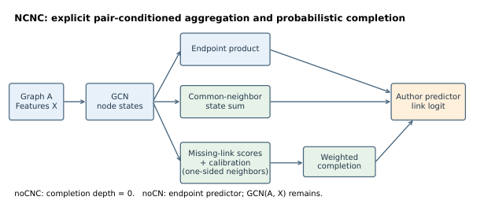
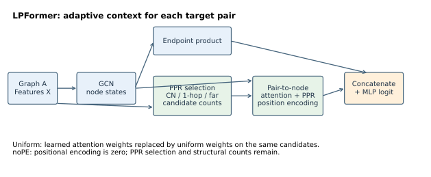
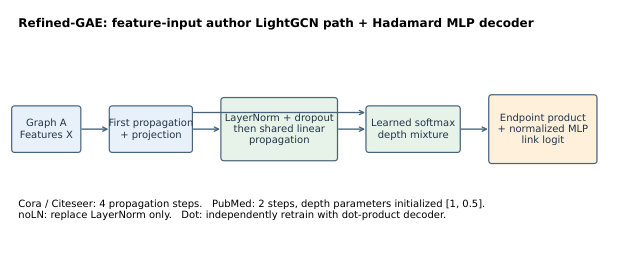

# NCNC、LPFormer 与 Refined-GAE：模型介绍

完整推导、结构图、实验设计与测量见 [PDF 报告](report.pdf)；可编辑的模型章节见 [models.tex](models.tex)，引用见 [references.bib](references.bib)。下面介绍对应本次实际运行的作者适配器。

## GCN 与 GAE 的关系

GCN 是根据邻接关系聚合节点信息的编码器；GAE 是“节点编码器 + 链路解码器 + 重构目标”的框架。GAE 可以使用 GCN 编码，再用点积或 MLP 预测边，因而二者并不互斥。VGAE 在此基础上使用潜变量分布和变分约束。[GCN 原论文](https://arxiv.org/abs/1609.02907)、[GAE/VGAE 原论文](https://arxiv.org/abs/1611.07308)。

## 1. NCNC：共同邻居补全

**论文**：Xiyuan Wang, Haotong Yang, Muhan Zhang. *Neural Common Neighbor with Completion for Link Prediction*. ICLR 2024。[正式论文](https://proceedings.iclr.cc/paper_files/paper/2024/hash/3efb4bdc6bfe13e1ff95b4407c37961d-Abstract-Conference.html)。

NCN 先用消息传递编码节点，再为每个候选点对聚合共同邻居的表示。NCNC 进一步处理缺失边：对只与一端相连的潜在共同邻居，预测另一条缺失连接的概率，经校准后参与加权聚合。它补充点对结构证据，不是生成整张新图。

本次采用一层 GCN、256维表示、一次补全，结合端点乘积与共同邻域分支。`no_completion` 关闭补全，保留 NCN 聚合；`no_cn` 改成作者端点预测器，仍保留 GCN(A,X)，因此不是特征-only。

需要检验的机制是：补全能否减轻邻域丢失；本次消融显示其边际收益小且随设置变化，不能把完整模型的攻击表现直接归因于补全。

## 2. LPFormer：为不同点对学习不同上下文

**论文**：Harry Shomer, Yao Ma, Haitao Mao, Juanhui Li, Bo Wu, Jiliang Tang. *LPFormer: An Adaptive Graph Transformer for Link Prediction*. KDD 2024, 2686–2698。[论文](https://arxiv.org/abs/2310.11009)，[DOI](https://doi.org/10.1145/3637528.3672025)。

LPFormer 先编码节点，用 PPR 为目标点对选择共同邻居、单侧邻居和较远节点，再结合节点表示与位置编码分配注意力。最终将点对聚合、端点交互和结构计数输入 MLP。它能对不同候选关系使用不同上下文。

PPR 同时用于候选筛选和位置编码。`uniform_attention` 只固定候选内均匀权重，保留值投影；`no_ppr_encoding` 只把位置编码置零，保留 PPR 筛选和计数。每张攻击图都会重算 PPR。训练中仍沿用作者全训练图 PPR，可能保留批次目标信息，报告明确披露该限制。

本次 PubMed 的两项消融未显示完整模型稳定占优；这不等于所有注意力或全部 PPR 无效。

## 3. Refined-GAE：重新审视强 GAE 基线

**论文**：Weishuo Ma, Yanbo Wang, Xiyuan Wang, Muhan Zhang. *Reconsidering the Performance of GAE in Link Prediction*. CIKM 2025。[论文](https://arxiv.org/abs/2411.03845)，[DOI](https://doi.org/10.1145/3746252.3761108)。Refined-GAE 是作者代码库名称；不是另一篇单独的论文。

该工作强调输入表示、传播、归一化和解码器设计的重要性。本文运行作者的属性输入 `LightGCN` 路径：首步传播与投影，后续共享传播算子，步间 LayerNorm/dropout，按可学习 softmax 权重混合各深度输出，再用端点 Hadamard 乘积和 MLP 预测边。Cora/Citeseer 为4步、1024维；PubMed 为2步、512维，使用GELU的两层解码器。

本次没有新增节点ID嵌入，不能据此检验论文在无属性图上的正交ID初始化论点。`no_norm` 仅移除网络内 LayerNorm，保留 dropout、输入标准化和邻接归一化；`dot_decoder` 改为点积预测器后独立重训。PubMed 上完整模型相对点积版本有较大配对AUC收益，但差异包含非线性、参数量、正则化与训练轨迹的共同影响。

## 原论文图与本次结构图

PDF 正文另放入三个原论文的局部图，均标明论文、页码和面板，来源保存在 `figure_sources.json`。NCNC 的架构分类图、LPFormer 的候选筛选面板、Refined-GAE 的典型GAE概览均保留原作者标签；上面的流程图则是依据固定作者代码和本次配置重新绘制，二者含义在图注中分别说明。
