# HL-GNN 重训、完整鲁棒性与重要节点 AUROC 报告

2026-11-24 新训练结果；旧逐边预测和权重已无法恢复，因此按用户要求重训。旧汇总与训练记录保留在 [历史记录](../hlgnn-historical/)，不将新模型伪装成旧 checkpoint。

**新增发现：** PubMed 特征打乱后，HL-GNN 的全局 AUROC 为 0.8691，高于 Katz 的 0.8256；但 Degree Top 10% 节点相关边上分别为 0.6965 与 0.8295，模型排序反转。该子集每个 seed 至少有 4,769 条正边和 1,184 条负边，不是极小样本点。它说明整体成绩可能掩盖重要节点子集的弱点，结论仅限本次特征打乱与固定负例协议。

## 训练与协议核验

- 使用恢复的 HL-GNN 实现；固定历史验证集选择的 `readme_exact` 配置，不重新选配置，不根据测试集调整超参。每次最多 150 epoch、每 5 epoch 验证，连续 15 次验证未改善后停止；按干净验证 AUROC 保存最佳模型。
- Cora / CiteSeer / PubMed × seeds 0/1/2 × full / fixed_weights / shallow_k2：27 个独立训练模型。先核验每个数据集 full seed 0 的验证差异，再继续后续模型；不因为某个 seed 的测试成绩不好而重抽 seed。
- 无向正边按 80% / 5% / 15% 划分 train / validation / test，各集合使用等量固定负例，负例集合互相不重叠。特征、全部 9 组 split 和测试边顺序均与历史指纹一致；评测使用 Junxiong 固定提交 `95083da808e500c02da458e205f4b861ceb80871` 的原生 `run.evaluate`。训练上下文移除当前正例批次；验证只用 train；测试上下文用 train+validation。
- 共 117 张结构缓存图通过旧 HL-GNN / Katz 历史 graph_sha256 核验；特征打乱使用原协议的固定节点置换。没有生成新攻击图、重抽负例或对扰动图重新训练。
- RF / DICE / EA 为 10%、25%、50%；随机删边、高度端点优先删边、随机插边为 50%；另有 clean 与整行特征打乱，共 14 条件。这里的 EA 是 Junxiong 的可见图线性代理攻击，不能称为与 DeepRobust 或 SGDiff 原论文攻击完全等价。
- 本次恢复的是组内协议实验，不声称重新执行了 HL-GNN 原论文的 Planetoid Hits@100 实验。达到 150 epoch 上限不等于已证明收敛；本轮固定历史预算以保持可比，完整训练曲线随工件发布。环境、训练日志和 checkpoint 哈希另见交付工件。

重训与旧结果的最大逐 seed / 条件 AUROC 差异为 **0.058103**（cora / fixed_weights / seed 2 / feature_shuffle，新−旧 +0.058103）。完整对照见 [historical_comparison.csv](historical_comparison.csv)。不要求 CUDA 重训逐位相同，也不为迎合旧测试成绩反复重训。

另见 [重训差异诊断](retraining_diagnostics.md)：Cora fixed_weights seed 2 的新旧训练合同相同、初期 loss 仅约 1e-7 差异，但验证选中的 epoch 从 105 变为 75，特征打乱成绩变化较大。组件优势应重新解释，不能强制让完整版胜出。

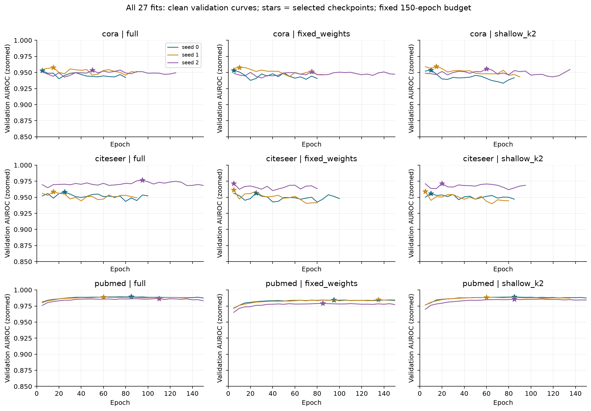

## 完整鲁棒性结果

下表为三 seed 均值 ± 样本标准差。AUROC / AP / Hits@100 / Precision@100 的全部 378 组结果在 [per_seed.csv](per_seed.csv)，所有 14 条件汇总在 [robustness_summary.csv](robustness_summary.csv)。

|数据集|版本|Clean AUROC|EA 50%|随机删边 50%|高度删边 50%|特征打乱|
|---|---|---|---|---|---|---|
|cora|full|0.9596 ± 0.0008|0.9505 ± 0.0010|0.9419 ± 0.0022|0.9395 ± 0.0027|0.7217 ± 0.0314|
|cora|fixed_weights|0.9591 ± 0.0026|0.9506 ± 0.0012|0.9429 ± 0.0052|0.9390 ± 0.0055|0.7259 ± 0.0169|
|cora|shallow_k2|0.9566 ± 0.0032|0.9496 ± 0.0028|0.9424 ± 0.0081|0.9381 ± 0.0077|0.6836 ± 0.0182|
|citeseer|full|0.9566 ± 0.0045|0.9500 ± 0.0061|0.9512 ± 0.0042|0.9487 ± 0.0035|0.5216 ± 0.0115|
|citeseer|fixed_weights|0.9574 ± 0.0099|0.9471 ± 0.0090|0.9503 ± 0.0087|0.9497 ± 0.0077|0.5257 ± 0.0072|
|citeseer|shallow_k2|0.9565 ± 0.0056|0.9503 ± 0.0053|0.9499 ± 0.0039|0.9495 ± 0.0023|0.5383 ± 0.0090|
|pubmed|full|0.9881 ± 0.0006|0.9839 ± 0.0015|0.9779 ± 0.0004|0.9784 ± 0.0006|0.8691 ± 0.0015|
|pubmed|fixed_weights|0.9832 ± 0.0003|0.9804 ± 0.0004|0.9747 ± 0.0010|0.9764 ± 0.0006|0.7793 ± 0.0059|
|pubmed|shallow_k2|0.9878 ± 0.0005|0.9842 ± 0.0008|0.9786 ± 0.0008|0.9798 ± 0.0015|0.8539 ± 0.0023|

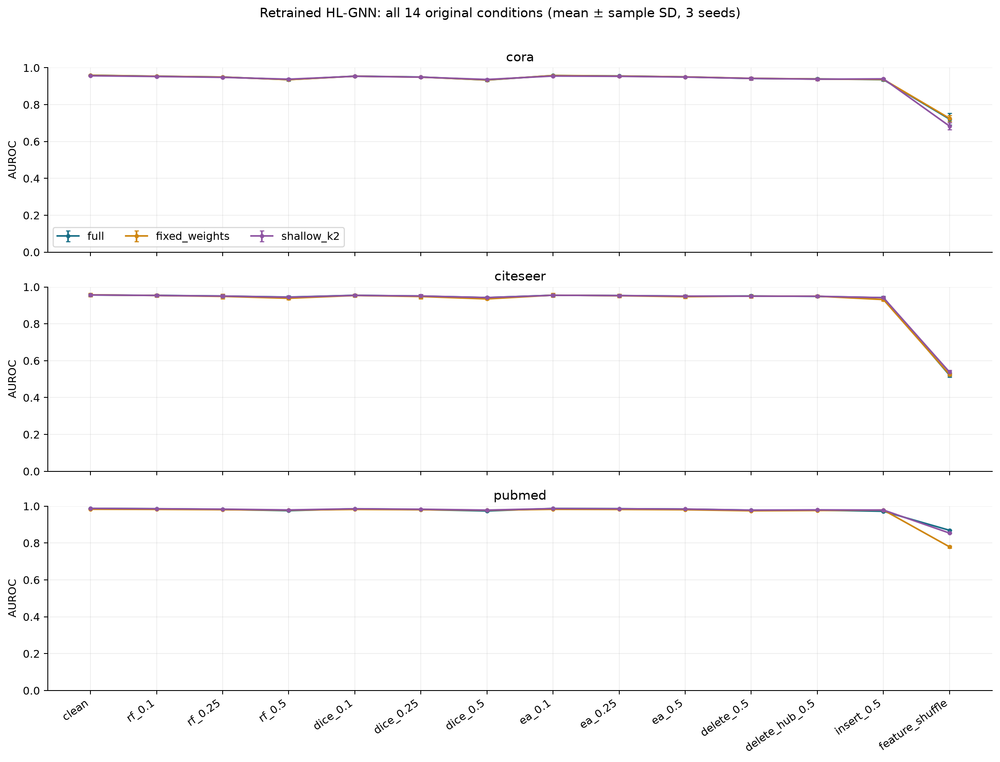

## 组件消融

`fixed_weights` 冻结解析 RWR / KI 跳权，保留 20-hop 传播及特征/MLP；`shallow_k2` 保留可学习跳权，将传播截断为 2-hop。三个版本分别训练，不能把推断时关模块当作这些消融。固定权重改变可训练参数数量；浅层版本同时改变可用跳数及跳权向量长度；在 Cora/CiteSeer 的 RWR 初始化中，最后一跳还承接剩余权重（K=2 时初始末项为 0.64，而 K=20 的第 2 跳为 0.128）。因此它是历史定义的浅层配置对照，并非完全隔离初始化影响的纯深度因果实验。

差值为同 seed 的 Full − Variant（百分点）；正值表示完整模型更高，误差为配对差值的样本标准差。三个 seed 不能支持强显著性或因果泛化主张。

|数据集|对照|Clean 增益 pp|EA 50% 增益 pp|特征打乱增益 pp|
|---|---|---|---|---|
|cora|full − fixed_weights|+0.05 ± 0.19|-0.01 ± 0.22|-0.41 ± 1.55|
|cora|full − shallow_k2|+0.30 ± 0.25|+0.09 ± 0.37|+3.81 ± 1.64|
|citeseer|full − fixed_weights|-0.08 ± 0.65|+0.29 ± 0.35|-0.41 ± 1.62|
|citeseer|full − shallow_k2|+0.01 ± 0.16|-0.03 ± 0.12|-1.68 ± 1.68|
|pubmed|full − fixed_weights|+0.49 ± 0.05|+0.35 ± 0.12|+8.98 ± 0.47|
|pubmed|full − shallow_k2|+0.03 ± 0.01|-0.03 ± 0.07|+1.52 ± 0.10|

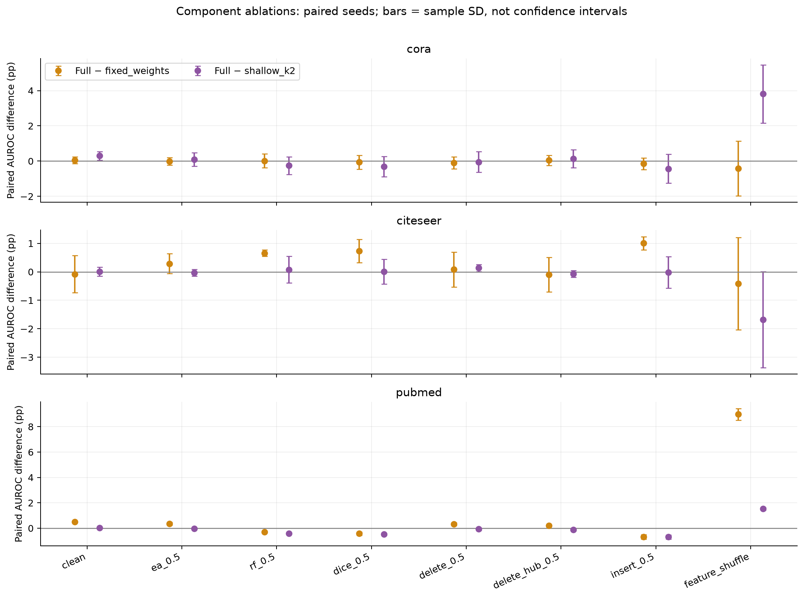

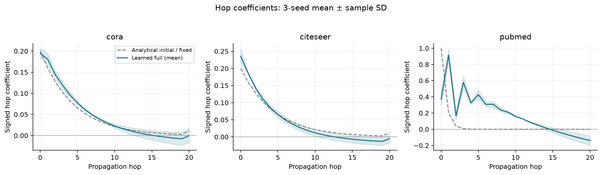

跳权的数值展示模型如何偏离解析初始化；各阶传播表示的尺度和下游非线性不同，权重绝对值不能直接解释为严格的特征重要性。逐 seed 数值见 [learned_hop_weights.csv](learned_hop_weights.csv)。

## 新指标：Top-k% 重要节点相关边的 AUROC

先按干净训练图的 Degree 或 PageRank 排节点；选前 ceil(N×k/100) 个节点，再在原测试候选边中保留“至少一端属于所选节点”的边，计算 AUROC。横轴 k=0..100；k=0 无定义，k=100 恢复全测试 AUROC。排名与测试边子集在所有模型、组件及扰动间固定。

这是重要节点相关预测的条件评测，**不是只挑预测最高分的边，也不是一种天然更优的总体指标**。Top 10% 节点通常覆盖远多于 10% 的正边，且负边覆盖率不同；因此同时报告正负样本数与覆盖率。不重新平衡正负例、不按攻击后的度重新排节点。少于 20 正或 20 负的点标为低支持。

|数据集|模型|条件|Degree Top 10% AUROC|Degree Top 100% AUROC|
|---|---|---|---|---|
|cora|katz|clean|0.8801 ± 0.0220|0.8434 ± 0.0109|
|cora|katz|ea_0.5|0.8507 ± 0.0244|0.8214 ± 0.0087|
|cora|katz|delete_hub_0.5|0.6264 ± 0.0023|0.6278 ± 0.0095|
|cora|katz|feature_shuffle|0.8801 ± 0.0220|0.8434 ± 0.0109|
|cora|hlgnn|clean|0.9539 ± 0.0092|0.9596 ± 0.0008|
|cora|hlgnn|ea_0.5|0.9450 ± 0.0135|0.9505 ± 0.0010|
|cora|hlgnn|delete_hub_0.5|0.9290 ± 0.0125|0.9395 ± 0.0027|
|cora|hlgnn|feature_shuffle|0.7346 ± 0.0244|0.7217 ± 0.0314|
|citeseer|katz|clean|0.8875 ± 0.0078|0.7778 ± 0.0087|
|citeseer|katz|ea_0.5|0.8827 ± 0.0127|0.7745 ± 0.0081|
|citeseer|katz|delete_hub_0.5|0.5830 ± 0.0164|0.5740 ± 0.0075|
|citeseer|katz|feature_shuffle|0.8875 ± 0.0078|0.7778 ± 0.0087|
|citeseer|hlgnn|clean|0.9661 ± 0.0129|0.9566 ± 0.0045|
|citeseer|hlgnn|ea_0.5|0.9623 ± 0.0145|0.9500 ± 0.0061|
|citeseer|hlgnn|delete_hub_0.5|0.9520 ± 0.0161|0.9487 ± 0.0035|
|citeseer|hlgnn|feature_shuffle|0.5260 ± 0.0390|0.5216 ± 0.0115|
|pubmed|katz|clean|0.8295 ± 0.0033|0.8256 ± 0.0021|
|pubmed|katz|ea_0.5|0.8088 ± 0.0033|0.8141 ± 0.0029|
|pubmed|katz|delete_hub_0.5|0.7265 ± 0.0031|0.7046 ± 0.0024|
|pubmed|katz|feature_shuffle|0.8295 ± 0.0033|0.8256 ± 0.0021|
|pubmed|hlgnn|clean|0.9764 ± 0.0018|0.9881 ± 0.0006|
|pubmed|hlgnn|ea_0.5|0.9672 ± 0.0016|0.9839 ± 0.0015|
|pubmed|hlgnn|delete_hub_0.5|0.9635 ± 0.0007|0.9784 ± 0.0006|
|pubmed|hlgnn|feature_shuffle|0.6965 ± 0.0067|0.8691 ± 0.0015|

### 本次结果的解释边界

组件贡献取决于评测条件和节点子集，完整版并不必然在所有攻击与 k 上胜出。下面直接比较 Cora 特征打乱时的同 seed Full − Fixed：

|节点范围|Full − Fixed AUROC（pp，均值 ± 样本 SD）|
|---|---|
|Degree Top 10%|+1.73 ± 1.02|
|Degree Top 100%|-0.41 ± 1.55|

这说明全局组件结论可能掩盖重要节点子集中的不同表现；三个 seed 的差值及离散程度需要一起看，不能把均值符号变化宣称为统计显著或一般规律。完整条件组件差值见 [conditional_component_deltas.csv](conditional_component_deltas.csv)。

Katz 的 H=5/3/2 三个版本也全部进入新指标。这里的截断跳数是该经典路径计数方法的组件调查；Katz 不使用节点特征，因此 feature_shuffle 分数应与 clean 完全相同，这一不变量已逐组核验。HL-GNN 的特征打乱成绩变化则表明模型依赖属性证据，但本实验不能把这一影响等同于真实世界所有特征缺失形式。

### clean

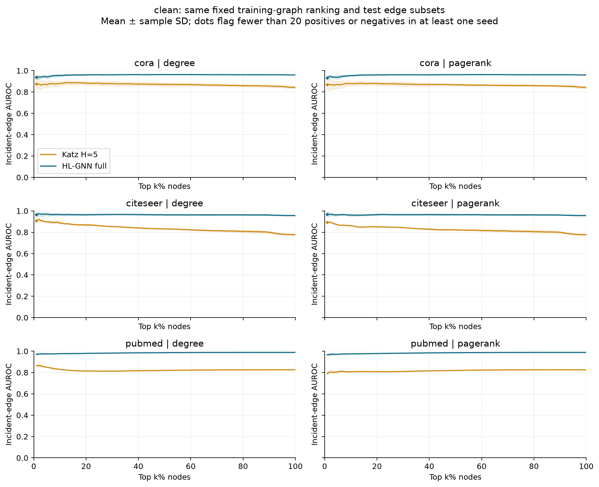

### ea_0.5

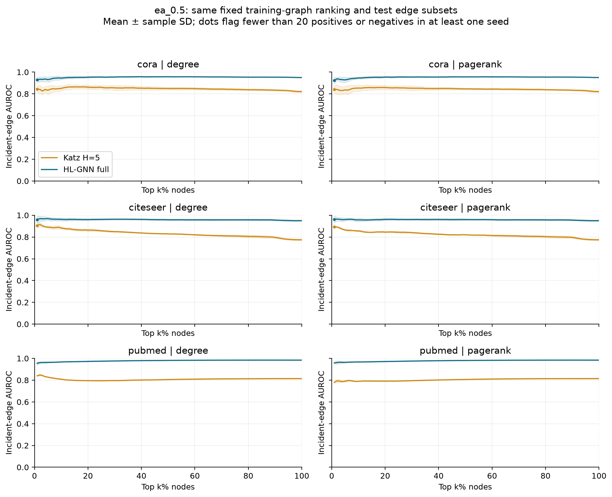

### delete_hub_0.5

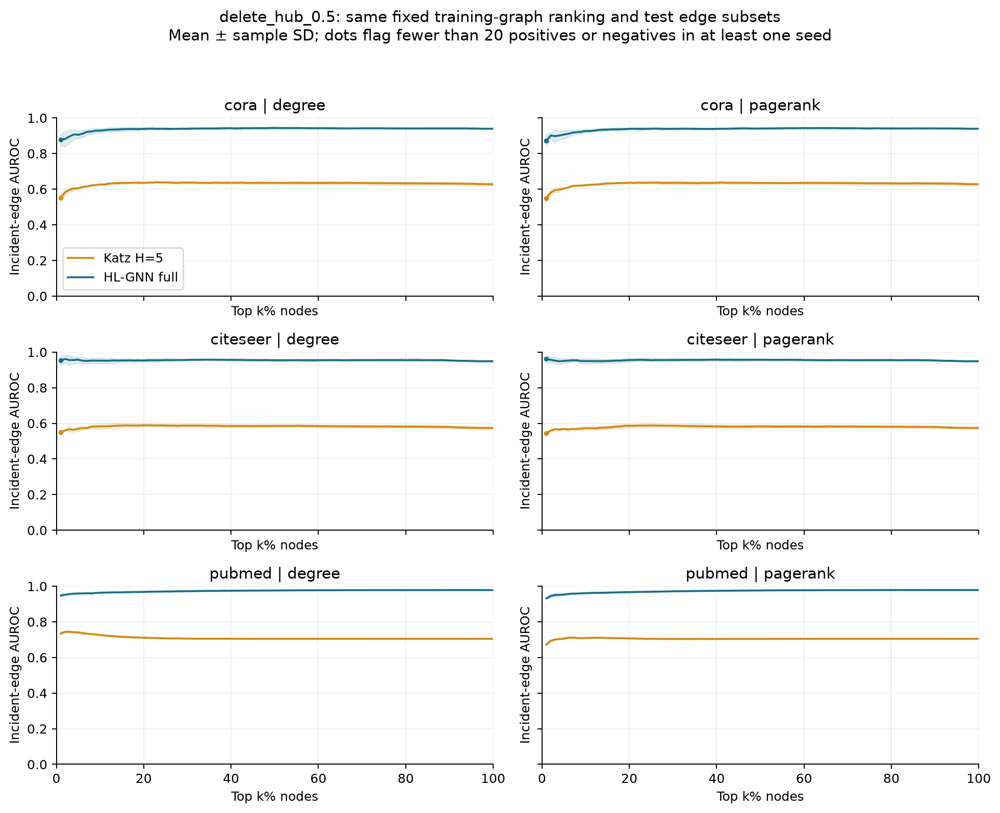

### feature_shuffle

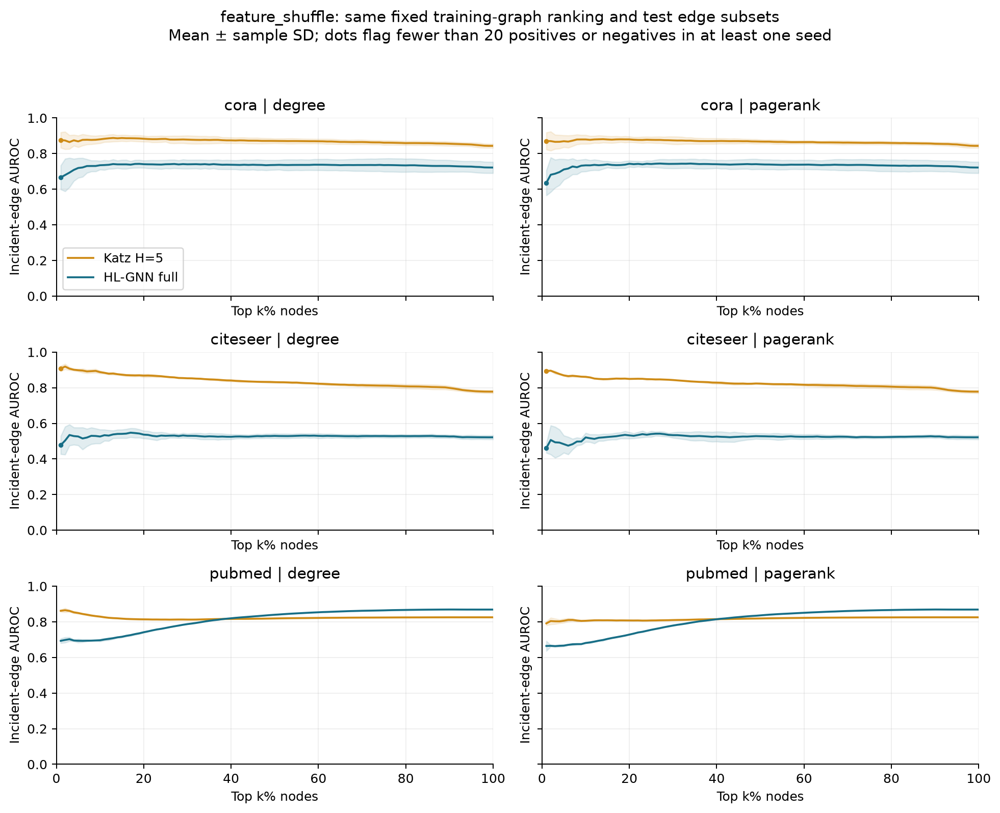

### 组件的新指标曲线

完整版和两种消融均计算了所有 14 条件 × 两种排名 × 101 个 k；下图展示 clean / EA50 / feature_shuffle，完整数值见归档。

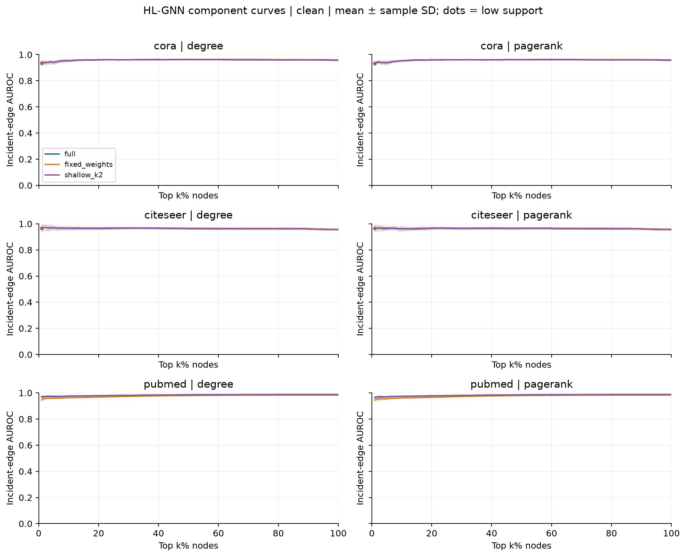

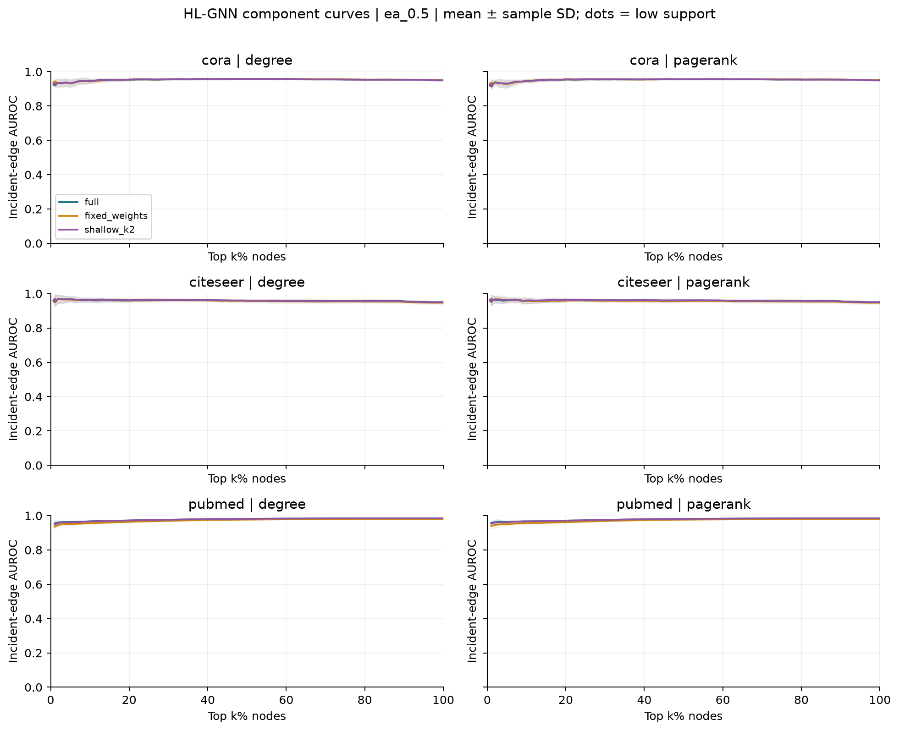

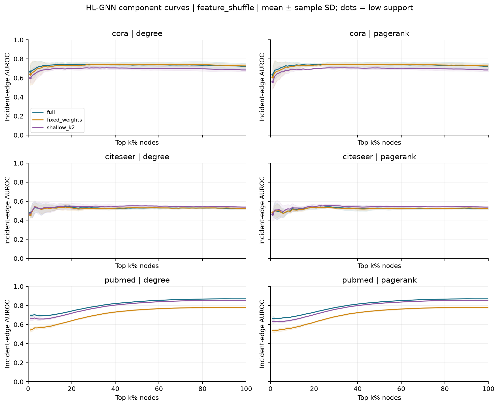

## 结果文件与复算

- [predictions.zip](predictions.zip)：新 HL-GNN 逐边分数、queries、receipts、split、原生逐条件记录；没有 GPU 也可重算所有新指标。
- [training_records.zip](training_records.zip)：27 个训练的完整 history / receipt / complete、配置、环境和验收记录。
- [checkpoints.json](checkpoints.json)：27 个模型权重的 NAS 路径和 SHA256；权重保存在持久 NAS，没有把大权重提交进 Git 历史。
- `../node-rank-auc/`：Katz 与重训 HL-GNN 合并的新指标汇总、逐 seed 曲线归档、协议与复算说明。
- 代码在 `../../experiments/node_rank_auc/`，训练与原生评测入口在 `../../scripts/`。

局限：只有 3 个数据集与 3 个既定种子；测试时观测退化，不含受损图重训。两种消融并非所有组件的穷尽实验。重要节点子集并不能消除负采样的度偏差，不能仅凭子集 AUC 上升宣称模型变好了。
