# NCNC、LPFormer、Refined-GAE：统一鲁棒性、组件消融与重要节点 AUROC

**2026-11-26 实验更新，交付分支 `feat/ncnc-lpformer-refined-gae`。** 本报告基于 `unified-robustness-ablation@bef9674` 的 2026-11-24 交付。主结果全部完成后生成，不以计划代替实测。

## 完成内容与复用范围

- **三个数据集 × 三个模型 × 三个组件版本 × 三个种子 =81份模型权重、1134组原生14条件评估。** Cora/Citeseer复用原候选保护协议的54份权重与756组逐边预测；PubMed按共享协议新增27次从头训练与378组评估。未用后来main补实验的标准化特征权重替代本轮模型。
- Degree/PageRank × k=0..100：新增 **229,068行逐seed条件曲线、76,356行跨seed汇总、50,904行配对组件条件汇总**。k=0的空样本点保留NA，不算作有定义AUC。
- 对齐已有Katz和重训HL-GNN：9份划分、原始属性、117张结构缓存、查询顺序和冻结节点排名逐项核验；只读取已发布攻击图，不生成新EA或为每个k重新扰动图。
- 全局AUROC/AP/严格Hits@100/并列平均Precision@100均核验；每条新曲线k=100还原原模型全测试AUROC。三个模型与两位现有比较对象的训练配方各自保留，统一的是数据、攻击、测试对象和计分层。

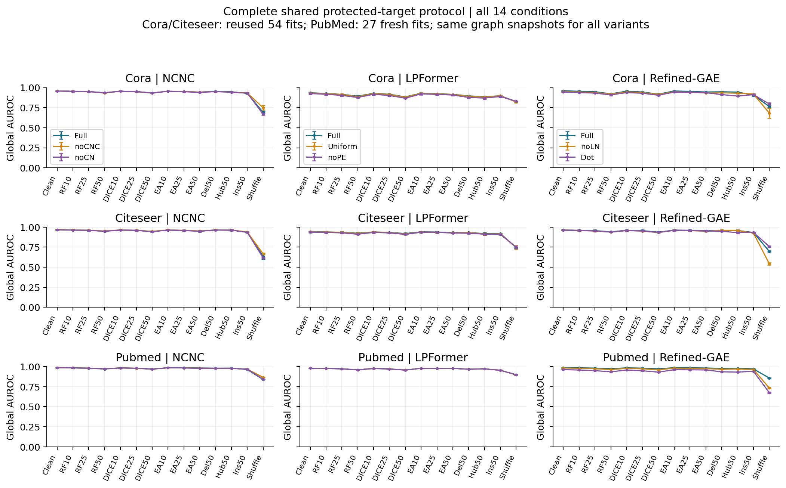

## 新指标到底测什么

每个dataset/seed仅用干净`train_pos`计算Degree和PageRank（alpha=0.85，均匀teleport与dangling，tol=1e-12，max_iter=1000）。先按分数降序，再按既定SHA256键处理并列；排名图不包含验证/测试正边。取前ceil(N×k/100)个节点，从原测试正负边同时筛出“至少一端命中”的边，计算pooled AUROC。不重新平衡负例，不按预测分数挑边，不按攻击后图重新排节点。

k=100是全测试集，k=0没有样本、AUROC=NA；任一类别为空为NA；少于20正例或20负例标为低支持。图纵轴固定0–1，三seed阴影为样本标准差，不是置信区间。低支持点用空心点表示，不连接成与充分样本相同的主曲线。

**冻结排名的额外核验：** 本机NetworkX与原交付环境不同，PageRank数值近乎相同仍可能使少量近并列节点换序。`frozen_rank.py`验证训练图指纹、Degree、PageRank数值及tie key后，直接复用已发布`node_ranks.csv`，输出须与Katz、HL-GNN的排名CSV逐字节一致。原`node_rank_auc/evaluate.py`的计分逻辑保持不变，适配层与排名源哈希单独记录。

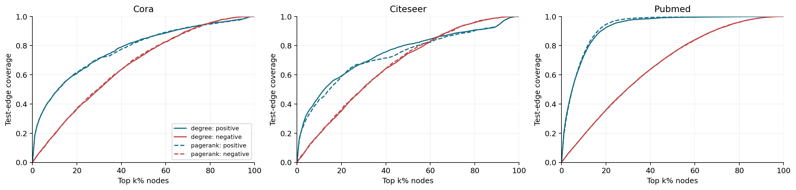

Top10%节点通常覆盖远多于10%的正边，且正负覆盖率不等；较高条件AUROC可能来自测试人群改变，不能解释为选择节点使模型变强。Degree与PageRank可能高度相关。本指标的全局PageRank中心性也不同于LPFormer内部为源节点计算的个性化PPR，两者用途不同。

## 五模型在同图、同候选上的曲线

Katz与HL-GNN直接引用本分支已发布曲线，没有重新训练它们；三个新模型使用同一组排名与测试边子集。所有14条件均进入数值归档，下图选择代表条件。

### clean

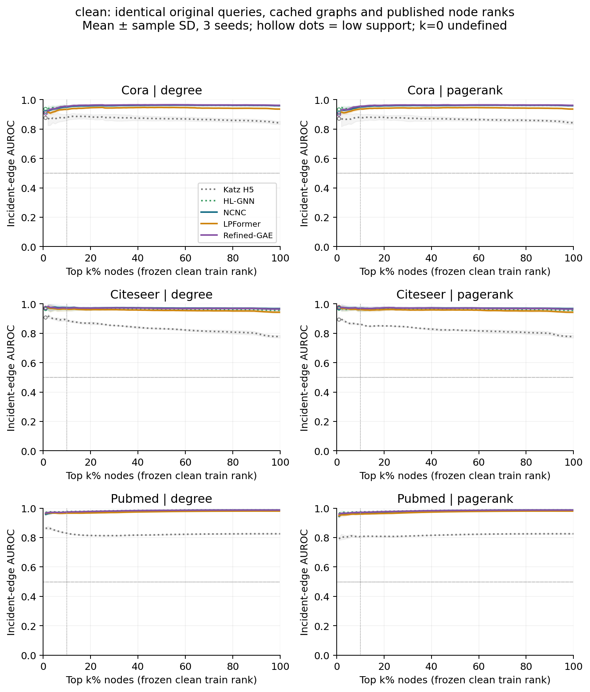

### ea_0.5

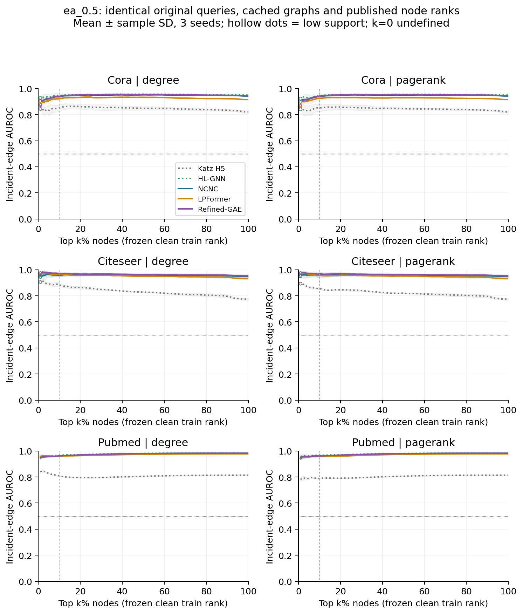

### delete_hub_0.5

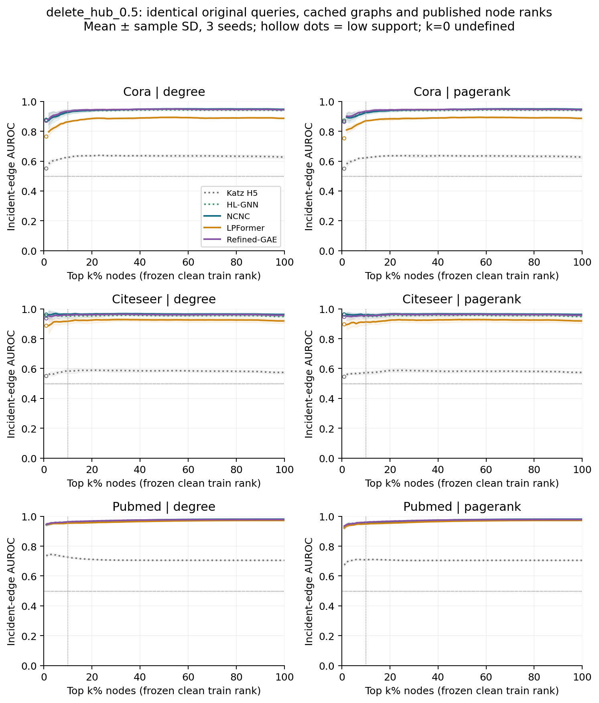

### feature_shuffle

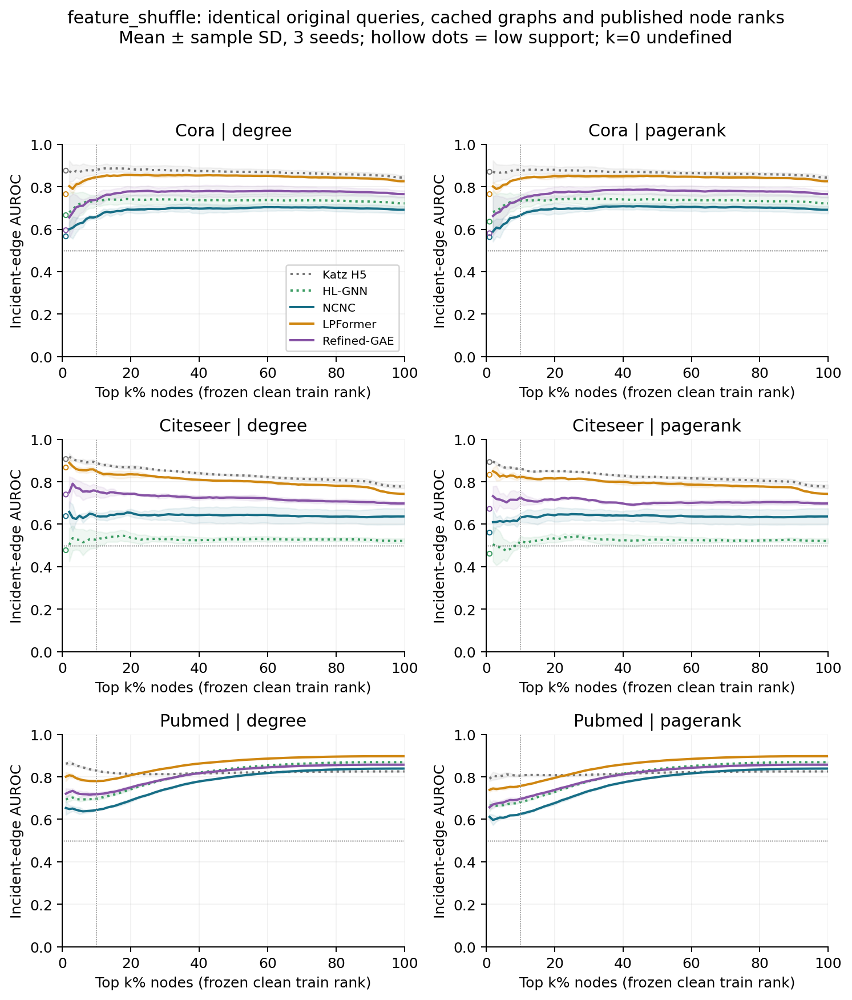

## Top10%与全局：详细关键结果

### cora

|模型|条件|Degree10 AUC|PageRank10 AUC|全局AUC|D10最少正例|D10最少负例|P10最少正例|P10最少负例|
|---|---|---|---|---|---|---|---|---|
|NCNC|clean|0.9497 ± 0.0045|0.9510 ± 0.0031|0.9592 ± 0.0019|359|144|357|146|
|NCNC|ea_0.5|0.9380 ± 0.0056|0.9417 ± 0.0035|0.9435 ± 0.0026|359|144|357|146|
|NCNC|delete_hub_0.5|0.9265 ± 0.0162|0.9251 ± 0.0115|0.9477 ± 0.0031|359|144|357|146|
|NCNC|feature_shuffle|0.6583 ± 0.0099|0.6652 ± 0.0032|0.6916 ± 0.0169|359|144|357|146|
|LPFormer|clean|0.9338 ± 0.0054|0.9369 ± 0.0076|0.9361 ± 0.0008|359|144|357|146|
|LPFormer|ea_0.5|0.9218 ± 0.0116|0.9268 ± 0.0157|0.9158 ± 0.0017|359|144|357|146|
|LPFormer|delete_hub_0.5|0.8632 ± 0.0073|0.8700 ± 0.0042|0.8870 ± 0.0012|359|144|357|146|
|LPFormer|feature_shuffle|0.8455 ± 0.0078|0.8381 ± 0.0057|0.8263 ± 0.0058|359|144|357|146|
|Refined-GAE|clean|0.9548 ± 0.0050|0.9558 ± 0.0049|0.9616 ± 0.0035|359|144|357|146|
|Refined-GAE|ea_0.5|0.9409 ± 0.0085|0.9423 ± 0.0042|0.9452 ± 0.0014|359|144|357|146|
|Refined-GAE|delete_hub_0.5|0.9345 ± 0.0127|0.9349 ± 0.0111|0.9443 ± 0.0025|359|144|357|146|
|Refined-GAE|feature_shuffle|0.7395 ± 0.0217|0.7413 ± 0.0205|0.7652 ± 0.0164|359|144|357|146|

### citeseer

|模型|条件|Degree10 AUC|PageRank10 AUC|全局AUC|D10最少正例|D10最少负例|P10最少正例|P10最少负例|
|---|---|---|---|---|---|---|---|---|
|NCNC|clean|0.9745 ± 0.0140|0.9710 ± 0.0145|0.9683 ± 0.0067|295|128|278|124|
|NCNC|ea_0.5|0.9583 ± 0.0135|0.9596 ± 0.0159|0.9500 ± 0.0062|295|128|278|124|
|NCNC|delete_hub_0.5|0.9641 ± 0.0079|0.9605 ± 0.0115|0.9627 ± 0.0077|295|128|278|124|
|NCNC|feature_shuffle|0.6388 ± 0.0167|0.6320 ± 0.0207|0.6369 ± 0.0374|295|128|278|124|
|LPFormer|clean|0.9646 ± 0.0139|0.9608 ± 0.0121|0.9435 ± 0.0055|295|128|278|124|
|LPFormer|ea_0.5|0.9632 ± 0.0112|0.9586 ± 0.0092|0.9317 ± 0.0068|295|128|278|124|
|LPFormer|delete_hub_0.5|0.9170 ± 0.0194|0.9120 ± 0.0190|0.9193 ± 0.0152|295|128|278|124|
|LPFormer|feature_shuffle|0.8491 ± 0.0073|0.8234 ± 0.0085|0.7434 ± 0.0039|295|128|278|124|
|Refined-GAE|clean|0.9717 ± 0.0109|0.9696 ± 0.0111|0.9651 ± 0.0073|295|128|278|124|
|Refined-GAE|ea_0.5|0.9707 ± 0.0111|0.9685 ± 0.0125|0.9533 ± 0.0105|295|128|278|124|
|Refined-GAE|delete_hub_0.5|0.9579 ± 0.0169|0.9548 ± 0.0173|0.9575 ± 0.0080|295|128|278|124|
|Refined-GAE|feature_shuffle|0.7568 ± 0.0237|0.7263 ± 0.0316|0.6980 ± 0.0072|295|128|278|124|

### pubmed

|模型|条件|Degree10 AUC|PageRank10 AUC|全局AUC|D10最少正例|D10最少负例|P10最少正例|P10最少负例|
|---|---|---|---|---|---|---|---|---|
|NCNC|clean|0.9707 ± 0.0018|0.9681 ± 0.0001|0.9872 ± 0.0008|4769|1184|4863|1193|
|NCNC|ea_0.5|0.9616 ± 0.0027|0.9615 ± 0.0023|0.9828 ± 0.0005|4769|1184|4863|1193|
|NCNC|delete_hub_0.5|0.9579 ± 0.0019|0.9545 ± 0.0025|0.9809 ± 0.0015|4769|1184|4863|1193|
|NCNC|feature_shuffle|0.6438 ± 0.0003|0.6254 ± 0.0061|0.8391 ± 0.0027|4769|1184|4863|1193|
|LPFormer|clean|0.9659 ± 0.0030|0.9600 ± 0.0027|0.9801 ± 0.0011|4769|1184|4863|1193|
|LPFormer|ea_0.5|0.9613 ± 0.0024|0.9564 ± 0.0021|0.9774 ± 0.0010|4769|1184|4863|1193|
|LPFormer|delete_hub_0.5|0.9538 ± 0.0031|0.9487 ± 0.0013|0.9721 ± 0.0016|4769|1184|4863|1193|
|LPFormer|feature_shuffle|0.7799 ± 0.0012|0.7578 ± 0.0025|0.8975 ± 0.0033|4769|1184|4863|1193|
|Refined-GAE|clean|0.9737 ± 0.0025|0.9718 ± 0.0020|0.9871 ± 0.0003|4769|1184|4863|1193|
|Refined-GAE|ea_0.5|0.9616 ± 0.0027|0.9621 ± 0.0024|0.9822 ± 0.0005|4769|1184|4863|1193|
|Refined-GAE|delete_hub_0.5|0.9630 ± 0.0010|0.9604 ± 0.0018|0.9782 ± 0.0011|4769|1184|4863|1193|
|Refined-GAE|feature_shuffle|0.7180 ± 0.0083|0.6966 ± 0.0089|0.8573 ± 0.0042|4769|1184|4863|1193|

## PubMed属性错配：五模型的关键节点与全局比较

|模型|Degree Top10 AUC|PageRank Top10 AUC|全局AUC|
|---|---|---|---|
|Katz H5|0.8295 ± 0.0033|0.8061 ± 0.0030|0.8256 ± 0.0021|
|HL-GNN|0.6965 ± 0.0067|0.6816 ± 0.0030|0.8691 ± 0.0015|
|NCNC|0.6438 ± 0.0003|0.6254 ± 0.0061|0.8391 ± 0.0027|
|LPFormer|0.7799 ± 0.0012|0.7578 ± 0.0025|0.8975 ± 0.0033|
|Refined-GAE|0.7180 ± 0.0083|0.6966 ± 0.0089|0.8573 ± 0.0042|

在这次PubMed特征打乱实验中，NCNC、LPFormer、Refined-GAE的全局均值高于Katz，但Degree Top10均值低于Katz。该现象与已有HL-GNN交付中的观察相呼应，说明重要节点子集的弱点并不限于一个模型；仍只限这批固定负例与属性错配条件，不能称为显著性或一般规律。

## 固定节点子集的扰动降幅

以下为Full模型的“扰动−clean”，单位百分点；每个seed在相同k、相同边子集上相减，再汇总为均值±样本SD。负值代表退化。全14条件、所有k见`delta_summary.csv`。

### cora

|模型|条件|Degree10 Δ pp|PageRank10 Δ pp|全局 Δ pp|
|---|---|---|---|---|
|NCNC|ea_0.5|-1.17 ± 0.11|-0.93 ± 0.05|-1.56 ± 0.36|
|NCNC|delete_hub_0.5|-2.33 ± 1.35|-2.58 ± 1.27|-1.15 ± 0.12|
|NCNC|feature_shuffle|-29.14 ± 1.01|-28.57 ± 0.40|-26.76 ± 1.65|
|LPFormer|ea_0.5|-1.20 ± 0.77|-1.01 ± 0.81|-2.03 ± 0.09|
|LPFormer|delete_hub_0.5|-7.05 ± 0.48|-6.69 ± 0.47|-4.91 ± 0.20|
|LPFormer|feature_shuffle|-8.82 ± 0.30|-9.88 ± 0.94|-10.98 ± 0.51|
|Refined-GAE|ea_0.5|-1.39 ± 0.50|-1.35 ± 0.32|-1.64 ± 0.23|
|Refined-GAE|delete_hub_0.5|-2.02 ± 1.15|-2.09 ± 1.29|-1.73 ± 0.13|
|Refined-GAE|feature_shuffle|-21.53 ± 2.61|-21.45 ± 2.43|-19.64 ± 1.99|

### citeseer

|模型|条件|Degree10 Δ pp|PageRank10 Δ pp|全局 Δ pp|
|---|---|---|---|---|
|NCNC|ea_0.5|-1.62 ± 0.06|-1.13 ± 0.15|-1.82 ± 0.21|
|NCNC|delete_hub_0.5|-1.05 ± 0.68|-1.05 ± 0.48|-0.55 ± 0.36|
|NCNC|feature_shuffle|-33.57 ± 2.15|-33.89 ± 3.15|-33.14 ± 4.21|
|LPFormer|ea_0.5|-0.14 ± 0.35|-0.21 ± 0.30|-1.18 ± 0.47|
|LPFormer|delete_hub_0.5|-4.76 ± 2.06|-4.88 ± 2.30|-2.42 ± 0.97|
|LPFormer|feature_shuffle|-11.55 ± 1.95|-13.73 ± 2.03|-20.01 ± 0.61|
|Refined-GAE|ea_0.5|-0.10 ± 0.17|-0.11 ± 0.37|-1.18 ± 0.32|
|Refined-GAE|delete_hub_0.5|-1.37 ± 0.68|-1.48 ± 0.64|-0.76 ± 0.07|
|Refined-GAE|feature_shuffle|-21.48 ± 3.42|-24.33 ± 4.25|-26.71 ± 1.45|

### pubmed

|模型|条件|Degree10 Δ pp|PageRank10 Δ pp|全局 Δ pp|
|---|---|---|---|---|
|NCNC|ea_0.5|-0.91 ± 0.27|-0.66 ± 0.23|-0.44 ± 0.12|
|NCNC|delete_hub_0.5|-1.28 ± 0.23|-1.36 ± 0.26|-0.63 ± 0.09|
|NCNC|feature_shuffle|-32.69 ± 0.15|-34.26 ± 0.61|-14.81 ± 0.27|
|LPFormer|ea_0.5|-0.46 ± 0.07|-0.35 ± 0.07|-0.27 ± 0.02|
|LPFormer|delete_hub_0.5|-1.22 ± 0.41|-1.13 ± 0.30|-0.81 ± 0.14|
|LPFormer|feature_shuffle|-18.60 ± 0.39|-20.22 ± 0.26|-8.26 ± 0.26|
|Refined-GAE|ea_0.5|-1.22 ± 0.20|-0.97 ± 0.16|-0.49 ± 0.08|
|Refined-GAE|delete_hub_0.5|-1.07 ± 0.15|-1.14 ± 0.17|-0.88 ± 0.13|
|Refined-GAE|feature_shuffle|-25.57 ± 1.07|-27.52 ± 1.04|-12.98 ± 0.43|

## 可以支持的观察

下面比较的是同一批已冻结子集，数值均为三seed均值±样本SD；均值排序变化不是显著性检验。

1. **重要节点子集可以改变模型均值排序。** Citeseer的EA50下，NCNC/LPFormer全局AUC分别为0.9500 ± 0.0062 / 0.9317 ± 0.0068；Degree Top10%分别为0.9583 ± 0.0135 / 0.9632 ± 0.0112。子集上的LPFormer均值超过NCNC，而全局相反。该比较不说明LPFormer在所有攻击或数据集上更稳健。

- cora特征打乱时，Refined-GAE Full−noLN：Degree Top10为 **6.35 ± 5.43 pp**，全局为 **8.22 ± 6.68 pp**。
- citeseer特征打乱时，Refined-GAE Full−noLN：Degree Top10为 **22.06 ± 3.30 pp**，全局为 **15.46 ± 1.99 pp**。
- pubmed特征打乱时，Refined-GAE Full−noLN：Degree Top10为 **8.12 ± 0.73 pp**，全局为 **12.39 ± 0.53 pp**。

2. **归一化贡献依赖评测子集。** 上述差值衡量网络内LayerNorm组与独立重训的共同影响。noLN仅移除LayerNorm，dropout与邻接归一化保留；本协议输入为原始属性，没有列标准化。它不能区分编码器、解码器各自贡献。特征打乱只是属性错配，不代表所有真实特征损坏。

3. **补全不能被自动当作鲁棒性来源。** 在Cora/Citeseer特征打乱下，Full−noCNC的Degree Top10配对AUC差分别为 -10.54 ± 2.90 / -9.28 ± 2.95 pp。该设置下完整补全版本均值更低；可能的属性错配传播机制仍是待检验假设，不能反推所有补全方法无效。

补充PubMed：Full−noCNC的Degree Top10差为 -8.09 ± 0.64 pp，全局为 -2.71 ± 0.16 pp；与前两个数据集的均值方向一致。

PubMed特征打乱下，LPFormer Full−Uniform：Degree Top10为 0.31 ± 1.06 pp，全局为 -0.03 ± 0.08 pp。Full−noPE分别为 0.19 ± 0.56 / -0.14 ± 0.26 pp。三seed差值较小，不能把LPFormer在该设置的较高绝对AUC直接归因为可学习注意力或位置编码；两种变体仍共享PPR候选和值投影。

4. **同时看绝对性能、同k扰动差与样本覆盖率。** 降幅表采用“扰动−clean”，负值是退化；组件表采用“Full−Variant”，正值是完整模型更高。两个符号约定不同。两类差值均先逐seed计算再汇总，不能相减两个SD得到配对SD。

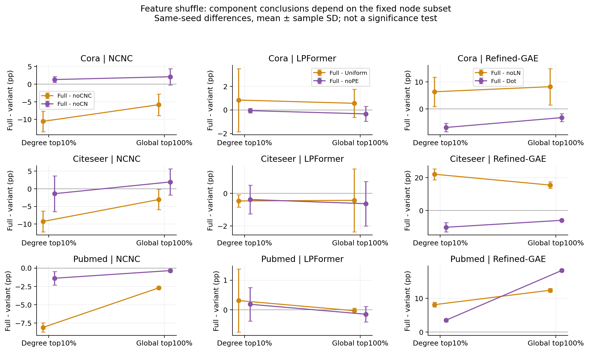

## 三个模型与本轮组件操作

|模型|主要信息路径|两个独立重训变体|解释边界|
|---|---|---|---|
|NCNC|GCN节点表示、端点乘积、共同邻域与缺失关系概率补全|noCNC：补全深度1→0；noCN：作者端点预测器|noCN仍含GCN(A,X)，不是特征-only|
|LPFormer|GCN、PPR候选、点对到节点注意力、位置编码与计数|Uniform：固定候选内均匀权重；noPE：位置编码置零|两者均保留候选和值投影；noPE仍用PPR筛选|
|Refined-GAE|属性输入、传播深度混合、端点Hadamard-MLP解码|noLN：仅移除LayerNorm；Dot：改点积后重训|保留dropout及邻接归一化；Dot改变训练、参数量与非线性|

模型论文：[NCNC, ICLR2024](https://proceedings.iclr.cc/paper_files/paper/2024/hash/3efb4bdc6bfe13e1ff95b4407c37961d-Abstract-Conference.html)、[LPFormer, KDD2024](https://arxiv.org/abs/2310.11009)、[Refined-GAE, CIKM2025](https://arxiv.org/abs/2411.03845)。较完整的模型介绍与原论文图见此前[LaTeX研究报告](https://github.com/2ira/sgdiff-repo/tree/2f4a482/experiments/new_link_models/paper_report)。

### clean / degree

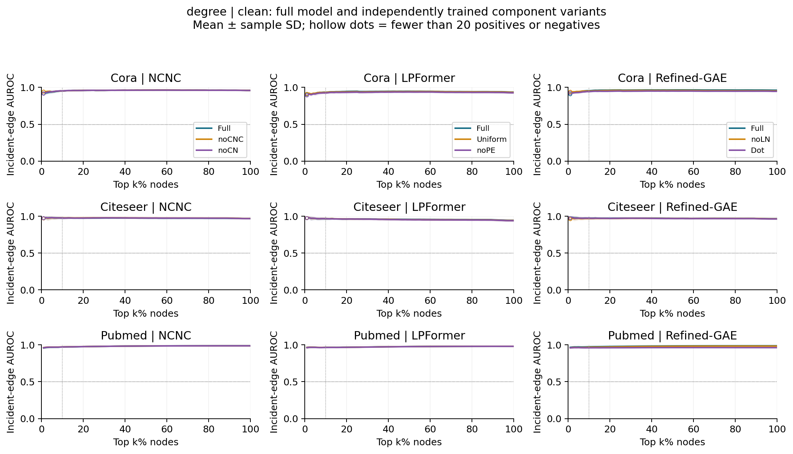

### clean / pagerank

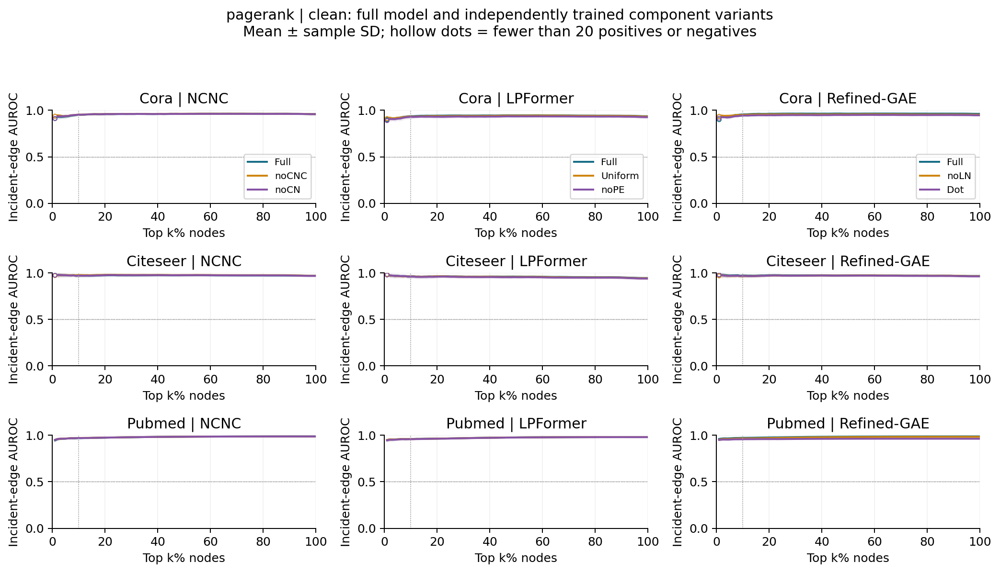

### ea_0.5 / degree

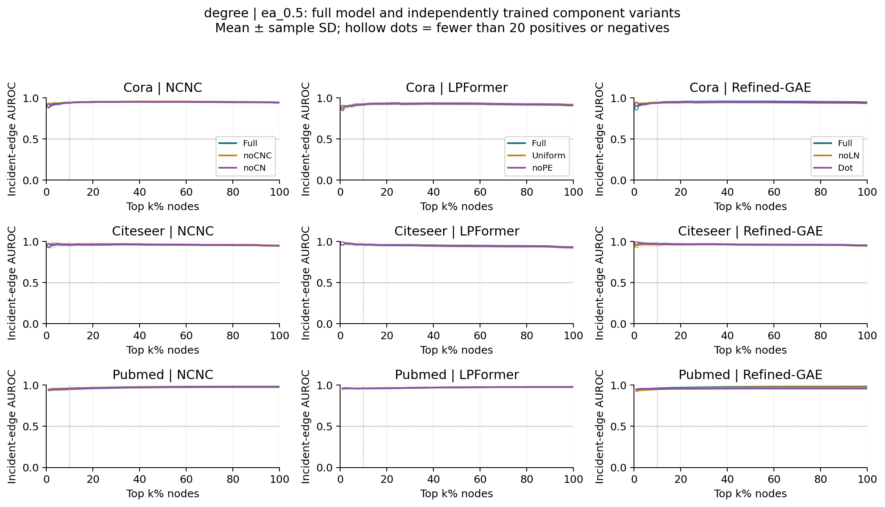

### ea_0.5 / pagerank

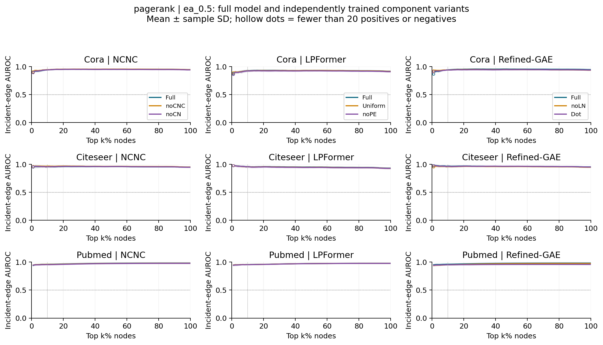

### feature_shuffle / degree

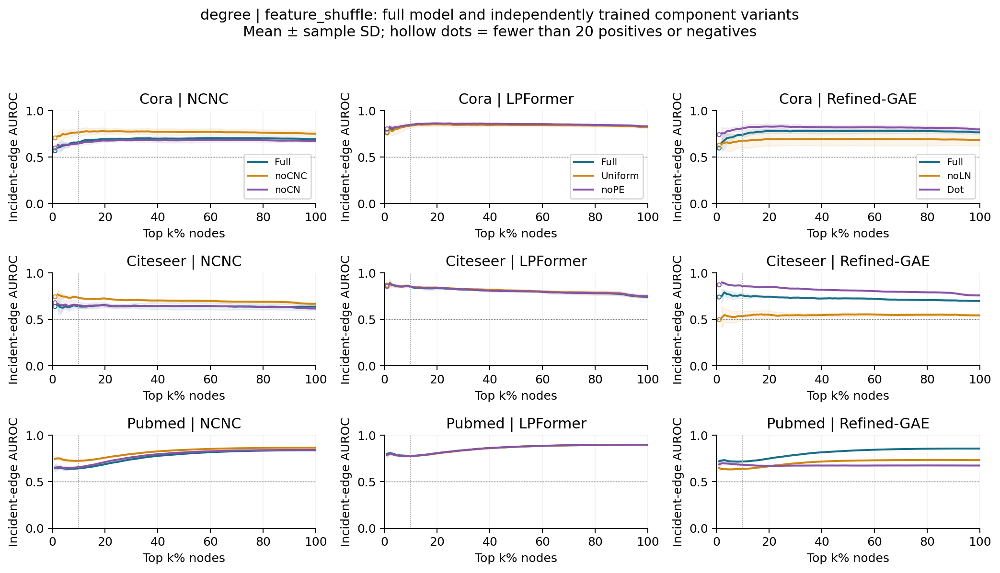

### feature_shuffle / pagerank

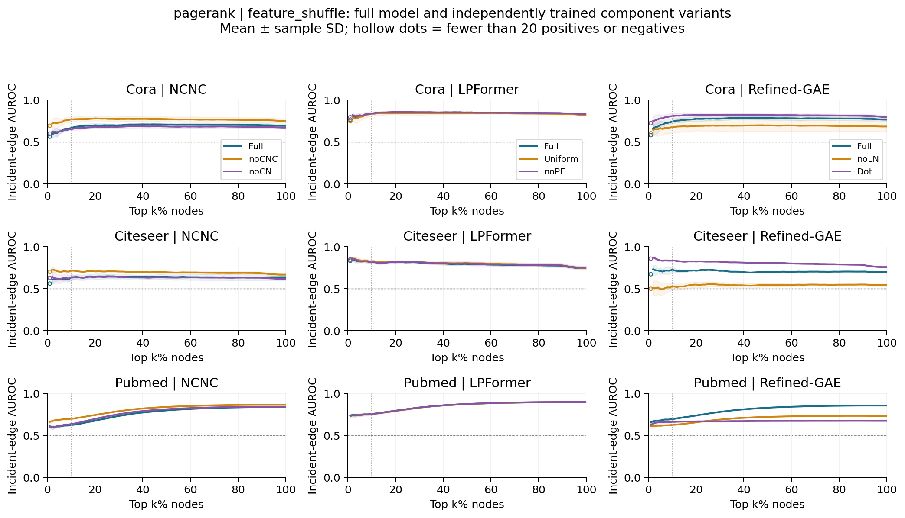

## 学到的模型参数

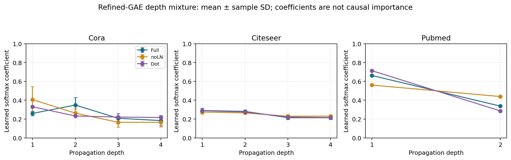

Refined-GAE的传播深度softmax系数分别按数据集与组件绘出；Cora/Citeseer为4步，PubMed为2步。这些系数描述混合方式，不是严格的因果重要性。`learned_parameters.csv`还记录NCNC的beta/JK标量；CN0注册的beta在其前向路径不使用，不能按数值大小把它解释为共同邻居贡献。LPFormer没有统一的全局注意力重要性向量，其注意力依赖具体点对；Uniform的零向量已逐权重核验，不能把注意力集中等同因果归因。

## PubMed新增训练的精确合同与原实验区别

PubMed原始Planetoid属性，19717节点、44324无向边、500维。沿用80/5/15互斥正边、各集合等量且互不重叠的固定负例。正例batch512，移除当前批次目标边；每5epoch按仅训练图上下文的干净验证AUC选点，最多100epoch、30epoch无提升停止、梯度范数裁剪1。保留作者数据集专属优化配置；不重做超参搜索，不因测试表现重抽seed。LPFormer训练PPR仍来自完整训练图，可能保留批次训练目标信息，推理PPR则按每张攻击图重新计算。

- NCNC：hidden256；GCN dropout0.1、xdropout0.3；predictor dropout0.05；lr0.0097/0.002；pt0.5、scale5.3、offset0.5、alpha0.3。
- LPFormer：hidden128、lr0.001、dropout0.3、weight decay0.0001；PPR alpha0.15、eps1e-5，候选阈值0.01。
- Refined-GAE：hidden512、2步传播、dropout0.4、lr0.001、GELU两层预测器；传播深度参数从[1,0.5]初始化，softmax后可学习。

与11月21日main补实验不同：这里使用原始属性、训练图验证、完整6649正+6649负测试候选，并加载本分支的PubMed图。旧main的标准化权重与500+500候选结果不能混入本报告。如今PubMed的EA也能评，是因为直接复用已发布H200攻击图，不需要在本机重新运行密集攻击，更没有擅自提高旧main节点上限。

**攻击边界：** 原生EA是可见图线性代理梯度迁移攻击，不等价于DeepRobust谱攻击或目标模型白盒最强攻击。实际共享的27张EA图（含PubMed新增9张）全部为插边；删边结论应依据delete/delete_hub独立条件。RF/DICE的预算为混合删插次数，不是纯删边比例。

## 训练、审计与可复算工件

全部81个模型的干净训练图验证曲线与所选epoch如下；验证图仅含训练边，不同于main补实验的验证上下文。训练曲线使用已标注的放大纵轴，主要节点条件AUROC图仍固定0–1。达到100epoch预算上限不等于已证明收敛。

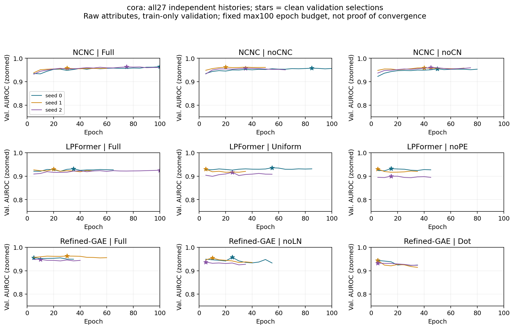

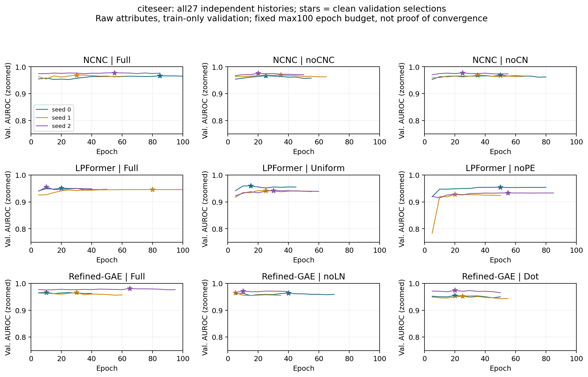

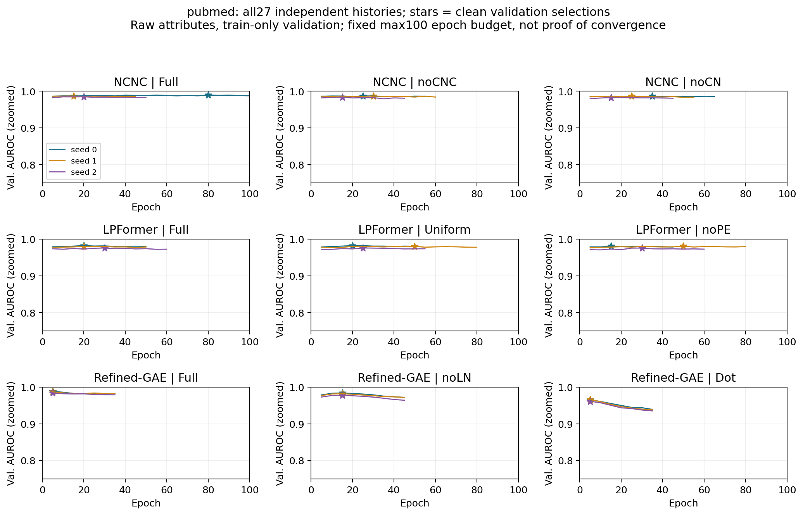

- [逐seed原生指标](per_seed.csv)、[全部14条件汇总](robustness_summary.csv)、[全局配对消融](paired_component_deltas.csv)。
- [全部k的汇总](summary.csv)、[扰动−clean](delta_summary.csv)、[关键k](key_points.csv)、[全部条件组件差](conditional_component_deltas.csv)。
- [逐seed曲线与冻结排名](per_seed_curves.zip)、[原始逐边预测与查询](predictions.zip)、[训练日志与配置](training_records.zip)、[权重清单](checkpoints.json)。
- [整体交付审计](delivery_audit.json)、[独立复算审计](replay_audit.json)、[无需GPU的复算代码](../../experiments/new_models_rank/README.md)。
- [TeX源码](report.tex)与[PDF补充报告](report.pdf)。Katz和HL-GNN的原报告及分数保持不变。

这是统一协议下的作者架构复现，不是三篇论文原表的逐项复刻；负例、评价指标和训练预算存在明确差异。只有3个既定seed；没有强显著性或泛化因果声明。所有排名和测试边子集固定，不消除随机负例在hub子集的度偏差。历史Cora/Citeseer与新PubMed的拟合时间/设备不同，跨模型还保留各自优化配方。纯缺边重训、度匹配负例和自适应白盒攻击应另设协议，不能混入本轮表。

## 全部14条件：全局完整结果

下面每行都是3seed均值±样本SD；AUC降幅为clean−perturbed，单位pp。完整1134行逐seed结果在末尾展开。
### cora / NCNC

|版本|条件|AUROC|AP|Strict Hits100|Tieavg Precision100|AUC降幅pp|
|---|---|---|---|---|---|---|
|Full|clean|0.9592 ± 0.0019|0.9578 ± 0.0013|0.9141 ± 0.0055|0.9867 ± 0.0115|0.00 ± 0.00|
|Full|rf_0.1|0.9548 ± 0.0038|0.9524 ± 0.0031|0.9082 ± 0.0077|0.9833 ± 0.0058|0.43 ± 0.19|
|Full|rf_0.25|0.9507 ± 0.0017|0.9511 ± 0.0014|0.8885 ± 0.0084|0.9867 ± 0.0153|0.85 ± 0.03|
|Full|rf_0.5|0.9361 ± 0.0056|0.9391 ± 0.0076|0.8577 ± 0.0077|0.9900 ± 0.0100|2.31 ± 0.50|
|Full|dice_0.1|0.9556 ± 0.0023|0.9541 ± 0.0013|0.9028 ± 0.0058|0.9833 ± 0.0115|0.36 ± 0.07|
|Full|dice_0.25|0.9496 ± 0.0034|0.9498 ± 0.0026|0.8876 ± 0.0141|0.9867 ± 0.0153|0.95 ± 0.16|
|Full|dice_0.5|0.9342 ± 0.0057|0.9366 ± 0.0068|0.8535 ± 0.0153|0.9933 ± 0.0058|2.50 ± 0.50|
|Full|ea_0.1|0.9552 ± 0.0006|0.9545 ± 0.0014|0.9028 ± 0.0067|0.9900 ± 0.0100|0.39 ± 0.22|
|Full|ea_0.25|0.9512 ± 0.0015|0.9509 ± 0.0032|0.8948 ± 0.0053|0.9933 ± 0.0058|0.80 ± 0.34|
|Full|ea_0.5|0.9435 ± 0.0026|0.9444 ± 0.0008|0.8801 ± 0.0143|0.9933 ± 0.0058|1.56 ± 0.36|
|Full|delete_0.5|0.9547 ± 0.0014|0.9526 ± 0.0028|0.8965 ± 0.0088|0.9867 ± 0.0058|0.44 ± 0.15|
|Full|delete_hub_0.5|0.9477 ± 0.0031|0.9479 ± 0.0047|0.8767 ± 0.0139|0.9867 ± 0.0058|1.15 ± 0.12|
|Full|insert_0.5|0.9292 ± 0.0055|0.9317 ± 0.0028|0.8338 ± 0.0096|0.9900 ± 0.0100|3.00 ± 0.36|
|Full|feature_shuffle|0.6916 ± 0.0169|0.7114 ± 0.0159|0.3981 ± 0.0179|0.8867 ± 0.0473|26.76 ± 1.65|
|noCNC|clean|0.9586 ± 0.0027|0.9604 ± 0.0034|0.9141 ± 0.0154|0.9933 ± 0.0058|0.00 ± 0.00|
|noCNC|rf_0.1|0.9540 ± 0.0034|0.9563 ± 0.0031|0.9032 ± 0.0158|0.9967 ± 0.0058|0.46 ± 0.14|
|noCNC|rf_0.25|0.9500 ± 0.0032|0.9531 ± 0.0046|0.8931 ± 0.0135|0.9933 ± 0.0058|0.85 ± 0.09|
|noCNC|rf_0.5|0.9340 ± 0.0039|0.9392 ± 0.0034|0.8485 ± 0.0051|0.9967 ± 0.0058|2.46 ± 0.60|
|noCNC|dice_0.1|0.9549 ± 0.0038|0.9562 ± 0.0049|0.9028 ± 0.0120|0.9933 ± 0.0058|0.36 ± 0.12|
|noCNC|dice_0.25|0.9495 ± 0.0038|0.9541 ± 0.0033|0.8906 ± 0.0168|1.0000 ± 0.0000|0.91 ± 0.13|
|noCNC|dice_0.5|0.9326 ± 0.0058|0.9368 ± 0.0022|0.8527 ± 0.0136|0.9867 ± 0.0058|2.60 ± 0.83|
|noCNC|ea_0.1|0.9552 ± 0.0038|0.9577 ± 0.0040|0.9082 ± 0.0158|0.9933 ± 0.0058|0.34 ± 0.20|
|noCNC|ea_0.25|0.9511 ± 0.0024|0.9543 ± 0.0030|0.8952 ± 0.0108|0.9933 ± 0.0058|0.75 ± 0.11|
|noCNC|ea_0.5|0.9442 ± 0.0031|0.9486 ± 0.0035|0.8830 ± 0.0202|0.9933 ± 0.0058|1.44 ± 0.06|
|noCNC|delete_0.5|0.9502 ± 0.0037|0.9513 ± 0.0045|0.8956 ± 0.0102|0.9933 ± 0.0058|0.83 ± 0.11|
|noCNC|delete_hub_0.5|0.9438 ± 0.0038|0.9455 ± 0.0021|0.8695 ± 0.0151|0.9967 ± 0.0058|1.47 ± 0.25|
|noCNC|insert_0.5|0.9340 ± 0.0038|0.9390 ± 0.0039|0.8493 ± 0.0081|0.9900 ± 0.0100|2.45 ± 0.13|
|noCNC|feature_shuffle|0.7499 ± 0.0270|0.8055 ± 0.0272|0.5526 ± 0.0435|0.9867 ± 0.0153|20.87 ± 2.58|
|noCN|clean|0.9579 ± 0.0025|0.9590 ± 0.0008|0.9150 ± 0.0081|0.9933 ± 0.0058|0.00 ± 0.00|
|noCN|rf_0.1|0.9532 ± 0.0043|0.9544 ± 0.0023|0.9024 ± 0.0158|0.9967 ± 0.0058|0.47 ± 0.19|
|noCN|rf_0.25|0.9503 ± 0.0019|0.9526 ± 0.0025|0.8939 ± 0.0067|0.9933 ± 0.0058|0.76 ± 0.11|
|noCN|rf_0.5|0.9365 ± 0.0052|0.9404 ± 0.0065|0.8649 ± 0.0191|0.9967 ± 0.0058|2.14 ± 0.52|
|noCN|dice_0.1|0.9547 ± 0.0041|0.9563 ± 0.0021|0.9074 ± 0.0084|0.9967 ± 0.0058|0.32 ± 0.21|
|noCN|dice_0.25|0.9507 ± 0.0029|0.9538 ± 0.0011|0.8931 ± 0.0084|0.9967 ± 0.0058|0.72 ± 0.13|
|noCN|dice_0.5|0.9341 ± 0.0053|0.9381 ± 0.0058|0.8523 ± 0.0158|0.9933 ± 0.0058|2.38 ± 0.64|
|noCN|ea_0.1|0.9541 ± 0.0019|0.9557 ± 0.0006|0.9045 ± 0.0057|0.9933 ± 0.0058|0.38 ± 0.14|
|noCN|ea_0.25|0.9495 ± 0.0008|0.9515 ± 0.0011|0.8969 ± 0.0107|0.9933 ± 0.0058|0.84 ± 0.22|
|noCN|ea_0.5|0.9402 ± 0.0031|0.9447 ± 0.0021|0.8775 ± 0.0158|0.9967 ± 0.0058|1.77 ± 0.25|
|noCN|delete_0.5|0.9510 ± 0.0035|0.9526 ± 0.0035|0.8939 ± 0.0134|0.9933 ± 0.0058|0.69 ± 0.10|
|noCN|delete_hub_0.5|0.9429 ± 0.0055|0.9456 ± 0.0045|0.8716 ± 0.0192|0.9967 ± 0.0058|1.50 ± 0.32|
|noCN|insert_0.5|0.9318 ± 0.0055|0.9356 ± 0.0033|0.8468 ± 0.0070|0.9833 ± 0.0058|2.62 ± 0.30|
|noCN|feature_shuffle|0.6706 ± 0.0135|0.6990 ± 0.0186|0.3817 ± 0.0247|0.8967 ± 0.0252|28.73 ± 1.10|

### cora / LPFormer

|版本|条件|AUROC|AP|Strict Hits100|Tieavg Precision100|AUC降幅pp|
|---|---|---|---|---|---|---|
|Full|clean|0.9361 ± 0.0008|0.9438 ± 0.0019|0.8674 ± 0.0112|0.9967 ± 0.0058|0.00 ± 0.00|
|Full|rf_0.1|0.9269 ± 0.0026|0.9355 ± 0.0022|0.8422 ± 0.0161|0.9967 ± 0.0058|0.92 ± 0.24|
|Full|rf_0.25|0.9155 ± 0.0038|0.9266 ± 0.0044|0.8085 ± 0.0201|0.9967 ± 0.0058|2.06 ± 0.31|
|Full|rf_0.5|0.8941 ± 0.0071|0.9070 ± 0.0042|0.7609 ± 0.0106|0.9967 ± 0.0058|4.21 ± 0.78|
|Full|dice_0.1|0.9289 ± 0.0029|0.9368 ± 0.0018|0.8392 ± 0.0221|0.9967 ± 0.0058|0.72 ± 0.29|
|Full|dice_0.25|0.9165 ± 0.0022|0.9272 ± 0.0010|0.8215 ± 0.0146|0.9967 ± 0.0058|1.96 ± 0.21|
|Full|dice_0.5|0.8848 ± 0.0099|0.8989 ± 0.0068|0.7370 ± 0.0191|0.9967 ± 0.0058|5.13 ± 1.05|
|Full|ea_0.1|0.9306 ± 0.0034|0.9396 ± 0.0035|0.8586 ± 0.0109|0.9967 ± 0.0058|0.55 ± 0.28|
|Full|ea_0.25|0.9244 ± 0.0044|0.9348 ± 0.0046|0.8418 ± 0.0026|0.9967 ± 0.0058|1.17 ± 0.42|
|Full|ea_0.5|0.9158 ± 0.0017|0.9264 ± 0.0006|0.8253 ± 0.0136|0.9867 ± 0.0115|2.03 ± 0.09|
|Full|delete_0.5|0.8967 ± 0.0023|0.9024 ± 0.0060|0.7723 ± 0.0158|0.9900 ± 0.0000|3.94 ± 0.25|
|Full|delete_hub_0.5|0.8870 ± 0.0012|0.8969 ± 0.0040|0.7471 ± 0.0039|0.9967 ± 0.0058|4.91 ± 0.20|
|Full|insert_0.5|0.8982 ± 0.0025|0.9120 ± 0.0030|0.7736 ± 0.0162|0.9967 ± 0.0058|3.79 ± 0.19|
|Full|feature_shuffle|0.8263 ± 0.0058|0.8669 ± 0.0039|0.6932 ± 0.0203|0.9933 ± 0.0058|10.98 ± 0.51|
|Uniform|clean|0.9330 ± 0.0067|0.9414 ± 0.0068|0.8418 ± 0.0172|0.9967 ± 0.0058|0.00 ± 0.00|
|Uniform|rf_0.1|0.9237 ± 0.0057|0.9334 ± 0.0067|0.8253 ± 0.0184|0.9967 ± 0.0058|0.92 ± 0.23|
|Uniform|rf_0.25|0.9130 ± 0.0124|0.9230 ± 0.0112|0.8001 ± 0.0278|0.9967 ± 0.0058|1.99 ± 0.59|
|Uniform|rf_0.5|0.8882 ± 0.0075|0.9015 ± 0.0092|0.7311 ± 0.0272|1.0000 ± 0.0000|4.48 ± 0.40|
|Uniform|dice_0.1|0.9254 ± 0.0048|0.9347 ± 0.0060|0.8182 ± 0.0186|0.9967 ± 0.0058|0.76 ± 0.20|
|Uniform|dice_0.25|0.9127 ± 0.0091|0.9223 ± 0.0077|0.7950 ± 0.0109|0.9967 ± 0.0058|2.03 ± 0.24|
|Uniform|dice_0.5|0.8812 ± 0.0074|0.8947 ± 0.0078|0.7243 ± 0.0084|1.0000 ± 0.0000|5.17 ± 0.73|
|Uniform|ea_0.1|0.9282 ± 0.0069|0.9381 ± 0.0073|0.8342 ± 0.0168|0.9967 ± 0.0058|0.47 ± 0.03|
|Uniform|ea_0.25|0.9217 ± 0.0061|0.9323 ± 0.0074|0.8178 ± 0.0251|0.9967 ± 0.0058|1.13 ± 0.07|
|Uniform|ea_0.5|0.9132 ± 0.0053|0.9249 ± 0.0058|0.7980 ± 0.0211|0.9933 ± 0.0058|1.98 ± 0.17|
|Uniform|delete_0.5|0.8929 ± 0.0083|0.8999 ± 0.0117|0.7496 ± 0.0181|0.9933 ± 0.0058|4.01 ± 0.17|
|Uniform|delete_hub_0.5|0.8812 ± 0.0139|0.8921 ± 0.0098|0.7142 ± 0.0265|0.9967 ± 0.0058|5.17 ± 0.96|
|Uniform|insert_0.5|0.8983 ± 0.0065|0.9105 ± 0.0066|0.7521 ± 0.0247|1.0000 ± 0.0000|3.46 ± 0.22|
|Uniform|feature_shuffle|0.8207 ± 0.0114|0.8665 ± 0.0119|0.6776 ± 0.0401|1.0000 ± 0.0000|11.22 ± 0.99|
|noPE|clean|0.9263 ± 0.0117|0.9371 ± 0.0107|0.8396 ± 0.0329|0.9967 ± 0.0058|0.00 ± 0.00|
|noPE|rf_0.1|0.9175 ± 0.0127|0.9285 ± 0.0111|0.8148 ± 0.0344|0.9967 ± 0.0058|0.88 ± 0.25|
|noPE|rf_0.25|0.9031 ± 0.0133|0.9166 ± 0.0107|0.7854 ± 0.0504|0.9967 ± 0.0058|2.32 ± 0.17|
|noPE|rf_0.5|0.8774 ± 0.0047|0.8940 ± 0.0056|0.7159 ± 0.0207|0.9967 ± 0.0058|4.89 ± 0.70|
|noPE|dice_0.1|0.9171 ± 0.0120|0.9284 ± 0.0105|0.8253 ± 0.0399|0.9967 ± 0.0058|0.92 ± 0.45|
|noPE|dice_0.25|0.9021 ± 0.0125|0.9167 ± 0.0101|0.7883 ± 0.0360|0.9967 ± 0.0058|2.42 ± 0.23|
|noPE|dice_0.5|0.8681 ± 0.0033|0.8853 ± 0.0030|0.6982 ± 0.0110|0.9967 ± 0.0058|5.82 ± 1.06|
|noPE|ea_0.1|0.9223 ± 0.0125|0.9338 ± 0.0110|0.8300 ± 0.0310|0.9967 ± 0.0058|0.40 ± 0.12|
|noPE|ea_0.25|0.9158 ± 0.0089|0.9290 ± 0.0080|0.8178 ± 0.0204|0.9967 ± 0.0058|1.05 ± 0.28|
|noPE|ea_0.5|0.9079 ± 0.0100|0.9233 ± 0.0073|0.8030 ± 0.0191|0.9933 ± 0.0115|1.84 ± 0.74|
|noPE|delete_0.5|0.8778 ± 0.0119|0.8893 ± 0.0128|0.7180 ± 0.0640|0.9933 ± 0.0058|4.85 ± 0.47|
|noPE|delete_hub_0.5|0.8701 ± 0.0179|0.8816 ± 0.0162|0.6902 ± 0.0575|0.9967 ± 0.0058|5.62 ± 1.15|
|noPE|insert_0.5|0.8894 ± 0.0139|0.9057 ± 0.0101|0.7567 ± 0.0236|0.9967 ± 0.0058|3.69 ± 0.22|
|noPE|feature_shuffle|0.8297 ± 0.0053|0.8743 ± 0.0049|0.7054 ± 0.0168|0.9967 ± 0.0058|9.66 ± 0.64|

### cora / Refined-GAE

|版本|条件|AUROC|AP|Strict Hits100|Tieavg Precision100|AUC降幅pp|
|---|---|---|---|---|---|---|
|Full|clean|0.9616 ± 0.0035|0.9597 ± 0.0041|0.9116 ± 0.0110|0.9867 ± 0.0153|0.00 ± 0.00|
|Full|rf_0.1|0.9538 ± 0.0047|0.9523 ± 0.0020|0.8973 ± 0.0158|0.9867 ± 0.0153|0.78 ± 0.21|
|Full|rf_0.25|0.9482 ± 0.0047|0.9484 ± 0.0036|0.8859 ± 0.0172|0.9933 ± 0.0058|1.34 ± 0.12|
|Full|rf_0.5|0.9230 ± 0.0040|0.9272 ± 0.0070|0.8291 ± 0.0170|0.9867 ± 0.0153|3.86 ± 0.75|
|Full|dice_0.1|0.9554 ± 0.0038|0.9541 ± 0.0014|0.9024 ± 0.0159|0.9933 ± 0.0058|0.62 ± 0.18|
|Full|dice_0.25|0.9452 ± 0.0028|0.9466 ± 0.0025|0.8826 ± 0.0141|0.9900 ± 0.0100|1.64 ± 0.24|
|Full|dice_0.5|0.9185 ± 0.0060|0.9225 ± 0.0063|0.8220 ± 0.0087|0.9900 ± 0.0100|4.31 ± 0.95|
|Full|ea_0.1|0.9580 ± 0.0042|0.9568 ± 0.0043|0.9028 ± 0.0165|0.9867 ± 0.0153|0.36 ± 0.07|
|Full|ea_0.25|0.9533 ± 0.0021|0.9526 ± 0.0048|0.8931 ± 0.0076|0.9900 ± 0.0100|0.83 ± 0.19|
|Full|ea_0.5|0.9452 ± 0.0014|0.9460 ± 0.0042|0.8763 ± 0.0055|0.9900 ± 0.0100|1.64 ± 0.23|
|Full|delete_0.5|0.9480 ± 0.0042|0.9498 ± 0.0007|0.8838 ± 0.0122|0.9900 ± 0.0000|1.36 ± 0.09|
|Full|delete_hub_0.5|0.9443 ± 0.0025|0.9480 ± 0.0030|0.8708 ± 0.0091|0.9967 ± 0.0058|1.73 ± 0.13|
|Full|insert_0.5|0.9070 ± 0.0158|0.9097 ± 0.0166|0.7980 ± 0.0364|0.9767 ± 0.0115|5.46 ± 1.92|
|Full|feature_shuffle|0.7652 ± 0.0164|0.7863 ± 0.0103|0.5404 ± 0.0275|0.9267 ± 0.0153|19.64 ± 1.99|
|noLN|clean|0.9520 ± 0.0030|0.9580 ± 0.0033|0.8960 ± 0.0121|0.9967 ± 0.0058|0.00 ± 0.00|
|noLN|rf_0.1|0.9444 ± 0.0023|0.9511 ± 0.0029|0.8758 ± 0.0158|0.9967 ± 0.0058|0.75 ± 0.29|
|noLN|rf_0.25|0.9382 ± 0.0036|0.9453 ± 0.0038|0.8704 ± 0.0123|1.0000 ± 0.0000|1.38 ± 0.06|
|noLN|rf_0.5|0.9200 ± 0.0047|0.9287 ± 0.0050|0.8161 ± 0.0141|1.0000 ± 0.0000|3.19 ± 0.20|
|noLN|dice_0.1|0.9456 ± 0.0015|0.9523 ± 0.0022|0.8868 ± 0.0109|0.9967 ± 0.0058|0.64 ± 0.30|
|noLN|dice_0.25|0.9383 ± 0.0038|0.9460 ± 0.0036|0.8788 ± 0.0224|0.9967 ± 0.0058|1.37 ± 0.18|
|noLN|dice_0.5|0.9158 ± 0.0055|0.9246 ± 0.0052|0.8211 ± 0.0190|0.9967 ± 0.0058|3.62 ± 0.27|
|noLN|ea_0.1|0.9483 ± 0.0015|0.9550 ± 0.0024|0.8897 ± 0.0084|0.9967 ± 0.0058|0.37 ± 0.15|
|noLN|ea_0.25|0.9431 ± 0.0031|0.9505 ± 0.0035|0.8809 ± 0.0064|0.9967 ± 0.0058|0.89 ± 0.12|
|noLN|ea_0.5|0.9347 ± 0.0031|0.9429 ± 0.0030|0.8624 ± 0.0066|0.9967 ± 0.0058|1.72 ± 0.13|
|noLN|delete_0.5|0.9356 ± 0.0023|0.9422 ± 0.0045|0.8594 ± 0.0084|0.9933 ± 0.0115|1.64 ± 0.17|
|noLN|delete_hub_0.5|0.9304 ± 0.0086|0.9375 ± 0.0086|0.8430 ± 0.0146|0.9967 ± 0.0058|2.15 ± 0.60|
|noLN|insert_0.5|0.9197 ± 0.0029|0.9288 ± 0.0008|0.8241 ± 0.0053|0.9967 ± 0.0058|3.23 ± 0.42|
|noLN|feature_shuffle|0.6830 ± 0.0609|0.7066 ± 0.0369|0.4158 ± 0.0530|0.8633 ± 0.0231|26.90 ± 6.21|
|Dot|clean|0.9459 ± 0.0015|0.9559 ± 0.0021|0.8906 ± 0.0007|1.0000 ± 0.0000|0.00 ± 0.00|
|Dot|rf_0.1|0.9387 ± 0.0015|0.9500 ± 0.0017|0.8758 ± 0.0032|1.0000 ± 0.0000|0.71 ± 0.13|
|Dot|rf_0.25|0.9319 ± 0.0024|0.9435 ± 0.0029|0.8506 ± 0.0135|1.0000 ± 0.0000|1.39 ± 0.20|
|Dot|rf_0.5|0.9092 ± 0.0113|0.9262 ± 0.0090|0.8093 ± 0.0091|0.9967 ± 0.0058|3.67 ± 0.98|
|Dot|dice_0.1|0.9387 ± 0.0014|0.9498 ± 0.0010|0.8746 ± 0.0048|1.0000 ± 0.0000|0.72 ± 0.17|
|Dot|dice_0.25|0.9298 ± 0.0014|0.9432 ± 0.0025|0.8430 ± 0.0098|1.0000 ± 0.0000|1.60 ± 0.10|
|Dot|dice_0.5|0.9051 ± 0.0073|0.9234 ± 0.0045|0.8043 ± 0.0076|1.0000 ± 0.0000|4.08 ± 0.57|
|Dot|ea_0.1|0.9445 ± 0.0007|0.9544 ± 0.0019|0.8851 ± 0.0033|1.0000 ± 0.0000|0.14 ± 0.12|
|Dot|ea_0.25|0.9421 ± 0.0014|0.9522 ± 0.0027|0.8771 ± 0.0072|1.0000 ± 0.0000|0.37 ± 0.09|
|Dot|ea_0.5|0.9368 ± 0.0014|0.9474 ± 0.0015|0.8666 ± 0.0057|1.0000 ± 0.0000|0.91 ± 0.17|
|Dot|delete_0.5|0.9134 ± 0.0043|0.9306 ± 0.0030|0.8220 ± 0.0088|1.0000 ± 0.0000|3.24 ± 0.51|
|Dot|delete_hub_0.5|0.8947 ± 0.0022|0.9172 ± 0.0035|0.7748 ± 0.0090|1.0000 ± 0.0000|5.11 ± 0.13|
|Dot|insert_0.5|0.9130 ± 0.0025|0.9292 ± 0.0024|0.8110 ± 0.0127|0.9967 ± 0.0058|3.28 ± 0.19|
|Dot|feature_shuffle|0.7969 ± 0.0162|0.8501 ± 0.0125|0.6435 ± 0.0293|0.9967 ± 0.0058|14.89 ± 1.55|

### citeseer / NCNC

|版本|条件|AUROC|AP|Strict Hits100|Tieavg Precision100|AUC降幅pp|
|---|---|---|---|---|---|---|
|Full|clean|0.9683 ± 0.0067|0.9697 ± 0.0050|0.9449 ± 0.0176|1.0000 ± 0.0000|0.00 ± 0.00|
|Full|rf_0.1|0.9640 ± 0.0057|0.9658 ± 0.0044|0.9385 ± 0.0089|1.0000 ± 0.0000|0.42 ± 0.12|
|Full|rf_0.25|0.9602 ± 0.0079|0.9618 ± 0.0063|0.9258 ± 0.0133|0.9967 ± 0.0058|0.80 ± 0.12|
|Full|rf_0.5|0.9497 ± 0.0029|0.9528 ± 0.0022|0.8956 ± 0.0108|0.9967 ± 0.0058|1.86 ± 0.39|
|Full|dice_0.1|0.9641 ± 0.0058|0.9661 ± 0.0043|0.9336 ± 0.0157|1.0000 ± 0.0000|0.41 ± 0.09|
|Full|dice_0.25|0.9598 ± 0.0072|0.9616 ± 0.0054|0.9258 ± 0.0131|0.9933 ± 0.0058|0.85 ± 0.06|
|Full|dice_0.5|0.9449 ± 0.0017|0.9492 ± 0.0022|0.8897 ± 0.0136|0.9967 ± 0.0058|2.33 ± 0.54|
|Full|ea_0.1|0.9638 ± 0.0065|0.9658 ± 0.0047|0.9380 ± 0.0171|1.0000 ± 0.0000|0.44 ± 0.04|
|Full|ea_0.25|0.9591 ± 0.0057|0.9611 ± 0.0041|0.9336 ± 0.0103|0.9967 ± 0.0058|0.91 ± 0.11|
|Full|ea_0.5|0.9500 ± 0.0062|0.9528 ± 0.0052|0.9161 ± 0.0142|0.9933 ± 0.0058|1.82 ± 0.21|
|Full|delete_0.5|0.9640 ± 0.0060|0.9648 ± 0.0048|0.9390 ± 0.0141|0.9933 ± 0.0058|0.43 ± 0.07|
|Full|delete_hub_0.5|0.9627 ± 0.0077|0.9635 ± 0.0050|0.9312 ± 0.0173|0.9933 ± 0.0058|0.55 ± 0.36|
|Full|insert_0.5|0.9362 ± 0.0048|0.9429 ± 0.0043|0.8736 ± 0.0051|0.9933 ± 0.0058|3.20 ± 0.78|
|Full|feature_shuffle|0.6369 ± 0.0374|0.6488 ± 0.0415|0.3509 ± 0.0657|0.7933 ± 0.0651|33.14 ± 4.21|
|noCNC|clean|0.9683 ± 0.0053|0.9701 ± 0.0047|0.9419 ± 0.0185|1.0000 ± 0.0000|0.00 ± 0.00|
|noCNC|rf_0.1|0.9644 ± 0.0054|0.9667 ± 0.0047|0.9302 ± 0.0170|1.0000 ± 0.0000|0.39 ± 0.05|
|noCNC|rf_0.25|0.9613 ± 0.0058|0.9635 ± 0.0052|0.9214 ± 0.0191|0.9967 ± 0.0058|0.70 ± 0.05|
|noCNC|rf_0.5|0.9504 ± 0.0071|0.9549 ± 0.0057|0.9009 ± 0.0219|1.0000 ± 0.0000|1.79 ± 0.68|
|noCNC|dice_0.1|0.9645 ± 0.0052|0.9668 ± 0.0044|0.9327 ± 0.0216|1.0000 ± 0.0000|0.38 ± 0.07|
|noCNC|dice_0.25|0.9601 ± 0.0053|0.9620 ± 0.0046|0.9214 ± 0.0229|0.9933 ± 0.0058|0.82 ± 0.18|
|noCNC|dice_0.5|0.9469 ± 0.0062|0.9514 ± 0.0045|0.8912 ± 0.0222|0.9933 ± 0.0058|2.14 ± 0.66|
|noCNC|ea_0.1|0.9645 ± 0.0065|0.9674 ± 0.0053|0.9351 ± 0.0202|1.0000 ± 0.0000|0.38 ± 0.14|
|noCNC|ea_0.25|0.9594 ± 0.0058|0.9633 ± 0.0053|0.9229 ± 0.0147|1.0000 ± 0.0000|0.89 ± 0.10|
|noCNC|ea_0.5|0.9508 ± 0.0079|0.9566 ± 0.0077|0.9068 ± 0.0200|1.0000 ± 0.0000|1.75 ± 0.34|
|noCNC|delete_0.5|0.9646 ± 0.0047|0.9653 ± 0.0050|0.9336 ± 0.0205|0.9900 ± 0.0100|0.37 ± 0.09|
|noCNC|delete_hub_0.5|0.9635 ± 0.0070|0.9660 ± 0.0045|0.9351 ± 0.0216|0.9967 ± 0.0058|0.48 ± 0.26|
|noCNC|insert_0.5|0.9400 ± 0.0026|0.9477 ± 0.0004|0.8731 ± 0.0133|1.0000 ± 0.0000|2.84 ± 0.62|
|noCNC|feature_shuffle|0.6675 ± 0.0085|0.7201 ± 0.0036|0.4456 ± 0.0474|0.9000 ± 0.0889|30.08 ± 1.35|
|noCN|clean|0.9663 ± 0.0057|0.9687 ± 0.0036|0.9322 ± 0.0142|0.9967 ± 0.0058|0.00 ± 0.00|
|noCN|rf_0.1|0.9625 ± 0.0048|0.9652 ± 0.0028|0.9268 ± 0.0088|0.9967 ± 0.0058|0.38 ± 0.15|
|noCN|rf_0.25|0.9592 ± 0.0070|0.9609 ± 0.0040|0.9161 ± 0.0249|0.9967 ± 0.0058|0.71 ± 0.14|
|noCN|rf_0.5|0.9474 ± 0.0053|0.9519 ± 0.0020|0.8931 ± 0.0173|0.9967 ± 0.0058|1.89 ± 0.65|
|noCN|dice_0.1|0.9629 ± 0.0047|0.9656 ± 0.0027|0.9204 ± 0.0171|0.9967 ± 0.0058|0.34 ± 0.13|
|noCN|dice_0.25|0.9588 ± 0.0065|0.9612 ± 0.0041|0.9141 ± 0.0176|0.9967 ± 0.0058|0.75 ± 0.17|
|noCN|dice_0.5|0.9430 ± 0.0040|0.9502 ± 0.0038|0.8814 ± 0.0153|1.0000 ± 0.0000|2.33 ± 0.65|
|noCN|ea_0.1|0.9622 ± 0.0067|0.9652 ± 0.0044|0.9263 ± 0.0138|0.9967 ± 0.0058|0.41 ± 0.10|
|noCN|ea_0.25|0.9568 ± 0.0064|0.9603 ± 0.0043|0.9175 ± 0.0108|0.9967 ± 0.0058|0.95 ± 0.12|
|noCN|ea_0.5|0.9478 ± 0.0073|0.9519 ± 0.0061|0.8980 ± 0.0148|0.9967 ± 0.0058|1.85 ± 0.30|
|noCN|delete_0.5|0.9638 ± 0.0037|0.9655 ± 0.0022|0.9341 ± 0.0116|0.9967 ± 0.0058|0.25 ± 0.20|
|noCN|delete_hub_0.5|0.9617 ± 0.0078|0.9636 ± 0.0039|0.9253 ± 0.0154|0.9967 ± 0.0058|0.46 ± 0.30|
|noCN|insert_0.5|0.9351 ± 0.0020|0.9439 ± 0.0010|0.8658 ± 0.0170|1.0000 ± 0.0000|3.12 ± 0.76|
|noCN|feature_shuffle|0.6174 ± 0.0059|0.6342 ± 0.0144|0.3075 ± 0.0417|0.7867 ± 0.0379|34.89 ± 1.04|

### citeseer / LPFormer

|版本|条件|AUROC|AP|Strict Hits100|Tieavg Precision100|AUC降幅pp|
|---|---|---|---|---|---|---|
|Full|clean|0.9435 ± 0.0055|0.9488 ± 0.0044|0.8887 ± 0.0082|0.9900 ± 0.0000|0.00 ± 0.00|
|Full|rf_0.1|0.9392 ± 0.0060|0.9446 ± 0.0048|0.8790 ± 0.0128|0.9900 ± 0.0000|0.43 ± 0.33|
|Full|rf_0.25|0.9352 ± 0.0065|0.9396 ± 0.0061|0.8726 ± 0.0039|0.9833 ± 0.0058|0.83 ± 0.14|
|Full|rf_0.5|0.9235 ± 0.0080|0.9301 ± 0.0062|0.8516 ± 0.0097|0.9833 ± 0.0058|2.00 ± 0.71|
|Full|dice_0.1|0.9394 ± 0.0051|0.9450 ± 0.0040|0.8760 ± 0.0111|0.9867 ± 0.0058|0.40 ± 0.17|
|Full|dice_0.25|0.9341 ± 0.0056|0.9405 ± 0.0043|0.8609 ± 0.0076|0.9900 ± 0.0100|0.94 ± 0.09|
|Full|dice_0.5|0.9198 ± 0.0091|0.9276 ± 0.0072|0.8389 ± 0.0163|0.9933 ± 0.0058|2.37 ± 0.92|
|Full|ea_0.1|0.9408 ± 0.0064|0.9472 ± 0.0058|0.8834 ± 0.0086|0.9867 ± 0.0058|0.26 ± 0.14|
|Full|ea_0.25|0.9384 ± 0.0056|0.9449 ± 0.0051|0.8780 ± 0.0059|0.9833 ± 0.0058|0.51 ± 0.24|
|Full|ea_0.5|0.9317 ± 0.0068|0.9401 ± 0.0051|0.8668 ± 0.0140|0.9833 ± 0.0058|1.18 ± 0.47|
|Full|delete_0.5|0.9320 ± 0.0071|0.9374 ± 0.0078|0.8594 ± 0.0240|1.0000 ± 0.0000|1.15 ± 0.44|
|Full|delete_hub_0.5|0.9193 ± 0.0152|0.9272 ± 0.0140|0.8414 ± 0.0351|0.9933 ± 0.0115|2.42 ± 0.97|
|Full|insert_0.5|0.9217 ± 0.0030|0.9306 ± 0.0006|0.8375 ± 0.0088|0.9900 ± 0.0000|2.18 ± 0.81|
|Full|feature_shuffle|0.7434 ± 0.0039|0.8218 ± 0.0027|0.6066 ± 0.0232|0.9933 ± 0.0115|20.01 ± 0.61|
|Uniform|clean|0.9409 ± 0.0084|0.9479 ± 0.0068|0.8746 ± 0.0246|0.9967 ± 0.0058|0.00 ± 0.00|
|Uniform|rf_0.1|0.9378 ± 0.0086|0.9446 ± 0.0066|0.8702 ± 0.0220|0.9933 ± 0.0058|0.31 ± 0.02|
|Uniform|rf_0.25|0.9333 ± 0.0121|0.9399 ± 0.0096|0.8604 ± 0.0297|0.9900 ± 0.0000|0.76 ± 0.47|
|Uniform|rf_0.5|0.9184 ± 0.0134|0.9278 ± 0.0120|0.8243 ± 0.0278|0.9933 ± 0.0058|2.24 ± 0.63|
|Uniform|dice_0.1|0.9378 ± 0.0084|0.9451 ± 0.0071|0.8702 ± 0.0251|0.9967 ± 0.0058|0.31 ± 0.13|
|Uniform|dice_0.25|0.9312 ± 0.0087|0.9395 ± 0.0061|0.8546 ± 0.0213|0.9933 ± 0.0058|0.97 ± 0.20|
|Uniform|dice_0.5|0.9134 ± 0.0100|0.9241 ± 0.0093|0.8121 ± 0.0266|0.9967 ± 0.0058|2.74 ± 0.19|
|Uniform|ea_0.1|0.9376 ± 0.0097|0.9454 ± 0.0082|0.8726 ± 0.0259|0.9967 ± 0.0058|0.33 ± 0.21|
|Uniform|ea_0.25|0.9348 ± 0.0101|0.9427 ± 0.0089|0.8658 ± 0.0199|0.9867 ± 0.0058|0.61 ± 0.33|
|Uniform|ea_0.5|0.9284 ± 0.0100|0.9373 ± 0.0095|0.8511 ± 0.0309|0.9833 ± 0.0115|1.25 ± 0.39|
|Uniform|delete_0.5|0.9305 ± 0.0099|0.9381 ± 0.0087|0.8599 ± 0.0237|1.0000 ± 0.0000|1.04 ± 0.62|
|Uniform|delete_hub_0.5|0.9134 ± 0.0174|0.9266 ± 0.0131|0.8331 ± 0.0349|0.9967 ± 0.0058|2.75 ± 0.92|
|Uniform|insert_0.5|0.9151 ± 0.0041|0.9282 ± 0.0029|0.8253 ± 0.0186|0.9933 ± 0.0058|2.57 ± 0.51|
|Uniform|feature_shuffle|0.7476 ± 0.0219|0.8198 ± 0.0141|0.6027 ± 0.0220|0.9900 ± 0.0000|19.33 ± 2.88|
|noPE|clean|0.9378 ± 0.0091|0.9448 ± 0.0072|0.8721 ± 0.0158|0.9900 ± 0.0000|0.00 ± 0.00|
|noPE|rf_0.1|0.9334 ± 0.0071|0.9402 ± 0.0050|0.8629 ± 0.0142|0.9900 ± 0.0000|0.44 ± 0.25|
|noPE|rf_0.25|0.9283 ± 0.0089|0.9342 ± 0.0069|0.8526 ± 0.0291|0.9900 ± 0.0000|0.95 ± 0.14|
|noPE|rf_0.5|0.9111 ± 0.0050|0.9211 ± 0.0020|0.8102 ± 0.0327|0.9933 ± 0.0115|2.67 ± 0.43|
|noPE|dice_0.1|0.9340 ± 0.0071|0.9411 ± 0.0060|0.8629 ± 0.0163|0.9900 ± 0.0000|0.38 ± 0.21|
|noPE|dice_0.25|0.9275 ± 0.0083|0.9348 ± 0.0060|0.8458 ± 0.0197|0.9933 ± 0.0058|1.03 ± 0.08|
|noPE|dice_0.5|0.9091 ± 0.0024|0.9182 ± 0.0022|0.8082 ± 0.0144|0.9933 ± 0.0058|2.87 ± 0.69|
|noPE|ea_0.1|0.9361 ± 0.0080|0.9439 ± 0.0061|0.8687 ± 0.0150|0.9900 ± 0.0000|0.17 ± 0.22|
|noPE|ea_0.25|0.9340 ± 0.0074|0.9419 ± 0.0050|0.8658 ± 0.0157|0.9900 ± 0.0000|0.38 ± 0.32|
|noPE|ea_0.5|0.9266 ± 0.0075|0.9365 ± 0.0057|0.8516 ± 0.0155|0.9900 ± 0.0000|1.12 ± 0.44|
|noPE|delete_0.5|0.9236 ± 0.0079|0.9287 ± 0.0061|0.8453 ± 0.0138|1.0000 ± 0.0000|1.42 ± 0.18|
|noPE|delete_hub_0.5|0.9118 ± 0.0118|0.9190 ± 0.0101|0.8287 ± 0.0198|1.0000 ± 0.0000|2.60 ± 0.69|
|noPE|insert_0.5|0.9099 ± 0.0077|0.9230 ± 0.0066|0.8072 ± 0.0167|0.9933 ± 0.0058|2.79 ± 0.64|
|noPE|feature_shuffle|0.7497 ± 0.0162|0.8254 ± 0.0125|0.6081 ± 0.0330|0.9967 ± 0.0058|18.81 ± 2.52|

### citeseer / Refined-GAE

|版本|条件|AUROC|AP|Strict Hits100|Tieavg Precision100|AUC降幅pp|
|---|---|---|---|---|---|---|
|Full|clean|0.9651 ± 0.0073|0.9663 ± 0.0066|0.9356 ± 0.0183|0.9967 ± 0.0058|0.00 ± 0.00|
|Full|rf_0.1|0.9596 ± 0.0069|0.9617 ± 0.0063|0.9204 ± 0.0147|0.9967 ± 0.0058|0.55 ± 0.04|
|Full|rf_0.25|0.9558 ± 0.0087|0.9588 ± 0.0067|0.9146 ± 0.0110|0.9933 ± 0.0058|0.93 ± 0.14|
|Full|rf_0.5|0.9416 ± 0.0037|0.9453 ± 0.0036|0.8878 ± 0.0132|0.9933 ± 0.0058|2.35 ± 0.46|
|Full|dice_0.1|0.9602 ± 0.0060|0.9626 ± 0.0058|0.9224 ± 0.0128|0.9967 ± 0.0058|0.49 ± 0.19|
|Full|dice_0.25|0.9556 ± 0.0096|0.9577 ± 0.0077|0.9136 ± 0.0140|0.9933 ± 0.0058|0.95 ± 0.24|
|Full|dice_0.5|0.9365 ± 0.0048|0.9431 ± 0.0070|0.8824 ± 0.0161|0.9933 ± 0.0058|2.86 ± 0.33|
|Full|ea_0.1|0.9628 ± 0.0078|0.9643 ± 0.0066|0.9317 ± 0.0168|0.9967 ± 0.0058|0.24 ± 0.05|
|Full|ea_0.25|0.9600 ± 0.0074|0.9618 ± 0.0068|0.9273 ± 0.0147|0.9967 ± 0.0058|0.51 ± 0.03|
|Full|ea_0.5|0.9533 ± 0.0105|0.9564 ± 0.0094|0.9165 ± 0.0183|0.9967 ± 0.0058|1.18 ± 0.32|
|Full|delete_0.5|0.9590 ± 0.0060|0.9619 ± 0.0050|0.9214 ± 0.0081|1.0000 ± 0.0000|0.61 ± 0.20|
|Full|delete_hub_0.5|0.9575 ± 0.0080|0.9613 ± 0.0069|0.9258 ± 0.0173|1.0000 ± 0.0000|0.76 ± 0.07|
|Full|insert_0.5|0.9327 ± 0.0067|0.9392 ± 0.0057|0.8736 ± 0.0147|0.9900 ± 0.0000|3.24 ± 1.02|
|Full|feature_shuffle|0.6980 ± 0.0072|0.7223 ± 0.0101|0.4021 ± 0.0308|0.9433 ± 0.0115|26.71 ± 1.45|
|noLN|clean|0.9639 ± 0.0067|0.9669 ± 0.0066|0.9322 ± 0.0138|0.9933 ± 0.0058|0.00 ± 0.00|
|noLN|rf_0.1|0.9569 ± 0.0074|0.9614 ± 0.0071|0.9161 ± 0.0185|0.9933 ± 0.0058|0.70 ± 0.20|
|noLN|rf_0.25|0.9513 ± 0.0098|0.9560 ± 0.0094|0.9039 ± 0.0197|0.9967 ± 0.0058|1.26 ± 0.36|
|noLN|rf_0.5|0.9376 ± 0.0034|0.9446 ± 0.0046|0.8755 ± 0.0197|0.9967 ± 0.0058|2.63 ± 0.46|
|noLN|dice_0.1|0.9583 ± 0.0065|0.9623 ± 0.0066|0.9219 ± 0.0161|0.9933 ± 0.0058|0.56 ± 0.13|
|noLN|dice_0.25|0.9502 ± 0.0087|0.9550 ± 0.0093|0.9000 ± 0.0175|0.9933 ± 0.0058|1.37 ± 0.27|
|noLN|dice_0.5|0.9318 ± 0.0029|0.9401 ± 0.0041|0.8668 ± 0.0140|0.9933 ± 0.0058|3.21 ± 0.78|
|noLN|ea_0.1|0.9603 ± 0.0068|0.9643 ± 0.0065|0.9297 ± 0.0163|0.9933 ± 0.0058|0.36 ± 0.13|
|noLN|ea_0.25|0.9555 ± 0.0056|0.9603 ± 0.0064|0.9239 ± 0.0158|0.9933 ± 0.0058|0.84 ± 0.22|
|noLN|ea_0.5|0.9482 ± 0.0071|0.9542 ± 0.0086|0.9107 ± 0.0198|1.0000 ± 0.0000|1.57 ± 0.43|
|noLN|delete_0.5|0.9598 ± 0.0036|0.9622 ± 0.0042|0.9253 ± 0.0073|1.0000 ± 0.0000|0.41 ± 0.31|
|noLN|delete_hub_0.5|0.9571 ± 0.0025|0.9594 ± 0.0017|0.9200 ± 0.0008|0.9967 ± 0.0058|0.68 ± 0.48|
|noLN|insert_0.5|0.9258 ± 0.0069|0.9355 ± 0.0071|0.8492 ± 0.0183|0.9933 ± 0.0115|3.81 ± 0.16|
|noLN|feature_shuffle|0.5433 ± 0.0127|0.6121 ± 0.0060|0.3080 ± 0.0142|0.8333 ± 0.0115|42.05 ± 0.86|
|Dot|clean|0.9613 ± 0.0054|0.9685 ± 0.0047|0.9224 ± 0.0144|1.0000 ± 0.0000|0.00 ± 0.00|
|Dot|rf_0.1|0.9570 ± 0.0055|0.9651 ± 0.0044|0.9126 ± 0.0112|1.0000 ± 0.0000|0.44 ± 0.06|
|Dot|rf_0.25|0.9526 ± 0.0041|0.9618 ± 0.0036|0.9107 ± 0.0096|1.0000 ± 0.0000|0.87 ± 0.16|
|Dot|rf_0.5|0.9380 ± 0.0058|0.9496 ± 0.0041|0.8712 ± 0.0130|1.0000 ± 0.0000|2.33 ± 0.21|
|Dot|dice_0.1|0.9565 ± 0.0040|0.9648 ± 0.0037|0.9151 ± 0.0102|1.0000 ± 0.0000|0.48 ± 0.23|
|Dot|dice_0.25|0.9515 ± 0.0052|0.9603 ± 0.0049|0.9048 ± 0.0125|1.0000 ± 0.0000|0.99 ± 0.02|
|Dot|dice_0.5|0.9344 ± 0.0070|0.9475 ± 0.0057|0.8668 ± 0.0191|1.0000 ± 0.0000|2.69 ± 0.51|
|Dot|ea_0.1|0.9593 ± 0.0067|0.9670 ± 0.0057|0.9214 ± 0.0165|1.0000 ± 0.0000|0.20 ± 0.13|
|Dot|ea_0.25|0.9572 ± 0.0073|0.9651 ± 0.0060|0.9200 ± 0.0141|1.0000 ± 0.0000|0.41 ± 0.21|
|Dot|ea_0.5|0.9518 ± 0.0075|0.9604 ± 0.0066|0.9068 ± 0.0205|1.0000 ± 0.0000|0.95 ± 0.27|
|Dot|delete_0.5|0.9486 ± 0.0064|0.9584 ± 0.0052|0.9014 ± 0.0177|1.0000 ± 0.0000|1.28 ± 0.27|
|Dot|delete_hub_0.5|0.9305 ± 0.0088|0.9453 ± 0.0072|0.8692 ± 0.0191|1.0000 ± 0.0000|3.09 ± 0.50|
|Dot|insert_0.5|0.9343 ± 0.0045|0.9470 ± 0.0036|0.8663 ± 0.0097|1.0000 ± 0.0000|2.70 ± 0.79|
|Dot|feature_shuffle|0.7577 ± 0.0074|0.8248 ± 0.0052|0.5964 ± 0.0122|1.0000 ± 0.0000|20.36 ± 1.26|

### pubmed / NCNC

|版本|条件|AUROC|AP|Strict Hits100|Tieavg Precision100|AUC降幅pp|
|---|---|---|---|---|---|---|
|Full|clean|0.9872 ± 0.0008|0.9856 ± 0.0006|0.8102 ± 0.0030|1.0000 ± 0.0000|0.00 ± 0.00|
|Full|rf_0.1|0.9842 ± 0.0008|0.9829 ± 0.0006|0.7895 ± 0.0029|1.0000 ± 0.0000|0.30 ± 0.02|
|Full|rf_0.25|0.9793 ± 0.0011|0.9784 ± 0.0010|0.7523 ± 0.0173|1.0000 ± 0.0000|0.79 ± 0.07|
|Full|rf_0.5|0.9696 ± 0.0008|0.9694 ± 0.0003|0.6833 ± 0.0130|1.0000 ± 0.0000|1.76 ± 0.01|
|Full|dice_0.1|0.9835 ± 0.0006|0.9820 ± 0.0004|0.7781 ± 0.0103|1.0000 ± 0.0000|0.36 ± 0.02|
|Full|dice_0.25|0.9786 ± 0.0011|0.9776 ± 0.0006|0.7449 ± 0.0105|1.0000 ± 0.0000|0.86 ± 0.04|
|Full|dice_0.5|0.9672 ± 0.0005|0.9668 ± 0.0006|0.6655 ± 0.0101|0.9967 ± 0.0058|2.00 ± 0.05|
|Full|ea_0.1|0.9861 ± 0.0005|0.9845 ± 0.0003|0.7997 ± 0.0035|1.0000 ± 0.0000|0.11 ± 0.03|
|Full|ea_0.25|0.9852 ± 0.0001|0.9835 ± 0.0003|0.7841 ± 0.0065|1.0000 ± 0.0000|0.20 ± 0.06|
|Full|ea_0.5|0.9828 ± 0.0005|0.9812 ± 0.0009|0.7579 ± 0.0172|1.0000 ± 0.0000|0.44 ± 0.12|
|Full|delete_0.5|0.9802 ± 0.0004|0.9782 ± 0.0003|0.7351 ± 0.0049|1.0000 ± 0.0000|0.70 ± 0.04|
|Full|delete_hub_0.5|0.9809 ± 0.0015|0.9788 ± 0.0011|0.7277 ± 0.0014|1.0000 ± 0.0000|0.63 ± 0.09|
|Full|insert_0.5|0.9634 ± 0.0021|0.9644 ± 0.0019|0.6574 ± 0.0085|1.0000 ± 0.0000|2.38 ± 0.15|
|Full|feature_shuffle|0.8391 ± 0.0027|0.7986 ± 0.0038|0.0933 ± 0.0148|0.8900 ± 0.0173|14.81 ± 0.27|
|noCNC|clean|0.9865 ± 0.0005|0.9850 ± 0.0007|0.8116 ± 0.0098|1.0000 ± 0.0000|0.00 ± 0.00|
|noCNC|rf_0.1|0.9842 ± 0.0004|0.9830 ± 0.0007|0.7938 ± 0.0066|1.0000 ± 0.0000|0.23 ± 0.03|
|noCNC|rf_0.25|0.9802 ± 0.0009|0.9792 ± 0.0012|0.7544 ± 0.0150|1.0000 ± 0.0000|0.63 ± 0.05|
|noCNC|rf_0.5|0.9720 ± 0.0010|0.9720 ± 0.0005|0.6955 ± 0.0006|1.0000 ± 0.0000|1.45 ± 0.06|
|noCNC|dice_0.1|0.9836 ± 0.0005|0.9822 ± 0.0007|0.7819 ± 0.0111|1.0000 ± 0.0000|0.29 ± 0.00|
|noCNC|dice_0.25|0.9791 ± 0.0012|0.9780 ± 0.0011|0.7424 ± 0.0105|1.0000 ± 0.0000|0.73 ± 0.07|
|noCNC|dice_0.5|0.9688 ± 0.0016|0.9680 ± 0.0017|0.6664 ± 0.0050|0.9967 ± 0.0058|1.76 ± 0.15|
|noCNC|ea_0.1|0.9854 ± 0.0003|0.9840 ± 0.0006|0.8033 ± 0.0099|1.0000 ± 0.0000|0.11 ± 0.02|
|noCNC|ea_0.25|0.9838 ± 0.0006|0.9823 ± 0.0006|0.7843 ± 0.0190|1.0000 ± 0.0000|0.27 ± 0.07|
|noCNC|ea_0.5|0.9795 ± 0.0011|0.9784 ± 0.0009|0.7529 ± 0.0188|1.0000 ± 0.0000|0.69 ± 0.11|
|noCNC|delete_0.5|0.9753 ± 0.0001|0.9731 ± 0.0004|0.6855 ± 0.0095|1.0000 ± 0.0000|1.12 ± 0.04|
|noCNC|delete_hub_0.5|0.9765 ± 0.0015|0.9736 ± 0.0012|0.6975 ± 0.0174|1.0000 ± 0.0000|1.00 ± 0.11|
|noCNC|insert_0.5|0.9683 ± 0.0015|0.9689 ± 0.0012|0.6941 ± 0.0075|1.0000 ± 0.0000|1.82 ± 0.10|
|noCNC|feature_shuffle|0.8662 ± 0.0026|0.8580 ± 0.0032|0.2598 ± 0.0292|0.9733 ± 0.0208|12.03 ± 0.27|
|noCN|clean|0.9865 ± 0.0011|0.9846 ± 0.0017|0.8095 ± 0.0159|1.0000 ± 0.0000|0.00 ± 0.00|
|noCN|rf_0.1|0.9841 ± 0.0009|0.9821 ± 0.0013|0.7859 ± 0.0078|1.0000 ± 0.0000|0.25 ± 0.02|
|noCN|rf_0.25|0.9805 ± 0.0012|0.9788 ± 0.0014|0.7652 ± 0.0169|1.0000 ± 0.0000|0.61 ± 0.04|
|noCN|rf_0.5|0.9721 ± 0.0012|0.9715 ± 0.0012|0.6969 ± 0.0070|1.0000 ± 0.0000|1.44 ± 0.02|
|noCN|dice_0.1|0.9837 ± 0.0010|0.9820 ± 0.0013|0.7705 ± 0.0146|1.0000 ± 0.0000|0.28 ± 0.01|
|noCN|dice_0.25|0.9795 ± 0.0016|0.9781 ± 0.0017|0.7563 ± 0.0253|1.0000 ± 0.0000|0.70 ± 0.05|
|noCN|dice_0.5|0.9693 ± 0.0024|0.9679 ± 0.0028|0.6834 ± 0.0252|0.9967 ± 0.0058|1.73 ± 0.14|
|noCN|ea_0.1|0.9852 ± 0.0007|0.9834 ± 0.0013|0.7951 ± 0.0162|1.0000 ± 0.0000|0.13 ± 0.04|
|noCN|ea_0.25|0.9831 ± 0.0011|0.9813 ± 0.0013|0.7687 ± 0.0290|1.0000 ± 0.0000|0.34 ± 0.13|
|noCN|ea_0.5|0.9773 ± 0.0019|0.9765 ± 0.0016|0.7317 ± 0.0249|1.0000 ± 0.0000|0.92 ± 0.24|
|noCN|delete_0.5|0.9763 ± 0.0014|0.9738 ± 0.0026|0.6988 ± 0.0205|1.0000 ± 0.0000|1.02 ± 0.07|
|noCN|delete_hub_0.5|0.9774 ± 0.0025|0.9747 ± 0.0032|0.7240 ± 0.0347|0.9967 ± 0.0058|0.91 ± 0.14|
|noCN|insert_0.5|0.9680 ± 0.0023|0.9676 ± 0.0019|0.6708 ± 0.0132|1.0000 ± 0.0000|1.85 ± 0.13|
|noCN|feature_shuffle|0.8426 ± 0.0009|0.8044 ± 0.0069|0.0951 ± 0.0289|0.8533 ± 0.0666|14.40 ± 0.11|

### pubmed / LPFormer

|版本|条件|AUROC|AP|Strict Hits100|Tieavg Precision100|AUC降幅pp|
|---|---|---|---|---|---|---|
|Full|clean|0.9801 ± 0.0011|0.9800 ± 0.0012|0.7727 ± 0.0122|1.0000 ± 0.0000|0.00 ± 0.00|
|Full|rf_0.1|0.9773 ± 0.0014|0.9775 ± 0.0012|0.7456 ± 0.0193|1.0000 ± 0.0000|0.28 ± 0.02|
|Full|rf_0.25|0.9719 ± 0.0015|0.9728 ± 0.0014|0.7077 ± 0.0143|1.0000 ± 0.0000|0.82 ± 0.04|
|Full|rf_0.5|0.9604 ± 0.0020|0.9628 ± 0.0018|0.6637 ± 0.0215|1.0000 ± 0.0000|1.97 ± 0.11|
|Full|dice_0.1|0.9767 ± 0.0017|0.9768 ± 0.0016|0.7387 ± 0.0244|1.0000 ± 0.0000|0.34 ± 0.05|
|Full|dice_0.25|0.9708 ± 0.0020|0.9714 ± 0.0017|0.7000 ± 0.0224|1.0000 ± 0.0000|0.93 ± 0.09|
|Full|dice_0.5|0.9573 ± 0.0010|0.9594 ± 0.0005|0.6412 ± 0.0126|1.0000 ± 0.0000|2.28 ± 0.07|
|Full|ea_0.1|0.9791 ± 0.0014|0.9790 ± 0.0013|0.7679 ± 0.0094|1.0000 ± 0.0000|0.10 ± 0.02|
|Full|ea_0.25|0.9785 ± 0.0011|0.9781 ± 0.0007|0.7518 ± 0.0154|1.0000 ± 0.0000|0.16 ± 0.01|
|Full|ea_0.5|0.9774 ± 0.0010|0.9769 ± 0.0008|0.7331 ± 0.0198|1.0000 ± 0.0000|0.27 ± 0.02|
|Full|delete_0.5|0.9681 ± 0.0009|0.9687 ± 0.0009|0.6905 ± 0.0082|1.0000 ± 0.0000|1.20 ± 0.03|
|Full|delete_hub_0.5|0.9721 ± 0.0016|0.9715 ± 0.0016|0.6958 ± 0.0071|0.9967 ± 0.0058|0.81 ± 0.14|
|Full|insert_0.5|0.9546 ± 0.0021|0.9572 ± 0.0018|0.6232 ± 0.0210|1.0000 ± 0.0000|2.55 ± 0.09|
|Full|feature_shuffle|0.8975 ± 0.0033|0.9017 ± 0.0011|0.3942 ± 0.0078|1.0000 ± 0.0000|8.26 ± 0.26|
|Uniform|clean|0.9801 ± 0.0006|0.9800 ± 0.0008|0.7617 ± 0.0127|1.0000 ± 0.0000|0.00 ± 0.00|
|Uniform|rf_0.1|0.9772 ± 0.0008|0.9773 ± 0.0006|0.7370 ± 0.0115|1.0000 ± 0.0000|0.29 ± 0.02|
|Uniform|rf_0.25|0.9718 ± 0.0011|0.9727 ± 0.0009|0.7013 ± 0.0121|1.0000 ± 0.0000|0.83 ± 0.05|
|Uniform|rf_0.5|0.9598 ± 0.0016|0.9623 ± 0.0016|0.6496 ± 0.0158|1.0000 ± 0.0000|2.03 ± 0.10|
|Uniform|dice_0.1|0.9767 ± 0.0009|0.9767 ± 0.0009|0.7334 ± 0.0115|1.0000 ± 0.0000|0.34 ± 0.03|
|Uniform|dice_0.25|0.9707 ± 0.0012|0.9716 ± 0.0008|0.6995 ± 0.0060|1.0000 ± 0.0000|0.94 ± 0.06|
|Uniform|dice_0.5|0.9567 ± 0.0006|0.9590 ± 0.0004|0.6339 ± 0.0133|1.0000 ± 0.0000|2.34 ± 0.07|
|Uniform|ea_0.1|0.9791 ± 0.0009|0.9789 ± 0.0007|0.7523 ± 0.0103|1.0000 ± 0.0000|0.10 ± 0.02|
|Uniform|ea_0.25|0.9785 ± 0.0006|0.9778 ± 0.0003|0.7427 ± 0.0128|0.9967 ± 0.0058|0.17 ± 0.01|
|Uniform|ea_0.5|0.9773 ± 0.0006|0.9765 ± 0.0008|0.7245 ± 0.0172|0.9967 ± 0.0058|0.28 ± 0.01|
|Uniform|delete_0.5|0.9678 ± 0.0008|0.9686 ± 0.0008|0.6843 ± 0.0090|1.0000 ± 0.0000|1.23 ± 0.08|
|Uniform|delete_hub_0.5|0.9720 ± 0.0018|0.9716 ± 0.0017|0.6890 ± 0.0048|1.0000 ± 0.0000|0.81 ± 0.17|
|Uniform|insert_0.5|0.9542 ± 0.0022|0.9569 ± 0.0017|0.6290 ± 0.0176|1.0000 ± 0.0000|2.59 ± 0.16|
|Uniform|feature_shuffle|0.8978 ± 0.0029|0.8997 ± 0.0029|0.3904 ± 0.0418|1.0000 ± 0.0000|8.24 ± 0.26|
|noPE|clean|0.9794 ± 0.0009|0.9794 ± 0.0012|0.7606 ± 0.0113|1.0000 ± 0.0000|0.00 ± 0.00|
|noPE|rf_0.1|0.9764 ± 0.0009|0.9767 ± 0.0011|0.7367 ± 0.0129|1.0000 ± 0.0000|0.30 ± 0.01|
|noPE|rf_0.25|0.9710 ± 0.0010|0.9720 ± 0.0011|0.7072 ± 0.0059|1.0000 ± 0.0000|0.84 ± 0.02|
|noPE|rf_0.5|0.9594 ± 0.0004|0.9620 ± 0.0009|0.6635 ± 0.0096|1.0000 ± 0.0000|2.01 ± 0.07|
|noPE|dice_0.1|0.9757 ± 0.0011|0.9760 ± 0.0013|0.7306 ± 0.0107|1.0000 ± 0.0000|0.37 ± 0.04|
|noPE|dice_0.25|0.9699 ± 0.0008|0.9709 ± 0.0008|0.6972 ± 0.0166|1.0000 ± 0.0000|0.95 ± 0.03|
|noPE|dice_0.5|0.9559 ± 0.0014|0.9586 ± 0.0020|0.6389 ± 0.0234|1.0000 ± 0.0000|2.35 ± 0.21|
|noPE|ea_0.1|0.9784 ± 0.0012|0.9783 ± 0.0011|0.7518 ± 0.0104|0.9967 ± 0.0058|0.10 ± 0.03|
|noPE|ea_0.25|0.9778 ± 0.0009|0.9772 ± 0.0004|0.7389 ± 0.0077|0.9933 ± 0.0058|0.17 ± 0.01|
|noPE|ea_0.5|0.9765 ± 0.0008|0.9759 ± 0.0009|0.7295 ± 0.0121|0.9933 ± 0.0058|0.29 ± 0.05|
|noPE|delete_0.5|0.9670 ± 0.0004|0.9679 ± 0.0005|0.6896 ± 0.0184|1.0000 ± 0.0000|1.24 ± 0.07|
|noPE|delete_hub_0.5|0.9715 ± 0.0007|0.9712 ± 0.0007|0.6921 ± 0.0094|1.0000 ± 0.0000|0.79 ± 0.12|
|noPE|insert_0.5|0.9534 ± 0.0003|0.9562 ± 0.0014|0.6225 ± 0.0286|1.0000 ± 0.0000|2.60 ± 0.06|
|noPE|feature_shuffle|0.8989 ± 0.0008|0.9006 ± 0.0033|0.3814 ± 0.0415|1.0000 ± 0.0000|8.05 ± 0.06|

### pubmed / Refined-GAE

|版本|条件|AUROC|AP|Strict Hits100|Tieavg Precision100|AUC降幅pp|
|---|---|---|---|---|---|---|
|Full|clean|0.9871 ± 0.0003|0.9860 ± 0.0004|0.8242 ± 0.0069|1.0000 ± 0.0000|0.00 ± 0.00|
|Full|rf_0.1|0.9846 ± 0.0005|0.9836 ± 0.0009|0.7981 ± 0.0208|1.0000 ± 0.0000|0.25 ± 0.02|
|Full|rf_0.25|0.9810 ± 0.0006|0.9805 ± 0.0010|0.7725 ± 0.0281|1.0000 ± 0.0000|0.61 ± 0.05|
|Full|rf_0.5|0.9735 ± 0.0005|0.9738 ± 0.0004|0.7250 ± 0.0175|1.0000 ± 0.0000|1.36 ± 0.05|
|Full|dice_0.1|0.9843 ± 0.0004|0.9834 ± 0.0008|0.7939 ± 0.0135|1.0000 ± 0.0000|0.28 ± 0.02|
|Full|dice_0.25|0.9804 ± 0.0004|0.9800 ± 0.0009|0.7629 ± 0.0173|1.0000 ± 0.0000|0.67 ± 0.05|
|Full|dice_0.5|0.9720 ± 0.0002|0.9720 ± 0.0002|0.7169 ± 0.0203|1.0000 ± 0.0000|1.51 ± 0.04|
|Full|ea_0.1|0.9862 ± 0.0002|0.9851 ± 0.0004|0.8093 ± 0.0069|1.0000 ± 0.0000|0.09 ± 0.01|
|Full|ea_0.25|0.9850 ± 0.0002|0.9838 ± 0.0004|0.7863 ± 0.0083|1.0000 ± 0.0000|0.21 ± 0.04|
|Full|ea_0.5|0.9822 ± 0.0005|0.9810 ± 0.0008|0.7621 ± 0.0185|1.0000 ± 0.0000|0.49 ± 0.08|
|Full|delete_0.5|0.9774 ± 0.0004|0.9764 ± 0.0006|0.7471 ± 0.0036|1.0000 ± 0.0000|0.97 ± 0.03|
|Full|delete_hub_0.5|0.9782 ± 0.0011|0.9772 ± 0.0011|0.7441 ± 0.0121|1.0000 ± 0.0000|0.88 ± 0.13|
|Full|insert_0.5|0.9712 ± 0.0011|0.9711 ± 0.0018|0.6897 ± 0.0441|1.0000 ± 0.0000|1.59 ± 0.10|
|Full|feature_shuffle|0.8573 ± 0.0042|0.8526 ± 0.0055|0.2350 ± 0.0228|0.9767 ± 0.0115|12.98 ± 0.43|
|noLN|clean|0.9824 ± 0.0006|0.9809 ± 0.0003|0.7595 ± 0.0188|1.0000 ± 0.0000|0.00 ± 0.00|
|noLN|rf_0.1|0.9787 ± 0.0011|0.9774 ± 0.0008|0.7313 ± 0.0266|1.0000 ± 0.0000|0.37 ± 0.05|
|noLN|rf_0.25|0.9732 ± 0.0013|0.9724 ± 0.0013|0.6970 ± 0.0265|1.0000 ± 0.0000|0.92 ± 0.07|
|noLN|rf_0.5|0.9625 ± 0.0013|0.9629 ± 0.0010|0.6300 ± 0.0149|1.0000 ± 0.0000|1.98 ± 0.12|
|noLN|dice_0.1|0.9779 ± 0.0010|0.9768 ± 0.0008|0.7187 ± 0.0232|1.0000 ± 0.0000|0.45 ± 0.04|
|noLN|dice_0.25|0.9718 ± 0.0010|0.9713 ± 0.0002|0.6845 ± 0.0223|1.0000 ± 0.0000|1.05 ± 0.08|
|noLN|dice_0.5|0.9597 ± 0.0010|0.9600 ± 0.0005|0.6169 ± 0.0236|1.0000 ± 0.0000|2.26 ± 0.09|
|noLN|ea_0.1|0.9805 ± 0.0006|0.9791 ± 0.0004|0.7378 ± 0.0152|1.0000 ± 0.0000|0.19 ± 0.02|
|noLN|ea_0.25|0.9783 ± 0.0005|0.9766 ± 0.0010|0.7058 ± 0.0241|1.0000 ± 0.0000|0.41 ± 0.06|
|noLN|ea_0.5|0.9746 ± 0.0005|0.9725 ± 0.0014|0.6719 ± 0.0151|1.0000 ± 0.0000|0.77 ± 0.09|
|noLN|delete_0.5|0.9663 ± 0.0001|0.9635 ± 0.0006|0.5920 ± 0.0357|1.0000 ± 0.0000|1.60 ± 0.07|
|noLN|delete_hub_0.5|0.9699 ± 0.0015|0.9672 ± 0.0015|0.6266 ± 0.0124|1.0000 ± 0.0000|1.25 ± 0.15|
|noLN|insert_0.5|0.9628 ± 0.0013|0.9633 ± 0.0015|0.6194 ± 0.0396|1.0000 ± 0.0000|1.96 ± 0.07|
|noLN|feature_shuffle|0.7334 ± 0.0051|0.7310 ± 0.0075|0.0937 ± 0.0080|0.9167 ± 0.0513|24.90 ± 0.49|
|Dot|clean|0.9621 ± 0.0012|0.9706 ± 0.0009|0.7800 ± 0.0041|1.0000 ± 0.0000|0.00 ± 0.00|
|Dot|rf_0.1|0.9573 ± 0.0014|0.9665 ± 0.0014|0.7533 ± 0.0094|1.0000 ± 0.0000|0.48 ± 0.04|
|Dot|rf_0.25|0.9493 ± 0.0013|0.9597 ± 0.0011|0.7079 ± 0.0058|1.0000 ± 0.0000|1.28 ± 0.07|
|Dot|rf_0.5|0.9351 ± 0.0017|0.9469 ± 0.0018|0.6255 ± 0.0135|1.0000 ± 0.0000|2.70 ± 0.11|
|Dot|dice_0.1|0.9568 ± 0.0013|0.9661 ± 0.0011|0.7575 ± 0.0038|1.0000 ± 0.0000|0.53 ± 0.06|
|Dot|dice_0.25|0.9480 ± 0.0022|0.9588 ± 0.0018|0.7055 ± 0.0047|1.0000 ± 0.0000|1.42 ± 0.18|
|Dot|dice_0.5|0.9308 ± 0.0013|0.9438 ± 0.0017|0.6291 ± 0.0028|1.0000 ± 0.0000|3.14 ± 0.07|
|Dot|ea_0.1|0.9611 ± 0.0009|0.9695 ± 0.0006|0.7683 ± 0.0037|1.0000 ± 0.0000|0.11 ± 0.04|
|Dot|ea_0.25|0.9600 ± 0.0007|0.9683 ± 0.0003|0.7558 ± 0.0025|1.0000 ± 0.0000|0.21 ± 0.07|
|Dot|ea_0.5|0.9582 ± 0.0004|0.9663 ± 0.0004|0.7298 ± 0.0047|1.0000 ± 0.0000|0.39 ± 0.11|
|Dot|delete_0.5|0.9346 ± 0.0012|0.9454 ± 0.0008|0.6057 ± 0.0219|1.0000 ± 0.0000|2.75 ± 0.12|
|Dot|delete_hub_0.5|0.9312 ± 0.0023|0.9442 ± 0.0019|0.6195 ± 0.0166|1.0000 ± 0.0000|3.09 ± 0.23|
|Dot|insert_0.5|0.9413 ± 0.0022|0.9530 ± 0.0024|0.6811 ± 0.0208|1.0000 ± 0.0000|2.09 ± 0.11|
|Dot|feature_shuffle|0.6750 ± 0.0063|0.7013 ± 0.0081|0.0990 ± 0.0053|0.9300 ± 0.0361|28.72 ± 0.69|

## 全部14条件：Degree/PageRank Top10及全局条件组件效应

差值为同seed Full−Variant，单位pp。每行对应一个固定排名与k，完整0..100的50904行汇总在CSV中保留；k=0无定义，不填虚构值。

### cora

|模型|消融|条件|Degree10 Full−V pp|PageRank10 Full−V pp|全局 Full−V pp|
|---|---|---|---|---|---|
|NCNC|noCNC|clean|-0.09 ± 0.63|-0.24 ± 0.79|0.06 ± 0.27|
|NCNC|noCNC|rf_0.1|-0.26 ± 0.62|-0.44 ± 0.64|0.08 ± 0.26|
|NCNC|noCNC|rf_0.25|0.04 ± 0.87|-0.21 ± 0.84|0.06 ± 0.34|
|NCNC|noCNC|rf_0.5|-0.07 ± 0.63|-0.09 ± 0.80|0.21 ± 0.18|
|NCNC|noCNC|dice_0.1|-0.19 ± 0.80|-0.39 ± 0.96|0.06 ± 0.30|
|NCNC|noCNC|dice_0.25|-0.43 ± 0.64|-0.51 ± 0.65|0.01 ± 0.40|
|NCNC|noCNC|dice_0.5|0.25 ± 0.73|0.41 ± 0.87|0.16 ± 0.23|
|NCNC|noCNC|ea_0.1|-0.24 ± 0.62|-0.39 ± 0.79|-0.00 ± 0.32|
|NCNC|noCNC|ea_0.25|-0.27 ± 0.66|-0.43 ± 0.80|0.01 ± 0.32|
|NCNC|noCNC|ea_0.5|-0.20 ± 0.82|-0.35 ± 0.66|-0.07 ± 0.13|
|NCNC|noCNC|delete_0.5|0.31 ± 0.40|0.25 ± 0.41|0.45 ± 0.23|
|NCNC|noCNC|delete_hub_0.5|-0.16 ± 1.26|-0.23 ± 0.94|0.39 ± 0.24|
|NCNC|noCNC|insert_0.5|-0.45 ± 0.93|-0.45 ± 0.88|-0.49 ± 0.54|
|NCNC|noCNC|feature_shuffle|-10.54 ± 2.90|-10.16 ± 3.12|-5.83 ± 3.06|
|NCNC|noCN|clean|-0.18 ± 0.11|-0.17 ± 0.25|0.12 ± 0.10|
|NCNC|noCN|rf_0.1|-0.35 ± 0.13|-0.35 ± 0.07|0.17 ± 0.17|
|NCNC|noCN|rf_0.25|-0.11 ± 0.27|-0.14 ± 0.43|0.04 ± 0.04|
|NCNC|noCN|rf_0.5|-0.17 ± 0.43|0.04 ± 0.42|-0.04 ± 0.06|
|NCNC|noCN|dice_0.1|-0.38 ± 0.29|-0.39 ± 0.39|0.09 ± 0.23|
|NCNC|noCN|dice_0.25|-0.54 ± 0.22|-0.48 ± 0.15|-0.11 ± 0.17|
|NCNC|noCN|dice_0.5|-0.16 ± 0.07|0.13 ± 0.15|0.01 ± 0.23|
|NCNC|noCN|ea_0.1|-0.18 ± 0.15|-0.15 ± 0.32|0.11 ± 0.16|
|NCNC|noCN|ea_0.25|-0.19 ± 0.15|-0.12 ± 0.36|0.17 ± 0.21|
|NCNC|noCN|ea_0.5|-0.11 ± 0.25|0.01 ± 0.44|0.33 ± 0.15|
|NCNC|noCN|delete_0.5|-0.03 ± 0.22|0.08 ± 0.29|0.37 ± 0.23|
|NCNC|noCN|delete_hub_0.5|-0.41 ± 0.32|-0.31 ± 0.31|0.48 ± 0.26|
|NCNC|noCN|insert_0.5|-0.55 ± 0.43|-0.42 ± 0.40|-0.26 ± 0.27|
|NCNC|noCN|feature_shuffle|1.30 ± 0.85|1.36 ± 1.33|2.10 ± 2.32|
|LPFormer|Uniform|clean|0.31 ± 0.58|0.35 ± 0.38|0.32 ± 0.59|
|LPFormer|Uniform|rf_0.1|0.44 ± 0.71|0.32 ± 0.57|0.32 ± 0.52|
|LPFormer|Uniform|rf_0.25|0.30 ± 0.55|0.25 ± 0.30|0.25 ± 0.94|
|LPFormer|Uniform|rf_0.5|0.93 ± 0.64|0.51 ± 0.69|0.59 ± 1.02|
|LPFormer|Uniform|dice_0.1|0.26 ± 0.68|0.23 ± 0.45|0.35 ± 0.58|
|LPFormer|Uniform|dice_0.25|0.33 ± 0.78|0.38 ± 0.81|0.38 ± 0.93|
|LPFormer|Uniform|dice_0.5|1.14 ± 0.53|0.73 ± 0.31|0.36 ± 0.98|
|LPFormer|Uniform|ea_0.1|0.26 ± 0.34|0.38 ± 0.13|0.24 ± 0.38|
|LPFormer|Uniform|ea_0.25|0.04 ± 0.20|0.13 ± 0.05|0.27 ± 0.47|
|LPFormer|Uniform|ea_0.5|0.12 ± 0.68|0.16 ± 0.49|0.27 ± 0.37|
|LPFormer|Uniform|delete_0.5|0.45 ± 0.63|0.25 ± 0.17|0.38 ± 0.92|
|LPFormer|Uniform|delete_hub_0.5|0.56 ± 1.51|0.92 ± 1.34|0.58 ± 1.51|
|LPFormer|Uniform|insert_0.5|0.67 ± 0.88|0.67 ± 0.82|-0.01 ± 0.39|
|LPFormer|Uniform|feature_shuffle|0.83 ± 2.67|0.46 ± 2.99|0.56 ± 1.19|
|LPFormer|noPE|clean|0.95 ± 0.88|0.80 ± 0.98|0.98 ± 1.10|
|LPFormer|noPE|rf_0.1|1.03 ± 1.11|0.80 ± 1.10|0.94 ± 1.04|
|LPFormer|noPE|rf_0.25|0.78 ± 0.95|0.63 ± 1.23|1.25 ± 0.96|
|LPFormer|noPE|rf_0.5|1.56 ± 0.95|1.13 ± 1.34|1.67 ± 1.18|
|LPFormer|noPE|dice_0.1|1.07 ± 0.87|0.92 ± 0.92|1.18 ± 0.96|
|LPFormer|noPE|dice_0.25|1.15 ± 0.86|0.99 ± 0.93|1.44 ± 1.05|
|LPFormer|noPE|dice_0.5|1.74 ± 1.03|1.55 ± 1.34|1.67 ± 1.19|
|LPFormer|noPE|ea_0.1|0.83 ± 0.72|0.79 ± 0.92|0.83 ± 1.15|
|LPFormer|noPE|ea_0.25|0.71 ± 0.26|0.67 ± 0.40|0.86 ± 1.13|
|LPFormer|noPE|ea_0.5|0.55 ± 0.13|0.49 ± 0.30|0.79 ± 0.97|
|LPFormer|noPE|delete_0.5|2.05 ± 0.89|1.85 ± 1.65|1.89 ± 1.00|
|LPFormer|noPE|delete_hub_0.5|1.50 ± 2.66|1.58 ± 2.47|1.69 ± 1.84|
|LPFormer|noPE|insert_0.5|1.34 ± 0.96|1.10 ± 0.91|0.88 ± 1.35|
|LPFormer|noPE|feature_shuffle|-0.06 ± 0.19|-0.03 ± 0.83|-0.34 ± 0.63|
|Refined-GAE|noLN|clean|0.52 ± 0.53|0.52 ± 0.69|0.96 ± 0.64|
|Refined-GAE|noLN|rf_0.1|0.31 ± 0.47|0.35 ± 0.54|0.93 ± 0.59|
|Refined-GAE|noLN|rf_0.25|0.66 ± 0.51|0.68 ± 0.46|1.00 ± 0.81|
|Refined-GAE|noLN|rf_0.5|0.14 ± 0.58|0.48 ± 0.64|0.30 ± 0.36|
|Refined-GAE|noLN|dice_0.1|0.36 ± 0.34|0.35 ± 0.39|0.98 ± 0.41|
|Refined-GAE|noLN|dice_0.25|0.53 ± 0.34|0.60 ± 0.28|0.69 ± 0.59|
|Refined-GAE|noLN|dice_0.5|0.37 ± 0.51|0.66 ± 0.61|0.27 ± 0.16|
|Refined-GAE|noLN|ea_0.1|0.41 ± 0.33|0.39 ± 0.56|0.97 ± 0.56|
|Refined-GAE|noLN|ea_0.25|0.34 ± 0.07|0.35 ± 0.31|1.02 ± 0.43|
|Refined-GAE|noLN|ea_0.5|0.25 ± 0.37|0.29 ± 0.37|1.05 ± 0.44|
|Refined-GAE|noLN|delete_0.5|1.57 ± 0.68|1.33 ± 0.48|1.24 ± 0.65|
|Refined-GAE|noLN|delete_hub_0.5|1.18 ± 0.76|1.08 ± 0.97|1.38 ± 1.10|
|Refined-GAE|noLN|insert_0.5|-2.10 ± 1.74|-1.95 ± 1.71|-1.27 ± 1.42|
|Refined-GAE|noLN|feature_shuffle|6.35 ± 5.43|6.59 ± 4.71|8.22 ± 6.68|
|Refined-GAE|Dot|clean|1.23 ± 0.32|1.30 ± 0.39|1.57 ± 0.50|
|Refined-GAE|Dot|rf_0.1|0.71 ± 0.71|0.88 ± 0.60|1.50 ± 0.56|
|Refined-GAE|Dot|rf_0.25|1.54 ± 0.17|1.64 ± 0.38|1.63 ± 0.59|
|Refined-GAE|Dot|rf_0.5|1.05 ± 1.48|1.43 ± 0.81|1.38 ± 0.79|
|Refined-GAE|Dot|dice_0.1|1.00 ± 0.35|1.13 ± 0.18|1.67 ± 0.43|
|Refined-GAE|Dot|dice_0.25|1.37 ± 0.59|1.55 ± 0.44|1.54 ± 0.42|
|Refined-GAE|Dot|dice_0.5|1.14 ± 0.77|1.68 ± 0.31|1.34 ± 0.12|
|Refined-GAE|Dot|ea_0.1|0.92 ± 0.25|0.96 ± 0.38|1.35 ± 0.46|
|Refined-GAE|Dot|ea_0.25|0.72 ± 0.11|0.67 ± 0.43|1.12 ± 0.28|
|Refined-GAE|Dot|ea_0.5|0.51 ± 0.68|0.41 ± 0.75|0.84 ± 0.22|
|Refined-GAE|Dot|delete_0.5|4.10 ± 0.46|4.03 ± 0.09|3.45 ± 0.63|
|Refined-GAE|Dot|delete_hub_0.5|6.86 ± 0.92|7.09 ± 0.41|4.95 ± 0.39|
|Refined-GAE|Dot|insert_0.5|-1.69 ± 2.36|-1.47 ± 1.89|-0.61 ± 1.33|
|Refined-GAE|Dot|feature_shuffle|-6.79 ± 1.51|-6.54 ± 1.41|-3.17 ± 1.48|

### citeseer

|模型|消融|条件|Degree10 Full−V pp|PageRank10 Full−V pp|全局 Full−V pp|
|---|---|---|---|---|---|
|NCNC|noCNC|clean|-0.21 ± 0.41|-0.30 ± 0.16|-0.01 ± 0.26|
|NCNC|noCNC|rf_0.1|-0.18 ± 0.46|-0.28 ± 0.20|-0.04 ± 0.20|
|NCNC|noCNC|rf_0.25|-0.29 ± 0.25|-0.28 ± 0.14|-0.11 ± 0.35|
|NCNC|noCNC|rf_0.5|-0.02 ± 0.17|-0.02 ± 0.03|-0.07 ± 0.69|
|NCNC|noCNC|dice_0.1|-0.22 ± 0.47|-0.31 ± 0.24|-0.04 ± 0.28|
|NCNC|noCNC|dice_0.25|-0.22 ± 0.06|-0.23 ± 0.05|-0.03 ± 0.45|
|NCNC|noCNC|dice_0.5|-0.29 ± 0.62|-0.29 ± 0.35|-0.20 ± 0.74|
|NCNC|noCNC|ea_0.1|-0.49 ± 0.78|-0.52 ± 0.48|-0.07 ± 0.26|
|NCNC|noCNC|ea_0.25|-0.56 ± 0.88|-0.60 ± 0.69|-0.03 ± 0.26|
|NCNC|noCNC|ea_0.5|-0.84 ± 1.09|-0.74 ± 0.86|-0.08 ± 0.31|
|NCNC|noCNC|delete_0.5|-0.09 ± 0.20|-0.19 ± 0.11|-0.06 ± 0.33|
|NCNC|noCNC|delete_hub_0.5|-0.10 ± 0.18|-0.31 ± 0.06|-0.08 ± 0.17|
|NCNC|noCNC|insert_0.5|-0.64 ± 0.87|-0.48 ± 0.59|-0.37 ± 0.73|
|NCNC|noCNC|feature_shuffle|-9.28 ± 2.95|-8.28 ± 2.41|-3.06 ± 2.89|
|NCNC|noCN|clean|0.09 ± 0.28|0.26 ± 0.17|0.20 ± 0.20|
|NCNC|noCN|rf_0.1|0.08 ± 0.29|0.31 ± 0.24|0.15 ± 0.23|
|NCNC|noCN|rf_0.25|0.13 ± 0.45|0.34 ± 0.30|0.10 ± 0.31|
|NCNC|noCN|rf_0.5|0.14 ± 0.29|0.33 ± 0.10|0.23 ± 0.55|
|NCNC|noCN|dice_0.1|0.00 ± 0.27|0.21 ± 0.31|0.12 ± 0.26|
|NCNC|noCN|dice_0.25|0.05 ± 0.30|0.25 ± 0.07|0.10 ± 0.34|
|NCNC|noCN|dice_0.5|-0.00 ± 0.39|0.26 ± 0.14|0.19 ± 0.54|
|NCNC|noCN|ea_0.1|-0.03 ± 0.53|0.15 ± 0.33|0.17 ± 0.17|
|NCNC|noCN|ea_0.25|0.05 ± 0.68|0.23 ± 0.46|0.23 ± 0.24|
|NCNC|noCN|ea_0.5|0.02 ± 0.84|0.21 ± 0.53|0.22 ± 0.26|
|NCNC|noCN|delete_0.5|0.10 ± 0.14|0.19 ± 0.19|0.02 ± 0.30|
|NCNC|noCN|delete_hub_0.5|0.15 ± 0.28|0.25 ± 0.30|0.10 ± 0.09|
|NCNC|noCN|insert_0.5|0.11 ± 0.52|0.40 ± 0.35|0.11 ± 0.40|
|NCNC|noCN|feature_shuffle|-1.38 ± 5.06|-0.49 ± 4.78|1.95 ± 3.74|
|LPFormer|Uniform|clean|-0.09 ± 0.73|-0.03 ± 1.00|0.26 ± 0.35|
|LPFormer|Uniform|rf_0.1|-0.37 ± 0.56|-0.31 ± 0.92|0.14 ± 0.64|
|LPFormer|Uniform|rf_0.25|-0.11 ± 0.97|-0.15 ± 1.27|0.19 ± 0.66|
|LPFormer|Uniform|rf_0.5|0.38 ± 0.98|0.49 ± 1.47|0.50 ± 1.11|
|LPFormer|Uniform|dice_0.1|-0.14 ± 0.60|-0.17 ± 0.94|0.17 ± 0.58|
|LPFormer|Uniform|dice_0.25|-0.10 ± 0.63|-0.13 ± 1.16|0.29 ± 0.56|
|LPFormer|Uniform|dice_0.5|0.06 ± 0.57|0.14 ± 0.85|0.63 ± 1.27|
|LPFormer|Uniform|ea_0.1|-0.01 ± 0.66|-0.10 ± 0.96|0.32 ± 0.40|
|LPFormer|Uniform|ea_0.25|0.07 ± 0.80|-0.03 ± 1.03|0.36 ± 0.54|
|LPFormer|Uniform|ea_0.5|0.12 ± 0.89|0.14 ± 1.04|0.33 ± 0.62|
|LPFormer|Uniform|delete_0.5|-0.17 ± 0.64|0.04 ± 1.23|0.15 ± 0.36|
|LPFormer|Uniform|delete_hub_0.5|0.44 ± 0.81|0.79 ± 1.03|0.59 ± 0.40|
|LPFormer|Uniform|insert_0.5|0.18 ± 0.73|0.22 ± 1.02|0.65 ± 0.54|
|LPFormer|Uniform|feature_shuffle|-0.46 ± 0.38|-0.50 ± 0.60|-0.42 ± 1.93|
|LPFormer|noPE|clean|-0.06 ± 0.27|0.12 ± 1.00|0.57 ± 0.82|
|LPFormer|noPE|rf_0.1|-0.29 ± 0.44|-0.14 ± 1.24|0.58 ± 0.89|
|LPFormer|noPE|rf_0.25|-0.07 ± 0.14|0.23 ± 0.58|0.69 ± 0.63|
|LPFormer|noPE|rf_0.5|0.49 ± 0.66|0.86 ± 1.87|1.23 ± 1.09|
|LPFormer|noPE|dice_0.1|-0.28 ± 0.33|-0.12 ± 1.22|0.55 ± 0.76|
|LPFormer|noPE|dice_0.25|-0.12 ± 0.32|0.03 ± 0.84|0.65 ± 0.84|
|LPFormer|noPE|dice_0.5|-0.12 ± 1.01|-0.05 ± 1.96|1.06 ± 1.04|
|LPFormer|noPE|ea_0.1|0.09 ± 0.33|0.15 ± 0.99|0.47 ± 0.75|
|LPFormer|noPE|ea_0.25|0.10 ± 0.61|0.15 ± 1.26|0.43 ± 0.75|
|LPFormer|noPE|ea_0.5|0.07 ± 0.46|0.18 ± 1.27|0.51 ± 0.91|
|LPFormer|noPE|delete_0.5|0.08 ± 1.17|0.26 ± 1.66|0.84 ± 1.08|
|LPFormer|noPE|delete_hub_0.5|-0.93 ± 0.89|-0.57 ± 0.97|0.74 ± 0.80|
|LPFormer|noPE|insert_0.5|0.65 ± 0.33|1.15 ± 0.89|1.17 ± 0.55|
|LPFormer|noPE|feature_shuffle|-0.37 ± 0.88|0.41 ± 1.86|-0.63 ± 1.36|
|Refined-GAE|noLN|clean|0.36 ± 0.70|0.48 ± 0.72|0.12 ± 0.37|
|Refined-GAE|noLN|rf_0.1|0.52 ± 0.59|0.58 ± 0.57|0.27 ± 0.19|
|Refined-GAE|noLN|rf_0.25|0.73 ± 0.46|0.60 ± 0.67|0.45 ± 0.27|
|Refined-GAE|noLN|rf_0.5|0.70 ± 0.41|0.77 ± 0.54|0.41 ± 0.25|
|Refined-GAE|noLN|dice_0.1|0.53 ± 0.50|0.65 ± 0.55|0.19 ± 0.33|
|Refined-GAE|noLN|dice_0.25|0.87 ± 0.36|0.79 ± 0.58|0.55 ± 0.22|
|Refined-GAE|noLN|dice_0.5|0.57 ± 0.87|0.62 ± 1.05|0.46 ± 0.37|
|Refined-GAE|noLN|ea_0.1|0.53 ± 0.79|0.51 ± 0.86|0.25 ± 0.26|
|Refined-GAE|noLN|ea_0.25|0.66 ± 0.85|0.62 ± 0.88|0.45 ± 0.22|
|Refined-GAE|noLN|ea_0.5|0.82 ± 0.83|0.79 ± 0.90|0.52 ± 0.34|
|Refined-GAE|noLN|delete_0.5|0.05 ± 0.96|0.13 ± 0.96|-0.08 ± 0.25|
|Refined-GAE|noLN|delete_hub_0.5|0.24 ± 1.70|0.17 ± 1.65|0.05 ± 0.72|
|Refined-GAE|noLN|insert_0.5|1.01 ± 0.44|0.75 ± 0.59|0.69 ± 0.56|
|Refined-GAE|noLN|feature_shuffle|22.06 ± 3.30|19.53 ± 4.77|15.46 ± 1.99|
|Refined-GAE|Dot|clean|-0.04 ± 0.38|0.37 ± 0.29|0.38 ± 0.21|
|Refined-GAE|Dot|rf_0.1|0.14 ± 0.21|0.43 ± 0.13|0.27 ± 0.20|
|Refined-GAE|Dot|rf_0.25|-0.10 ± 0.33|0.35 ± 0.34|0.32 ± 0.51|
|Refined-GAE|Dot|rf_0.5|0.54 ± 0.69|0.83 ± 0.31|0.36 ± 0.51|
|Refined-GAE|Dot|dice_0.1|0.19 ± 0.37|0.52 ± 0.20|0.37 ± 0.25|
|Refined-GAE|Dot|dice_0.25|0.23 ± 0.36|0.51 ± 0.40|0.42 ± 0.47|
|Refined-GAE|Dot|dice_0.5|0.74 ± 0.52|1.08 ± 0.33|0.21 ± 0.39|
|Refined-GAE|Dot|ea_0.1|-0.08 ± 0.43|0.29 ± 0.33|0.34 ± 0.15|
|Refined-GAE|Dot|ea_0.25|-0.14 ± 0.28|0.25 ± 0.28|0.28 ± 0.21|
|Refined-GAE|Dot|ea_0.5|-0.10 ± 0.38|0.46 ± 0.38|0.15 ± 0.43|
|Refined-GAE|Dot|delete_0.5|1.11 ± 0.41|1.56 ± 0.44|1.05 ± 0.47|
|Refined-GAE|Dot|delete_hub_0.5|4.75 ± 1.21|5.27 ± 1.08|2.71 ± 0.36|
|Refined-GAE|Dot|insert_0.5|-0.35 ± 0.11|-0.06 ± 0.51|-0.17 ± 0.24|
|Refined-GAE|Dot|feature_shuffle|-10.20 ± 2.78|-10.97 ± 2.86|-5.97 ± 0.13|

### pubmed

|模型|消融|条件|Degree10 Full−V pp|PageRank10 Full−V pp|全局 Full−V pp|
|---|---|---|---|---|---|
|NCNC|noCNC|clean|-0.15 ± 0.09|-0.20 ± 0.01|0.07 ± 0.03|
|NCNC|noCNC|rf_0.1|-0.19 ± 0.20|-0.23 ± 0.14|-0.00 ± 0.05|
|NCNC|noCNC|rf_0.25|-0.16 ± 0.07|-0.19 ± 0.05|-0.09 ± 0.02|
|NCNC|noCNC|rf_0.5|-0.25 ± 0.17|-0.18 ± 0.07|-0.24 ± 0.02|
|NCNC|noCNC|dice_0.1|-0.18 ± 0.11|-0.20 ± 0.03|-0.00 ± 0.02|
|NCNC|noCNC|dice_0.25|-0.12 ± 0.06|-0.11 ± 0.04|-0.05 ± 0.02|
|NCNC|noCNC|dice_0.5|-0.05 ± 0.23|-0.00 ± 0.24|-0.17 ± 0.12|
|NCNC|noCNC|ea_0.1|-0.12 ± 0.06|-0.20 ± 0.07|0.08 ± 0.02|
|NCNC|noCNC|ea_0.25|0.02 ± 0.22|-0.11 ± 0.21|0.14 ± 0.05|
|NCNC|noCNC|ea_0.5|0.45 ± 0.53|0.21 ± 0.49|0.33 ± 0.16|
|NCNC|noCNC|delete_0.5|-0.01 ± 0.16|0.02 ± 0.07|0.48 ± 0.03|
|NCNC|noCNC|delete_hub_0.5|-0.10 ± 0.12|-0.15 ± 0.16|0.43 ± 0.03|
|NCNC|noCNC|insert_0.5|-0.36 ± 0.30|-0.33 ± 0.35|-0.49 ± 0.08|
|NCNC|noCNC|feature_shuffle|-8.09 ± 0.64|-7.46 ± 0.54|-2.71 ± 0.16|
|NCNC|noCN|clean|-0.04 ± 0.14|-0.14 ± 0.22|0.06 ± 0.05|
|NCNC|noCN|rf_0.1|-0.01 ± 0.13|-0.11 ± 0.16|0.01 ± 0.05|
|NCNC|noCN|rf_0.25|-0.05 ± 0.27|-0.12 ± 0.34|-0.12 ± 0.09|
|NCNC|noCN|rf_0.5|-0.16 ± 0.10|-0.15 ± 0.10|-0.25 ± 0.06|
|NCNC|noCN|dice_0.1|-0.06 ± 0.11|-0.15 ± 0.21|-0.02 ± 0.05|
|NCNC|noCN|dice_0.25|-0.04 ± 0.15|-0.11 ± 0.19|-0.09 ± 0.09|
|NCNC|noCN|dice_0.5|-0.00 ± 0.16|0.04 ± 0.25|-0.21 ± 0.19|
|NCNC|noCN|ea_0.1|0.05 ± 0.16|-0.08 ± 0.22|0.09 ± 0.06|
|NCNC|noCN|ea_0.25|0.34 ± 0.29|0.13 ± 0.28|0.20 ± 0.11|
|NCNC|noCN|ea_0.5|1.02 ± 0.45|0.65 ± 0.44|0.54 ± 0.19|
|NCNC|noCN|delete_0.5|-0.05 ± 0.24|-0.11 ± 0.26|0.38 ± 0.13|
|NCNC|noCN|delete_hub_0.5|-0.08 ± 0.17|-0.22 ± 0.20|0.35 ± 0.10|
|NCNC|noCN|insert_0.5|-0.12 ± 0.18|-0.10 ± 0.18|-0.46 ± 0.02|
|NCNC|noCN|feature_shuffle|-1.39 ± 0.91|-1.12 ± 0.92|-0.35 ± 0.21|
|LPFormer|Uniform|clean|0.00 ± 0.07|0.07 ± 0.05|-0.00 ± 0.05|
|LPFormer|Uniform|rf_0.1|0.03 ± 0.07|0.10 ± 0.04|0.01 ± 0.06|
|LPFormer|Uniform|rf_0.25|0.02 ± 0.08|0.03 ± 0.05|0.01 ± 0.05|
|LPFormer|Uniform|rf_0.5|0.07 ± 0.13|0.10 ± 0.16|0.06 ± 0.04|
|LPFormer|Uniform|dice_0.1|0.04 ± 0.12|0.10 ± 0.10|0.00 ± 0.07|
|LPFormer|Uniform|dice_0.25|-0.04 ± 0.16|0.02 ± 0.14|0.01 ± 0.10|
|LPFormer|Uniform|dice_0.5|0.01 ± 0.11|0.07 ± 0.06|0.07 ± 0.06|
|LPFormer|Uniform|ea_0.1|-0.00 ± 0.10|0.06 ± 0.05|0.01 ± 0.05|
|LPFormer|Uniform|ea_0.25|-0.01 ± 0.10|0.07 ± 0.05|0.00 ± 0.05|
|LPFormer|Uniform|ea_0.5|-0.01 ± 0.08|0.07 ± 0.02|0.01 ± 0.04|
|LPFormer|Uniform|delete_0.5|0.01 ± 0.05|0.05 ± 0.05|0.03 ± 0.09|
|LPFormer|Uniform|delete_hub_0.5|-0.09 ± 0.08|0.01 ± 0.04|0.01 ± 0.04|
|LPFormer|Uniform|insert_0.5|0.02 ± 0.16|0.03 ± 0.13|0.04 ± 0.02|
|LPFormer|Uniform|feature_shuffle|0.31 ± 1.06|0.27 ± 0.94|-0.03 ± 0.08|
|LPFormer|noPE|clean|0.17 ± 0.12|0.24 ± 0.11|0.07 ± 0.06|
|LPFormer|noPE|rf_0.1|0.19 ± 0.11|0.26 ± 0.11|0.09 ± 0.07|
|LPFormer|noPE|rf_0.25|0.19 ± 0.16|0.28 ± 0.15|0.10 ± 0.08|
|LPFormer|noPE|rf_0.5|0.12 ± 0.31|0.26 ± 0.34|0.11 ± 0.21|
|LPFormer|noPE|dice_0.1|0.19 ± 0.12|0.26 ± 0.12|0.10 ± 0.07|
|LPFormer|noPE|dice_0.25|0.14 ± 0.22|0.26 ± 0.22|0.09 ± 0.13|
|LPFormer|noPE|dice_0.5|0.16 ± 0.36|0.31 ± 0.33|0.15 ± 0.23|
|LPFormer|noPE|ea_0.1|0.15 ± 0.13|0.23 ± 0.11|0.07 ± 0.06|
|LPFormer|noPE|ea_0.25|0.17 ± 0.16|0.23 ± 0.13|0.07 ± 0.08|
|LPFormer|noPE|ea_0.5|0.18 ± 0.20|0.24 ± 0.13|0.09 ± 0.09|
|LPFormer|noPE|delete_0.5|0.22 ± 0.16|0.33 ± 0.19|0.11 ± 0.10|
|LPFormer|noPE|delete_hub_0.5|0.12 ± 0.11|0.20 ± 0.08|0.06 ± 0.09|
|LPFormer|noPE|insert_0.5|0.24 ± 0.26|0.35 ± 0.32|0.12 ± 0.19|
|LPFormer|noPE|feature_shuffle|0.19 ± 0.56|0.17 ± 0.53|-0.14 ± 0.26|
|Refined-GAE|noLN|clean|0.69 ± 0.18|0.69 ± 0.18|0.47 ± 0.04|
|Refined-GAE|noLN|rf_0.1|0.80 ± 0.12|0.85 ± 0.13|0.59 ± 0.07|
|Refined-GAE|noLN|rf_0.25|1.00 ± 0.02|1.08 ± 0.05|0.78 ± 0.07|
|Refined-GAE|noLN|rf_0.5|1.11 ± 0.07|1.23 ± 0.13|1.10 ± 0.09|
|Refined-GAE|noLN|dice_0.1|0.84 ± 0.19|0.90 ± 0.20|0.64 ± 0.06|
|Refined-GAE|noLN|dice_0.25|1.10 ± 0.19|1.18 ± 0.19|0.86 ± 0.13|
|Refined-GAE|noLN|dice_0.5|1.32 ± 0.20|1.40 ± 0.30|1.22 ± 0.11|
|Refined-GAE|noLN|ea_0.1|0.81 ± 0.17|0.77 ± 0.18|0.57 ± 0.05|
|Refined-GAE|noLN|ea_0.25|0.97 ± 0.17|0.95 ± 0.20|0.67 ± 0.05|
|Refined-GAE|noLN|ea_0.5|1.07 ± 0.19|1.14 ± 0.24|0.76 ± 0.05|
|Refined-GAE|noLN|delete_0.5|1.26 ± 0.38|1.32 ± 0.42|1.10 ± 0.06|
|Refined-GAE|noLN|delete_hub_0.5|0.91 ± 0.17|0.98 ± 0.17|0.83 ± 0.14|
|Refined-GAE|noLN|insert_0.5|0.82 ± 0.25|0.97 ± 0.36|0.84 ± 0.09|
|Refined-GAE|noLN|feature_shuffle|8.12 ± 0.73|7.01 ± 0.55|12.39 ± 0.53|
|Refined-GAE|Dot|clean|1.36 ± 0.05|1.48 ± 0.10|2.49 ± 0.10|
|Refined-GAE|Dot|rf_0.1|1.39 ± 0.14|1.49 ± 0.22|2.73 ± 0.10|
|Refined-GAE|Dot|rf_0.25|1.64 ± 0.18|1.76 ± 0.21|3.17 ± 0.10|
|Refined-GAE|Dot|rf_0.5|1.82 ± 0.26|1.90 ± 0.22|3.84 ± 0.12|
|Refined-GAE|Dot|dice_0.1|1.37 ± 0.10|1.49 ± 0.16|2.75 ± 0.09|
|Refined-GAE|Dot|dice_0.25|1.63 ± 0.21|1.74 ± 0.27|3.24 ± 0.21|
|Refined-GAE|Dot|dice_0.5|2.04 ± 0.32|2.06 ± 0.41|4.12 ± 0.15|
|Refined-GAE|Dot|ea_0.1|1.31 ± 0.09|1.46 ± 0.11|2.51 ± 0.09|
|Refined-GAE|Dot|ea_0.25|1.15 ± 0.05|1.36 ± 0.09|2.50 ± 0.07|
|Refined-GAE|Dot|ea_0.5|0.75 ± 0.06|1.08 ± 0.09|2.40 ± 0.05|
|Refined-GAE|Dot|delete_0.5|2.83 ± 0.26|2.99 ± 0.18|4.28 ± 0.11|
|Refined-GAE|Dot|delete_hub_0.5|3.41 ± 0.21|3.52 ± 0.13|4.70 ± 0.12|
|Refined-GAE|Dot|insert_0.5|0.56 ± 0.70|0.46 ± 0.69|2.99 ± 0.26|
|Refined-GAE|Dot|feature_shuffle|3.52 ± 0.39|3.41 ± 0.27|18.23 ± 0.42|

## 全部1134次原生逐seed评估

分数为0..1，未从汇总表反推；每个点均有保存的真实逐边预测。

### cora / NCNC

|版本|seed|条件|AUROC|AP|Strict Hits100|Tieavg Precision100|
|---|---|---|---|---|---|---|
|Full|0|clean|0.957806|0.956480|0.910354|1.000000|
|Full|0|rf_0.1|0.952607|0.949059|0.901515|0.980000|
|Full|0|rf_0.25|0.949603|0.949574|0.886364|1.000000|
|Full|0|rf_0.5|0.929652|0.931131|0.851010|0.990000|
|Full|0|dice_0.1|0.954646|0.952625|0.896465|0.990000|
|Full|0|dice_0.25|0.948212|0.946841|0.885101|0.990000|
|Full|0|dice_0.5|0.927707|0.929140|0.837121|0.990000|
|Full|0|ea_0.1|0.955856|0.954963|0.910354|1.000000|
|Full|0|ea_0.25|0.951787|0.950760|0.898990|1.000000|
|Full|0|ea_0.5|0.946291|0.944960|0.890152|0.990000|
|Full|0|delete_0.5|0.955030|0.950144|0.887626|0.980000|
|Full|0|delete_hub_0.5|0.945130|0.942473|0.867424|0.980000|
|Full|0|insert_0.5|0.924571|0.929992|0.829545|1.000000|
|Full|0|feature_shuffle|0.673394|0.693080|0.378788|0.870000|
|Full|1|clean|0.961378|0.957868|0.920455|0.980000|
|Full|1|rf_0.1|0.959213|0.955111|0.916667|0.980000|
|Full|1|rf_0.25|0.952672|0.951664|0.897727|0.970000|
|Full|1|rf_0.5|0.938570|0.939992|0.856061|0.980000|
|Full|1|dice_0.1|0.958187|0.954455|0.907828|0.970000|
|Full|1|dice_0.25|0.953527|0.951934|0.902778|0.970000|
|Full|1|dice_0.5|0.936732|0.938361|0.856061|0.990000|
|Full|1|ea_0.1|0.955065|0.952928|0.900253|0.980000|
|Full|1|ea_0.25|0.949442|0.947815|0.896465|0.990000|
|Full|1|ea_0.5|0.943201|0.943484|0.886364|1.000000|
|Full|1|delete_0.5|0.955929|0.955700|0.905303|0.990000|
|Full|1|delete_hub_0.5|0.951155|0.950536|0.892677|0.990000|
|Full|1|insert_0.5|0.935333|0.934930|0.844697|0.980000|
|Full|1|feature_shuffle|0.694468|0.721448|0.401515|0.940000|
|Full|2|clean|0.958279|0.959106|0.911616|0.980000|
|Full|2|rf_0.1|0.952718|0.952990|0.906566|0.990000|
|Full|2|rf_0.25|0.949766|0.952106|0.881313|0.990000|
|Full|2|rf_0.5|0.940067|0.946171|0.866162|1.000000|
|Full|2|dice_0.1|0.953854|0.955078|0.904040|0.990000|
|Full|2|dice_0.25|0.947209|0.950571|0.875000|1.000000|
|Full|2|dice_0.5|0.938136|0.942344|0.867424|1.000000|
|Full|2|ea_0.1|0.954692|0.955695|0.897727|0.990000|
|Full|2|ea_0.25|0.952329|0.954170|0.888889|0.990000|
|Full|2|ea_0.5|0.941052|0.944748|0.863636|0.990000|
|Full|2|delete_0.5|0.953165|0.951842|0.896465|0.990000|
|Full|2|delete_hub_0.5|0.946786|0.950572|0.869949|0.990000|
|Full|2|insert_0.5|0.927660|0.930241|0.827020|0.990000|
|Full|2|feature_shuffle|0.706918|0.719702|0.414141|0.850000|
|noCNC|0|clean|0.960289|0.963031|0.924242|1.000000|
|noCNC|0|rf_0.1|0.954730|0.957463|0.910354|1.000000|
|noCNC|0|rf_0.25|0.952768|0.957407|0.900253|1.000000|
|noCNC|0|rf_0.5|0.929510|0.935932|0.848485|1.000000|
|noCNC|0|dice_0.1|0.957308|0.959705|0.909091|1.000000|
|noCNC|0|dice_0.25|0.952693|0.956322|0.900253|1.000000|
|noCNC|0|dice_0.5|0.926803|0.934647|0.837121|0.990000|
|noCNC|0|ea_0.1|0.959111|0.961899|0.919192|1.000000|
|noCNC|0|ea_0.25|0.953452|0.957407|0.896465|1.000000|
|noCNC|0|ea_0.5|0.946527|0.952491|0.883838|1.000000|
|noCNC|0|delete_0.5|0.952014|0.952214|0.893939|0.990000|
|noCNC|0|delete_hub_0.5|0.943357|0.945170|0.880051|1.000000|
|noCNC|0|insert_0.5|0.935612|0.943153|0.858586|1.000000|
|noCNC|0|feature_shuffle|0.735964|0.788821|0.534091|0.970000|
|noCNC|1|clean|0.959959|0.961615|0.921717|0.990000|
|noCNC|1|rf_0.1|0.957002|0.958588|0.914141|0.990000|
|noCNC|1|rf_0.25|0.950809|0.953610|0.901515|0.990000|
|noCNC|1|rf_0.5|0.935754|0.938914|0.853535|0.990000|
|noCNC|1|dice_0.1|0.956977|0.958349|0.910354|0.990000|
|noCNC|1|dice_0.25|0.950491|0.955713|0.900253|1.000000|
|noCNC|1|dice_0.5|0.932612|0.936638|0.858586|0.990000|
|noCNC|1|ea_0.1|0.954931|0.957222|0.915404|0.990000|
|noCNC|1|ea_0.25|0.951206|0.954141|0.905303|0.990000|
|noCNC|1|ea_0.5|0.945283|0.947696|0.902778|0.990000|
|noCNC|1|delete_0.5|0.952682|0.955267|0.906566|1.000000|
|noCNC|1|delete_hub_0.5|0.947904|0.947673|0.876263|0.990000|
|noCNC|1|insert_0.5|0.936803|0.938172|0.845960|0.980000|
|noCNC|1|feature_shuffle|0.781038|0.836835|0.602273|1.000000|
|noCNC|2|clean|0.955497|0.956605|0.896465|0.990000|
|noCNC|2|rf_0.1|0.950322|0.952762|0.885101|1.000000|
|noCNC|2|rf_0.25|0.946528|0.948269|0.877525|0.990000|
|noCNC|2|rf_0.5|0.936610|0.942800|0.843434|1.000000|
|noCNC|2|dice_0.1|0.950522|0.950638|0.888889|0.990000|
|noCNC|2|dice_0.25|0.945361|0.950242|0.871212|1.000000|
|noCNC|2|dice_0.5|0.938417|0.939112|0.862374|0.980000|
|noCNC|2|ea_0.1|0.951577|0.953906|0.890152|0.990000|
|noCNC|2|ea_0.25|0.948564|0.951497|0.883838|0.990000|
|noCNC|2|ea_0.5|0.940712|0.945681|0.862374|0.990000|
|noCNC|2|delete_0.5|0.946026|0.946380|0.886364|0.990000|
|noCNC|2|delete_hub_0.5|0.940260|0.943522|0.852273|1.000000|
|noCNC|2|insert_0.5|0.929723|0.935572|0.843434|0.990000|
|noCNC|2|feature_shuffle|0.732642|0.790761|0.521465|0.990000|
|noCN|0|clean|0.957099|0.958498|0.911616|1.000000|
|noCN|0|rf_0.1|0.952417|0.953577|0.891414|1.000000|
|noCN|0|rf_0.25|0.948801|0.949738|0.886364|1.000000|
|noCN|0|rf_0.5|0.930536|0.933323|0.843434|1.000000|
|noCN|0|dice_0.1|0.955330|0.956767|0.905303|1.000000|
|noCN|0|dice_0.25|0.951245|0.953966|0.888889|1.000000|
|noCN|0|dice_0.5|0.928789|0.932982|0.834596|1.000000|
|noCN|0|ea_0.1|0.954683|0.956345|0.904040|1.000000|
|noCN|0|ea_0.25|0.950157|0.952572|0.896465|1.000000|
|noCN|0|ea_0.5|0.942299|0.946597|0.878788|1.000000|
|noCN|0|delete_0.5|0.949989|0.950980|0.883838|0.990000|
|noCN|0|delete_hub_0.5|0.939348|0.940895|0.851010|1.000000|
|noCN|0|insert_0.5|0.929794|0.934577|0.843434|0.990000|
|noCN|0|feature_shuffle|0.667135|0.695808|0.383838|0.900000|
|noCN|1|clean|0.960717|0.959849|0.924242|0.990000|
|noCN|1|rf_0.1|0.957850|0.956891|0.920455|0.990000|
|noCN|1|rf_0.25|0.952455|0.954301|0.898990|0.990000|
|noCN|1|rf_0.5|0.939230|0.941701|0.880051|0.990000|
|noCN|1|dice_0.1|0.958360|0.958220|0.916667|0.990000|
|noCN|1|dice_0.25|0.953324|0.954871|0.902778|0.990000|
|noCN|1|dice_0.5|0.934044|0.936827|0.857323|0.990000|
|noCN|1|ea_0.1|0.955580|0.955585|0.910354|0.990000|
|noCN|1|ea_0.25|0.949863|0.950307|0.907828|0.990000|
|noCN|1|ea_0.5|0.941643|0.945007|0.892677|1.000000|
|noCN|1|delete_0.5|0.954917|0.956570|0.909091|1.000000|
|noCN|1|delete_hub_0.5|0.949270|0.949969|0.888889|1.000000|
|noCN|1|insert_0.5|0.937932|0.939319|0.854798|0.980000|
|noCN|1|feature_shuffle|0.685488|0.719063|0.405303|0.920000|
|noCN|2|clean|0.955921|0.958542|0.909091|0.990000|
|noCN|2|rf_0.1|0.949270|0.952590|0.895202|1.000000|
|noCN|2|rf_0.25|0.949630|0.953713|0.896465|0.990000|
|noCN|2|rf_0.5|0.939842|0.946111|0.871212|1.000000|
|noCN|2|dice_0.1|0.950322|0.954032|0.900253|1.000000|
|noCN|2|dice_0.25|0.947528|0.952619|0.887626|1.000000|
|noCN|2|dice_0.5|0.939483|0.944422|0.864899|0.990000|
|noCN|2|ea_0.1|0.952022|0.955081|0.898990|0.990000|
|noCN|2|ea_0.25|0.948581|0.951652|0.886364|0.990000|
|noCN|2|ea_0.5|0.936665|0.942464|0.861111|0.990000|
|noCN|2|delete_0.5|0.948189|0.950195|0.888889|0.990000|
|noCN|2|delete_hub_0.5|0.940033|0.945980|0.875000|0.990000|
|noCN|2|insert_0.5|0.927541|0.932875|0.842172|0.980000|
|noCN|2|feature_shuffle|0.659155|0.682180|0.356061|0.870000|

### cora / LPFormer

|版本|seed|条件|AUROC|AP|Strict Hits100|Tieavg Precision100|
|---|---|---|---|---|---|---|
|Full|0|clean|0.937049|0.945973|0.863636|1.000000|
|Full|0|rf_0.1|0.927227|0.937644|0.838384|1.000000|
|Full|0|rf_0.25|0.918924|0.931604|0.803030|1.000000|
|Full|0|rf_0.5|0.889479|0.905495|0.748737|1.000000|
|Full|0|dice_0.1|0.928336|0.937768|0.833333|1.000000|
|Full|0|dice_0.25|0.916705|0.927049|0.813131|1.000000|
|Full|0|dice_0.5|0.877090|0.895277|0.723485|1.000000|
|Full|0|ea_0.1|0.934308|0.943486|0.864899|1.000000|
|Full|0|ea_0.25|0.927222|0.938239|0.839646|1.000000|
|Full|0|ea_0.5|0.917706|0.925814|0.819444|0.980000|
|Full|0|delete_0.5|0.895983|0.909305|0.761364|0.990000|
|Full|0|delete_hub_0.5|0.885720|0.897767|0.743687|1.000000|
|Full|0|insert_0.5|0.900881|0.915414|0.780303|0.990000|
|Full|0|feature_shuffle|0.832455|0.867752|0.715909|0.990000|
|Full|1|clean|0.935847|0.942538|0.880051|0.990000|
|Full|1|rf_0.1|0.929296|0.935637|0.859848|0.990000|
|Full|1|rf_0.25|0.916257|0.924851|0.830808|0.990000|
|Full|1|rf_0.5|0.890427|0.903701|0.766414|1.000000|
|Full|1|dice_0.1|0.932049|0.937923|0.863636|0.990000|
|Full|1|dice_0.25|0.918607|0.928211|0.838384|0.990000|
|Full|1|dice_0.5|0.881377|0.894656|0.728535|0.990000|
|Full|1|ea_0.1|0.927574|0.936873|0.864899|0.990000|
|Full|1|ea_0.25|0.919327|0.929583|0.844697|0.990000|
|Full|1|ea_0.5|0.915412|0.926905|0.840909|0.980000|
|Full|1|delete_0.5|0.899280|0.899026|0.790404|0.990000|
|Full|1|delete_hub_0.5|0.887110|0.892545|0.751263|0.990000|
|Full|1|insert_0.5|0.895927|0.909653|0.785354|1.000000|
|Full|1|feature_shuffle|0.820970|0.862677|0.686869|0.990000|
|Full|2|clean|0.935467|0.942964|0.858586|1.000000|
|Full|2|rf_0.1|0.924167|0.933212|0.828283|1.000000|
|Full|2|rf_0.25|0.911364|0.923409|0.791667|1.000000|
|Full|2|rf_0.5|0.902292|0.911702|0.767677|0.990000|
|Full|2|dice_0.1|0.926398|0.934679|0.820707|1.000000|
|Full|2|dice_0.25|0.914159|0.926299|0.813131|1.000000|
|Full|2|dice_0.5|0.895892|0.906670|0.758838|1.000000|
|Full|2|ea_0.1|0.929918|0.938447|0.845960|1.000000|
|Full|2|ea_0.25|0.926745|0.936449|0.840909|1.000000|
|Full|2|ea_0.5|0.914411|0.926616|0.815657|1.000000|
|Full|2|delete_0.5|0.894760|0.898741|0.765152|0.990000|
|Full|2|delete_hub_0.5|0.888154|0.900484|0.746212|1.000000|
|Full|2|insert_0.5|0.897810|0.910939|0.755051|1.000000|
|Full|2|feature_shuffle|0.825501|0.870244|0.676768|1.000000|
|Uniform|0|clean|0.940636|0.949332|0.853535|1.000000|
|Uniform|0|rf_0.1|0.930006|0.941109|0.838384|1.000000|
|Uniform|0|rf_0.25|0.927277|0.935905|0.828283|1.000000|
|Uniform|0|rf_0.5|0.895191|0.909600|0.758838|1.000000|
|Uniform|0|dice_0.1|0.930927|0.941538|0.821970|1.000000|
|Uniform|0|dice_0.25|0.923173|0.931006|0.806818|1.000000|
|Uniform|0|dice_0.5|0.884835|0.899728|0.728535|1.000000|
|Uniform|0|ea_0.1|0.936229|0.946529|0.848485|1.000000|
|Uniform|0|ea_0.25|0.928719|0.940676|0.835859|1.000000|
|Uniform|0|ea_0.5|0.919315|0.931444|0.816919|0.990000|
|Uniform|0|delete_0.5|0.902468|0.913339|0.770202|1.000000|
|Uniform|0|delete_hub_0.5|0.894193|0.901952|0.741162|1.000000|
|Uniform|0|insert_0.5|0.905231|0.917667|0.777778|1.000000|
|Uniform|0|feature_shuffle|0.827852|0.871619|0.709596|1.000000|
|Uniform|1|clean|0.928811|0.937217|0.849747|0.990000|
|Uniform|1|rf_0.1|0.922254|0.930666|0.833333|0.990000|
|Uniform|1|rf_0.25|0.907288|0.916095|0.799242|0.990000|
|Uniform|1|rf_0.5|0.880349|0.891438|0.704545|1.000000|
|Uniform|1|dice_0.1|0.923005|0.931203|0.834596|0.990000|
|Uniform|1|dice_0.25|0.906896|0.916419|0.792929|0.990000|
|Uniform|1|dice_0.5|0.872722|0.885706|0.714646|1.000000|
|Uniform|1|ea_0.1|0.924105|0.934647|0.838384|0.990000|
|Uniform|1|ea_0.25|0.917403|0.926726|0.828283|0.990000|
|Uniform|1|ea_0.5|0.910832|0.920663|0.801768|0.990000|
|Uniform|1|delete_0.5|0.887990|0.892255|0.742424|0.990000|
|Uniform|1|delete_hub_0.5|0.882872|0.891956|0.713384|0.990000|
|Uniform|1|insert_0.5|0.892454|0.904777|0.728535|1.000000|
|Uniform|1|feature_shuffle|0.826754|0.874985|0.690657|1.000000|
|Uniform|2|clean|0.929428|0.937769|0.821970|1.000000|
|Uniform|2|rf_0.1|0.918887|0.928478|0.804293|1.000000|
|Uniform|2|rf_0.25|0.904571|0.916919|0.772727|1.000000|
|Uniform|2|rf_0.5|0.888941|0.903505|0.729798|1.000000|
|Uniform|2|dice_0.1|0.922202|0.931247|0.797980|1.000000|
|Uniform|2|dice_0.25|0.907988|0.919382|0.785354|1.000000|
|Uniform|2|dice_0.5|0.886129|0.898616|0.729798|1.000000|
|Uniform|2|ea_0.1|0.924400|0.933198|0.815657|1.000000|
|Uniform|2|ea_0.25|0.918926|0.929640|0.789141|1.000000|
|Uniform|2|ea_0.5|0.909430|0.922575|0.775253|1.000000|
|Uniform|2|delete_0.5|0.888101|0.894113|0.736111|0.990000|
|Uniform|2|delete_hub_0.5|0.866576|0.882369|0.688131|1.000000|
|Uniform|2|insert_0.5|0.897305|0.908975|0.750000|1.000000|
|Uniform|2|feature_shuffle|0.807548|0.852956|0.632576|1.000000|
|noPE|0|clean|0.934826|0.945634|0.861111|1.000000|
|noPE|0|rf_0.1|0.924486|0.935907|0.832071|1.000000|
|noPE|0|rf_0.25|0.912082|0.923416|0.803030|1.000000|
|noPE|0|rf_0.5|0.880986|0.898124|0.720960|1.000000|
|noPE|0|dice_0.1|0.921202|0.933091|0.828283|1.000000|
|noPE|0|dice_0.25|0.908994|0.921146|0.790404|1.000000|
|noPE|0|dice_0.5|0.871871|0.888692|0.693182|1.000000|
|noPE|0|ea_0.1|0.932255|0.942927|0.845960|1.000000|
|noPE|0|ea_0.25|0.921977|0.936167|0.829545|1.000000|
|noPE|0|ea_0.5|0.907922|0.927624|0.809343|1.000000|
|noPE|0|delete_0.5|0.881629|0.899598|0.743687|1.000000|
|noPE|0|delete_hub_0.5|0.870093|0.881525|0.712121|0.990000|
|noPE|0|insert_0.5|0.899025|0.914189|0.766414|0.990000|
|noPE|0|feature_shuffle|0.833947|0.877552|0.719697|1.000000|
|noPE|1|clean|0.931098|0.940659|0.856061|0.990000|
|noPE|1|rf_0.1|0.925121|0.933841|0.837121|0.990000|
|noPE|1|rf_0.25|0.909300|0.921984|0.824495|0.990000|
|noPE|1|rf_0.5|0.879060|0.896234|0.733586|1.000000|
|noPE|1|dice_0.1|0.926513|0.935633|0.863636|0.990000|
|noPE|1|dice_0.25|0.909556|0.923864|0.823232|0.990000|
|noPE|1|dice_0.5|0.865511|0.884110|0.710859|0.990000|
|noPE|1|ea_0.1|0.926411|0.937033|0.849747|0.990000|
|noPE|1|ea_0.25|0.919986|0.930552|0.829545|0.990000|
|noPE|1|ea_0.5|0.917937|0.927476|0.818182|0.980000|
|noPE|1|delete_0.5|0.887368|0.893295|0.765152|0.990000|
|noPE|1|delete_hub_0.5|0.887886|0.897889|0.733586|1.000000|
|noPE|1|insert_0.5|0.895685|0.908384|0.773990|1.000000|
|noPE|1|feature_shuffle|0.831374|0.876657|0.709596|1.000000|
|noPE|2|clean|0.912974|0.925094|0.801768|1.000000|
|noPE|2|rf_0.1|0.902768|0.915744|0.775253|1.000000|
|noPE|2|rf_0.25|0.887802|0.904278|0.728535|1.000000|
|noPE|2|rf_0.5|0.872086|0.887622|0.693182|0.990000|
|noPE|2|dice_0.1|0.903573|0.916356|0.784091|1.000000|
|noPE|2|dice_0.25|0.887629|0.905112|0.751263|1.000000|
|noPE|2|dice_0.5|0.866954|0.883022|0.690657|1.000000|
|noPE|2|ea_0.1|0.908334|0.921570|0.794192|1.000000|
|noPE|2|ea_0.25|0.905584|0.920407|0.794192|1.000000|
|noPE|2|ea_0.5|0.897839|0.914894|0.781566|1.000000|
|noPE|2|delete_0.5|0.864456|0.874955|0.645202|0.990000|
|noPE|2|delete_hub_0.5|0.852180|0.865502|0.625000|1.000000|
|noPE|2|insert_0.5|0.873492|0.894542|0.729798|1.000000|
|noPE|2|feature_shuffle|0.823744|0.868595|0.686869|0.990000|

### cora / Refined-GAE

|版本|seed|条件|AUROC|AP|Strict Hits100|Tieavg Precision100|
|---|---|---|---|---|---|---|
|Full|0|clean|0.965597|0.960093|0.924242|0.990000|
|Full|0|rf_0.1|0.959032|0.954051|0.915404|0.990000|
|Full|0|rf_0.25|0.953549|0.949752|0.901515|0.990000|
|Full|0|rf_0.5|0.918758|0.919739|0.829545|0.970000|
|Full|0|dice_0.1|0.959626|0.954404|0.919192|0.990000|
|Full|0|dice_0.25|0.947979|0.946898|0.885101|0.990000|
|Full|0|dice_0.5|0.911541|0.915239|0.811869|0.980000|
|Full|0|ea_0.1|0.962778|0.957822|0.921717|0.990000|
|Full|0|ea_0.25|0.955197|0.950190|0.900253|0.980000|
|Full|0|ea_0.5|0.946780|0.943180|0.873737|0.980000|
|Full|0|delete_0.5|0.952548|0.950191|0.892677|0.990000|
|Full|0|delete_hub_0.5|0.946810|0.948806|0.881313|1.000000|
|Full|0|insert_0.5|0.891349|0.893949|0.757576|0.970000|
|Full|0|feature_shuffle|0.746262|0.775873|0.508838|0.930000|
|Full|1|clean|0.958982|0.955500|0.904040|0.970000|
|Full|1|rf_0.1|0.952320|0.950163|0.890152|0.970000|
|Full|1|rf_0.25|0.944720|0.944301|0.888889|0.990000|
|Full|1|rf_0.5|0.926780|0.933671|0.845960|1.000000|
|Full|1|dice_0.1|0.954432|0.952582|0.900253|0.990000|
|Full|1|dice_0.25|0.945403|0.943932|0.895202|0.980000|
|Full|1|dice_0.5|0.921239|0.926186|0.827020|1.000000|
|Full|1|ea_0.1|0.954815|0.952046|0.891414|0.970000|
|Full|1|ea_0.25|0.951054|0.949478|0.885101|0.990000|
|Full|1|ea_0.5|0.944701|0.944046|0.872475|0.990000|
|Full|1|delete_0.5|0.944261|0.949007|0.869949|0.990000|
|Full|1|delete_hub_0.5|0.941844|0.944679|0.864899|0.990000|
|Full|1|insert_0.5|0.923018|0.926994|0.828283|0.990000|
|Full|1|feature_shuffle|0.774938|0.796377|0.553030|0.940000|
|Full|2|clean|0.960238|0.963596|0.906566|1.000000|
|Full|2|rf_0.1|0.949988|0.952743|0.886364|1.000000|
|Full|2|rf_0.25|0.946369|0.951182|0.867424|1.000000|
|Full|2|rf_0.5|0.923466|0.928151|0.811869|0.990000|
|Full|2|dice_0.1|0.952183|0.955227|0.887626|1.000000|
|Full|2|dice_0.25|0.942299|0.948892|0.867424|1.000000|
|Full|2|dice_0.5|0.922647|0.926124|0.827020|0.990000|
|Full|2|ea_0.1|0.956482|0.960442|0.895202|1.000000|
|Full|2|ea_0.25|0.953635|0.958061|0.893939|1.000000|
|Full|2|ea_0.5|0.944092|0.950812|0.882576|1.000000|
|Full|2|delete_0.5|0.947108|0.950179|0.888889|0.990000|
|Full|2|delete_hub_0.5|0.944116|0.950403|0.866162|1.000000|
|Full|2|insert_0.5|0.906547|0.908204|0.808081|0.970000|
|Full|2|feature_shuffle|0.774470|0.786540|0.559343|0.910000|
|noLN|0|clean|0.948556|0.954128|0.893939|0.990000|
|noLN|0|rf_0.1|0.942971|0.948770|0.876263|0.990000|
|noLN|0|rf_0.25|0.934179|0.940878|0.867424|1.000000|
|noLN|0|rf_0.5|0.915052|0.922897|0.810606|1.000000|
|noLN|0|dice_0.1|0.945050|0.950702|0.888889|0.990000|
|noLN|0|dice_0.25|0.934237|0.941982|0.861111|0.990000|
|noLN|0|dice_0.5|0.909861|0.918954|0.799242|0.990000|
|noLN|0|ea_0.1|0.946641|0.952243|0.887626|0.990000|
|noLN|0|ea_0.25|0.939998|0.946769|0.875000|0.990000|
|noLN|0|ea_0.5|0.931278|0.939361|0.858586|0.990000|
|noLN|0|delete_0.5|0.933200|0.937867|0.849747|0.980000|
|noLN|0|delete_hub_0.5|0.920992|0.928664|0.829545|1.000000|
|noLN|0|insert_0.5|0.919262|0.928587|0.828283|1.000000|
|noLN|0|feature_shuffle|0.701067|0.716670|0.441919|0.890000|
|noLN|1|clean|0.953289|0.960131|0.909091|1.000000|
|noLN|1|rf_0.1|0.947135|0.954260|0.891414|1.000000|
|noLN|1|rf_0.25|0.939499|0.947641|0.883838|1.000000|
|noLN|1|rf_0.5|0.920662|0.931206|0.832071|1.000000|
|noLN|1|dice_0.1|0.947271|0.954832|0.896465|1.000000|
|noLN|1|dice_0.25|0.941659|0.949045|0.904040|1.000000|
|noLN|1|dice_0.5|0.916652|0.925945|0.833333|1.000000|
|noLN|1|ea_0.1|0.948701|0.956147|0.898990|1.000000|
|noLN|1|ea_0.25|0.943065|0.951010|0.887626|1.000000|
|noLN|1|ea_0.5|0.937361|0.944643|0.869949|1.000000|
|noLN|1|delete_0.5|0.937806|0.946920|0.863636|1.000000|
|noLN|1|delete_hub_0.5|0.937766|0.945822|0.858586|1.000000|
|noLN|1|insert_0.5|0.922747|0.929616|0.825758|0.990000|
|noLN|1|feature_shuffle|0.732783|0.737358|0.450758|0.850000|
|noLN|2|clean|0.954056|0.959667|0.885101|1.000000|
|noLN|2|rf_0.1|0.943238|0.950129|0.859848|1.000000|
|noLN|2|rf_0.25|0.940929|0.947411|0.859848|1.000000|
|noLN|2|rf_0.5|0.924399|0.931886|0.805556|1.000000|
|noLN|2|dice_0.1|0.944492|0.951473|0.875000|1.000000|
|noLN|2|dice_0.25|0.938943|0.946917|0.871212|1.000000|
|noLN|2|dice_0.5|0.920804|0.929046|0.830808|1.000000|
|noLN|2|ea_0.1|0.949546|0.956680|0.882576|1.000000|
|noLN|2|ea_0.25|0.946182|0.953777|0.880051|1.000000|
|noLN|2|ea_0.5|0.935561|0.944599|0.858586|1.000000|
|noLN|2|delete_0.5|0.935651|0.941759|0.864899|1.000000|
|noLN|2|delete_hub_0.5|0.932524|0.938027|0.840909|0.990000|
|noLN|2|insert_0.5|0.917021|0.928145|0.818182|1.000000|
|noLN|2|feature_shuffle|0.615146|0.665740|0.354798|0.850000|
|Dot|0|clean|0.944103|0.954087|0.890152|1.000000|
|Dot|0|rf_0.1|0.937487|0.948035|0.872475|1.000000|
|Dot|0|rf_0.25|0.930656|0.941631|0.835859|1.000000|
|Dot|0|rf_0.5|0.896085|0.915870|0.806818|0.990000|
|Dot|0|dice_0.1|0.937961|0.948631|0.871212|1.000000|
|Dot|0|dice_0.25|0.928705|0.940779|0.832071|1.000000|
|Dot|0|dice_0.5|0.896710|0.918305|0.804293|1.000000|
|Dot|0|ea_0.1|0.943984|0.953827|0.887626|1.000000|
|Dot|0|ea_0.25|0.940870|0.950769|0.871212|1.000000|
|Dot|0|ea_0.5|0.936162|0.946104|0.861111|1.000000|
|Dot|0|delete_0.5|0.914672|0.928603|0.818182|1.000000|
|Dot|0|delete_hub_0.5|0.892822|0.913352|0.765152|1.000000|
|Dot|0|insert_0.5|0.910819|0.926998|0.799242|1.000000|
|Dot|0|feature_shuffle|0.786141|0.842107|0.632576|0.990000|
|Dot|1|clean|0.946597|0.955329|0.890152|1.000000|
|Dot|1|rf_0.1|0.940445|0.950919|0.878788|1.000000|
|Dot|1|rf_0.25|0.930455|0.942033|0.853535|1.000000|
|Dot|1|rf_0.5|0.915576|0.931852|0.819444|1.000000|
|Dot|1|dice_0.1|0.940341|0.950408|0.880051|1.000000|
|Dot|1|dice_0.25|0.929374|0.943222|0.851010|1.000000|
|Dot|1|dice_0.5|0.908742|0.925023|0.811869|1.000000|
|Dot|1|ea_0.1|0.944151|0.952884|0.881313|1.000000|
|Dot|1|ea_0.25|0.941814|0.950560|0.875000|1.000000|
|Dot|1|ea_0.5|0.938409|0.946915|0.872475|1.000000|
|Dot|1|delete_0.5|0.917003|0.934105|0.832071|1.000000|
|Dot|1|delete_hub_0.5|0.894260|0.918002|0.776515|1.000000|
|Dot|1|insert_0.5|0.915817|0.928778|0.824495|0.990000|
|Dot|1|feature_shuffle|0.815577|0.864486|0.676768|1.000000|
|Dot|2|clean|0.946908|0.958205|0.891414|1.000000|
|Dot|2|rf_0.1|0.938316|0.951086|0.876263|1.000000|
|Dot|2|rf_0.25|0.934665|0.946880|0.862374|1.000000|
|Dot|2|rf_0.5|0.915841|0.930854|0.801768|1.000000|
|Dot|2|dice_0.1|0.937777|0.950390|0.872475|1.000000|
|Dot|2|dice_0.25|0.931397|0.945745|0.845960|1.000000|
|Dot|2|dice_0.5|0.909751|0.926801|0.796717|1.000000|
|Dot|2|ea_0.1|0.945301|0.956503|0.886364|1.000000|
|Dot|2|ea_0.25|0.943698|0.955314|0.885101|1.000000|
|Dot|2|ea_0.5|0.935828|0.949034|0.866162|1.000000|
|Dot|2|delete_0.5|0.908594|0.929075|0.815657|1.000000|
|Dot|2|delete_hub_0.5|0.897090|0.920261|0.782828|1.000000|
|Dot|2|insert_0.5|0.912469|0.931811|0.809343|1.000000|
|Dot|2|feature_shuffle|0.789047|0.843825|0.621212|1.000000|

### citeseer / NCNC

|版本|seed|条件|AUROC|AP|Strict Hits100|Tieavg Precision100|
|---|---|---|---|---|---|---|
|Full|0|clean|0.971142|0.970577|0.945827|1.000000|
|Full|0|rf_0.1|0.967161|0.967078|0.942899|1.000000|
|Full|0|rf_0.25|0.963444|0.962588|0.923865|0.990000|
|Full|0|rf_0.5|0.951577|0.952828|0.907760|0.990000|
|Full|0|dice_0.1|0.966655|0.966698|0.937042|1.000000|
|Full|0|dice_0.25|0.963212|0.963531|0.932650|0.990000|
|Full|0|dice_0.5|0.944376|0.947744|0.896047|0.990000|
|Full|0|ea_0.1|0.967067|0.967407|0.941435|1.000000|
|Full|0|ea_0.25|0.962003|0.962662|0.932650|1.000000|
|Full|0|ea_0.5|0.954681|0.956000|0.928258|0.990000|
|Full|0|delete_0.5|0.966220|0.965038|0.941435|0.990000|
|Full|0|delete_hub_0.5|0.969515|0.968604|0.935578|0.990000|
|Full|0|insert_0.5|0.931381|0.938168|0.868228|0.990000|
|Full|0|feature_shuffle|0.596186|0.604009|0.275256|0.730000|
|Full|1|clean|0.960629|0.964307|0.926794|1.000000|
|Full|1|rf_0.1|0.957405|0.960837|0.928258|1.000000|
|Full|1|rf_0.25|0.951212|0.955170|0.913616|1.000000|
|Full|1|rf_0.5|0.946295|0.950550|0.891654|1.000000|
|Full|1|dice_0.1|0.957517|0.961489|0.916545|1.000000|
|Full|1|dice_0.25|0.951540|0.955429|0.910688|1.000000|
|Full|1|dice_0.5|0.943559|0.948060|0.898975|1.000000|
|Full|1|ea_0.1|0.956348|0.960580|0.919473|1.000000|
|Full|1|ea_0.25|0.952548|0.956524|0.923865|1.000000|
|Full|1|ea_0.5|0.942911|0.946825|0.900439|1.000000|
|Full|1|delete_0.5|0.957161|0.959948|0.923865|1.000000|
|Full|1|delete_hub_0.5|0.954395|0.958627|0.912152|1.000000|
|Full|1|insert_0.5|0.936417|0.944159|0.878477|1.000000|
|Full|1|feature_shuffle|0.669754|0.685819|0.393851|0.860000|
|Full|2|clean|0.972983|0.974126|0.961933|1.000000|
|Full|2|rf_0.1|0.967478|0.969425|0.944363|1.000000|
|Full|2|rf_0.25|0.965991|0.967783|0.939971|1.000000|
|Full|2|rf_0.5|0.951099|0.954911|0.887262|1.000000|
|Full|2|dice_0.1|0.968203|0.970049|0.947291|1.000000|
|Full|2|dice_0.25|0.964649|0.965773|0.934114|0.990000|
|Full|2|dice_0.5|0.946813|0.951783|0.874085|1.000000|
|Full|2|ea_0.1|0.968083|0.969465|0.953148|1.000000|
|Full|2|ea_0.25|0.962794|0.964245|0.944363|0.990000|
|Full|2|ea_0.5|0.952423|0.955486|0.919473|0.990000|
|Full|2|delete_0.5|0.968584|0.969477|0.951684|0.990000|
|Full|2|delete_hub_0.5|0.964233|0.963134|0.945827|0.990000|
|Full|2|insert_0.5|0.940918|0.946397|0.874085|0.990000|
|Full|2|feature_shuffle|0.644733|0.656551|0.383602|0.790000|
|noCNC|0|clean|0.972495|0.971869|0.956076|1.000000|
|noCNC|0|rf_0.1|0.969131|0.968708|0.941435|1.000000|
|noCNC|0|rf_0.25|0.966068|0.965995|0.939971|1.000000|
|noCNC|0|rf_0.5|0.958198|0.961465|0.925329|1.000000|
|noCNC|0|dice_0.1|0.969230|0.968606|0.944363|1.000000|
|noCNC|0|dice_0.25|0.965534|0.964932|0.945827|0.990000|
|noCNC|0|dice_0.5|0.953508|0.956407|0.915081|0.990000|
|noCNC|0|ea_0.1|0.970175|0.970510|0.950220|1.000000|
|noCNC|0|ea_0.25|0.964694|0.966332|0.938507|1.000000|
|noCNC|0|ea_0.5|0.958897|0.962729|0.928258|1.000000|
|noCNC|0|delete_0.5|0.968829|0.967202|0.950220|0.980000|
|noCNC|0|delete_hub_0.5|0.970642|0.970758|0.951684|0.990000|
|noCNC|0|insert_0.5|0.941909|0.947320|0.882870|1.000000|
|noCNC|0|feature_shuffle|0.658391|0.723797|0.390922|1.000000|
|noCNC|1|clean|0.962389|0.964777|0.920937|1.000000|
|noCNC|1|rf_0.1|0.958518|0.961361|0.910688|1.000000|
|noCNC|1|rf_0.25|0.954891|0.957479|0.901903|0.990000|
|noCNC|1|rf_0.5|0.948661|0.952262|0.894583|1.000000|
|noCNC|1|dice_0.1|0.958910|0.961742|0.907760|1.000000|
|noCNC|1|dice_0.25|0.954891|0.956694|0.900439|0.990000|
|noCNC|1|dice_0.5|0.946112|0.947664|0.887262|0.990000|
|noCNC|1|ea_0.1|0.957356|0.961253|0.912152|1.000000|
|noCNC|1|ea_0.25|0.953272|0.957142|0.909224|1.000000|
|noCNC|1|ea_0.5|0.943158|0.947908|0.888726|1.000000|
|noCNC|1|delete_0.5|0.959620|0.959665|0.910688|0.990000|
|noCNC|1|delete_hub_0.5|0.956747|0.961718|0.910688|1.000000|
|noCNC|1|insert_0.5|0.941017|0.948046|0.878477|1.000000|
|noCNC|1|feature_shuffle|0.675251|0.719882|0.475842|0.870000|
|noCNC|2|clean|0.970070|0.973551|0.948755|1.000000|
|noCNC|2|rf_0.1|0.965656|0.970073|0.938507|1.000000|
|noCNC|2|rf_0.25|0.963071|0.966968|0.922401|1.000000|
|noCNC|2|rf_0.5|0.944254|0.951071|0.882870|1.000000|
|noCNC|2|dice_0.1|0.965493|0.969945|0.945827|1.000000|
|noCNC|2|dice_0.25|0.959821|0.964440|0.918009|1.000000|
|noCNC|2|dice_0.5|0.941165|0.950045|0.871157|1.000000|
|noCNC|2|ea_0.1|0.965928|0.970354|0.942899|1.000000|
|noCNC|2|ea_0.25|0.960370|0.966278|0.920937|1.000000|
|noCNC|2|ea_0.5|0.950434|0.959089|0.903367|1.000000|
|noCNC|2|delete_0.5|0.965448|0.969111|0.939971|1.000000|
|noCNC|2|delete_hub_0.5|0.963215|0.965401|0.942899|1.000000|
|noCNC|2|insert_0.5|0.936952|0.947594|0.857980|1.000000|
|noCNC|2|feature_shuffle|0.668957|0.716575|0.469985|0.830000|
|noCN|0|clean|0.970387|0.970200|0.944363|0.990000|
|noCN|0|rf_0.1|0.966827|0.966739|0.935578|0.990000|
|noCN|0|rf_0.25|0.964689|0.962719|0.929722|0.990000|
|noCN|0|rf_0.5|0.953161|0.953568|0.907760|0.990000|
|noCN|0|dice_0.1|0.966947|0.966797|0.935578|0.990000|
|noCN|0|dice_0.25|0.964732|0.964566|0.931186|0.990000|
|noCN|0|dice_0.5|0.946957|0.954432|0.888726|1.000000|
|noCN|0|ea_0.1|0.967168|0.967674|0.937042|0.990000|
|noCN|0|ea_0.25|0.962323|0.963624|0.929722|0.990000|
|noCN|0|ea_0.5|0.955178|0.957543|0.915081|0.990000|
|noCN|0|delete_0.5|0.966569|0.965387|0.938507|0.990000|
|noCN|0|delete_hub_0.5|0.969204|0.967462|0.939971|0.990000|
|noCN|0|insert_0.5|0.933072|0.943695|0.877013|1.000000|
|noCN|0|feature_shuffle|0.619172|0.637095|0.308931|0.770000|
|noCN|1|clean|0.959783|0.964520|0.916545|1.000000|
|noCN|1|rf_0.1|0.957394|0.961990|0.918009|1.000000|
|noCN|1|rf_0.25|0.951354|0.956294|0.887262|1.000000|
|noCN|1|rf_0.5|0.946425|0.952429|0.897511|1.000000|
|noCN|1|dice_0.1|0.957701|0.962587|0.901903|1.000000|
|noCN|1|dice_0.25|0.951804|0.956644|0.896047|1.000000|
|noCN|1|dice_0.5|0.943045|0.949013|0.891654|1.000000|
|noCN|1|ea_0.1|0.954535|0.960120|0.910688|1.000000|
|noCN|1|ea_0.25|0.949782|0.955459|0.909224|1.000000|
|noCN|1|ea_0.5|0.940532|0.945449|0.890190|1.000000|
|noCN|1|delete_0.5|0.959635|0.963391|0.920937|1.000000|
|noCN|1|delete_hub_0.5|0.953705|0.959591|0.909224|1.000000|
|noCN|1|insert_0.5|0.937117|0.944960|0.874085|1.000000|
|noCN|1|feature_shuffle|0.622263|0.646912|0.348463|0.830000|
|noCN|2|clean|0.968705|0.971261|0.935578|1.000000|
|noCN|2|rf_0.1|0.963294|0.966984|0.926794|1.000000|
|noCN|2|rf_0.25|0.961485|0.963606|0.931186|1.000000|
|noCN|2|rf_0.5|0.942599|0.949608|0.874085|1.000000|
|noCN|2|dice_0.1|0.964003|0.967482|0.923865|1.000000|
|noCN|2|dice_0.25|0.959746|0.962411|0.915081|1.000000|
|noCN|2|dice_0.5|0.938961|0.947056|0.863836|1.000000|
|noCN|2|ea_0.1|0.964833|0.967670|0.931186|1.000000|
|noCN|2|ea_0.25|0.958372|0.961776|0.913616|1.000000|
|noCN|2|ea_0.5|0.947720|0.952782|0.888726|1.000000|
|noCN|2|delete_0.5|0.965176|0.967870|0.942899|1.000000|
|noCN|2|delete_hub_0.5|0.962171|0.963854|0.926794|1.000000|
|noCN|2|insert_0.5|0.935192|0.942943|0.846266|1.000000|
|noCN|2|feature_shuffle|0.610883|0.618576|0.265007|0.760000|

### citeseer / LPFormer

|版本|seed|条件|AUROC|AP|Strict Hits100|Tieavg Precision100|
|---|---|---|---|---|---|---|
|Full|0|clean|0.949182|0.952585|0.897511|0.990000|
|Full|0|rf_0.1|0.946037|0.950132|0.893119|0.990000|
|Full|0|rf_0.25|0.941225|0.945082|0.869693|0.980000|
|Full|0|rf_0.5|0.931042|0.936420|0.862372|0.980000|
|Full|0|dice_0.1|0.945214|0.949428|0.888726|0.990000|
|Full|0|dice_0.25|0.940301|0.945421|0.869693|0.980000|
|Full|0|dice_0.5|0.926832|0.932863|0.853587|0.990000|
|Full|0|ea_0.1|0.947909|0.953431|0.893119|0.990000|
|Full|0|ea_0.25|0.944800|0.950781|0.884334|0.980000|
|Full|0|ea_0.5|0.939163|0.946036|0.879941|0.980000|
|Full|0|delete_0.5|0.939950|0.946337|0.879941|1.000000|
|Full|0|delete_hub_0.5|0.935501|0.942379|0.879941|1.000000|
|Full|0|insert_0.5|0.918311|0.929935|0.828697|0.990000|
|Full|0|feature_shuffle|0.746035|0.823607|0.612006|1.000000|
|Full|1|clean|0.938224|0.943916|0.881406|0.990000|
|Full|1|rf_0.1|0.936451|0.941972|0.875549|0.990000|
|Full|1|rf_0.25|0.928346|0.933019|0.877013|0.980000|
|Full|1|rf_0.5|0.924202|0.929812|0.849195|0.990000|
|Full|1|dice_0.1|0.935853|0.941572|0.871157|0.980000|
|Full|1|dice_0.25|0.929390|0.937691|0.856515|1.000000|
|Full|1|dice_0.5|0.922969|0.930510|0.841874|1.000000|
|Full|1|ea_0.1|0.935608|0.941925|0.877013|0.980000|
|Full|1|ea_0.25|0.935090|0.941138|0.872621|0.980000|
|Full|1|ea_0.5|0.930035|0.936926|0.868228|0.980000|
|Full|1|delete_0.5|0.929561|0.933943|0.865300|1.000000|
|Full|1|delete_hub_0.5|0.905425|0.914891|0.811127|0.980000|
|Full|1|insert_0.5|0.922712|0.930749|0.846266|0.990000|
|Full|1|feature_shuffle|0.745132|0.823201|0.626647|0.980000|
|Full|2|clean|0.942972|0.949779|0.887262|0.990000|
|Full|2|rf_0.1|0.935000|0.941667|0.868228|0.990000|
|Full|2|rf_0.25|0.935900|0.940848|0.871157|0.990000|
|Full|2|rf_0.5|0.915123|0.924046|0.843338|0.980000|
|Full|2|dice_0.1|0.937220|0.943937|0.868228|0.990000|
|Full|2|dice_0.25|0.932511|0.938358|0.856515|0.990000|
|Full|2|dice_0.5|0.909496|0.919454|0.821376|0.990000|
|Full|2|ea_0.1|0.938916|0.946202|0.879941|0.990000|
|Full|2|ea_0.25|0.935169|0.942905|0.877013|0.990000|
|Full|2|ea_0.5|0.925846|0.937386|0.852123|0.990000|
|Full|2|delete_0.5|0.926496|0.932042|0.833089|1.000000|
|Full|2|delete_hub_0.5|0.916883|0.924340|0.833089|1.000000|
|Full|2|insert_0.5|0.923966|0.931009|0.837482|0.990000|
|Full|2|feature_shuffle|0.738941|0.818725|0.581259|1.000000|
|Uniform|0|clean|0.948063|0.953765|0.896047|1.000000|
|Uniform|0|rf_0.1|0.945195|0.950996|0.891654|0.990000|
|Uniform|0|rf_0.25|0.940697|0.946669|0.884334|0.990000|
|Uniform|0|rf_0.5|0.932879|0.941311|0.855051|1.000000|
|Uniform|0|dice_0.1|0.943898|0.950753|0.893119|1.000000|
|Uniform|0|dice_0.25|0.936912|0.944962|0.869693|0.990000|
|Uniform|0|dice_0.5|0.922832|0.934087|0.831625|1.000000|
|Uniform|0|ea_0.1|0.947058|0.953974|0.896047|1.000000|
|Uniform|0|ea_0.25|0.945383|0.952706|0.884334|0.990000|
|Uniform|0|ea_0.5|0.939338|0.947974|0.879941|0.990000|
|Uniform|0|delete_0.5|0.941868|0.947383|0.887262|1.000000|
|Uniform|0|delete_hub_0.5|0.930033|0.938143|0.859444|0.990000|
|Uniform|0|insert_0.5|0.916697|0.931324|0.836018|1.000000|
|Uniform|0|feature_shuffle|0.743900|0.818507|0.604685|0.990000|
|Uniform|1|clean|0.931696|0.940378|0.847731|1.000000|
|Uniform|1|rf_0.1|0.928433|0.937739|0.847731|1.000000|
|Uniform|1|rf_0.25|0.919334|0.928888|0.827233|0.990000|
|Uniform|1|rf_0.5|0.906394|0.918412|0.800878|0.990000|
|Uniform|1|dice_0.1|0.928157|0.937197|0.843338|1.000000|
|Uniform|1|dice_0.25|0.921250|0.932973|0.830161|1.000000|
|Uniform|1|dice_0.5|0.902943|0.915720|0.781845|1.000000|
|Uniform|1|ea_0.1|0.927765|0.937686|0.844802|1.000000|
|Uniform|1|ea_0.25|0.925359|0.935495|0.844802|0.990000|
|Uniform|1|ea_0.5|0.919627|0.929784|0.818448|0.990000|
|Uniform|1|delete_0.5|0.924249|0.930031|0.844802|1.000000|
|Uniform|1|delete_hub_0.5|0.895337|0.912388|0.793558|1.000000|
|Uniform|1|insert_0.5|0.910433|0.925612|0.803807|0.990000|
|Uniform|1|feature_shuffle|0.771075|0.834424|0.623719|0.990000|
|Uniform|2|clean|0.942860|0.949432|0.879941|0.990000|
|Uniform|2|rf_0.1|0.939806|0.945148|0.871157|0.990000|
|Uniform|2|rf_0.25|0.939791|0.944220|0.869693|0.990000|
|Uniform|2|rf_0.5|0.916054|0.923760|0.816984|0.990000|
|Uniform|2|dice_0.1|0.941205|0.947498|0.874085|0.990000|
|Uniform|2|dice_0.25|0.935484|0.940447|0.863836|0.990000|
|Uniform|2|dice_0.5|0.914521|0.922411|0.822840|0.990000|
|Uniform|2|ea_0.1|0.937870|0.944685|0.877013|0.990000|
|Uniform|2|ea_0.25|0.933615|0.939959|0.868228|0.980000|
|Uniform|2|ea_0.5|0.926273|0.934243|0.855051|0.970000|
|Uniform|2|delete_0.5|0.925398|0.936836|0.847731|1.000000|
|Uniform|2|delete_hub_0.5|0.914695|0.929189|0.846266|1.000000|
|Uniform|2|insert_0.5|0.918245|0.927745|0.836018|0.990000|
|Uniform|2|feature_shuffle|0.727801|0.806398|0.579795|0.990000|
|noPE|0|clean|0.937954|0.942657|0.865300|0.990000|
|noPE|0|rf_0.1|0.935017|0.939270|0.859444|0.990000|
|noPE|0|rf_0.25|0.929949|0.932803|0.846266|0.990000|
|noPE|0|rf_0.5|0.912534|0.922782|0.822840|1.000000|
|noPE|0|dice_0.1|0.934826|0.939581|0.856515|0.990000|
|noPE|0|dice_0.25|0.927893|0.932466|0.837482|0.990000|
|noPE|0|dice_0.5|0.910124|0.920606|0.819912|0.990000|
|noPE|0|ea_0.1|0.938342|0.943527|0.862372|0.990000|
|noPE|0|ea_0.25|0.937019|0.942248|0.862372|0.990000|
|noPE|0|ea_0.5|0.930830|0.937783|0.849195|0.990000|
|noPE|0|delete_0.5|0.925175|0.931010|0.840410|1.000000|
|noPE|0|delete_hub_0.5|0.919930|0.925918|0.827233|1.000000|
|noPE|0|insert_0.5|0.903841|0.916486|0.793558|0.990000|
|noPE|0|feature_shuffle|0.747497|0.824246|0.610542|0.990000|
|noPE|1|clean|0.928661|0.938925|0.860908|0.990000|
|noPE|1|rf_0.1|0.925653|0.935743|0.850659|0.990000|
|noPE|1|rf_0.25|0.918611|0.928096|0.827233|0.990000|
|noPE|1|rf_0.5|0.905560|0.918883|0.773060|1.000000|
|noPE|1|dice_0.1|0.926489|0.935989|0.850659|0.990000|
|noPE|1|dice_0.25|0.919044|0.930388|0.831625|1.000000|
|noPE|1|dice_0.5|0.906399|0.916204|0.792094|1.000000|
|noPE|1|ea_0.1|0.927267|0.938045|0.857980|0.990000|
|noPE|1|ea_0.25|0.925619|0.936797|0.852123|0.990000|
|noPE|1|ea_0.5|0.917859|0.930200|0.837482|0.990000|
|noPE|1|delete_0.5|0.914978|0.921829|0.834553|1.000000|
|noPE|1|delete_hub_0.5|0.898289|0.907490|0.809663|1.000000|
|noPE|1|insert_0.5|0.907408|0.923041|0.802343|1.000000|
|noPE|1|feature_shuffle|0.766788|0.838471|0.639824|1.000000|
|noPE|2|clean|0.946792|0.952772|0.890190|0.990000|
|noPE|2|rf_0.1|0.939529|0.945654|0.878477|0.990000|
|noPE|2|rf_0.25|0.936209|0.941665|0.884334|0.990000|
|noPE|2|rf_0.5|0.915344|0.921719|0.834553|0.980000|
|noPE|2|dice_0.1|0.940560|0.947716|0.881406|0.990000|
|noPE|2|dice_0.25|0.935623|0.941615|0.868228|0.990000|
|noPE|2|dice_0.5|0.910870|0.917666|0.812592|0.990000|
|noPE|2|ea_0.1|0.942837|0.950209|0.885798|0.990000|
|noPE|2|ea_0.25|0.939499|0.946692|0.882870|0.990000|
|noPE|2|ea_0.5|0.930967|0.941462|0.868228|0.990000|
|noPE|2|delete_0.5|0.930560|0.933307|0.860908|1.000000|
|noPE|2|delete_hub_0.5|0.917327|0.923716|0.849195|1.000000|
|noPE|2|insert_0.5|0.918555|0.929593|0.825769|0.990000|
|noPE|2|feature_shuffle|0.734697|0.813554|0.573939|1.000000|

### citeseer / Refined-GAE

|版本|seed|条件|AUROC|AP|Strict Hits100|Tieavg Precision100|
|---|---|---|---|---|---|---|
|Full|0|clean|0.969811|0.970207|0.953148|0.990000|
|Full|0|rf_0.1|0.963969|0.964669|0.935578|0.990000|
|Full|0|rf_0.25|0.961221|0.961986|0.925329|0.990000|
|Full|0|rf_0.5|0.941719|0.945450|0.900439|0.990000|
|Full|0|dice_0.1|0.965095|0.966561|0.937042|0.990000|
|Full|0|dice_0.25|0.960966|0.961165|0.928258|0.990000|
|Full|0|dice_0.5|0.940920|0.948871|0.900439|0.990000|
|Full|0|ea_0.1|0.967693|0.968308|0.948755|0.990000|
|Full|0|ea_0.25|0.964542|0.965715|0.942899|0.990000|
|Full|0|ea_0.5|0.960505|0.962376|0.937042|0.990000|
|Full|0|delete_0.5|0.961448|0.963659|0.929722|1.000000|
|Full|0|delete_hub_0.5|0.962687|0.964539|0.945827|1.000000|
|Full|0|insert_0.5|0.926018|0.936158|0.875549|0.990000|
|Full|0|feature_shuffle|0.693710|0.711089|0.370425|0.950000|
|Full|1|clean|0.956670|0.958721|0.916545|1.000000|
|Full|1|rf_0.1|0.951615|0.954536|0.906296|1.000000|
|Full|1|rf_0.25|0.945699|0.951020|0.903367|1.000000|
|Full|1|rf_0.5|0.937851|0.941663|0.874085|1.000000|
|Full|1|dice_0.1|0.953491|0.955859|0.913616|1.000000|
|Full|1|dice_0.25|0.944535|0.948886|0.900439|1.000000|
|Full|1|dice_0.5|0.931415|0.935339|0.877013|1.000000|
|Full|1|ea_0.1|0.953742|0.956679|0.915081|1.000000|
|Full|1|ea_0.25|0.951390|0.954031|0.913616|1.000000|
|Full|1|ea_0.5|0.941298|0.945591|0.901903|1.000000|
|Full|1|delete_0.5|0.952241|0.956276|0.913616|1.000000|
|Full|1|delete_hub_0.5|0.948275|0.953303|0.915081|1.000000|
|Full|1|insert_0.5|0.932504|0.935702|0.857980|0.990000|
|Full|1|feature_shuffle|0.706297|0.730582|0.404100|0.950000|
|Full|2|clean|0.968848|0.969934|0.937042|1.000000|
|Full|2|rf_0.1|0.963262|0.966003|0.919473|1.000000|
|Full|2|rf_0.25|0.960406|0.963287|0.915081|0.990000|
|Full|2|rf_0.5|0.945283|0.948837|0.888726|0.990000|
|Full|2|dice_0.1|0.961969|0.965237|0.916545|1.000000|
|Full|2|dice_0.25|0.961375|0.963033|0.912152|0.990000|
|Full|2|dice_0.5|0.937072|0.944963|0.869693|0.990000|
|Full|2|ea_0.1|0.966825|0.967969|0.931186|1.000000|
|Full|2|ea_0.25|0.964008|0.965788|0.925329|1.000000|
|Full|2|ea_0.5|0.958173|0.961381|0.910688|1.000000|
|Full|2|delete_0.5|0.963403|0.965836|0.920937|1.000000|
|Full|2|delete_hub_0.5|0.961626|0.965912|0.916545|1.000000|
|Full|2|insert_0.5|0.939458|0.945763|0.887262|0.990000|
|Full|2|feature_shuffle|0.693934|0.725138|0.431918|0.930000|
|noLN|0|clean|0.964344|0.967754|0.942899|0.990000|
|noLN|0|rf_0.1|0.959598|0.963282|0.932650|0.990000|
|noLN|0|rf_0.25|0.954563|0.959219|0.912152|1.000000|
|noLN|0|rf_0.5|0.940202|0.947275|0.891654|0.990000|
|noLN|0|dice_0.1|0.960164|0.963902|0.938507|0.990000|
|noLN|0|dice_0.25|0.952989|0.958667|0.912152|0.990000|
|noLN|0|dice_0.5|0.935135|0.943438|0.879941|0.990000|
|noLN|0|ea_0.1|0.962194|0.966449|0.944363|0.990000|
|noLN|0|ea_0.25|0.957900|0.963617|0.937042|0.990000|
|noLN|0|ea_0.5|0.953304|0.960858|0.929722|1.000000|
|noLN|0|delete_0.5|0.960522|0.963277|0.932650|1.000000|
|noLN|0|delete_hub_0.5|0.955675|0.959345|0.920937|0.990000|
|noLN|0|insert_0.5|0.924429|0.934761|0.847731|0.980000|
|noLN|0|feature_shuffle|0.553222|0.609986|0.304539|0.840000|
|noLN|1|clean|0.956955|0.959900|0.916545|0.990000|
|noLN|1|rf_0.1|0.948498|0.953636|0.896047|0.990000|
|noLN|1|rf_0.25|0.940284|0.945422|0.881406|0.990000|
|noLN|1|rf_0.5|0.933749|0.939339|0.881406|1.000000|
|noLN|1|dice_0.1|0.951073|0.954979|0.906296|0.990000|
|noLN|1|dice_0.25|0.940350|0.944440|0.879941|0.990000|
|noLN|1|dice_0.5|0.930869|0.935504|0.868228|0.990000|
|noLN|1|ea_0.1|0.952732|0.956950|0.912152|0.990000|
|noLN|1|ea_0.25|0.949088|0.952896|0.906296|0.990000|
|noLN|1|ea_0.5|0.940114|0.944502|0.890190|1.000000|
|noLN|1|delete_0.5|0.955853|0.957631|0.918009|1.000000|
|noLN|1|delete_hub_0.5|0.955572|0.957754|0.919473|1.000000|
|noLN|1|insert_0.5|0.919711|0.928752|0.831625|1.000000|
|noLN|1|feature_shuffle|0.528966|0.607416|0.295754|0.840000|
|noLN|2|clean|0.970393|0.973096|0.937042|1.000000|
|noLN|2|rf_0.1|0.962625|0.967390|0.919473|1.000000|
|noLN|2|rf_0.25|0.958998|0.963334|0.918009|1.000000|
|noLN|2|rf_0.5|0.938721|0.947275|0.853587|1.000000|
|noLN|2|dice_0.1|0.963627|0.967954|0.920937|1.000000|
|noLN|2|dice_0.25|0.957115|0.961836|0.907760|1.000000|
|noLN|2|dice_0.5|0.929476|0.941211|0.852123|1.000000|
|noLN|2|ea_0.1|0.965972|0.969477|0.932650|1.000000|
|noLN|2|ea_0.25|0.959575|0.964441|0.928258|1.000000|
|noLN|2|ea_0.5|0.951069|0.957318|0.912152|1.000000|
|noLN|2|delete_0.5|0.963036|0.965760|0.925329|1.000000|
|noLN|2|delete_hub_0.5|0.959969|0.961178|0.919473|1.000000|
|noLN|2|insert_0.5|0.933287|0.942894|0.868228|1.000000|
|noLN|2|feature_shuffle|0.547860|0.618875|0.323572|0.820000|
|Dot|0|clean|0.965330|0.971213|0.934114|1.000000|
|Dot|0|rf_0.1|0.961491|0.967834|0.922401|1.000000|
|Dot|0|rf_0.25|0.956308|0.964459|0.919473|1.000000|
|Dot|0|rf_0.5|0.943857|0.954023|0.885798|1.000000|
|Dot|0|dice_0.1|0.960591|0.967441|0.925329|1.000000|
|Dot|0|dice_0.25|0.955504|0.963811|0.918009|1.000000|
|Dot|0|dice_0.5|0.942515|0.953822|0.888726|1.000000|
|Dot|0|ea_0.1|0.964396|0.970648|0.935578|1.000000|
|Dot|0|ea_0.25|0.963450|0.969533|0.932650|1.000000|
|Dot|0|ea_0.5|0.959007|0.965818|0.926794|1.000000|
|Dot|0|delete_0.5|0.955259|0.962961|0.915081|1.000000|
|Dot|0|delete_hub_0.5|0.932136|0.945976|0.875549|1.000000|
|Dot|0|insert_0.5|0.929604|0.943550|0.857980|1.000000|
|Dot|0|feature_shuffle|0.754712|0.823140|0.600293|1.000000|
|Dot|1|clean|0.955191|0.963132|0.906296|1.000000|
|Dot|1|rf_0.1|0.950899|0.960026|0.900439|1.000000|
|Dot|1|rf_0.25|0.948245|0.957665|0.900439|1.000000|
|Dot|1|rf_0.5|0.932326|0.945895|0.860908|1.000000|
|Dot|1|dice_0.1|0.952638|0.960625|0.904832|1.000000|
|Dot|1|dice_0.25|0.945566|0.954772|0.893119|1.000000|
|Dot|1|dice_0.5|0.929844|0.942879|0.853587|1.000000|
|Dot|1|ea_0.1|0.951709|0.960479|0.903367|1.000000|
|Dot|1|ea_0.25|0.949167|0.958245|0.904832|1.000000|
|Dot|1|ea_0.5|0.944119|0.953016|0.885798|1.000000|
|Dot|1|delete_0.5|0.942427|0.952825|0.881406|1.000000|
|Dot|1|delete_hub_0.5|0.920920|0.937797|0.847731|1.000000|
|Dot|1|insert_0.5|0.934925|0.946731|0.877013|1.000000|
|Dot|1|feature_shuffle|0.766119|0.830632|0.606149|1.000000|
|Dot|2|clean|0.963412|0.971219|0.926794|1.000000|
|Dot|2|rf_0.1|0.958477|0.967353|0.915081|1.000000|
|Dot|2|rf_0.25|0.953294|0.963331|0.912152|1.000000|
|Dot|2|rf_0.5|0.937829|0.948765|0.866764|1.000000|
|Dot|2|dice_0.1|0.956351|0.966328|0.915081|1.000000|
|Dot|2|dice_0.25|0.953304|0.962364|0.903367|1.000000|
|Dot|2|dice_0.5|0.930839|0.945855|0.857980|1.000000|
|Dot|2|ea_0.1|0.961896|0.969893|0.925329|1.000000|
|Dot|2|ea_0.25|0.958912|0.967533|0.922401|1.000000|
|Dot|2|ea_0.5|0.952374|0.962505|0.907760|1.000000|
|Dot|2|delete_0.5|0.947967|0.959509|0.907760|1.000000|
|Dot|2|delete_hub_0.5|0.938318|0.952244|0.884334|1.000000|
|Dot|2|insert_0.5|0.938479|0.950726|0.863836|1.000000|
|Dot|2|feature_shuffle|0.752326|0.820538|0.582723|1.000000|

### pubmed / NCNC

|版本|seed|条件|AUROC|AP|Strict Hits100|Tieavg Precision100|
|---|---|---|---|---|---|---|
|Full|0|clean|0.986443|0.984929|0.810347|1.000000|
|Full|0|rf_0.1|0.983549|0.982586|0.786885|1.000000|
|Full|0|rf_0.25|0.978979|0.978731|0.768837|1.000000|
|Full|0|rf_0.5|0.968800|0.969197|0.695142|1.000000|
|Full|0|dice_0.1|0.982958|0.981806|0.788991|1.000000|
|Full|0|dice_0.25|0.977584|0.977148|0.753497|1.000000|
|Full|0|dice_0.5|0.966630|0.966135|0.675290|0.990000|
|Full|0|ea_0.1|0.985716|0.984238|0.802226|1.000000|
|Full|0|ea_0.25|0.985069|0.983508|0.791247|1.000000|
|Full|0|ea_0.5|0.983328|0.982113|0.774703|1.000000|
|Full|0|delete_0.5|0.979794|0.977892|0.737705|1.000000|
|Full|0|delete_hub_0.5|0.979128|0.977746|0.729132|1.000000|
|Full|0|insert_0.5|0.960985|0.962264|0.660099|1.000000|
|Full|0|feature_shuffle|0.840346|0.800161|0.082268|0.880000|
|Full|1|clean|0.987168|0.985709|0.807189|1.000000|
|Full|1|rf_0.1|0.983941|0.982490|0.788991|1.000000|
|Full|1|rf_0.25|0.978481|0.977214|0.734396|1.000000|
|Full|1|rf_0.5|0.969673|0.969256|0.669424|1.000000|
|Full|1|dice_0.1|0.983501|0.981862|0.768537|1.000000|
|Full|1|dice_0.25|0.978398|0.977347|0.733193|1.000000|
|Full|1|dice_0.5|0.967535|0.966973|0.655136|1.000000|
|Full|1|ea_0.1|0.985922|0.984502|0.795759|1.000000|
|Full|1|ea_0.25|0.985132|0.983771|0.778463|1.000000|
|Full|1|ea_0.5|0.982519|0.981236|0.758610|1.000000|
|Full|1|delete_0.5|0.980047|0.978510|0.738156|1.000000|
|Full|1|delete_hub_0.5|0.981593|0.979861|0.727628|1.000000|
|Full|1|insert_0.5|0.964411|0.964895|0.647917|1.000000|
|Full|1|feature_shuffle|0.835994|0.794207|0.087682|0.910000|
|Full|2|clean|0.987955|0.986138|0.813205|1.000000|
|Full|2|rf_0.1|0.985092|0.983527|0.792600|1.000000|
|Full|2|rf_0.25|0.980505|0.979201|0.753647|1.000000|
|Full|2|rf_0.5|0.970410|0.969813|0.685216|1.000000|
|Full|2|dice_0.1|0.984160|0.982482|0.776658|1.000000|
|Full|2|dice_0.25|0.979807|0.978315|0.747932|1.000000|
|Full|2|dice_0.5|0.967331|0.967338|0.666115|1.000000|
|Full|2|ea_0.1|0.986690|0.984820|0.801173|1.000000|
|Full|2|ea_0.25|0.985287|0.983226|0.782524|1.000000|
|Full|2|ea_0.5|0.982540|0.980338|0.740412|1.000000|
|Full|2|delete_0.5|0.980615|0.978085|0.729433|1.000000|
|Full|2|delete_hub_0.5|0.981868|0.978765|0.726425|1.000000|
|Full|2|insert_0.5|0.964867|0.965913|0.664310|1.000000|
|Full|2|feature_shuffle|0.840870|0.801327|0.110092|0.880000|
|noCNC|0|clean|0.986117|0.984602|0.801474|1.000000|
|noCNC|0|rf_0.1|0.984152|0.983184|0.791848|1.000000|
|noCNC|0|rf_0.25|0.980104|0.979567|0.764777|1.000000|
|noCNC|0|rf_0.5|0.970925|0.971349|0.696195|1.000000|
|noCNC|0|dice_0.1|0.983199|0.982032|0.776057|1.000000|
|noCNC|0|dice_0.25|0.977942|0.977242|0.733795|1.000000|
|noCNC|0|dice_0.5|0.967019|0.966101|0.664611|0.990000|
|noCNC|0|ea_0.1|0.985148|0.983675|0.792300|1.000000|
|noCNC|0|ea_0.25|0.983233|0.981703|0.764777|1.000000|
|noCNC|0|ea_0.5|0.978370|0.977454|0.735299|1.000000|
|noCNC|0|delete_0.5|0.975200|0.972832|0.678598|1.000000|
|noCNC|0|delete_hub_0.5|0.974900|0.972234|0.677545|1.000000|
|noCNC|0|insert_0.5|0.966710|0.967695|0.697398|1.000000|
|noCNC|0|feature_shuffle|0.868760|0.859828|0.269514|0.950000|
|noCNC|1|clean|0.986245|0.984638|0.821026|1.000000|
|noCNC|1|rf_0.1|0.983841|0.982254|0.801173|1.000000|
|noCNC|1|rf_0.25|0.979380|0.977950|0.761317|1.000000|
|noCNC|1|rf_0.5|0.972086|0.972100|0.695443|1.000000|
|noCNC|1|dice_0.1|0.983339|0.981653|0.794706|1.000000|
|noCNC|1|dice_0.25|0.979223|0.977626|0.739209|1.000000|
|noCNC|1|dice_0.5|0.970167|0.968976|0.671981|1.000000|
|noCNC|1|ea_0.1|0.985176|0.983634|0.811400|1.000000|
|noCNC|1|ea_0.25|0.984359|0.982751|0.802677|1.000000|
|noCNC|1|ea_0.5|0.980593|0.979220|0.772748|1.000000|
|noCNC|1|delete_0.5|0.975335|0.973479|0.696345|1.000000|
|noCNC|1|delete_hub_0.5|0.976900|0.974054|0.705219|1.000000|
|noCNC|1|insert_0.5|0.968507|0.968842|0.699504|1.000000|
|noCNC|1|feature_shuffle|0.863653|0.859870|0.282900|0.990000|
|noCNC|2|clean|0.987099|0.985878|0.812303|1.000000|
|noCNC|2|rf_0.1|0.984663|0.983582|0.788389|1.000000|
|noCNC|2|rf_0.25|0.981153|0.980214|0.737254|1.000000|
|noCNC|2|rf_0.5|0.973010|0.972410|0.694992|1.000000|
|noCNC|2|dice_0.1|0.984137|0.983012|0.774853|1.000000|
|noCNC|2|dice_0.25|0.980258|0.979280|0.754098|1.000000|
|noCNC|2|dice_0.5|0.969338|0.968991|0.662506|1.000000|
|noCNC|2|ea_0.1|0.985732|0.984663|0.806136|1.000000|
|noCNC|2|ea_0.25|0.983828|0.982545|0.785532|1.000000|
|noCNC|2|ea_0.5|0.979669|0.978628|0.750639|1.000000|
|noCNC|2|delete_0.5|0.975437|0.972858|0.681456|1.000000|
|noCNC|2|delete_hub_0.5|0.977743|0.974566|0.709731|1.000000|
|noCNC|2|insert_0.5|0.969616|0.970126|0.685517|1.000000|
|noCNC|2|feature_shuffle|0.866197|0.854359|0.226951|0.980000|
|noCN|0|clean|0.985299|0.982764|0.793052|1.000000|
|noCN|0|rf_0.1|0.983118|0.980812|0.779215|1.000000|
|noCN|0|rf_0.25|0.979284|0.977567|0.772748|1.000000|
|noCN|0|rf_0.5|0.970700|0.970111|0.689126|1.000000|
|noCN|0|dice_0.1|0.982602|0.980549|0.756956|1.000000|
|noCN|0|dice_0.25|0.977728|0.976221|0.731990|1.000000|
|noCN|0|dice_0.5|0.966610|0.964670|0.656941|1.000000|
|noCN|0|ea_0.1|0.984405|0.981934|0.778162|1.000000|
|noCN|0|ea_0.25|0.982661|0.980127|0.740713|1.000000|
|noCN|0|ea_0.5|0.977700|0.976016|0.716950|1.000000|
|noCN|0|delete_0.5|0.974755|0.970858|0.675891|1.000000|
|noCN|0|delete_hub_0.5|0.974511|0.971111|0.684614|1.000000|
|noCN|0|insert_0.5|0.965349|0.965576|0.655738|1.000000|
|noCN|0|feature_shuffle|0.842274|0.799653|0.069635|0.820000|
|noCN|1|clean|0.986992|0.985000|0.824786|1.000000|
|noCN|1|rf_0.1|0.984359|0.981913|0.794405|1.000000|
|noCN|1|rf_0.25|0.980546|0.978542|0.776959|1.000000|
|noCN|1|rf_0.5|0.972777|0.971947|0.702512|1.000000|
|noCN|1|dice_0.1|0.984138|0.982095|0.785983|1.000000|
|noCN|1|dice_0.25|0.980309|0.978816|0.782524|1.000000|
|noCN|1|dice_0.5|0.971193|0.969492|0.707024|1.000000|
|noCN|1|ea_0.1|0.985670|0.983653|0.810498|1.000000|
|noCN|1|ea_0.25|0.984333|0.982701|0.798616|1.000000|
|noCN|1|ea_0.5|0.979008|0.978177|0.760415|1.000000|
|noCN|1|delete_0.5|0.977572|0.975687|0.715296|1.000000|
|noCN|1|delete_hub_0.5|0.978570|0.975865|0.750188|0.990000|
|noCN|1|insert_0.5|0.968994|0.968059|0.680553|1.000000|
|noCN|1|feature_shuffle|0.841859|0.812330|0.126485|0.930000|
|noCN|2|clean|0.987328|0.986146|0.810648|1.000000|
|noCN|2|rf_0.1|0.984787|0.983466|0.784028|1.000000|
|noCN|2|rf_0.25|0.981615|0.980285|0.745826|1.000000|
|noCN|2|rf_0.5|0.972905|0.972422|0.699203|1.000000|
|noCN|2|dice_0.1|0.984455|0.983233|0.768687|1.000000|
|noCN|2|dice_0.25|0.980536|0.979377|0.754399|1.000000|
|noCN|2|dice_0.5|0.970050|0.969553|0.686118|0.990000|
|noCN|2|ea_0.1|0.985601|0.984485|0.796661|1.000000|
|noCN|2|ea_0.25|0.982375|0.981147|0.766732|1.000000|
|noCN|2|ea_0.5|0.975331|0.975170|0.717702|1.000000|
|noCN|2|delete_0.5|0.976589|0.974984|0.705219|1.000000|
|noCN|2|delete_hub_0.5|0.979095|0.977234|0.737103|1.000000|
|noCN|2|insert_0.5|0.969727|0.969281|0.676042|1.000000|
|noCN|2|feature_shuffle|0.843616|0.801290|0.089186|0.810000|

### pubmed / LPFormer

|版本|seed|条件|AUROC|AP|Strict Hits100|Tieavg Precision100|
|---|---|---|---|---|---|---|
|Full|0|clean|0.980193|0.980743|0.784178|1.000000|
|Full|0|rf_0.1|0.977362|0.978296|0.766882|1.000000|
|Full|0|rf_0.25|0.971740|0.973058|0.713190|1.000000|
|Full|0|rf_0.5|0.959398|0.962628|0.677245|1.000000|
|Full|0|dice_0.1|0.976691|0.977376|0.762220|1.000000|
|Full|0|dice_0.25|0.970552|0.971604|0.718454|1.000000|
|Full|0|dice_0.5|0.956692|0.959787|0.653632|1.000000|
|Full|0|ea_0.1|0.979208|0.979566|0.775154|1.000000|
|Full|0|ea_0.25|0.978480|0.978361|0.762821|1.000000|
|Full|0|ea_0.5|0.977563|0.977646|0.755151|1.000000|
|Full|0|delete_0.5|0.967986|0.968935|0.699955|1.000000|
|Full|0|delete_hub_0.5|0.970500|0.970632|0.693638|1.000000|
|Full|0|insert_0.5|0.954461|0.958148|0.643104|1.000000|
|Full|0|feature_shuffle|0.895129|0.901317|0.401263|1.000000|
|Full|1|clean|0.978938|0.978602|0.759814|1.000000|
|Full|1|rf_0.1|0.975976|0.976108|0.729283|1.000000|
|Full|1|rf_0.25|0.970481|0.971271|0.691533|1.000000|
|Full|1|rf_0.5|0.959169|0.961004|0.638893|1.000000|
|Full|1|dice_0.1|0.975091|0.974970|0.713491|1.000000|
|Full|1|dice_0.25|0.968931|0.969633|0.675139|1.000000|
|Full|1|dice_0.5|0.956900|0.958860|0.641600|1.000000|
|Full|1|ea_0.1|0.977752|0.977532|0.757257|1.000000|
|Full|1|ea_0.25|0.977366|0.977334|0.734246|1.000000|
|Full|1|ea_0.5|0.976361|0.976079|0.716950|1.000000|
|Full|1|delete_0.5|0.967318|0.967666|0.686269|1.000000|
|Full|1|delete_hub_0.5|0.971958|0.970571|0.690029|0.990000|
|Full|1|insert_0.5|0.952621|0.955074|0.601293|1.000000|
|Full|1|feature_shuffle|0.896096|0.900778|0.395548|1.000000|
|Full|2|clean|0.981219|0.980689|0.774101|1.000000|
|Full|2|rf_0.1|0.978698|0.978218|0.740562|1.000000|
|Full|2|rf_0.25|0.973535|0.974087|0.718454|1.000000|
|Full|2|rf_0.5|0.962678|0.964661|0.674838|1.000000|
|Full|2|dice_0.1|0.978411|0.977905|0.740262|1.000000|
|Full|2|dice_0.25|0.972957|0.973070|0.706422|1.000000|
|Full|2|dice_0.5|0.958451|0.959572|0.628365|1.000000|
|Full|2|ea_0.1|0.980481|0.979891|0.771244|1.000000|
|Full|2|ea_0.25|0.979657|0.978562|0.758310|1.000000|
|Full|2|ea_0.5|0.978297|0.976970|0.727327|1.000000|
|Full|2|delete_0.5|0.969040|0.969518|0.685366|1.000000|
|Full|2|delete_hub_0.5|0.973722|0.973328|0.703715|1.000000|
|Full|2|insert_0.5|0.956742|0.958276|0.625056|1.000000|
|Full|2|feature_shuffle|0.901272|0.902909|0.385772|1.000000|
|Uniform|0|clean|0.980084|0.980660|0.775756|1.000000|
|Uniform|0|rf_0.1|0.977010|0.977954|0.750188|1.000000|
|Uniform|0|rf_0.25|0.971484|0.972768|0.702361|1.000000|
|Uniform|0|rf_0.5|0.959004|0.962231|0.661453|1.000000|
|Uniform|0|dice_0.1|0.976520|0.977230|0.746729|1.000000|
|Uniform|0|dice_0.25|0.970251|0.971472|0.705971|1.000000|
|Uniform|0|dice_0.5|0.956007|0.959439|0.635284|1.000000|
|Uniform|0|ea_0.1|0.979026|0.979357|0.764175|1.000000|
|Uniform|0|ea_0.25|0.978318|0.978142|0.757407|1.000000|
|Uniform|0|ea_0.5|0.977352|0.977405|0.743871|1.000000|
|Uniform|0|delete_0.5|0.966997|0.967790|0.694541|1.000000|
|Uniform|0|delete_hub_0.5|0.970000|0.969836|0.683862|1.000000|
|Uniform|0|insert_0.5|0.954180|0.957825|0.648669|1.000000|
|Uniform|0|feature_shuffle|0.895098|0.903007|0.438111|1.000000|
|Uniform|1|clean|0.979516|0.979180|0.758310|1.000000|
|Uniform|1|rf_0.1|0.976560|0.976667|0.731689|1.000000|
|Uniform|1|rf_0.25|0.970928|0.971741|0.688675|1.000000|
|Uniform|1|rf_0.5|0.958785|0.960720|0.631674|1.000000|
|Uniform|1|dice_0.1|0.975824|0.975713|0.727478|1.000000|
|Uniform|1|dice_0.25|0.969906|0.970869|0.694240|1.000000|
|Uniform|1|dice_0.5|0.956888|0.958905|0.646413|1.000000|
|Uniform|1|ea_0.1|0.978260|0.978047|0.747481|1.000000|
|Uniform|1|ea_0.25|0.977896|0.977711|0.734396|1.000000|
|Uniform|1|ea_0.5|0.976695|0.976301|0.710934|1.000000|
|Uniform|1|delete_0.5|0.967997|0.968625|0.677395|1.000000|
|Uniform|1|delete_hub_0.5|0.972323|0.971999|0.689577|1.000000|
|Uniform|1|insert_0.5|0.952000|0.954907|0.614980|1.000000|
|Uniform|1|feature_shuffle|0.897296|0.898031|0.372988|1.000000|
|Uniform|2|clean|0.980784|0.980139|0.751090|1.000000|
|Uniform|2|rf_0.1|0.978052|0.977278|0.728982|1.000000|
|Uniform|2|rf_0.25|0.973057|0.973618|0.712889|1.000000|
|Uniform|2|rf_0.5|0.961664|0.963867|0.655587|1.000000|
|Uniform|2|dice_0.1|0.977703|0.977242|0.726124|1.000000|
|Uniform|2|dice_0.25|0.972048|0.972448|0.698300|1.000000|
|Uniform|2|dice_0.5|0.957170|0.958758|0.619943|1.000000|
|Uniform|2|ea_0.1|0.979979|0.979214|0.745375|1.000000|
|Uniform|2|ea_0.25|0.979143|0.977560|0.736201|0.990000|
|Uniform|2|ea_0.5|0.977844|0.975894|0.718604|0.990000|
|Uniform|2|delete_0.5|0.968542|0.969393|0.681005|1.000000|
|Uniform|2|delete_hub_0.5|0.973642|0.973111|0.693488|1.000000|
|Uniform|2|insert_0.5|0.956472|0.958021|0.623252|1.000000|
|Uniform|2|feature_shuffle|0.900894|0.897994|0.360054|1.000000|
|noPE|0|clean|0.980003|0.980562|0.773650|1.000000|
|noPE|0|rf_0.1|0.976846|0.977779|0.751391|1.000000|
|noPE|0|rf_0.25|0.971345|0.972763|0.709129|1.000000|
|noPE|0|rf_0.5|0.959786|0.963063|0.672131|1.000000|
|noPE|0|dice_0.1|0.976097|0.976931|0.742818|1.000000|
|noPE|0|dice_0.25|0.970149|0.971466|0.713491|1.000000|
|noPE|0|dice_0.5|0.956413|0.960212|0.661453|1.000000|
|noPE|0|ea_0.1|0.979126|0.979220|0.763724|0.990000|
|noPE|0|ea_0.25|0.978422|0.977704|0.747631|0.990000|
|noPE|0|ea_0.5|0.977414|0.976903|0.739660|0.990000|
|noPE|0|delete_0.5|0.967444|0.968487|0.701308|1.000000|
|noPE|0|delete_hub_0.5|0.970724|0.970553|0.681907|1.000000|
|noPE|0|insert_0.5|0.953647|0.957773|0.645661|1.000000|
|noPE|0|feature_shuffle|0.898787|0.904325|0.428937|1.000000|
|noPE|1|clean|0.978348|0.978187|0.753948|1.000000|
|noPE|1|rf_0.1|0.975391|0.975605|0.731388|1.000000|
|noPE|1|rf_0.25|0.969879|0.970705|0.700556|1.000000|
|noPE|1|rf_0.5|0.959091|0.961285|0.653181|1.000000|
|noPE|1|dice_0.1|0.974469|0.974528|0.722665|1.000000|
|noPE|1|dice_0.25|0.969015|0.969945|0.680253|1.000000|
|noPE|1|dice_0.5|0.956889|0.959329|0.640698|1.000000|
|noPE|1|ea_0.1|0.977074|0.977101|0.746729|1.000000|
|noPE|1|ea_0.25|0.976770|0.976975|0.736051|1.000000|
|noPE|1|ea_0.5|0.975745|0.975741|0.732742|1.000000|
|noPE|1|delete_0.5|0.966734|0.967658|0.699203|1.000000|
|noPE|1|delete_hub_0.5|0.971456|0.971069|0.693789|1.000000|
|noPE|1|insert_0.5|0.953058|0.955833|0.631373|1.000000|
|noPE|1|feature_shuffle|0.898192|0.898070|0.352685|1.000000|
|noPE|2|clean|0.979893|0.979452|0.754098|1.000000|
|noPE|2|rf_0.1|0.977012|0.976603|0.727177|1.000000|
|noPE|2|rf_0.25|0.971681|0.972399|0.711987|1.000000|
|noPE|2|rf_0.5|0.959196|0.961694|0.665062|1.000000|
|noPE|2|dice_0.1|0.976662|0.976506|0.726425|1.000000|
|noPE|2|dice_0.25|0.970646|0.971215|0.698000|1.000000|
|noPE|2|dice_0.5|0.954330|0.956323|0.614679|1.000000|
|noPE|2|ea_0.1|0.979115|0.978625|0.744924|1.000000|
|noPE|2|ea_0.25|0.978069|0.976998|0.733043|0.990000|
|noPE|2|ea_0.5|0.976455|0.975022|0.716198|0.990000|
|noPE|2|delete_0.5|0.966809|0.967609|0.668371|1.000000|
|noPE|2|delete_hub_0.5|0.972220|0.972005|0.700556|1.000000|
|noPE|2|insert_0.5|0.953477|0.955136|0.590615|1.000000|
|noPE|2|feature_shuffle|0.899826|0.899363|0.362611|1.000000|

### pubmed / Refined-GAE

|版本|seed|条件|AUROC|AP|Strict Hits100|Tieavg Precision100|
|---|---|---|---|---|---|---|
|Full|0|clean|0.987008|0.986156|0.831253|1.000000|
|Full|0|rf_0.1|0.984560|0.983881|0.821928|1.000000|
|Full|0|rf_0.25|0.981376|0.981206|0.804783|1.000000|
|Full|0|rf_0.5|0.972935|0.973311|0.742969|1.000000|
|Full|0|dice_0.1|0.984362|0.983957|0.809445|1.000000|
|Full|0|dice_0.25|0.980904|0.980978|0.782072|1.000000|
|Full|0|dice_0.5|0.971978|0.972258|0.732441|1.000000|
|Full|0|ea_0.1|0.986139|0.985421|0.816965|1.000000|
|Full|0|ea_0.25|0.984935|0.984240|0.794405|1.000000|
|Full|0|ea_0.5|0.982349|0.981702|0.779967|1.000000|
|Full|0|delete_0.5|0.976952|0.975737|0.745676|1.000000|
|Full|0|delete_hub_0.5|0.977114|0.976574|0.736351|1.000000|
|Full|0|insert_0.5|0.972313|0.973156|0.740412|1.000000|
|Full|0|feature_shuffle|0.853137|0.847150|0.211160|0.970000|
|Full|1|clean|0.986858|0.985482|0.823733|1.000000|
|Full|1|rf_0.1|0.984134|0.982660|0.788540|1.000000|
|Full|1|rf_0.25|0.980287|0.979259|0.753798|1.000000|
|Full|1|rf_0.5|0.973752|0.974081|0.724019|1.000000|
|Full|1|dice_0.1|0.983892|0.982429|0.785832|1.000000|
|Full|1|dice_0.25|0.980086|0.979347|0.748534|1.000000|
|Full|1|dice_0.5|0.972107|0.971870|0.724319|1.000000|
|Full|1|ea_0.1|0.986015|0.984599|0.803579|1.000000|
|Full|1|ea_0.25|0.985118|0.983712|0.786735|1.000000|
|Full|1|ea_0.5|0.982649|0.981213|0.763273|1.000000|
|Full|1|delete_0.5|0.977330|0.976739|0.751241|1.000000|
|Full|1|delete_hub_0.5|0.979403|0.978489|0.758009|1.000000|
|Full|1|insert_0.5|0.970217|0.969557|0.668371|1.000000|
|Full|1|feature_shuffle|0.861605|0.858159|0.256580|0.990000|
|Full|2|clean|0.987356|0.986243|0.817567|1.000000|
|Full|2|rf_0.1|0.985121|0.984365|0.783877|1.000000|
|Full|2|rf_0.25|0.981384|0.980892|0.758911|1.000000|
|Full|2|rf_0.5|0.973817|0.973995|0.707926|1.000000|
|Full|2|dice_0.1|0.984668|0.983730|0.786434|1.000000|
|Full|2|dice_0.25|0.980280|0.979681|0.758159|1.000000|
|Full|2|dice_0.5|0.971800|0.971949|0.693939|1.000000|
|Full|2|ea_0.1|0.986317|0.985158|0.807490|1.000000|
|Full|2|ea_0.25|0.984820|0.983377|0.777861|1.000000|
|Full|2|ea_0.5|0.981647|0.980191|0.743119|1.000000|
|Full|2|delete_0.5|0.977794|0.976658|0.744473|1.000000|
|Full|2|delete_hub_0.5|0.978195|0.976614|0.738006|1.000000|
|Full|2|insert_0.5|0.971005|0.970670|0.660400|1.000000|
|Full|2|feature_shuffle|0.857076|0.852567|0.237329|0.970000|
|noLN|0|clean|0.982520|0.981125|0.780268|1.000000|
|noLN|0|rf_0.1|0.979123|0.977973|0.758159|1.000000|
|noLN|0|rf_0.25|0.973571|0.973431|0.721763|1.000000|
|noLN|0|rf_0.5|0.961344|0.962468|0.647015|1.000000|
|noLN|0|dice_0.1|0.978144|0.977594|0.741916|1.000000|
|noLN|0|dice_0.25|0.971049|0.971317|0.704617|1.000000|
|noLN|0|dice_0.5|0.958842|0.959509|0.628816|1.000000|
|noLN|0|ea_0.1|0.980850|0.979481|0.753346|1.000000|
|noLN|0|ea_0.25|0.978833|0.977201|0.719055|1.000000|
|noLN|0|ea_0.5|0.975192|0.973252|0.679952|1.000000|
|noLN|0|delete_0.5|0.966424|0.963420|0.621447|1.000000|
|noLN|0|delete_hub_0.5|0.968362|0.965560|0.640848|1.000000|
|noLN|0|insert_0.5|0.963408|0.964878|0.664762|1.000000|
|noLN|0|feature_shuffle|0.728638|0.724244|0.087081|0.860000|
|noLN|1|clean|0.981670|0.980600|0.754700|1.000000|
|noLN|1|rf_0.1|0.977446|0.976390|0.730787|1.000000|
|noLN|1|rf_0.25|0.971754|0.970926|0.700256|1.000000|
|noLN|1|rf_0.5|0.962357|0.962191|0.619191|1.000000|
|noLN|1|dice_0.1|0.976728|0.975995|0.718604|1.000000|
|noLN|1|dice_0.25|0.971454|0.971004|0.688374|1.000000|
|noLN|1|dice_0.5|0.959621|0.960262|0.632276|1.000000|
|noLN|1|ea_0.1|0.979811|0.979016|0.737103|1.000000|
|noLN|1|ea_0.25|0.977940|0.977078|0.720409|1.000000|
|noLN|1|ea_0.5|0.974535|0.973377|0.681305|1.000000|
|noLN|1|delete_0.5|0.966417|0.964113|0.602346|1.000000|
|noLN|1|delete_hub_0.5|0.969933|0.967359|0.618589|1.000000|
|noLN|1|insert_0.5|0.961229|0.961818|0.591518|1.000000|
|noLN|1|feature_shuffle|0.732735|0.729713|0.091593|0.930000|
|noLN|2|clean|0.982871|0.980960|0.743570|1.000000|
|noLN|2|rf_0.1|0.979481|0.977690|0.704918|1.000000|
|noLN|2|rf_0.25|0.974273|0.972910|0.669123|1.000000|
|noLN|2|rf_0.5|0.963868|0.964047|0.623853|1.000000|
|noLN|2|dice_0.1|0.978704|0.976900|0.695593|1.000000|
|noLN|2|dice_0.25|0.972968|0.971441|0.660550|1.000000|
|noLN|2|dice_0.5|0.960783|0.960314|0.589713|1.000000|
|noLN|2|ea_0.1|0.980724|0.978773|0.722966|1.000000|
|noLN|2|ea_0.25|0.978050|0.975388|0.677997|1.000000|
|noLN|2|ea_0.5|0.974174|0.970968|0.654535|1.000000|
|noLN|2|delete_0.5|0.966173|0.962888|0.552263|1.000000|
|noLN|2|delete_hub_0.5|0.971403|0.968601|0.620394|1.000000|
|noLN|2|insert_0.5|0.963684|0.963215|0.601895|1.000000|
|noLN|2|feature_shuffle|0.738798|0.739048|0.102572|0.960000|
|Dot|0|clean|0.961055|0.969787|0.777861|1.000000|
|Dot|0|rf_0.1|0.956323|0.965659|0.751391|1.000000|
|Dot|0|rf_0.25|0.948808|0.959200|0.710633|1.000000|
|Dot|0|rf_0.5|0.933132|0.944968|0.620244|1.000000|
|Dot|0|dice_0.1|0.956268|0.965890|0.759964|1.000000|
|Dot|0|dice_0.25|0.948151|0.959138|0.708979|1.000000|
|Dot|0|dice_0.5|0.930233|0.943028|0.631674|1.000000|
|Dot|0|ea_0.1|0.960075|0.968851|0.766431|1.000000|
|Dot|0|ea_0.25|0.959182|0.967959|0.753948|1.000000|
|Dot|0|ea_0.5|0.957829|0.966321|0.726425|1.000000|
|Dot|0|delete_0.5|0.934764|0.944718|0.588510|1.000000|
|Dot|0|delete_hub_0.5|0.929222|0.942637|0.603249|1.000000|
|Dot|0|insert_0.5|0.939892|0.952263|0.692285|1.000000|
|Dot|0|feature_shuffle|0.672948|0.696884|0.094300|0.890000|
|Dot|1|clean|0.961936|0.970377|0.777410|1.000000|
|Dot|1|rf_0.1|0.956603|0.965767|0.745074|1.000000|
|Dot|1|rf_0.25|0.948325|0.958938|0.711836|1.000000|
|Dot|1|rf_0.5|0.936106|0.947401|0.615431|1.000000|
|Dot|1|dice_0.1|0.955928|0.965079|0.759362|1.000000|
|Dot|1|dice_0.25|0.945683|0.956843|0.700105|1.000000|
|Dot|1|dice_0.5|0.929830|0.942625|0.629568|1.000000|
|Dot|1|ea_0.1|0.961181|0.969607|0.765829|1.000000|
|Dot|1|ea_0.25|0.960317|0.968610|0.758610|1.000000|
|Dot|1|ea_0.5|0.958590|0.966661|0.735148|1.000000|
|Dot|1|delete_0.5|0.933334|0.945344|0.598285|1.000000|
|Dot|1|delete_hub_0.5|0.933716|0.946295|0.636487|1.000000|
|Dot|1|insert_0.5|0.940136|0.951093|0.657091|1.000000|
|Dot|1|feature_shuffle|0.682019|0.710591|0.104677|0.960000|
|Dot|2|clean|0.963425|0.971594|0.784780|1.000000|
|Dot|2|rf_0.1|0.958941|0.968130|0.763573|1.000000|
|Dot|2|rf_0.25|0.950762|0.960917|0.701308|1.000000|
|Dot|2|rf_0.5|0.936168|0.948409|0.640848|1.000000|
|Dot|2|dice_0.1|0.958261|0.967228|0.753046|1.000000|
|Dot|2|dice_0.25|0.950099|0.960429|0.707324|1.000000|
|Dot|2|dice_0.5|0.932279|0.945831|0.626109|1.000000|
|Dot|2|ea_0.1|0.961903|0.970128|0.772597|1.000000|
|Dot|2|ea_0.25|0.960502|0.968283|0.754700|1.000000|
|Dot|2|ea_0.5|0.958187|0.965802|0.727929|1.000000|
|Dot|2|delete_0.5|0.935695|0.946277|0.630320|1.000000|
|Dot|2|delete_hub_0.5|0.930799|0.943555|0.618890|1.000000|
|Dot|2|insert_0.5|0.943774|0.955699|0.693939|1.000000|
|Dot|2|feature_shuffle|0.669896|0.696348|0.098060|0.940000|
