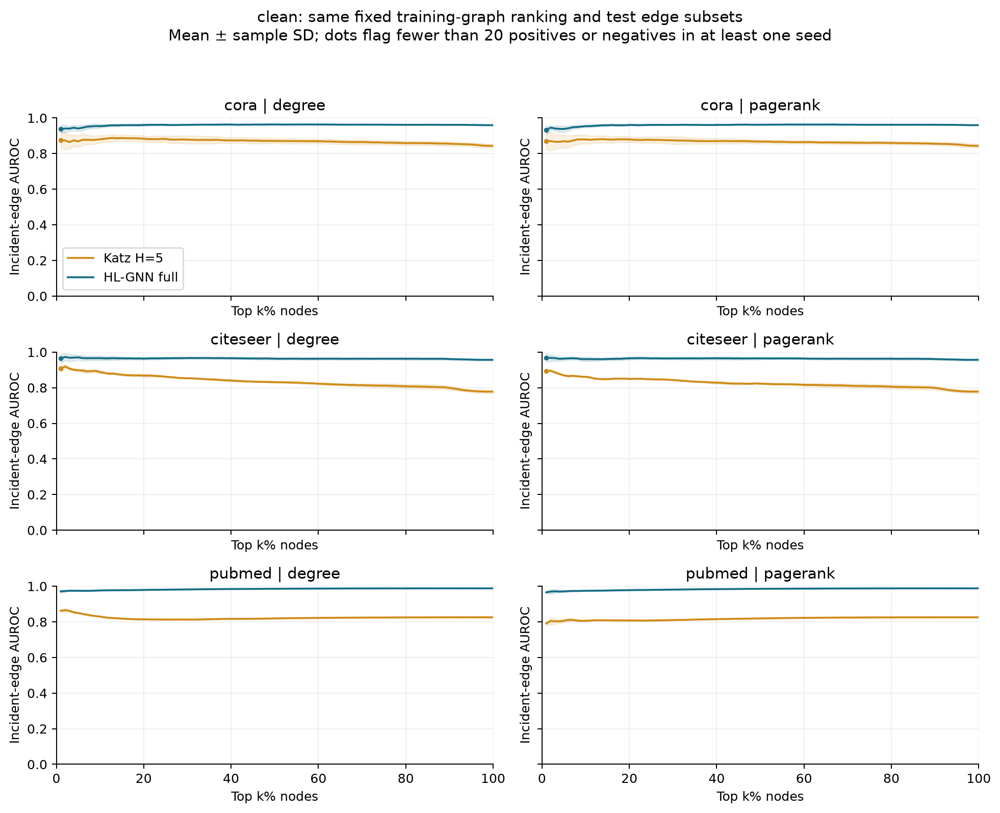
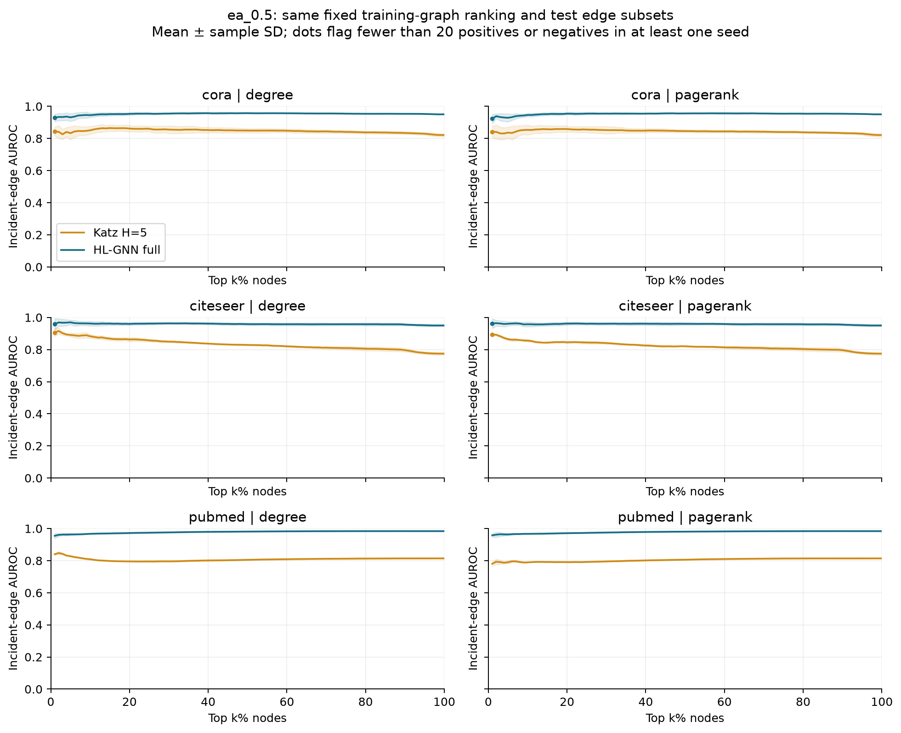
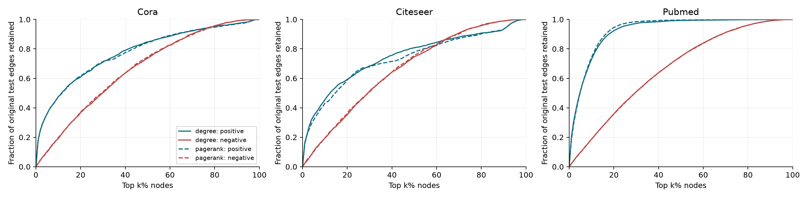
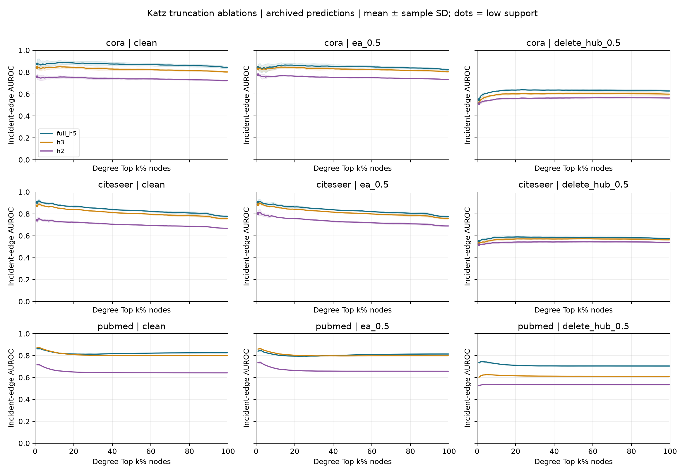

# Katz + HL-GNN：Top-k% 重要节点相关边的 AUROC

**完整主报告：** [HL-GNN 重训、14 条件鲁棒性、两个组件消融与新指标](../hlgnn-retrained/report.md)。

本轮共有 756 组原生评测分数：Katz 原归档 378 组；新训练 HL-GNN 378 组。每组计算 Degree / PageRank 两种节点排名 × k=0..100，共 **152,712 行逐 seed 曲线**。3 数据集为 Cora / CiteSeer / PubMed；每个模型族都有完整版本和两个组件变体、原 seeds 0/1/2、完整 14 条件。

Katz H=5/3/2 没有训练参数，使用已发布的原始预测；HL-GNN 是恢复丢失工件后的 27 次新拟合，不能与旧 checkpoint 混称。新旧 HL-GNN 的差异完整保留在主报告。

## 横纵轴与公平性

- 横轴：按干净训练图的 Degree 或 PageRank 排序，选前 ceil(N×k/100) 个节点；同分按固定哈希打破。
- 纵轴：原测试候选边中至少一个端点命中所选节点的 pooled AUROC，不是节点 accuracy 的平均，也不是按模型预测分数挑边。
- 模型、消融和所有攻击使用完全相同的排名、查询顺序和边子集；k=0 无定义，k=100 精确还原各自原生全局 AUROC。
- 样本不足 20 正/20 负标为低支持，任一类为空则 NA。三 seed 的阴影为样本标准差，不是置信区间。Top 10% 节点不等于 Top 10% 测试边，覆盖率必须一起看。

[完整协议](PROTOCOL.zh-CN.md) · [交付一致性审计](delivery_audit.json) · [发布归档复算](replay_audit.json) · [无需 GPU 的复算入口](../../experiments/node_rank_auc/README.md)

## 干净图结果示例

|数据集|模型|Degree Top 10% AUROC|Degree Top 100% AUROC|
|---|---|---|---|
|cora|katz|0.8801 ± 0.0220|0.8434 ± 0.0109|
|cora|hlgnn|0.9539 ± 0.0092|0.9596 ± 0.0008|
|citeseer|katz|0.8875 ± 0.0078|0.7778 ± 0.0087|
|citeseer|hlgnn|0.9661 ± 0.0129|0.9566 ± 0.0045|
|pubmed|katz|0.8295 ± 0.0033|0.8256 ± 0.0021|
|pubmed|hlgnn|0.9764 ± 0.0018|0.9881 ± 0.0006|

## Katz 组件分析

本实现计算截断 Katz 游走和 Σ β^l(A^l)uv，H=5 为完整设置，H=3 / H=2 为截断消融。β=0.85/max_degree，按当前可见图计算；同一扰动图上的三个版本共享 β。跨扰动时 β 也可能变化，因此其鲁棒性属于这个具体算法实现，不能解释成固定 β 下纯路径数量变化。
所有测试查询都被保护、不出现在可见图中，所以 H=2 的一阶项为零，分数与共同邻居数成正比；这是一个可解释的局部结构对照。更高 H 引入较长游走信息，不能称为对简单路径的精确枚举。

Degree / PageRank、全部 14 条件、所有 k 的同 seed H5−H3 / H5−H2 差值见 [katz_component_deltas.csv](katz_component_deltas.csv)。HL-GNN 的独立重训组件分析见主报告及 [条件组件差值](../hlgnn-retrained/conditional_component_deltas.csv)。

## 可下载结果

- [summary.csv](summary.csv)：所有模型/组件/条件/排名/k 的均值、样本 SD、样本量、覆盖率及低支持标记。
- [delta_summary.csv](delta_summary.csv)：同 seed 同 k 扰动 − clean 的配对差值；[key_points.csv](key_points.csv) 提供 k=1/5/10/20/50/100。
- [逐 seed 曲线与排名归档](per_seed_curves.zip)：18 份 dataset/seed/model-family 输出，含全部 152,712 行曲线和审计记录。
- [Katz 复算输入](katz-replay-inputs.zip) 与 [HL-GNN 逐边预测](../hlgnn-retrained/predictions.zip)：可在 CPU 上完整复算，不必训练或重新做 EA。
- [模型权重清单](../hlgnn-retrained/checkpoints.json)：27 个新 checkpoint 的持久 NAS 路径与 SHA256；[训练记录](../hlgnn-retrained/training_records.zip)。

该指标用于回答“重要节点相关预测如何退化”，并不天然比全局 AUC 更好。子集正负边的度分布不同也会改变任务难度；不可仅据曲线上升宣称模型能力增强。
