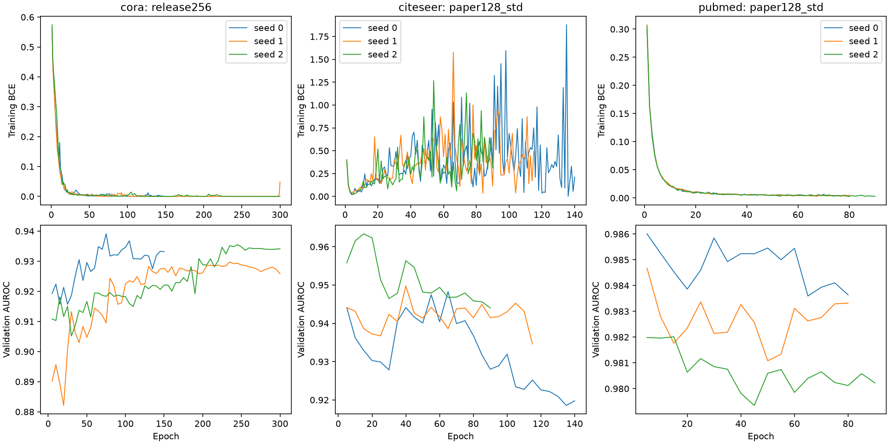

# SP4LP 全量训练、组件消融与统一鲁棒性评测

本次在一张 H200 上完成 42 次训练，其中 18 次为三数据集各六个配置的 seed 0 验证集比较。每个数据集固定选中配置后，完整、仅端点、无原始属性分别训练 seed 0/1/2，共 27 个正式检查点，包含复用的三个试验检查点。每个正式检查点评 14 个条件，共 378 组结果。所有指标已从逐对预测独立复算。

## 相对旧训练的变化

| 数据集 | 旧 AUROC | 新 AUROC | 旧 AP | 新 AP | AUROC 变化（百分点） |
|---|---|---|---|---|---|
| citeseer | 0.9133 | 0.9340 | 0.9308 | 0.9477 | 2.0694 |
| cora | 0.9141 | 0.9372 | 0.9265 | 0.9428 | 2.3082 |
| pubmed | 0.9666 | 0.9845 | 0.9675 | 0.9823 | 1.7890 |

表中为三个种子的均值，比较使用相同划分、测试正负对、攻击图与原生指标函数。旧结果保留在 [历史报告](../peer-protocol/five-models/README.md)。本次同时改变监督量、更新频率、模型配置和训练预算，因此成绩变化解释为训练配方整体的效果，不能单独归因于某一个改动。

## 训练与选择协议

每轮遍历完整训练正负对。Cora、CiteSeer、PubMed 每个种子的训练正对分别为 4,222、3,641、35,459，固定负对等量且与验证、测试对不重合。每批最多 512 正对和 512 负对，Adam 每批更新一次，梯度范数截断为 1。当前批次全部正边同时从 GNN 传播图与最短路径图中移除，代码断言查询对不出现在上下文中。为复用精确最短路径缓存，批次成员按种子固定，每轮打乱批次顺序。这与 Junxiong 每轮重新分组的训练器有区别，已显式记录在 receipt 中。

最多 300 轮，每 5 轮用全部验证正负对计算 AUROC，连续 15 次验证无提升即停止，并恢复最佳验证检查点。验证上下文只含训练边。测试上下文按 Junxiong 原协议包含训练边与验证正边，测试正负查询保持隐藏。所有扰动只在测试时施加，模型权重冻结。

六个候选是 full64、paper128、release256 及各自的逐特征标准化版本（后缀 _std）。原始属性与标准化属性均只使用节点输入属性，不使用测试边标签。full64 为原宽度 64 配置；paper128 按论文附录的不同数据集架构配置，Cora 为单层 GCN 与两层 Transformer，CiteSeer 为单层 GCN 与两层 LSTM，PubMed 为两层 SAGE 与两层 Transformer；release256 使用固定作者仓库 Cora 配置的宽度和序列结构，再跨数据集作为候选。它不是其他数据集的官方指定配方。具体 dropout、学习率、维度保存在各检查点 config/receipt。

| 数据集 | 选择配置 | 选择依据 |
|---|---|---|
| cora | release256 | seed 0 完整验证 AUROC |
| citeseer | paper128_std | seed 0 完整验证 AUROC |
| pubmed | paper128_std | seed 0 完整验证 AUROC |

以下正式运行达到 300 轮上限。它们保留预算内最佳验证权重，不能据此证明完全收敛。其余运行由验证早停结束。

| dataset | seed | variant | best_epoch | epochs_run |
|---|---|---|---|---|
| cora | 1 | full | 235 | 300 |
| cora | 2 | full | 245 | 300 |
| citeseer | 2 | featureless | 240 | 300 |

仅按 seed 0 完整模型的验证 AUROC 选配置，然后对三种子和两个组件变体固定该配置。每个变体独立训练并独立选择最佳验证轮数，没有按测试成绩选择或替换种子。消融未各自进行新的超参数搜索，所以其结论是固定完整模型配方下的组件效果。GPU 算子未要求位级确定性，跨设备重训不承诺逐位相同。

[全部候选验证成绩](configuration_selection.csv) · [正式模型的最佳轮数与实际更新数](training_summary.csv) · [运行环境](runtime.json)



训练曲线也显示当前配方的边界。CiteSeer 的 paper128_std 使用学习率 0.01，后段训练损失明显波动并升高，最终通过验证集恢复较早检查点。这组运行没有出现非有限损失，但不能据此宣称优化过程稳定或调参充分。Cora 两个完整模型达到轮数上限。后续若继续改进，可预先规定更低学习率和更长训练预算，并仅按验证集选择；本次没有在看到测试分数后追加配置筛选。

配置来源为 [论文附录表 10](https://arxiv.org/html/2507.07138v2#A4) 与 [固定作者代码配置](https://github.com/francescoferrini/sp4lp/blob/1b664cbb91eb0b88f7c99dca20754664f92632d0/configs/cora.json)。

## 两项组件消融

full 保留 GNN、最短路径序列编码与融合预测。endpoints 保留相同 GNN，去掉路径 tokenizer/序列编码，将融合头换成端点 Hadamard-MLP，考察整条路径分支的增益；它同时改变预测头容量，不能归因于注意力模块本身。featureless 将原始节点属性换为常数 1，保留图结构、路径与其余完整流程，考察原始属性证据的作用；此时 GNN 输入维度也改变。两个变体均从头训练，未在推断时临时关模块。

下表为 AUROC 的均值 ± 三种子样本标准差。完整的 AP、AUROC、降幅及同种子 full−variant 差值见 [summary.csv](summary.csv)，不能仅凭小样本均值宣称统计显著。

| 数据集 | 组件 | 干净 | EA 50% | 随机删边 50% | 高度删边 50% | 特征整行打乱 |
|---|---|---|---|---|---|---|
| cora | full | 0.9372 ± 0.0019 | 0.9123 ± 0.0022 | 0.8675 ± 0.0084 | 0.8493 ± 0.0192 | 0.8441 ± 0.0168 |
| cora | endpoints | 0.9497 ± 0.0013 | 0.9241 ± 0.0037 | 0.9355 ± 0.0013 | 0.9307 ± 0.0040 | 0.6093 ± 0.0109 |
| cora | featureless | 0.9106 ± 0.0076 | 0.8804 ± 0.0075 | 0.7653 ± 0.0085 | 0.7018 ± 0.0234 | 0.9106 ± 0.0076 |
| citeseer | full | 0.9340 ± 0.0089 | 0.9217 ± 0.0082 | 0.9289 ± 0.0084 | 0.9205 ± 0.0136 | 0.5999 ± 0.0116 |
| citeseer | endpoints | 0.9340 ± 0.0105 | 0.9177 ± 0.0120 | 0.9305 ± 0.0108 | 0.9245 ± 0.0115 | 0.5968 ± 0.0153 |
| citeseer | featureless | 0.8707 ± 0.0158 | 0.8424 ± 0.0146 | 0.7291 ± 0.0267 | 0.6352 ± 0.0199 | 0.8707 ± 0.0158 |
| pubmed | full | 0.9845 ± 0.0002 | 0.9812 ± 0.0003 | 0.9632 ± 0.0008 | 0.9611 ± 0.0033 | 0.8662 ± 0.0074 |
| pubmed | endpoints | 0.9817 ± 0.0009 | 0.9788 ± 0.0011 | 0.9701 ± 0.0017 | 0.9725 ± 0.0028 | 0.6825 ± 0.0046 |
| pubmed | featureless | 0.9325 ± 0.0034 | 0.9202 ± 0.0045 | 0.7761 ± 0.0206 | 0.7114 ± 0.0384 | 0.9325 ± 0.0034 |

- **cora**：路径分支对照在干净 / EA 50% 的 AUROC 配对均值差为 -1.26 / -1.18 个百分点；原始属性对照在干净 / EA 50% 的 AUROC 配对均值差为 +2.65 / +3.19 个百分点。正值表示完整版更高，负值表示该消融更高。
- **citeseer**：路径分支对照在干净 / EA 50% 的 AUROC 配对均值差为 -0.00 / +0.40 个百分点；原始属性对照在干净 / EA 50% 的 AUROC 配对均值差为 +6.33 / +7.93 个百分点。正值表示完整版更高，负值表示该消融更高。
- **pubmed**：路径分支对照在干净 / EA 50% 的 AUROC 配对均值差为 +0.28 / +0.24 个百分点；原始属性对照在干净 / EA 50% 的 AUROC 配对均值差为 +5.20 / +6.10 个百分点。正值表示完整版更高，负值表示该消融更高。

组件增益受数据集、训练配置和扰动机制影响。即使论文完整模型在其主表领先，也不能要求本协议下所有组件、所有条件都必须产生正增益。这里保留实际独立重训结果，未按预期趋势挑选检查点。

## 五模型在相同输入上的比较

下表每格为 AUROC / AP 均值。Katz、NCNC、LPFormer、Refined-GAE 复用已归档的 Junxiong 第一版协议结果，仅更新 SP4LP 的训练。三种子、测试对及实际攻击边数组均匹配。各模型训练预算和调参范围不同，本表比较这些已训练配置，不是等预算算法竞赛。PubMed 缺少这三个同学模型在该版协议下的结果，因此不拼接其他协议的 PubMed 分数。

| 数据集 | 方法 | clean | ea_0.1 | ea_0.25 | ea_0.5 |
|---|---|---|---|---|---|
| citeseer | katz | 0.7778 / 0.7828 | 0.7786 / 0.7839 | 0.7771 / 0.7833 | 0.7745 / 0.7831 |
| citeseer | lpformer | 0.9435 / 0.9488 | 0.9408 / 0.9472 | 0.9384 / 0.9449 | 0.9317 / 0.9401 |
| citeseer | ncnc | 0.9683 / 0.9697 | 0.9638 / 0.9658 | 0.9591 / 0.9611 | 0.9500 / 0.9528 |
| citeseer | refined_gae | 0.9651 / 0.9663 | 0.9628 / 0.9643 | 0.9600 / 0.9618 | 0.9533 / 0.9564 |
| citeseer | sp4lp_full_training | 0.9340 / 0.9477 | 0.9299 / 0.9442 | 0.9269 / 0.9414 | 0.9217 / 0.9365 |
| cora | katz | 0.8434 / 0.8580 | 0.8412 / 0.8568 | 0.8360 / 0.8542 | 0.8214 / 0.8463 |
| cora | lpformer | 0.9361 / 0.9438 | 0.9306 / 0.9396 | 0.9244 / 0.9348 | 0.9158 / 0.9264 |
| cora | ncnc | 0.9592 / 0.9578 | 0.9552 / 0.9545 | 0.9512 / 0.9509 | 0.9435 / 0.9444 |
| cora | refined_gae | 0.9616 / 0.9597 | 0.9580 / 0.9568 | 0.9533 / 0.9526 | 0.9452 / 0.9460 |
| cora | sp4lp_full_training | 0.9372 / 0.9428 | 0.9320 / 0.9384 | 0.9280 / 0.9346 | 0.9123 / 0.9220 |

[五模型逐种子结果](five_models_per_seed.csv) · [五模型均值与标准差](five_models_summary.csv)

## 扰动与评测实现

三个数据集均直接调用固定提交 95083da808e500c02da458e205f4b861ceb80871 的 `experiments.new_link_models.run.evaluate`，本组只提供模型的 context/score 适配器。评测前校验原评测器源码，测试指标仍为其 AUROC、AP、Hits@100、Precision@100。本次使用已归档图，缺缓存即报错，不现场生成替代图。

14 个条件是干净；RF、DICE、EA 各 10%/25%/50%；随机删边 50%、高度优先删边 50%、随机插边 50%；节点属性整行打乱。边编辑比例相对干净测试上下文的无向边数，RF/DICE 的总编辑预算包含增删两部分。DICE 使用攻击者可见的节点类别，预测模型不使用类别。高度优先删除按扰动前度加权。特征打乱使用原协议固定种子置换所有节点的属性行，保留每行完整属性及整体分布。每张图重新计算 GNN 表示与精确最短路径；不会复用干净图结构缓存。

Cora/CiteSeer 的 18 张 EA 图沿用 Junxiong 第一版原图发布提交 5d8242701e2325b2dec8461a16d3b4963876b892。PubMed 的九张 EA 图沿用本组此前按同一原生算法生成并归档的扩展。各条件实际图、查询与旧评测逐一核验一致。Cora/CiteSeer 的 18 张 EA 原图全部为插边；各图实际增删数量保存在 evaluation JSON 的 statistics 中，相关结论限于这些缓存图。

SP4LP 论文使用 HeaRT 困难负例及 MRR、Hits@K。本次以论文/作者配置为候选，在课程统一的随机负例 AUROC/AP 协议下训练与评测，不能声称复现了论文主表。

数值核验发现，无属性版本在特征打乱前后的最大分数差为 3.82×10⁻⁶。额外的相同输入重复推断对照也产生最高 3.29×10⁻⁶ 的差异，支持 CUDA 浮点累加误差的解释。对应对照保存在每个无属性运行的 numerical_control.json。全部指标在本机重算的最大差异为 2.22×10⁻¹⁶，审计容差为 10⁻¹²，原始预测与原始 CSV 均保留。

## 下载和复算

九个 `{dataset}_seed{seed}.zip` 包含正式模型和该种子试验模型的 best.pt、逐轮 history、receipt、complete，以及正式评测的全部逐对预测。`evaluation-inputs.zip` 包含三张原始属性图、固定划分与所有结构扰动图。[文件校验和](SHA256SUMS) · [378 组原始指标](per_seed.csv) · [审计结果](audit.json)。

- Cora：[seed 0](cora_seed0.zip)、[seed 1](cora_seed1.zip)、[seed 2](cora_seed2.zip)
- CiteSeer：[seed 0](citeseer_seed0.zip)、[seed 1](citeseer_seed1.zip)、[seed 2](citeseer_seed2.zip)
- PubMed：[seed 0](pubmed_seed0.zip)、[seed 1](pubmed_seed1.zip)、[seed 2](pubmed_seed2.zip)
- [共享数据、划分与攻击图](evaluation-inputs.zip)

```bash
# 在仓库根目录，准备仓库依赖与固定版本的同学评测代码
git worktree add --detach ../lin-eval 95083da808e500c02da458e205f4b861ceb80871
python scripts/audit_sp4lp_full.py --peer ../lin-eval --root results/sp4lp-full-training
python scripts/report_sp4lp_full.py --root results/sp4lp-full-training

# 解压并重新推断，无需训练
mkdir -p runs/sp4lp-replay
for f in results/sp4lp-full-training/*_seed*.zip results/sp4lp-full-training/evaluation-inputs.zip; do
    unzip -oq "$f" -d runs/sp4lp-replay
done
cp results/sp4lp-full-training/selection.json runs/sp4lp-replay/training/
# 删除已归档预测，确保 evaluate 真正重新计算
rm -f runs/sp4lp-replay/evaluation/runs/*/predictions_*.npz runs/sp4lp-replay/evaluation/runs/*/evaluation_*.json
python scripts/evaluate_sp4lp_full.py --peer ../lin-eval --data-root runs/sp4lp-replay/data --training runs/sp4lp-replay/training --output runs/sp4lp-replay/evaluation

# 从头训练，选择配置后再评测
python scripts/run_sp4lp_full_study.py --peer ../lin-eval --data-root runs/sp4lp-replay/data --output runs/new-sp4lp-training
mkdir -p runs/new-sp4lp-evaluation
cp -R runs/sp4lp-replay/evaluation/attacks runs/sp4lp-replay/evaluation/splits runs/new-sp4lp-evaluation/
python scripts/evaluate_sp4lp_full.py --peer ../lin-eval --data-root runs/sp4lp-replay/data --training runs/new-sp4lp-training --output runs/new-sp4lp-evaluation
```
