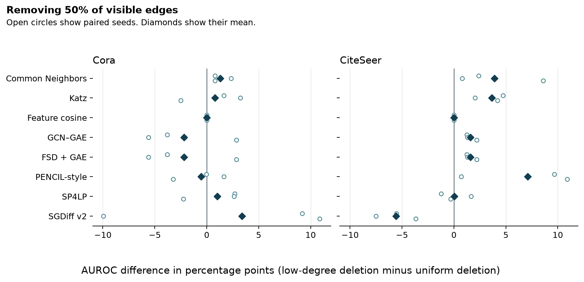

# 八种方法在相同观测扰动下的表现

本机 CPU 已运行 Cora、CiteSeer，各 3 个独立划分。每个划分 8 种主方法和 6 个组件对照，各评 15 个条件，共 **1,260** 个单元。所有 AUROC 和 AP 均已用保存的逐查询分数及 sklearn 独立复算。实验是统一的小预算档，训练、验证、测试分别为 256、128、128 条平衡查询。查询数限制对低差值与模型排名尤其重要。

[方法、分工、预算与复跑命令](../../docs/team_study.zh-CN.md) · [全部均值、样本标准差及配对下降](local/summary.csv) · [三组组件的配对差、标准差及同向种子数](local/components.csv)

## 各方法在典型扰动下的表现

表内为三种子 AUROC 均值。删边列均使用 50% 可见边预算。联合列在低度删边 50% 的同时遮蔽 50% 节点的整行属性。完整表另含 25%、随机翻转与 DICE，保留 AP。

### Cora

| 方法 | 干净 | 均匀删边 | 低度删边 | 只遮属性 | 联合 |
|---|---:|---:|---:|---:|---:|
| CN | 0.706 | 0.555 | 0.568 | 0.706 | 0.568 |
| 属性余弦 | 0.832 | 0.832 | 0.832 | 0.535 | 0.535 |
| Katz 五跳 | 0.825 | 0.630 | 0.638 | 0.825 | 0.638 |
| GCN–GAE | 0.815 | 0.779 | 0.757 | 0.772 | 0.658 |
| FSD + GAE | 0.815 | 0.779 | 0.757 | 0.794 | 0.679 |
| PENCIL-style | 0.811 | 0.643 | 0.637 | 0.810 | 0.634 |
| SP4LP | 0.816 | 0.681 | 0.692 | 0.783 | 0.643 |
| SGDiff v2 | 0.515 | 0.488 | 0.522 | 0.515 | 0.521 |

### CiteSeer

| 方法 | 干净 | 均匀删边 | 低度删边 | 只遮属性 | 联合 |
|---|---:|---:|---:|---:|---:|
| CN | 0.672 | 0.531 | 0.570 | 0.672 | 0.570 |
| 属性余弦 | 0.902 | 0.902 | 0.902 | 0.515 | 0.515 |
| Katz 五跳 | 0.782 | 0.608 | 0.644 | 0.782 | 0.644 |
| GCN–GAE | 0.766 | 0.741 | 0.757 | 0.697 | 0.625 |
| FSD + GAE | 0.766 | 0.741 | 0.757 | 0.724 | 0.655 |
| PENCIL-style | 0.796 | 0.579 | 0.650 | 0.800 | 0.648 |
| SP4LP | 0.866 | 0.832 | 0.832 | 0.788 | 0.726 |
| SGDiff v2 | 0.552 | 0.558 | 0.502 | 0.538 | 0.510 |

## 怎样解释

1. **同样删边数，低度删边让更多查询失去至少一个端点的所有邻居。** 均匀删边 50% → 低度删边 50%，这个比例在 Cora 从 43.5% 增至 52.9%，在 CiteSeer 从 54.7% 增至 63.5%。两图 Katz 的平均 AUROC 却分别高约 0.8、3.6 个百分点。Cora 三个种子里两个同向，CiteSeer 三个同向。孤立比例能说明受损范围，单凭它无法推出模型排序如何改变。
2. **把不同路径长度拆开，能看清一个稳定的结构信号。** 干净 Cora 上，Katz 两跳、三跳、五跳 AUROC 约 0.706、0.788、0.826；CiteSeer 对应 0.672、0.758、0.782。六个划分上五跳得分均高于两跳。删去一半边后，两图五跳相对两跳的平均优势仍存在。该差值测量长游走对排序的贡献，不代表每一条额外游走都有用。
3. **SP4LP 的路径分支收益依赖实验设置。** 干净 Cora 上仅端点 0.866、完整 0.816；CiteSeer 为 0.902、0.866。两图各有两个种子支持仅端点更好。历史较大预算的 SP4LP 结果中曾出现相反排序。训练查询数、验证/测试样本与协议同时变化，本轮不能把反转单独归因于训练样本数。删除路径也改变了读出头和参数量。
4. **邻居补全在两图都有平均收益。** 同一套 GAE 权重下，仅遮 50% 属性时，FSD 相对零填充在 Cora 提高 2.2 个 AUROC 百分点，在 CiteSeer 提高 2.7 点，分别有三个、两个种子同向。在没有属性缺失的条件下，两种方法的逐查询分数完全一致。此比较不能区分普通邻居传播与 FSD 特定指数的作用。
5. **SGDiff 的小预算诊断需要谨慎。** 干净 Cora 上，融合、仅结构与仅属性约为 0.515、0.517、0.520；CiteSeer 约为 0.553、0.495、0.555。CiteSeer 上保留属性路可维持融合的平均排序，Cora 三个版本都接近随机。此处测量同一检查点的推断贡献。原始训练日志随各 seed 提供；4+4 轮和 MC=2 无法证明充分收敛，也无法评价论文预算下的鲁棒性。

图中横轴大于零表示同样删除一半边时，低度删除下的 AUROC 更高。圆点是三个配对种子，菱形是均值。属性余弦的点重合在零，提供了一个不读结构的对照。

## 数据与执行环境

每个数据集下的三个 seed 目录均含实际 train/val/test 查询与逐查询预测、指标、带配置和图指纹的 manifest，以及 SGDiff 两阶段训练轨迹。训练器日志最后的 test 使用它自己的抽样与评价入口；横向比较统一读取本研究的 scores。复算同时检查 15 个条件的实际编辑预算、查询指纹，以及应对结构或属性变化保持相同的对照。主脚本在构造图时还检查了所有测试候选均未进入图。

执行环境为 macOS arm64、Python 3.11.8、PyTorch 2.15.0、PyG 2.8.1、NumPy 2.4.6、SciPy 1.17.1、scikit-learn 1.9.1，CPU 每个任务 3 个 PyTorch 线程。命令使用 OPENBLAS_NUM_THREADS=1 和 VECLIB_MAXIMUM_THREADS=1。生成图可运行 `python scripts/plot_team_deletion.py results/team-study/local`。

另外从零重跑了 Cora seed 0。全部查询相同，14 个模型配置中 12 个的 15 组预测逐值相同。GAE 与共享其参数的 FSD 在本机多线程 CPU 的独立重跑中有很小差异，最大 AUROC 绝对差为 0.000489，最大 AP 绝对差为 0.000213。表内保留首次运行的结果。
